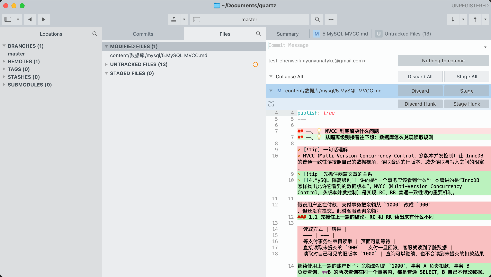

# Sublime Merge 使用指南

本文直接对照下面的实际界面，演示如何提交 Quartz 笔记。平时在编辑器里修改并保存文章，再到 Sublime Merge 查看差异、提交和推送即可。



> 图片是操作前的状态记录。后续文件数量、按钮状态会随操作变化，以实际界面为准。

## 1. 先确认：现在打开的是什么

看图片最上方和左侧：

| 图片位置 | 显示内容 | 含义 |
| --- | --- | --- |
| 顶部窗口标题 | `~/Documents/quartz` | 已经打开本地 Quartz 仓库 |
| 顶部中间 | `master` | 当前所在分支 |
| 左侧 BRANCHES (1) | `master` | 有 1 个本地分支 |
| 左侧 REMOTES (1) | 折叠状态 | 已配置 1 个远程，展开后才能查看具体信息 |
| 右上角 | UNREGISTERED | 软件尚未注册，与远程仓库登录状态不同 |

**当前已经打开仓库，可以直接查看改动，不需要重新克隆或新建仓库。**

提交说明框下方已经显示作者姓名和邮箱，说明当前有可用的提交身份。它用于记录谁做了这次修改，不代表远程推送认证一定已完成。

## 2. 中间列表：哪些文件发生了变化

截图中央的 Files 区域有三个分类：

| 图片中的分类 | 当前状态 | 应该怎么理解 |
| --- | --- | --- |
| MODIFIED FILES (1) | 1 个已有文件被修改 | 下面显示的是 `content/数据库/mysql/5.MySQL MVCC.md` |
| UNTRACKED FILES (13) | 13 个尚未被跟踪的新文件 | 点击左侧小三角展开，逐个检查文件名和内容 |
| STAGED FILES (0) | 尚未暂存任何文件 | 还没有把改动选入本次提交 |

**有文件修改，不等于已经选好了提交内容。** 图中右上方显示 `Nothing to commit`，结合 `STAGED FILES (0)`，说明当前还没有已暂存的改动。

截图中新增文件列表没有展开，所以不能仅凭图片确定那 13 个文件分别是什么。

## 3. 右侧红绿区域：检查具体改了什么

图片右侧当前展示的是 `5.MySQL MVCC.md` 的差异：

- 红色背景：旧版本中被删除或替换的内容。
- 绿色背景：当前新增或替换后的内容。
- 左右两列行号：分别对应修改前后的行号，增删内容后行号可能不同。

例如，图中原来的标题“MVCC 到底解决什么问题”显示为红色，新标题“从隔离级别接着往下想：数据库怎么兑现读取规则”显示为绿色，表示标题被替换了。

红绿同时出现是正常的修改对比，不是报错。提交前往下查看完整差异，确认本次修改符合预期。

## 4. 先点哪个按钮：Stage

图片右侧有多组按钮，注意区分作用范围：

| 按钮及图片位置 | 作用 |
| --- | --- |
| 文件名同一行最右边的 **Stage** | 将这整个文件当前的改动选入本次提交 |
| 下一行的 **Stage Hunk** | 只选入对应的一块连续改动 |
| 上方的 **Stage All** | 将全部待提交改动选入本次提交，可能包含其他文件 |
| Discard | 丢弃对应文件的未暂存改动 |
| Discard Hunk | 丢弃对应改动块 |
| Discard All | 批量丢弃未暂存改动 |

**Stage 是选入提交；Discard 是丢弃修改。** 如果只是选错了提交内容，应使用 Unstage 取消暂存，而不是 Discard。

### 示例 A：只提交图中的 MVCC 文章

1. 点击中间列表里的 `5.MySQL MVCC.md`。
2. 查看右侧红绿差异。
3. 点击文件名同一行最右侧的 **Stage**。
4. 检查中间的 **STAGED FILES**，确认这个文件已经进入暂存区。

如果暂存了整个文件且之后没有继续修改，它通常会从 MODIFIED FILES 中移出，并出现在 STAGED FILES 中。

### 示例 B：只提交 Sublime Merge 使用指南

1. 点击 **UNTRACKED FILES (13)** 左侧的小三角展开列表。
2. 找到 `content/Git/Sublime Merge 使用指南.md`；如果文章已被跟踪，则到 MODIFIED FILES 中查找。
3. 点击文件，检查右侧内容，再点它对应的 **Stage**。
4. 本文引用了截图，首次提交时也要选入 `content/Git/images/sublime-merge-quartz.png`，保证其他设备和网站能显示图片。
5. 检查 STAGED FILES，只保留本次需要提交的文章和配图。

不要为了省一次点击直接使用 Stage All；先确认其他新文件是否也属于本次提交。

> 暂存后又编辑了同一文件，需要再次暂存新增改动。最终提交的是暂存区里的版本。

## 5. 上方 Commit Message：写说明并提交

选好文件后，在图片右上方的 **Commit Message** 输入说明。

只提交 MVCC 文章时，可以写：

```text
调整 MySQL MVCC 文章结构和示例说明
```

提交本指南及配图时，可以写：

```text
按实际界面完善 Sublime Merge 使用指南并补充截图
```

然后检查：

1. 当前分支是否为准备提交的分支，图中是 `master`。
2. STAGED FILES 中的文件和差异是否正确。
3. 提交说明是否准确描述本次修改。

确认后，点击右上方的 **Commit** 按钮，也就是截图中当前显示 `Nothing to commit` 的那个位置。暂存改动并填写说明后，再根据实际按钮状态执行提交。

提交完成后，进入 **Commits** 查看历史，确认出现刚写的提交说明。

**Commit 将版本保存到本地，还没有上传远程。**

## 6. 右上角箭头：拉取和推送

图片最右上角有两组箭头：

| 图片位置 | 操作 | 含义 |
| --- | --- | --- |
| 向下箭头 `↓` | Pull | 拉取远程更新并整合到当前分支 |
| 向上箭头 `↑` | Push | 将本地提交上传到远程分支 |
| 箭头旁的小三角 | 更多选项 | 展开相关操作，执行前核对文字和目标 |

本地 Commit 完成后，如果要同步远程，就点击 **`↑`**，核对目标远程与分支，再完成推送。

远程网页没看到新内容时，检查推送是否成功，以及网页查看的分支是否与推送目标一致。

拉取会整合远程变化，操作前先处理本地未完成的修改。若推送被拒绝并提示远程有更新，先获取并查看变化，按项目约定整合后再推送。

## 7. 遇到提示时怎么处理

| 情况 | 排查方式 |
| --- | --- |
| 有修改却显示 Nothing to commit | 先看 STAGED FILES 是否为 0，再检查文件是否保存、说明是否填写 |
| 找不到刚新增的文章 | 展开 UNTRACKED FILES，核对文件保存位置及当前仓库；必要时检查忽略规则 |
| 文件选错了 | 在 STAGED FILES 中对该文件执行 Unstage，保留文件内容 |
| 暂存后仍显示同一文件有修改 | 可能暂存后又编辑了文件，检查并决定是否再次暂存 |
| 推送认证失败 | 核对远程地址及其 HTTPS 凭据或 SSH 密钥配置，提交作者信息不能替代认证 |
| 提示没有上游分支 | 核对目标远程分支；可按 `⌘ + P` 搜索 `Set Branch Upstream` 设置关联 |
| 拉取或合并冲突 | 在冲突文件上用 Resolve 检查最终结果，保存并暂存，按界面提示完成后续流程 |

## 8. 对照这张图记住操作顺序

```text
中间点文件
→ 右边看红绿差异
→ 文件名右边点 Stage
→ 中间检查 STAGED FILES
→ 右上方 Commit Message 写中文说明
→ Commit 保存本地版本
→ 最右上角 ↑ 推送远程
```

## 参考资料

- [Sublime Merge 官方入门文档](https://www.sublimemerge.com/docs/getting_started)
- [Sublime Merge 官方文档目录](https://www.sublimemerge.com/docs/)
