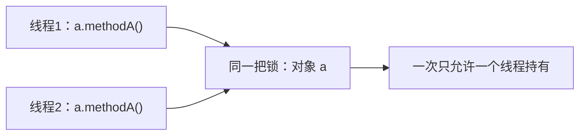
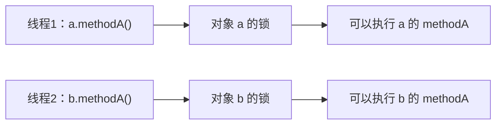
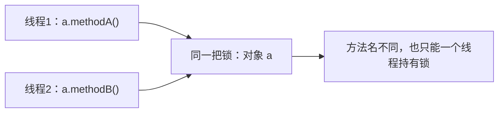
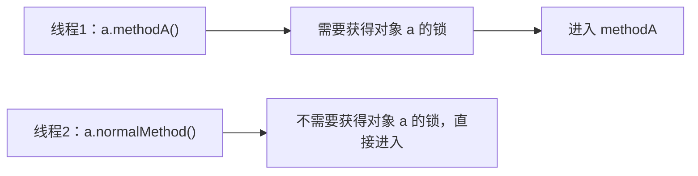
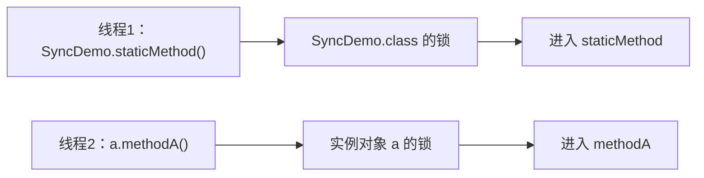

# synchronized

这份学习清单只关注 `synchronized` 本身。先掌握怎么写、锁住谁、谁需要等待、什么时候释放锁，再深入底层原理。

## 1. 它是干什么的

从一个场景开始：多个线程同时修改同一个计数器，结果可能出错。

需要弄懂：

- 为什么多个线程一起修改数据会出问题？
- `synchronized` 如何让使用同一把锁的线程依次执行同步代码？
- 什么情况下需要使用它？

注意：线程等待锁不代表一定按照先来后到的顺序执行。

## 2. 它怎么写

掌握三种写法：

```java
class Example {
    private final Object lock = new Object();

    // 1. 修饰实例方法
    public synchronized void method() {
        // 需要同步的操作
    }

    // 2. 修饰静态方法
    public static synchronized void staticMethod() {
        // 需要同步的操作
    }

    // 3. 修饰代码块
    public void blockMethod() {
        synchronized (lock) {
            // 需要同步的操作
        }
    }
}
```

先会使用，再理解它们的区别。

## 3. 它到底锁住谁

这是学习的重点：

| 写法 | 锁住的对象 |
| --- | --- |
| 实例同步方法 | 当前对象 `this` |
| 静态同步方法 | 当前类对应的 `Class` 对象，例如 `Example.class` |
| 同步代码块 | 括号里指定的对象，例如 `lock` |

**只有争抢同一把锁的线程，才需要相互等待。**

锁住对象不等于冻结整个对象。其他线程依然可以执行不需要获取这把锁的普通方法。

### 3.1 实例同步方法：锁住当前对象 `this`

```java
class Counter {
    private int count = 0;

    public synchronized void increment() {
        count++;
    }
}
```

从加锁对象和保护范围来看，上面的方法可以理解为下面的写法（两种写法选一种即可）：

```java
public void increment() {
    synchronized (this) {
        count++;
    }
}
```

`this` 就是调用这个方法的对象。看调用代码：

```java
Counter a = new Counter();
Counter b = new Counter();

new Thread(() -> a.increment()).start(); // 锁住 a
new Thread(() -> a.increment()).start(); // 也是锁住 a，与上一线程争抢同一把锁
new Thread(() -> b.increment()).start(); // 锁住 b，不与前两个线程争抢同一把锁
```

前两个线程调用的是同一个对象 `a`，如果一个正在执行同步方法，另一个就需要等待。第三个线程使用对象 `b`，可以与操作 `a` 的线程同时执行；这里 `a` 和 `b` 的计数值也是各自独立的。

**判断方法：看是谁调用这个实例方法，锁就是谁。**

### 3.2 静态同步方法：锁住类对应的 `Class` 对象

```java
class GlobalCounter {
    private static int count = 0;

    public static synchronized void increment() {
        count++;
    }
}
```

从加锁对象和保护范围来看，可以理解为：

```java
public static void increment() {
    synchronized (GlobalCounter.class) {
        count++;
    }
}
```

`GlobalCounter.class` 表示这个类对应的 `Class` 对象。它与 `new GlobalCounter()` 创建的实例对象不是同一个对象。

```java
new Thread(() -> GlobalCounter.increment()).start(); // 锁住 GlobalCounter.class
new Thread(() -> GlobalCounter.increment()).start(); // 也锁住 GlobalCounter.class
```

这两个线程争抢的是同一把锁。如果一个正在执行该同步方法，另一个就需要等待。

**判断方法：看这个静态同步方法定义在哪个类中，锁就是那个类的 `.class` 对象。**

### 3.3 同步代码块：锁住括号里指定的对象

```java
class Task {
    private final Object lock = new Object();

    public void execute() {
        // 这里不需要获得 lock，可以由多个线程同时执行

        synchronized (lock) {
            // 进入这里前，必须先获得 lock 指向的对象的锁
            System.out.println("执行需要同步的操作");
        }

        // 离开同步代码块后，已经释放这一层的锁
    }
}
```

这里锁住的是 `lock` 指向的对象，不是 `this`，也不是 `Task.class`。

```java
Task a = new Task();
Task b = new Task();

new Thread(() -> a.execute()).start(); // 使用 a 内部的 lock 对象
new Thread(() -> a.execute()).start(); // 使用 a 内部同一个 lock 对象
new Thread(() -> b.execute()).start(); // 使用 b 内部另一个 lock 对象
```

前两个线程进入同步代码块时，会争抢同一把锁。第三个线程的锁对象不同，不需要因为前两个线程持锁而等待。

这里的 `lock` 是实例字段，每创建一个 `Task`，就会创建一个独立的锁对象。`final` 表示这个字段初始化后不能再指向另一个对象。

同步代码块也可以明确使用前面两种锁：

```java
synchronized (this) {
    // 锁住当前实例对象
}

synchronized (Task.class) {
    // 锁住 Task 类对应的 Class 对象
}
```

**判断方法：看括号里的表达式实际指向哪个对象。变量名字相同，不代表锁对象相同。**

以上线程代码都是调用片段，可分别放入 `main` 方法中观察；两种方法写法的对照片段不要重复放进同一个类。线程的启动顺序不保证获得锁的顺序。

## 4. 什么情况下需要等待

判断时只问两个问题：**这个方法需要拿哪把锁？另一线程是否正在持有同一把锁？**

| 场景 | 是否因为同一把锁而互相等待 |
| --- | --- |
| 两个线程调用同一个对象的同步实例方法 | 是，使用同一个 `this` |
| 两个线程调用不同对象的同步实例方法 | 否，两个 `this` 是不同对象 |
| 两个线程调用同一个对象的不同同步实例方法 | 是，方法不同，但锁都是同一个 `this` |
| 一个线程调用同步方法，另一个线程调用普通方法 | 普通方法本身不需要获得这把锁；若内部另有同步代码，要单独判断 |
| 一个线程调用静态同步方法，另一个线程调用实例同步方法 | 通常不会，分别锁住 `Class` 对象和实例对象 |

下面五个例子分别对应这五行。图中的箭头表示需要获取哪把锁，不代表线程执行的先后顺序。

### 4.1 先准备一份可以运行的代码

将下面代码保存为 `SyncDemo.java`，运行 `main` 即可观察第一种情况。后面每个例子都给出了替换 `main` 方法体的代码，其他方法保持不变。

```java
public class SyncDemo {
    public synchronized void methodA() {
        work("methodA");
    }

    public synchronized void methodB() {
        work("methodB");
    }

    public void normalMethod() {
        work("normalMethod");
    }

    public static synchronized void staticMethod() {
        work("staticMethod");
    }

    // 只是为了打印日志、延长执行时间，方便观察
    private static void work(String method) {
        String name = Thread.currentThread().getName();
        System.out.println(name + " 进入 " + method);
        try {
            Thread.sleep(1000);
        } catch (InterruptedException e) {
            Thread.currentThread().interrupt();
        }
        System.out.println(name + " 结束 " + method);
    }

    public static void main(String[] args) {
        SyncDemo a = new SyncDemo();
        new Thread(() -> a.methodA(), "线程1").start();
        new Thread(() -> a.methodA(), "线程2").start();
    }
}
```

这里先知道两个辅助写法就够了：

- `new Thread(..., "线程1").start()`：启动一个线程，执行括号里指定的方法。
- `Thread.sleep(1000)`：让当前线程暂停约 1 秒，**不会释放它已经持有的锁**。这只是为了方便观察，不是实现同步的方式。

`work()` 是普通的静态方法，没有加 `synchronized`，不会因为是静态方法就自动获取类锁。调用它时，外层同步方法已经拿到的锁仍然持有。

下面的日志都是一种可能的结果，不保证线程1先执行。“可以同时执行”表示没有被这里讨论的同一把锁挡住，不保证每次运行都出现交错日志。

### 4.2 同一个对象，同一个同步实例方法：需要等待

```java
// main 方法体
SyncDemo a = new SyncDemo();
new Thread(() -> a.methodA(), "线程1").start();
new Thread(() -> a.methodA(), "线程2").start();
```



两个调用里的 `this` 都是 `a`。假设线程1先拿到锁：

1. 线程1获得 `a` 的锁，进入 `methodA()`。
2. 线程2尝试获得同一把锁，需要等待，暂时进不了方法体。
3. 线程1退出 `methodA()` 并释放锁后，线程2才能进入。

可能的输出：

```text
线程1 进入 methodA
线程1 结束 methodA
线程2 进入 methodA
线程2 结束 methodA
```

也可能线程2整组先执行，但不会两个线程都先打印“进入”，再分别打印“结束”。

### 4.3 不同对象，同一个同步实例方法：不因这把锁等待

```java
// main 方法体
SyncDemo a = new SyncDemo();
SyncDemo b = new SyncDemo();
new Thread(() -> a.methodA(), "线程1").start();
new Thread(() -> b.methodA(), "线程2").start();
```



虽然调用的方法名字一样，但线程1锁的是 `a`，线程2锁的是 `b`。两把锁互不影响。

可能的输出：

```text
线程1 进入 methodA
线程2 进入 methodA
线程1 结束 methodA
线程2 结束 methodA
```

**方法相同，不代表锁相同；要看调用方法的对象是不是同一个。**

### 4.4 同一个对象，不同同步实例方法：仍然需要等待

```java
// main 方法体
SyncDemo a = new SyncDemo();
new Thread(() -> a.methodA(), "线程1").start();
new Thread(() -> a.methodB(), "线程2").start();
```



`methodA()` 和 `methodB()` 都是同步实例方法，锁住的都是调用它们的对象 `a`，不是各自拥有一把“方法锁”。

假设线程1先进入 `methodA()`，即使线程2想进入的是另一个方法 `methodB()`，也必须等线程1释放 `a` 的锁。

可能的输出：

```text
线程1 进入 methodA
线程1 结束 methodA
线程2 进入 methodB
线程2 结束 methodB
```

**锁属于对象，不是每个同步方法各分配一把锁。**

### 4.5 同一个对象，同步方法和普通方法：普通方法不需要等这把锁

```java
// main 方法体
SyncDemo a = new SyncDemo();
new Thread(() -> a.methodA(), "线程1").start();
new Thread(() -> a.normalMethod(), "线程2").start();
```



线程1持有 `a` 的锁时，线程2仍然可以执行 `a.normalMethod()`，因为普通方法没有要求先获得这把锁。

可能的输出：

```text
线程1 进入 methodA
线程2 进入 normalMethod
线程2 结束 normalMethod
线程1 结束 methodA
```

**对象被锁住，不代表对象的所有方法都不能执行。**

但“能执行”不等于“访问共享数据就安全”。如果普通方法也修改了需要保护的同一份数据，就可能破坏原本的同步效果。这个示例只打印日志，没有修改这样的共享业务数据。

### 4.6 静态同步方法和实例同步方法：使用不同的锁

```java
// main 方法体
SyncDemo a = new SyncDemo();
new Thread(() -> SyncDemo.staticMethod(), "线程1").start();
new Thread(() -> a.methodA(), "线程2").start();
```



线程1需要的是 `SyncDemo.class` 的锁，线程2需要的是实例对象 `a` 的锁。这两个对象不同，因此两个方法可以同时执行。

可能的输出：

```text
线程1 进入 staticMethod
线程2 进入 methodA
线程1 结束 staticMethod
线程2 结束 methodA
```

**属于同一个类，不代表使用同一把锁。**

### 4.7 看代码时的判断顺序

1. 看方法或代码块有没有要求获取锁。普通方法本身不要求获取锁。
2. 有锁时，明确实际锁对象：`this`、`类名.class`，还是括号里的其他对象。
3. 对比两个线程使用的锁对象是否相同。
4. 如果相同，一个线程持有时，另一个想获取它就需要等待；如果不同，不会因为这两把锁互相等待。

以上结论按示例里的加锁方式判断。如果方法内部又获取其他锁，还需要继续分析。判断依据是锁对象，而不是单次运行的日志先后。

## 5. 什么时候获得锁、释放锁

需要掌握：

- 进入同步代码前，先获得对应的锁。
- 锁被其他线程持有时，需要等待。
- 正常执行结束，会退出这层同步代码并释放对应的锁。
- 执行 `return` 或因异常退出同步代码，也会释放对应的锁。
- 如果异常在同步代码内部被捕获，且代码还没有退出，就不会仅仅因为出现异常而释放锁。

同一个线程重复获取同一把锁时，需要退出所有对应的同步层次，其他线程才能获得它。

### 5.1 异常在同步代码内部被捕获，为什么不释放锁？

关键看 **有没有退出 `synchronized` 代码块**，而不是只看有没有发生异常。

下面的代码可以保存为 `CatchInsideDemo.java` 直接运行。`Thread.holdsLock(lock)` 用来检查当前线程是否持有 `lock` 对象的锁，返回 `true` 表示仍然持有；它只是检查，不会获取或释放锁。

```java
public class CatchInsideDemo {
    public static void main(String[] args) {
        Object lock = new Object();

        synchronized (lock) { // ① 获得锁
            try {
                System.out.println("开始执行业务");
                throw new IllegalStateException("模拟业务异常");
            } catch (IllegalStateException e) {
                // ② catch 仍然在 synchronized 的大括号里面
                System.out.println("捕获到异常：" + e.getMessage());
                System.out.println("catch 内是否持有锁："
                        + Thread.holdsLock(lock));
            }

            // ③ try-catch 结束了，但 synchronized 还没有结束
            System.out.println("捕获后继续执行，是否持有锁："
                    + Thread.holdsLock(lock));
        } // ④ 到这里退出同步代码块，释放锁

        System.out.println("退出同步代码块后，是否持有锁："
                + Thread.holdsLock(lock));
    }
}
```

输出：

```text
开始执行业务
捕获到异常：模拟业务异常
catch 内是否持有锁：true
捕获后继续执行，是否持有锁：true
退出同步代码块后，是否持有锁：false
```

执行过程是：

```text
进入 synchronized，获得锁
    ↓
try 中抛出异常
    ↓
进入内部的 catch，仍然持有锁
    ↓
继续执行 catch 后面的同步代码，仍然持有锁
    ↓
退出 synchronized，释放锁
```

发生异常时，程序从 `try` 跳到了 `catch`，但它们都在同步代码块内部，所以没有退出同步代码块，也就没有释放锁。

如果此时另一个线程尝试进入 `synchronized (lock)`，它仍然需要等待。这里的前提是两个线程使用的是同一个 `lock` 对象。

### 5.2 如果 catch 在同步代码块外面呢？

对比下面这段代码，可以放进 `main` 方法单独运行：

```java
Object lock = new Object();

try {
    synchronized (lock) {
        throw new IllegalStateException("模拟业务异常");
    } // 异常向外传播，退出同步代码块时自动释放锁
} catch (IllegalStateException e) {
    // 此时已经在 synchronized 外面
    System.out.println("外部 catch 中是否持有锁："
            + Thread.holdsLock(lock)); // false
}
```

两段代码的区别是 `catch` 的位置：

| 捕获异常的位置 | 执行 catch 时是否仍持有这把锁 |
| --- | --- |
| `catch` 在 `synchronized` 内部 | 是，还没有退出同步代码块 |
| `catch` 在 `synchronized` 外部 | 本例中否，异常传播时已经退出同步代码块并释放锁 |

这里假设外层没有再次持有同一把锁。若存在同一把锁的嵌套同步，需要退出所有对应的同步层次，才会完全释放锁。

## 6. 什么是可重入

**一个线程已经拿到某把锁，可以再次进入需要同一把锁的代码。**

```java
class Service {
    public synchronized void methodA() {
        methodB();
    }

    public synchronized void methodB() {
        // 执行业务操作
    }
}
```

同一个对象的 `methodA()` 和 `methodB()` 使用同一把锁，也就是 `this`。

线程进入 `methodA()` 后，已经持有这把锁，可以继续进入 `methodB()`，不会把自己堵住。退出 `methodB()` 后，外层 `methodA()` 仍然持有锁，其他线程还不能获得这把锁。

## 7. 使用时容易犯什么错

### 7.1 锁不一致

多个线程操作同一份数据，却使用不同的锁，无法形成需要的互斥。

例如，每次执行方法时都临时创建一个新的锁对象，各个线程拿到的锁就不同。

### 7.2 保护不完整

一次操作需要多个步骤，却只给其中一步加锁。

例如，扣库存需要先检查库存是否充足，再减少库存。如果检查和扣减没有作为一个整体受到同一把锁保护，两个线程可能都认为库存足够。

另外，只给写入操作加锁，而读取同一份数据时不遵守相同的加锁规则，也不能认为整个访问过程已经安全。

### 7.3 锁住的代码太多

把耗时且无关的操作放进同步代码，会让其他线程等待更久。

应该保护确实需要一起完成的共享数据操作，避免随意扩大同步范围。

## 学习顺序与自查

按顺序学习：

1. 理解多个线程同时修改数据为什么会出错。
2. 学会三种写法。
3. 判断每种写法锁住哪个对象。
4. 判断多个线程是否需要相互等待。
5. 理解获得锁与释放锁的时机。
6. 理解可重入。
7. 识别锁不一致、保护不完整和同步范围过大的问题。

能回答下面四个问题，就掌握了入门重点：

- 这段同步代码使用的是哪一个锁对象？
- 两个线程使用的是不是同一把锁？
- 需要一起完成的操作是否都受到这把锁保护？
- 线程执行到哪里，其他线程才能获得这把锁？
