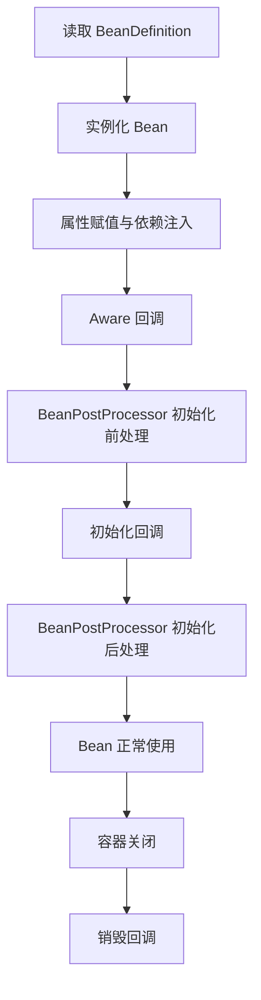

## 一、💡 一句话理解

> [!tip] 核心结论
> Spring Bean 的生命周期，就是 Spring 从“读取对象说明书”开始，依次完成创建对象、注入依赖、初始化、提供使用，并在容器关闭时执行清理的全过程。

本文建立在 [[Spring IoC、DI与构造方法注入]] 的基础上。IoC 解决“对象由谁管理”，Bean 生命周期解决“Spring 按什么顺序管理这个对象”。

最常用的记忆顺序是：

```text
实例化 → 依赖注入 → Aware 回调 → 初始化前处理
       → 初始化回调 → 初始化后处理 → 正常使用 → 销毁回调
```

## 二、🧭 理论：它是什么

### 2.1 什么是 Spring Bean

Bean 本质上仍然是普通 Java 对象。区别在于，它的创建和管理权交给了 Spring IoC 容器。

常见 Bean 来源包括：

| 来源 | 例子 |
| --- | --- |
| 组件扫描 | `@Component`、`@Service`、`@Controller` |
| Java 配置 | `@Configuration` 中的 `@Bean` 方法 |
| 自动配置 | Spring Boot 根据依赖和配置自动创建的对象 |

### 2.2 什么是 Bean 生命周期

生命周期描述的是一个 Bean 从“尚未创建”到“可以使用”，再到“被销毁”的状态变化。

可以把它类比成一名员工入职：

| 员工入职类比 | Spring 中的真实阶段 |
| --- | --- |
| 查看岗位说明 | 读取 `BeanDefinition` |
| 招聘员工 | 实例化 Bean |
| 分配电脑和权限 | 依赖注入、属性赋值 |
| 告知工号和公司信息 | `Aware` 回调 |
| 入职检查和培训 | 初始化回调 |
| 正式上岗 | Bean 可以被业务代码使用 |
| 离职交接 | 销毁回调、释放资源 |

> [!info] 类比边界
> “员工入职”只是帮助记忆。真实执行由 Spring IoC 容器、Bean 后置处理器和生命周期回调共同完成。

### 2.3 为什么需要生命周期回调

有些动作不能放在构造方法中完成：

- 需要等依赖注入完成后，再检查配置或预热缓存。
- 需要在 Bean 可用前建立连接、启动任务或准备资源。
- 需要在应用关闭时停止线程、关闭连接或释放文件句柄。
- 框架需要在 Bean 初始化前后添加代理、注解处理等能力。

## 三、⚙️ 理论：它是怎么工作的

### 3.1 Bean 创建之前：先处理对象说明书

Spring 会先读取配置类、组件扫描结果和 `@Bean` 方法，将它们解析成 `BeanDefinition`。它可以理解为 Bean 的“对象说明书”，记录 Bean 类型、作用域、依赖关系和初始化方法等信息。

`BeanFactoryPostProcessor` 操作的是这些定义信息，执行时间通常早于普通 Bean 的实例化。它不是对具体 Bean 对象做加工。

```text
配置类、注解、@Bean
        ↓
   BeanDefinition
        ↓
BeanFactoryPostProcessor 修改定义
        ↓
开始创建普通 Bean
```

### 3.2 单个 Bean 的主要创建流程



下面不只列术语，而是把每一站都拆成“大白话、例子和结果”。

#### 3.2.1 第一站：读取 BeanDefinition——先登记对象说明书

大白话：Spring 还没有创建对象，只是先发现“这里将来需要创建一个 Bean”。

```java
@Component
public class OrderService {
}
```

Spring 扫描到 `@Component` 后，会登记一份类似这样的信息：

```text
Bean 名称：orderService
Bean 类型：OrderService
作用域：singleton
是否懒加载：否
```

这一阶段没有执行 `OrderService` 的业务代码，相当于先把员工资料录入花名册。

#### 3.2.2 第二站：实例化——调用构造方法造出对象

大白话：Spring 根据对象说明书执行 `new`，内存中终于有了这个对象。

```java
public OrderService() {
    System.out.println("1. 构造方法：OrderService 被创建");
}
```

控制台会看到：

```text
1. 构造方法：OrderService 被创建
```

此时对象已经存在，但 setter 注入和字段注入的依赖还不一定准备完成。

#### 3.2.3 第三站：依赖注入——把需要的对象交给 Bean

大白话：`OrderService` 需要 `OrderRepository`，Spring 从容器中找到它并传进来。

为了明显看到“先构造、后注入”，下面特意使用 setter 注入：

```java
private OrderRepository orderRepository;

@Autowired
public void setOrderRepository(OrderRepository orderRepository) {
    this.orderRepository = orderRepository;
    System.out.println("2. 依赖注入：拿到 OrderRepository");
}
```

控制台会看到：

```text
2. 依赖注入：拿到 OrderRepository
```

> [!warning] 实际项目建议
> 日常业务代码仍然优先使用构造方法注入。使用构造方法注入时，Spring 会先找到构造参数依赖，再调用构造方法，所以“解析依赖”和“实例化”会交织在一起。

#### 3.2.4 第四站：BeanNameAware——告诉对象“你叫什么”

大白话：Spring 给对象发工牌，告诉它在容器中的 Bean 名称。

```java
@Override
public void setBeanName(String name) {
    System.out.println("3. BeanNameAware：我的名字是 " + name);
}
```

控制台会看到：

```text
3. BeanNameAware：我的名字是 orderService
```

普通业务 Bean 很少需要知道自己的名字，框架和通用组件使用得更多。

#### 3.2.5 第五站：ApplicationContextAware——告诉对象“容器在哪里”

大白话：Spring 把整个应用容器的引用交给 Bean，让它在必要时主动查找其他 Bean。

```java
@Override
public void setApplicationContext(ApplicationContext applicationContext) {
    System.out.println("4. ApplicationContextAware：拿到 Spring 容器");
}
```

控制台会看到：

```text
4. ApplicationContextAware：拿到 Spring 容器
```

业务代码不要为了方便到处使用 `applicationContext.getBean()`，正常依赖优先通过构造方法注入。

#### 3.2.6 第六站：初始化前处理——进入初始化之前的检查点

大白话：Bean 已经完成依赖注入，正式初始化之前，Spring 允许后置处理器先看一眼或加工它。

```java
@Override
public Object postProcessBeforeInitialization(Object bean, String beanName) {
    if (beanName.equals("orderService")) {
        System.out.println("5. BeanPostProcessor：初始化前处理");
    }
    return bean;
}
```

控制台会看到：

```text
5. BeanPostProcessor：初始化前处理
```

这里必须返回一个对象。多数情况直接返回传入的 `bean`；返回 `null` 或错误对象可能打断后续处理链。

#### 3.2.7 第七站：@PostConstruct——最常用的初始化入口

大白话：依赖已经装好，现在可以检查配置、加载必要数据或准备资源。

```java
@PostConstruct
public void loadCache() {
    System.out.println("6. @PostConstruct：加载订单缓存");
}
```

控制台会看到：

```text
6. @PostConstruct：加载订单缓存
```

这是日常业务最推荐的初始化回调，因为代码不需要实现 Spring 专用接口。

#### 3.2.8 第八站：InitializingBean——Spring 专用初始化接口

大白话：这也是初始化，但要求类实现 Spring 的 `InitializingBean` 接口。

```java
@Override
public void afterPropertiesSet() {
    System.out.println("7. InitializingBean：检查必填属性");
}
```

控制台会看到：

```text
7. InitializingBean：检查必填属性
```

它比 `@PostConstruct` 更依赖 Spring，业务代码通常不用同时写两种；这里同时展示只是为了验证顺序。

#### 3.2.9 第九站：自定义 initMethod——按配置指定初始化方法

大白话：类本身可以只是普通 Java 类，由配置告诉 Spring 哪个方法是初始化方法。

```java
@Bean(initMethod = "customInit")
public OrderService orderService() {
    return new OrderService();
}

public void customInit() {
    System.out.println("8. initMethod：自定义初始化");
}
```

控制台会看到：

```text
8. initMethod：自定义初始化
```

这适合管理第三方类：即使不能修改第三方源码，也能在注册 Bean 时指定初始化方法。

#### 3.2.10 第十站：初始化后处理——决定最终交出去的对象

大白话：初始化已经完成，Spring 再给后置处理器一次机会。它可以返回原对象，也可以返回一个代理对象。

```java
@Override
public Object postProcessAfterInitialization(Object bean, String beanName) {
    if (beanName.equals("orderService")) {
        System.out.println("9. BeanPostProcessor：初始化后处理");
    }
    return bean;
}
```

控制台会看到：

```text
9. BeanPostProcessor：初始化后处理
```

Spring AOP 可以在这一类扩展点中为 Bean 创建代理，所以容器最终交给其他对象的引用不一定是最初的原对象。

#### 3.2.11 第十一站：正常使用——Bean 正式上岗

大白话：前面的创建和初始化都成功后，业务代码才会正常使用这个 Bean。

```java
public void createOrder() {
    System.out.println("10. 业务方法：创建订单");
}
```

控制台会看到：

```text
10. 业务方法：创建订单
```

#### 3.2.12 第十二站：@PreDestroy——开始离职交接

大白话：容器准备关闭，Spring 先通知 Bean 清理自己持有的资源。

```java
@PreDestroy
public void stopTask() {
    System.out.println("11. @PreDestroy：停止订单后台任务");
}
```

控制台会看到：

```text
11. @PreDestroy：停止订单后台任务
```

#### 3.2.13 第十三站：DisposableBean——Spring 专用销毁接口

大白话：这是 Spring 提供的第二种销毁通知方式。

```java
@Override
public void destroy() {
    System.out.println("12. DisposableBean：关闭订单资源");
}
```

控制台会看到：

```text
12. DisposableBean：关闭订单资源
```

业务代码通常优先使用 `@PreDestroy`；同时实现两种只是为了观察顺序。

#### 3.2.14 第十四站：自定义 destroyMethod——执行最后的清理方法

大白话：配置告诉 Spring，在销毁对象前还要调用哪个普通方法。

```java
@Bean(destroyMethod = "customDestroy")
public OrderService orderService() {
    return new OrderService();
}

public void customDestroy() {
    System.out.println("13. destroyMethod：完成最终清理");
}
```

控制台会看到：

```text
13. destroyMethod：完成最终清理
```

适合管理提供了 `close()`、`shutdown()` 等清理方法的第三方对象。

### 3.3 Aware 回调做什么

`Aware` 的意思是“让 Bean 感知容器提供的某项信息”。常见接口有：

| 接口 | 得到的信息 |
| --- | --- |
| `BeanNameAware` | 当前 Bean 在容器中的名称 |
| `BeanFactoryAware` | 创建当前 Bean 的 `BeanFactory` |
| `ApplicationContextAware` | 当前 `ApplicationContext` |

业务代码通常不需要实现这些接口。只有确实需要访问容器信息时才使用，否则会增加代码与 Spring 的耦合。

### 3.4 初始化回调的执行顺序

同一个 Bean 同时配置不同名称的初始化方法时，Spring 官方说明的顺序是：

1. `@PostConstruct` 标注的方法。
2. `InitializingBean.afterPropertiesSet()`。
3. `@Bean(initMethod = "...")` 或 XML `init-method` 指定的方法。

Spring 官方更推荐 `@PostConstruct`，因为业务类不需要实现 Spring 专用接口。

```java
@PostConstruct
public void loadCache() {
    // 此时普通依赖注入已经完成，适合检查配置、加载必要数据。
}
```

如果多个机制最终指向同一个方法名，Spring 会避免把同一个方法重复执行多次。

### 3.5 BeanPostProcessor 在哪里发挥作用

`BeanPostProcessor` 是容器提供的 Bean 扩展点。它围绕初始化阶段执行：

```text
依赖注入和 Aware 回调
        ↓
postProcessBeforeInitialization
        ↓
@PostConstruct → afterPropertiesSet → initMethod
        ↓
postProcessAfterInitialization
```

它可以直接返回原对象，也可以返回包装后的对象。Spring AOP 的自动代理创建就是典型用途之一。

> [!warning] 这是常见主流程
> 不同 `BeanPostProcessor` 之间还存在排序规则，某些基础设施处理器也可能提前暴露对象引用。理解日常业务 Bean 时，先掌握上面的主流程即可。

### 3.6 BeanPostProcessor 与 BeanFactoryPostProcessor 的区别

| 对比项 | `BeanFactoryPostProcessor` | `BeanPostProcessor` |
| --- | --- | --- |
| 操作对象 | `BeanDefinition` 等配置元数据 | 已经实例化的 Bean 对象 |
| 主要时机 | 普通 Bean 创建之前 | 单个 Bean 创建和初始化期间 |
| 常见用途 | 修改配置、属性占位符、注册定义 | 注解处理、校验、创建代理 |
| 大白话 | 修改“对象说明书” | 加工“实际对象” |

### 3.7 销毁回调的执行顺序

同一个 Bean 同时配置不同名称的销毁方法时，执行顺序是：

1. `@PreDestroy` 标注的方法。
2. `DisposableBean.destroy()`。
3. `@Bean(destroyMethod = "...")` 或 XML `destroy-method` 指定的方法。

销毁回调适合释放由当前 Bean 自己持有的资源，例如线程池、网络连接和文件句柄。

### 3.8 单例、prototype 与懒加载的差异

| 情况 | 创建时机 | 销毁管理 |
| --- | --- | --- |
| 默认单例 Bean | 通常在容器启动时创建 | 容器关闭时执行销毁回调 |
| `@Lazy` Bean | 第一次真正获取或使用时创建 | 创建后仍由容器管理销毁 |
| prototype Bean | 每次获取时创建新对象 | 容器完成创建后通常不再负责销毁 |

> [!warning] prototype 注意事项
> Spring 会执行 prototype Bean 的创建和初始化流程，但不会自动完成完整销毁流程。若它持有需要释放的资源，应由使用方负责清理。

## 四、🚀 实践：从准备到验证

### 4.1 前置准备

#### 4.1.1 环境与版本

本例按 2026-10-10 的官方稳定版本编写：

| 项目 | 要求 |
| --- | --- |
| JDK | Java 17 或更高版本 |
| Spring Boot | 4.1.1 |
| Maven | 3.6.3 或更高版本 |

本例只观察核心容器生命周期，不需要数据库、外部账号或 API Key。

#### 4.1.2 项目结构

```text
spring-bean-lifecycle-demo/
├── pom.xml
└── src/main/java/com/example/lifecycle/
    ├── LifecycleApplication.java
    ├── LifecycleBeanPostProcessor.java
    ├── LifecycleConfig.java
    ├── LifecycleDependency.java
    └── LifecycleBean.java
```

### 4.2 可以拿来干什么

#### 4.2.1 依赖注入完成后加载资源

当初始化逻辑必须使用已经注入的依赖时，可以放入 `@PostConstruct` 方法。

```java
@PostConstruct
public void loadCache() {
    // dependency 已由 Spring 注入，可以安全调用。
    dependency.loadInitialData();
}
```

- 前置对象：`dependency` 必须是由 Spring 注入的 Bean。
- 输入：当前 Bean 已完成的属性和依赖注入结果。
- 过程：读取初始数据或进行配置校验。
- 输出：Bean 进入可用状态；初始化失败时，容器启动会失败。
- 适用场景：必要缓存预热、配置合法性检查、资源初始化。

#### 4.2.2 应用关闭时释放资源

Bean 自己创建了资源，就应在销毁回调中对称释放。

```java
@PreDestroy
public void stopWorker() {
    // 停止由当前 Bean 自己启动的任务，避免线程或连接泄漏。
    worker.shutdown();
}
```

- 前置对象：`worker` 是当前 Bean 持有并负责管理的资源。
- 输入：容器关闭事件。
- 过程：拒绝新任务并释放资源。
- 输出：应用可以干净退出。
- 适用场景：自建线程池、客户端连接、文件监听器。

#### 4.2.3 在初始化后包装 Bean

框架或基础设施代码可以通过 `BeanPostProcessor` 返回一个包装对象。

```java
@Override
public Object postProcessAfterInitialization(Object bean, String beanName) {
    // 可以直接返回 bean，也可以按条件返回代理对象。
    return bean;
}
```

- 前置对象：处理器自身必须注册进 Spring 容器。
- 输入：完成初始化的 Bean 与 Bean 名称。
- 过程：检查类型、增加代理或记录信息。
- 输出：返回给容器的最终对象。
- 适用场景：AOP 代理、统一校验、框架级扩展；普通业务初始化优先使用 `@PostConstruct`。

### 4.3 完整实践：代码、启动和验证

#### 4.3.1 创建 Maven 配置

文件位置：`spring-bean-lifecycle-demo/pom.xml`

```xml
<?xml version="1.0" encoding="UTF-8"?>
<project xmlns="http://maven.apache.org/POM/4.0.0"
         xmlns:xsi="http://www.w3.org/2001/XMLSchema-instance"
         xsi:schemaLocation="http://maven.apache.org/POM/4.0.0 https://maven.apache.org/xsd/maven-4.0.0.xsd">
    <modelVersion>4.0.0</modelVersion>

    <!-- Spring Boot 父工程：统一管理 Spring 及相关依赖版本。 -->
    <parent>
        <groupId>org.springframework.boot</groupId>
        <artifactId>spring-boot-starter-parent</artifactId>
        <version>4.1.1</version>
        <relativePath/>
    </parent>

    <groupId>com.example</groupId>
    <artifactId>spring-bean-lifecycle-demo</artifactId>
    <version>0.0.1-SNAPSHOT</version>

    <properties>
        <!-- Spring Boot 4.1.1 最低要求 Java 17。 -->
        <java.version>17</java.version>
    </properties>

    <dependencies>
        <!-- 引入 Spring 核心容器和 Spring Boot 基础启动能力。 -->
        <dependency>
            <groupId>org.springframework.boot</groupId>
            <artifactId>spring-boot-starter</artifactId>
        </dependency>

        <!-- 提供 @PostConstruct 和 @PreDestroy 注解。 -->
        <dependency>
            <groupId>jakarta.annotation</groupId>
            <artifactId>jakarta.annotation-api</artifactId>
        </dependency>
    </dependencies>

    <build>
        <plugins>
            <!-- 支持通过 Maven 运行和打包 Spring Boot 应用。 -->
            <plugin>
                <groupId>org.springframework.boot</groupId>
                <artifactId>spring-boot-maven-plugin</artifactId>
            </plugin>
        </plugins>
    </build>
</project>
```

#### 4.3.2 创建一个被依赖的 Bean

文件位置：`src/main/java/com/example/lifecycle/LifecycleDependency.java`

```java
package com.example.lifecycle;

import org.springframework.stereotype.Component;

@Component
public class LifecycleDependency {

    public LifecycleDependency() {
        System.out.println("0. LifecycleDependency：构造方法");
    }

    public String loadInitialData() {
        // 当前例子不访问外部系统，只返回一段可验证的固定数据。
        return "初始化数据加载成功";
    }
}
```

#### 4.3.3 创建生命周期 Bean

文件位置：`src/main/java/com/example/lifecycle/LifecycleBean.java`

```java
package com.example.lifecycle;

import jakarta.annotation.PostConstruct;
import jakarta.annotation.PreDestroy;
import org.springframework.beans.BeansException;
import org.springframework.beans.factory.BeanNameAware;
import org.springframework.beans.factory.DisposableBean;
import org.springframework.beans.factory.InitializingBean;
import org.springframework.beans.factory.annotation.Autowired;
import org.springframework.context.ApplicationContext;
import org.springframework.context.ApplicationContextAware;

public class LifecycleBean implements
        BeanNameAware,
        ApplicationContextAware,
        InitializingBean,
        DisposableBean {

    private LifecycleDependency dependency;

    public LifecycleBean() {
        // 实例化：Spring 先创建普通 Java 对象。
        System.out.println("1. LifecycleBean：构造方法");
    }

    @Autowired
    public void setDependency(LifecycleDependency dependency) {
        // 为了清楚展示“实例化之后再注入”，这里特意使用 setter 注入。
        // 正常业务代码仍然优先使用构造方法注入。
        this.dependency = dependency;
        System.out.println("2. LifecycleBean：依赖注入");
    }

    @Override
    public void setBeanName(String name) {
        // BeanNameAware：Spring 把当前 Bean 在容器中的名称告诉对象。
        System.out.println("3. BeanNameAware：beanName = " + name);
    }

    @Override
    public void setApplicationContext(ApplicationContext applicationContext)
            throws BeansException {
        // ApplicationContextAware：Spring 把当前应用上下文告诉对象。
        System.out.println("4. ApplicationContextAware：获得容器引用");
    }

    @PostConstruct
    public void postConstruct() {
        // @PostConstruct：依赖注入完成后执行，适合做初始化检查。
        System.out.println("6. @PostConstruct：" + dependency.loadInitialData());
    }

    @Override
    public void afterPropertiesSet() {
        // InitializingBean：Spring 专用初始化接口，在 @PostConstruct 之后执行。
        System.out.println("7. InitializingBean.afterPropertiesSet");
    }

    public void customInit() {
        // 该方法由 @Bean(initMethod = "customInit") 指定。
        System.out.println("8. 自定义 initMethod");
    }

    public void doWork() {
        // 只有初始化完成后，其他代码才会拿到并正常使用这个 Bean。
        System.out.println("10. Bean 正常提供业务能力");
    }

    @PreDestroy
    public void preDestroy() {
        // @PreDestroy：容器关闭时，最先执行的标准销毁回调。
        System.out.println("11. @PreDestroy");
    }

    @Override
    public void destroy() {
        // DisposableBean：Spring 专用销毁接口。
        System.out.println("12. DisposableBean.destroy");
    }

    public void customDestroy() {
        // 该方法由 @Bean(destroyMethod = "customDestroy") 指定。
        System.out.println("13. 自定义 destroyMethod");
    }
}
```

#### 4.3.4 创建 Bean 后置处理器

文件位置：`src/main/java/com/example/lifecycle/LifecycleBeanPostProcessor.java`

```java
package com.example.lifecycle;

import org.springframework.beans.factory.config.BeanPostProcessor;
import org.springframework.core.Ordered;
import org.springframework.core.PriorityOrdered;
import org.springframework.stereotype.Component;

@Component
public class LifecycleBeanPostProcessor
        implements BeanPostProcessor, PriorityOrdered {

    @Override
    public int getOrder() {
        // HIGHEST_PRECEDENCE：让当前示例处理器尽量排在其他有序处理器之前。
        return Ordered.HIGHEST_PRECEDENCE;
    }

    @Override
    public Object postProcessBeforeInitialization(Object bean, String beanName) {
        // 只观察目标 Bean，避免把 Spring 内部 Bean 的日志全部打印出来。
        if (beanName.equals("lifecycleBean")) {
            System.out.println("5. BeanPostProcessor：初始化前处理");
        }
        // 必须把 Bean 返回给后续处理器。
        return bean;
    }

    @Override
    public Object postProcessAfterInitialization(Object bean, String beanName) {
        if (beanName.equals("lifecycleBean")) {
            System.out.println("9. BeanPostProcessor：初始化后处理");
        }
        return bean;
    }
}
```

这个处理器只负责观察，不创建代理，所以始终返回原对象。

#### 4.3.5 使用配置类注册 Bean

文件位置：`src/main/java/com/example/lifecycle/LifecycleConfig.java`

```java
package com.example.lifecycle;

import org.springframework.context.annotation.Bean;
import org.springframework.context.annotation.Configuration;

@Configuration
public class LifecycleConfig {

    @Bean(
            initMethod = "customInit",
            destroyMethod = "customDestroy"
    )
    public LifecycleBean lifecycleBean() {
        // @Bean 方法返回的对象会交给 Spring 继续完成依赖注入和初始化。
        return new LifecycleBean();
    }
}
```

#### 4.3.6 启动、使用并关闭容器

文件位置：`src/main/java/com/example/lifecycle/LifecycleApplication.java`

```java
package com.example.lifecycle;

import org.springframework.boot.SpringApplication;
import org.springframework.boot.autoconfigure.SpringBootApplication;
import org.springframework.context.ConfigurableApplicationContext;

@SpringBootApplication
public class LifecycleApplication {

    public static void main(String[] args) {
        // run：启动 Spring 容器，并完成非懒加载单例 Bean 的创建和初始化。
        ConfigurableApplicationContext context =
                SpringApplication.run(LifecycleApplication.class, args);

        // getBean：从容器获取已经完成初始化的 Bean。
        LifecycleBean bean = context.getBean(LifecycleBean.class);
        bean.doWork();

        // close：主动关闭容器，从而稳定触发销毁回调。
        context.close();
    }
}
```

#### 4.3.7 启动命令

在项目根目录执行：

```bash
mvn spring-boot:run
```

也可以先打包再运行：

```bash
mvn clean package
java -jar target/spring-bean-lifecycle-demo-0.0.1-SNAPSHOT.jar
```

#### 4.3.8 预期结果

忽略 Spring Boot 自身日志后，关键输出顺序应为：

```text
0. LifecycleDependency：构造方法
1. LifecycleBean：构造方法
2. LifecycleBean：依赖注入
3. BeanNameAware：beanName = lifecycleBean
4. ApplicationContextAware：获得容器引用
5. BeanPostProcessor：初始化前处理
6. @PostConstruct：初始化数据加载成功
7. InitializingBean.afterPropertiesSet
8. 自定义 initMethod
9. BeanPostProcessor：初始化后处理
10. Bean 正常提供业务能力
11. @PreDestroy
12. DisposableBean.destroy
13. 自定义 destroyMethod
```

这个结果验证了：对象先创建并注入依赖，随后执行初始化回调；业务使用结束并关闭容器后，才执行销毁回调。

### 4.4 关键报错排查

#### 4.4.1 `@PostConstruct` 没有执行

优先检查：

- 当前对象是否真的由 Spring 创建；自己 `new LifecycleBean()` 不会自动获得完整生命周期管理。
- 是否导入了 `jakarta.annotation.PostConstruct`，而不是旧版 `javax.annotation.PostConstruct`。
- 方法是否无参数、非静态，并且没有被错误配置排除。

#### 4.4.2 `@PreDestroy` 没有执行

优先检查：

- 是否正常关闭 `ApplicationContext`。
- 是否通过 IDE 强制终止或操作系统强杀进程；这种情况下 JVM 可能来不及执行清理。
- Bean 是否为 prototype 作用域；prototype Bean 不由容器负责完整销毁。

#### 4.4.3 初始化方法中出现空指针

如果在构造方法中访问 setter 或字段注入的依赖，该依赖此时可能尚未设置。可以改为：

- 优先使用构造方法注入，让必要依赖在构造时就存在。
- 把必须等注入完成后执行的逻辑放进 `@PostConstruct`。
- 不要在构造方法中执行复杂外部调用。

## 五、🔍 常见误区

### 5.1 `new` 出来的对象也有 Spring 生命周期吗

没有。普通 `new` 只会调用 Java 构造方法。除非该对象后来被显式交给 Spring 处理，否则不会自动获得依赖注入、`@PostConstruct`、AOP 和销毁回调。

### 5.2 `@PostConstruct` 等于构造方法吗

不等于。构造方法负责创建对象；`@PostConstruct` 在依赖注入后执行，更适合依赖相关的初始化。

### 5.3 初始化后的对象一定还是原对象吗

不一定。`BeanPostProcessor` 可以在初始化后返回代理对象。其他 Bean 最终从容器拿到的可能是代理，而不是最初创建的原始对象。

### 5.4 Bean 生命周期等于 ApplicationContext 生命周期吗

不等于。Bean 生命周期描述单个对象；`ApplicationContext` 生命周期描述整个容器。容器启动和关闭会驱动其中许多 Bean 的创建与销毁。

### 5.5 `Lifecycle` 接口和 Bean 初始化回调是一回事吗

不是。`Lifecycle`、`SmartLifecycle` 更适合参与容器的启动和停止过程，例如启动后台消费者；`@PostConstruct`、`InitializingBean` 解决的是单个 Bean 初始化问题。

## 六、📌 总结

- Bean 是由 Spring IoC 容器管理的普通 Java 对象。
- 主流程是：实例化、注入、Aware、初始化前处理、初始化、初始化后处理、使用、销毁。
- `@PostConstruct` 适合在依赖注入完成后执行初始化，是日常业务的优先选择。
- `BeanFactoryPostProcessor` 修改 Bean 定义，`BeanPostProcessor` 加工 Bean 实例。
- `@PreDestroy` 适合清理当前 Bean 自己持有的资源。
- 单例 Bean 通常由容器管理销毁，prototype Bean 的清理通常由使用方负责。
- Spring AOP 代理通常在 Bean 后置处理阶段产生，所以容器最终返回的对象可能是代理。

> [!tip] 记忆句
> Spring 先看说明书，再造对象、装依赖、做初始化；对象用完以后，容器关闭时再通知它清理现场。

## 七、📚 官方资料

以下资料于 2026-10-10 查阅：

- [Spring Framework：Bean 生命周期回调](https://docs.spring.io/spring-framework/reference/core/beans/factory-nature.html)
- [Spring Framework：BeanPostProcessor 与 BeanFactoryPostProcessor](https://docs.spring.io/spring-framework/reference/core/beans/factory-extension.html)
- [Spring Framework：Bean 定义概览](https://docs.spring.io/spring-framework/reference/core/beans/definition.html)
- [Spring Boot：项目与稳定版本](https://spring.io/projects/spring-boot/)
- [Spring Boot：系统要求](https://docs.spring.io/spring-boot/system-requirements.html)
