[返回 JUC 导航](00-目录.md)

## 一、概念速览

> [!tip] 先记住一幅画
> **程序是开店说明书，进程是已经营业的店，线程是店里干活的员工。**
> 员工多了，可以分头推进工作；但能不能同一时刻一起计算，还要看有多少 CPU 执行能力。

早上七点，你的早餐店开门了。

小李煎蛋，小王准备豆浆，你负责接单。

小李等食材送来时，你可以继续接单，不必全店一起停下来。

但如果两个人一起修改剩余鸡蛋数量，就得约好谁先改，避免记错账。

这就是本篇一直使用的场景：**怎样让几个人合作，又不把事情做乱。**

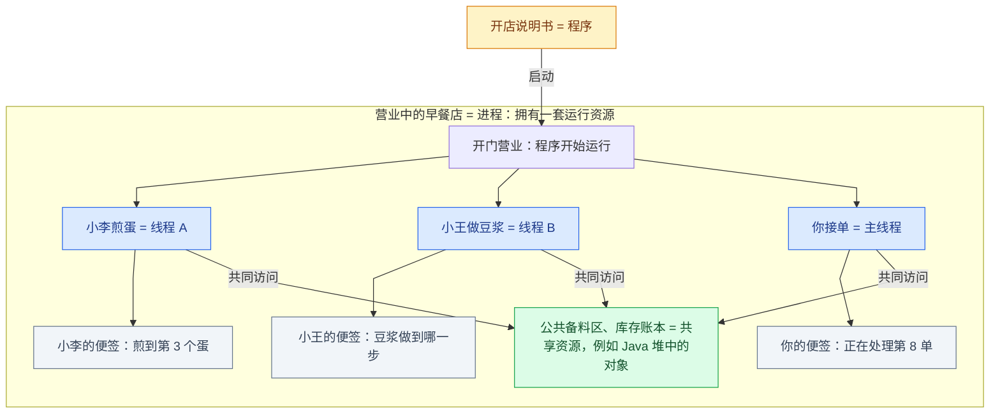

**看图记三件事：**


	
- **大框是进程，里面的员工是线程**：一个进程里可以有多个线程。
- **便签各自保管，账本大家共用**：线程有自己的栈、执行位置，也能访问进程内的共享对象。便签只类比各自的执行进度，不代表局部变量引用的对象一定独享。
- **员工需要使用 CPU 才能计算**：CPU 核心提供计算能力。


 **CPU核心解释**

| 概念            | 先这样理解                  |
| ------------- | ---------------------- |
| 物理核心          | CPU 实际的计算核心            |
| 硬件线程（逻辑处理器）   | 核心提供的“工位”，数量由 CPU 设计决定 |
| Java 线程（软件线程） | 程序里的执行路线，好比等着上工位干活的员工  |

例如：**8 核 16 线程**表示 8 个物理核心、16 个硬件线程。

> 8 个核心提供 16 个工位，**每个核心提供两个工位，这两个工位共用所在核心的计算资源**。

程序可以创建 **100 个 Java 线程**。以普通平台线程为例，操作系统会把需要运行的线程安排到这 16 个工位上，工位不够就轮流使用


## 二、进程与线程

### 2.1 程序与进程


对应到 Java，可以这样理解：

- **写说明书**：编写 `.java` 源代码。
- **准备好可执行的说明书**：编译成 `.class` 字节码，通常打包成 JAR。
- **按说明书开店**：用 `java -jar app.jar` 启动程序，形成一个运行中的进程。


**同一份程序启动两次，通常会得到两个进程**，好比同一份开店说明书开出了两家店：

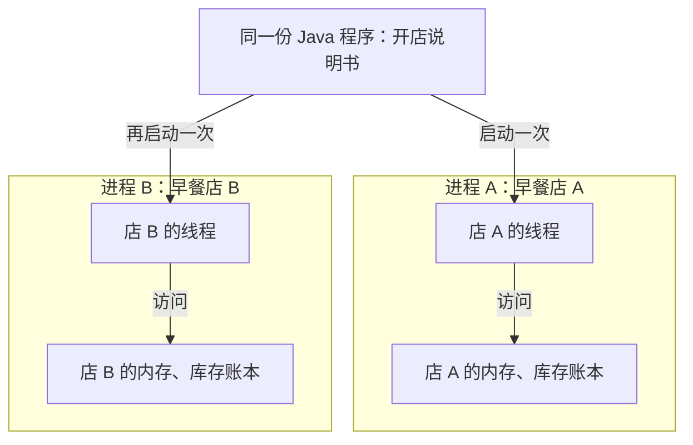
所以，**程序是静态的代码和指令，进程是它运行起来的实例。**

两家店的账本各自管理；不同进程通常有隔离的地址空间，交换信息要通过约定的通信方式。

### 2.2 线程

**一个进程里可以有多个线程**，好比一家店有多个员工。它们共用店里的资源，但各自记着自己的工作进度：

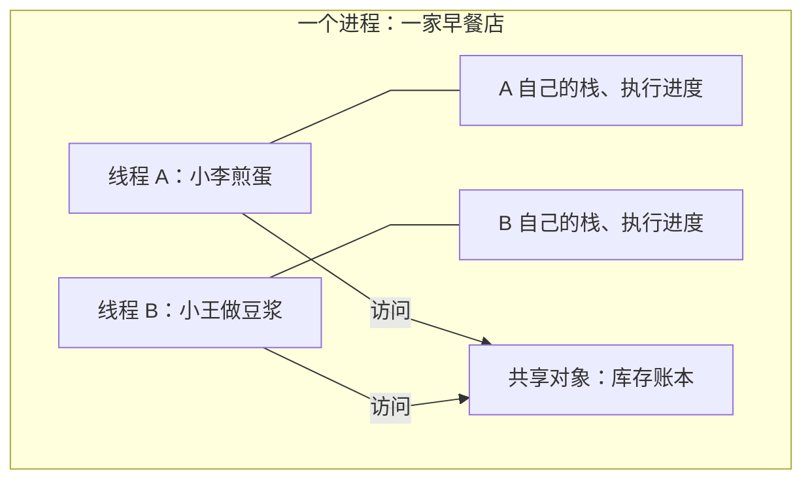

> **每个进程有自己的运行资源，进程里的多个线程共享其中的许多资源。**
>
> **线程是具体执行代码的路线。** 对普通平台线程，操作系统把 CPU 运行机会分配给具体的线程。

**进程管资源归谁**

比如你同时启动两次同一个 Java 程序：

| | 进程 A | 进程 B |
| --- | --- | --- |
| 堆内存 | A 有自己的一份 | B 有自己的一份 |
| 创建的对象 | 保存在 A 的堆里 | 保存在 B 的堆里 |
| 里面的线程 | 可以访问 A 的共享对象 | 可以访问 B 的共享对象 |

> 就像两家早餐店，**各有自己的库存账本；同一家店里的员工共用本店的账本。**

### 2.3 共享方便，也可能改错数据

假设账本里有 10 个鸡蛋，小李、小王各用掉一个，却可能发生下面的情况：

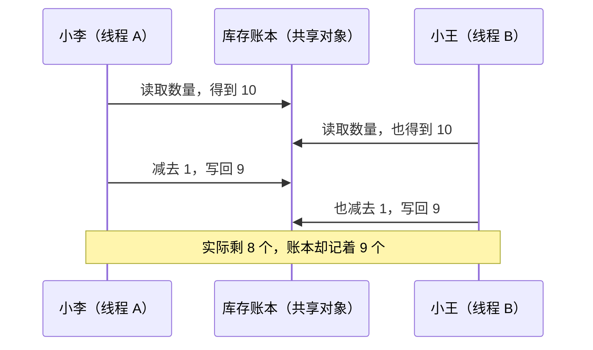

**共享数据需要协作规则**，这就是后面学习锁等知识的原因。

| 比较点 | 进程：不同店铺 | 线程：同店员工 |
| --- | --- | --- |
| 数据与资源 | 通常隔离，交换数据需要通信 | 共享进程资源，也有自己的栈等信息 |
| 创建与切换 | 通常涉及更多资源管理 | 平台线程通常更轻，但也有成本 |
| 出错影响 | 隔离提供一定保护 | 共享数据被改坏，可能影响其他线程 |

### 2.4 main 与主线程

**先启动 JVM 进程，再由主线程执行 `main()`**，不是 `main()` 创建了进程。主线程还可以启动其他线程：

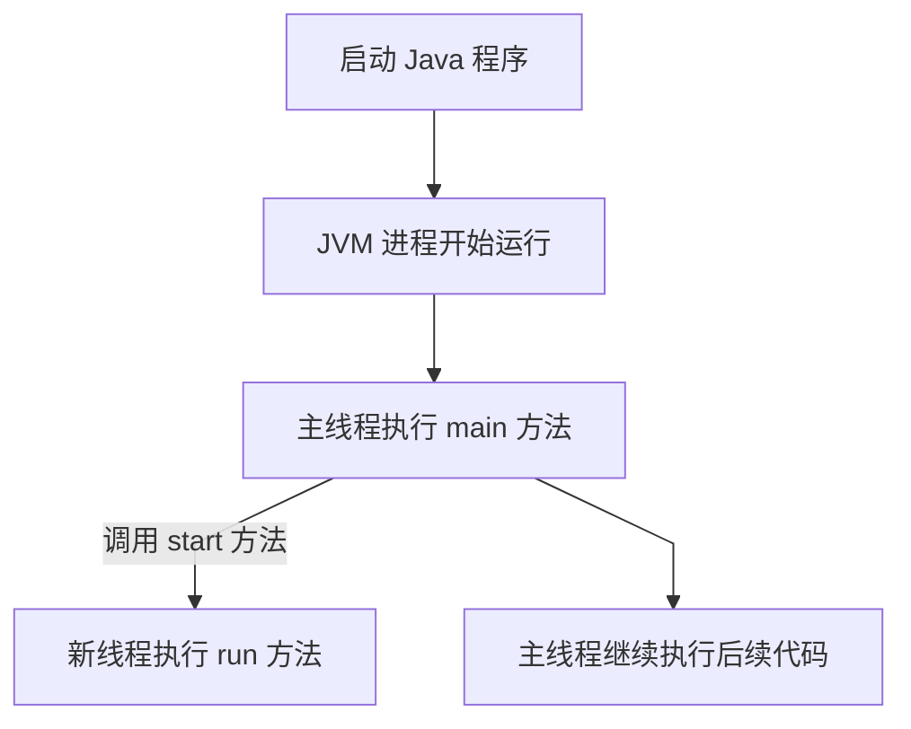

两个分支表示两条执行路线，**不保证同时执行或谁先完成**。主线程结束后，新线程也不会自动跟着停止；只要还有存活的非守护线程，JVM 通常就会继续运行。

## 三、并发、并行、同步与异步

### 3.1 并发

为了看清区别，先假设只有一个执行位置，不能同一瞬间做两份计算。

小李用一下，换小王用一下，再换回小李。从一段时间来看，两份工作都在往前推进：

```mermaid
gantt
    title 并发示例：只有一个 CPU 工位，轮流执行
    dateFormat HH:mm:ss
    axisFormat %S秒
    section 小李
    煎蛋第一步 :a1, 00:00:00, 1s
    煎蛋第二步 :a2, 00:00:02, 1s
    section 小王
    豆浆第一步 :b1, 00:00:01, 1s
    豆浆第二步 :b2, 00:00:03, 1s
```

图中横轴表示时间，色块表示正在执行；小李、小王的执行时间交错，没有重叠。

这叫**并发**：多个任务在一段时间内都有进展，不要求同一瞬间都在执行。

注意，“同一时刻交替执行”容易把人绕晕。交替发生在一段时间内，不能把“轮流”说成同一瞬间一起做。

### 3.2 并行

现在有两个可同时工作的执行位置。小李、小王可以在同一时刻分别工作：

```mermaid
gantt
    title 并行示例：两个 CPU 工位，同时执行
    dateFormat HH:mm:ss
    axisFormat %S秒
    section CPU 工位 1
    小李煎蛋 :a, 00:00:00, 4s
    section CPU 工位 2
    小王做豆浆 :b, 00:00:00, 4s
```

两条色块覆盖同一段时间，表示两个任务在同一时刻实际执行。

这叫**并行**：多个任务在同一时刻实际执行。

记法：**并发看“这段时间都在推进”，并行看“这一刻确实一起做”。** 并发也能发生在多核机器上，不能把它限定成“只有单核才有”。

### 3.3 同步与异步

你让小李煎蛋，现在要处理下一位顾客。

| 你的做法 | 对应概念 |
| --- | --- |
| 必须等小李把煎蛋交过来，才能继续后面的流程 | 同步：当前流程要等这次操作完成 |
| 交代后先去接下一单，之后再取结果或接收通知 | 异步：发起操作后可以先推进其他工作 |

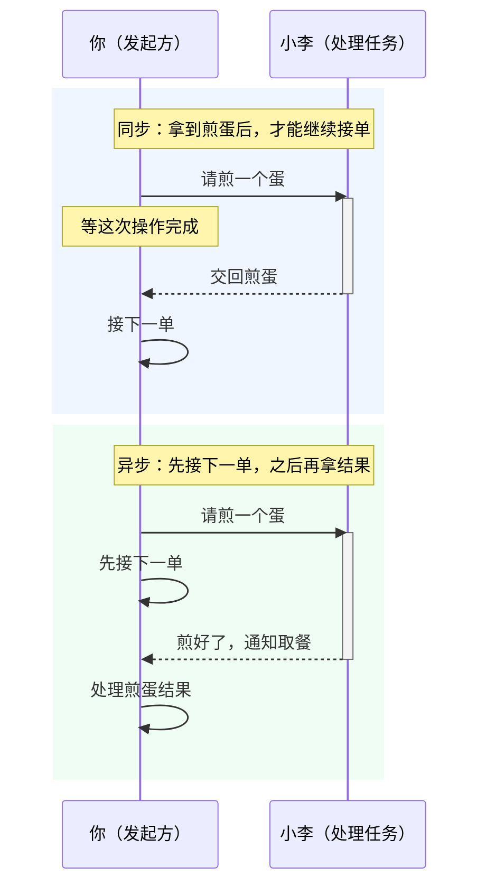

图中从上往下读，重点看“接下一单”发生在结果返回之前还是之后；两条竖线不代表两个 CPU 核心。

判断时就问一句：**发起这件事之后，我的后续流程是否必须等它完成？**

这里的同步/异步描述的是任务调用与完成的关系。它也不完全等同于阻塞/非阻塞；“等”可以通过不同机制实现，本篇先理解等待关系。

另一个常见词是“线程同步”，意思是**给线程之间安排协作顺序、保护共享数据**，例如两个人改账本要轮流。它和上面的“同步调用”侧重点不同。

### 3.4 异步与并行的区别

- **异步**：发起任务后，可以先做其他事，之后再处理结果。
- **并行**：多个任务在同一时刻实际执行。

```mermaid
gantt
    title 异步但不并行：只有一个 CPU 工位
    dateFormat HH:mm:ss
    axisFormat %S秒
    section 你（发起方）
    发起煎蛋任务 :a1, 00:00:00, 1s
    接下一单 :a2, 00:00:02, 1s
    处理煎蛋结果 :a3, 00:00:04, 1s
    section 小李（任务执行方）
    煎蛋第一步 :b1, 00:00:01, 1s
    煎蛋第二步 :b2, 00:00:03, 1s
```

一个 CPU 工位：先接下一单，但计算仍轮流执行，**异步、不并行**。

```mermaid
gantt
    title 异步且发生并行：有两个可同时工作的 CPU 工位
    dateFormat HH:mm:ss
    axisFormat %S秒
    section 你（CPU 工位 1）
    发起煎蛋任务 :a1, 00:00:00, 1s
    接下一单 :a2, 00:00:01, 2s
    处理煎蛋结果 :a3, 00:00:03, 1s
    section 小李（CPU 工位 2）
    执行煎蛋任务 :b1, 00:00:01, 2s
```

两个 CPU 工位：接单与煎蛋同时执行，**异步且并行**。

> **异步看等待关系，并行看执行情况；异步不保证并行。** 图中将工作简化为计算步骤，时间仅作示意。

### 3.5 多线程的作用与开销

**作用：利用 I/O 等待时间；CPU 资源充足时，还能并行计算。**

```mermaid
gantt
    title 多线程利用 I/O 等待时间：一个 CPU 工位也能受益
    dateFormat HH:mm:ss
    axisFormat %S秒
    section 线程 A
    发出网络请求 :a1, 00:00:00, 1s
    等网络返回（不占 CPU） :done, a2, 00:00:01, 3s
    处理返回结果 :a3, 00:00:04, 1s
    section 线程 B
    利用 A 等待的时间处理其他订单 :b1, 00:00:01, 3s
```

A 等网络时，B 利用 CPU 做事，有机会提高吞吐量。**重叠的是等待与计算，A 的网络请求本身没有变快。**

**开销：内存占用、上下文切换、资源竞争。**

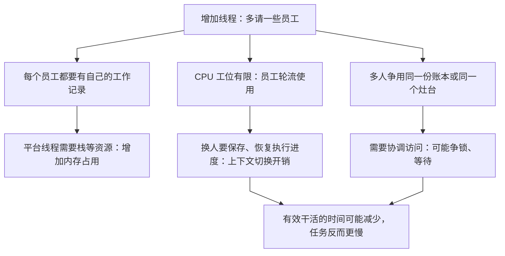

> **线程不是越多越好：收益要能抵过开销。** I/O 多时可利用等待时间；纯计算依赖 CPU 能力；争用同一个瓶颈资源时，加线程也难提速。

## 四、线程常用操作

### 4.1 Thread、Runnable 与 Callable

**你是 main（安排工作的人），Thread 是员工，Runnable / Callable 是任务单。**

下面用同一件事对照图和代码：让员工计算 **1 + 2**。

| 名称 | 在这个例子中负责什么 |
| --- | --- |
| `Runnable` | 定义怎么算，算完自己打印 |
| `Callable<Integer>` | 定义怎么算，用 `return` 交回整数结果 |
| `Thread` | 启动一条新的执行路线，执行交给它的任务 |

**例子一：Runnable——让新线程算完后自己打印。**

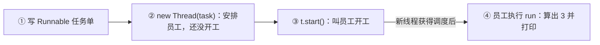

- **写任务单 `Runnable`**：写清楚“算 `1 + 2`，然后把答案打印出来”。此时只是写要求，还没开始算。
- **安排员工 `new Thread(task)`**：找一位员工，把这张任务单交给他。
- **叫他开工 `t.start()`**：员工开始执行任务，你可以继续做自己的事。
- **员工照着任务单干活**：执行 `run()` 里的代码，算出 `3`，打印到屏幕上，任务结束。


新建 `RunnableDemo.java`，对照上图运行：

```java
public class RunnableDemo {
    public static void main(String[] args) {
        // 1. 定义任务。此时还没有开始计算。
        Runnable task = new Runnable() {
            @Override
            public void run() {
                int sum = 1 + 2;
                System.out.println("计算线程自己打印：" + sum);
                // run 的返回类型是 void，不能写 return sum;
            }
        };

        // 2. 创建线程对象，把任务交给它。此时还没有启动新线程。
        Thread t = new Thread(task);

        // 3. 启动新线程。新线程获得调度后，会执行上面 run 里的代码。
        t.start();
    }
}
```

输出：

```text
计算线程自己打印：3
```

这里的 `sum` 是 `run()` 内的局部变量，**main 没有通过返回值拿到它，只是新线程把它打印了出来。**

**例子二：Callable——让新线程计算，再由 main 拿结果。**

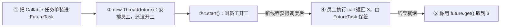

- **写任务单 `Callable`**：要求“算 `1 + 2`，把结果交回来”。
- **包装任务 `FutureTask`**：让任务能交给 Thread 执行，完成后保管结果。
- **安排员工 `new Thread(future)`**：把包装好的任务交给员工，此时还没开工。
- **叫他开工 `t.start()`**：新线程执行 `call()`，返回的 `3` 由 FutureTask 保存。
- **你领取结果 `future.get()`**：main 拿到 `3`；还没做好就等待。

图中最后一步表示成功取得结果；`get()` 可以提前调用，并在结果就绪前等待。

新建 `CallableDemo.java`，对照上图运行：

```java
import java.util.concurrent.Callable;
import java.util.concurrent.FutureTask;

public class CallableDemo {
    public static void main(String[] args) throws Exception {
        // 1. 定义任务。Integer 表示任务会返回一个整数结果。
        Callable<Integer> task = new Callable<Integer>() {
            @Override
            public Integer call() {
                int sum = 1 + 2;
                return sum; // 把结果交出去，不在这里打印。
            }
        };

        // 2. Thread 不能直接接收 Callable，用 FutureTask 包装一下。
        //    它既能交给 Thread 执行，也能保存任务的结果。
        FutureTask<Integer> future = new FutureTask<>(task);

        // 3. 创建并启动线程，新线程通过 FutureTask 执行上面的 call。
        Thread t = new Thread(future);
        t.start();

        // 4. main 取出结果；如果还没算完，main 就在这里等待。
        //等待期间，工作线程继续计算，main 不会一直占着 CPU 空转。
        Integer result = future.get();
        System.out.println("main 拿到结果：" + result);
    }
}
```

输出：

```text
main 拿到结果：3
```

**区别：第一个例子是新线程自己打印；第二个例子是新线程返回结果，main 取到后再打印。** `Callable` 的结果通过 `FutureTask.get()` 取出，`t.start()` 只负责启动线程。

> `Runnable` 也可以把结果写到共享对象中，但 `run()` 本身没有返回值。`Callable.call()` 有返回值，也允许声明受检异常。

### 4.2 start 与 run

**把 main 当成你，新线程当成小李，任务是煎蛋。**

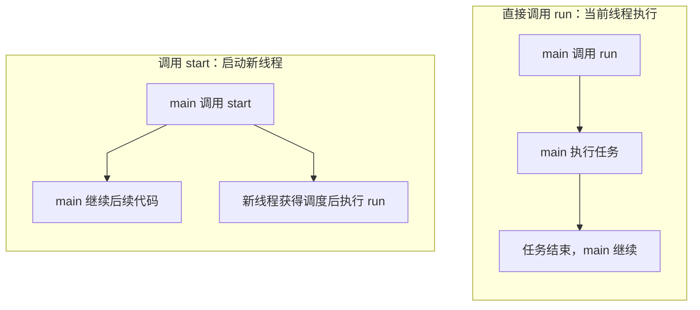

下面两种写法分开看，都先创建同样的任务和线程对象：

```java
Runnable task = () -> {
    System.out.println(Thread.currentThread().getName() + "：煎蛋");
};
Thread t = new Thread(task, "小李");
```

**直接调用 `t.run()`：你自己煎蛋，做完再接单。**

```java
t.run(); // main 亲自执行任务，没有启动新线程。
System.out.println("main：接下一位顾客");
```

输出顺序固定：

```text
main：煎蛋
main：接下一位顾客
```

**调用 `t.start()`：叫小李煎蛋，你继续接单。**

```java
t.start(); // 启动新线程“小李”，由它执行任务。
System.out.println("main：接下一位顾客");
```

会输出下面两行，但先后顺序不保证：

```text
小李：煎蛋
main：接下一位顾客
```

> **`run()` 是当前线程亲自做；`start()` 是启动另一个线程去做。** `Thread.currentThread().getName()` 显示实际执行这行代码的线程名，因此直接调用 `t.run()` 时，打印的仍是 `main`。

**同一个线程对象只能 `start()` 一次；启动顺序不保证执行、完成顺序。**

### 4.3 sleep 与 yield

把 **CPU 想成工位，线程想成员工，调度器想成安排员工使用工位的人**。

**调度器是什么？**

调度器决定“现在让哪个线程使用 CPU”。对本文普通的 Java 平台线程来说，主要由操作系统负责安排：

- 员工多、工位少，就安排谁先干、谁等一等。
- 有员工暂停休息，就可以安排其他员工使用工位。
- 员工休息结束，只表示可以重新等候安排，**不代表马上轮到他**。

**`sleep(1000)`：我休息一秒，这一秒先别安排我干活。**

当前线程暂停执行；正常休眠约一秒后，才重新等候安排。**时间到了，也不保证立刻执行**；休眠也可能被中断。

**`yield()`：我还可以继续干，但愿意让别人先来。**

它只是建议，没有规定休息多久。调度器可以忽略，**下一次仍让当前线程继续执行**。

| 对比 | `Thread.sleep(1000)` | `Thread.yield()` |
| --- | --- | --- |
| 员工说的话 | “我先休息一秒，之后再安排我” | “别人可以先干，也可以还是我干” |
| 是否暂停一段时间 | 会，正常情况下约一秒 | 不保证 |
| 能否马上继续执行 | 正常情况下要等休眠结束 | 可以 |

> **sleep 是暂停，yield 是礼让建议；两者都不会释放已持有的锁。** 你写代码定义线程干什么，调度器安排线程什么时候获得 CPU 执行机会。`sleep()` 暂停的是调用它的当前线程，不能代替等待任务完成。

### 4.4 interrupt 中断

**`t.interrupt()` 是请求，线程需要配合响应，不是强制停止。**

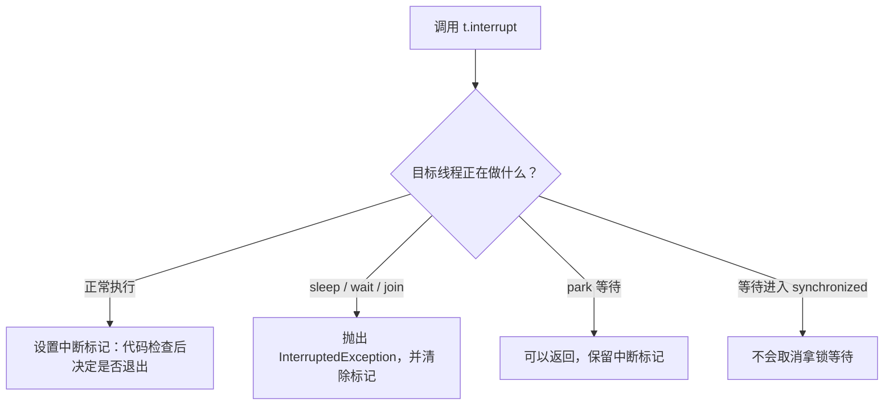

**怎么读这张图？** 把线程当成小李，`interrupt()` 就是给他发“准备下班”的通知。先看他正在做什么，再沿对应分支看：

- **正常执行**：给小李贴上“收到停工通知”的标记。他的代码要主动检查，发现标记后退出循环；不检查，就可能继续干。
- **在 `sleep / wait / join` 中等待**：用 `InterruptedException` 打断这次等待，同时清除标记。进入 `catch` 后如何退出或收尾，需要自己写。
- **在 `park` 中等待**：可以从等待中返回，标记仍保留；后续代码需要检查并处理中断。
- **在等 `synchronized` 的锁**：通知不能取消拿锁等待，也不会让持锁的线程释放锁。

**“检查标记后决定是否退出”具体怎么写？**

```java
Thread t = new Thread(() -> {
    // isInterrupted()：检查当前线程自己的中断标记。
    // 没通知：false，取反后为 true，继续干活。
    // 有通知：true，取反后为 false，退出循环。
    while (!Thread.currentThread().isInterrupted()) {
        System.out.println("小李：处理一份订单");
    }

    System.out.println("小李：收到通知，下班");
});

t.start();
t.interrupt(); // main 给小李发通知；小李下一次检查条件时退出。
```

通知也可能在第一轮工作前就到达，所以“处理一份订单”可能一次也不打印。**通知不会跳过正在执行的代码；若已开始处理一份订单，就在做完并再次检查循环条件时退出。**

> **`interrupt()` 负责发通知，`isInterrupted()` 负责看通知，退出循环的代码负责真正停下来。** 这个例子没有 `sleep()`，因此演示的是图中的“正常执行”分支。

| 方法 | 对谁操作 | 标记变化 |
| --- | --- | --- |
| `t.interrupt()` | 指定线程 | 发出中断请求 |
| `t.isInterrupted()` | 指定线程 | 读取，保留标记 |
| `Thread.interrupted()` | 当前线程 | 读取并清除标记 |

捕获 `InterruptedException` 后，应结束任务，或恢复标记交给上层处理；不要只打印异常就继续循环。

### 4.5 join 与 get

**谁调用，谁等待：`join()` 等线程结束，`get()` 等任务结果。**

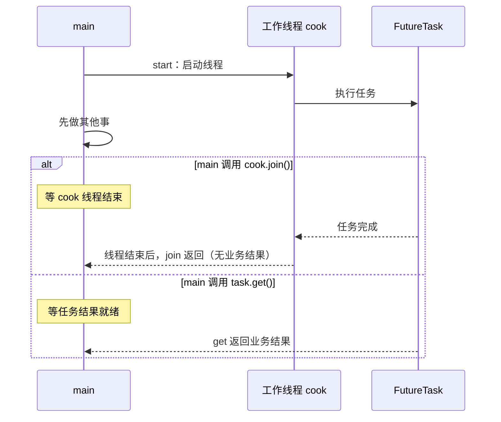

- 异步启动后立刻 `get()`，调用者仍可能等住；任务失败由 `ExecutionException` 报告。
- `join(1000)` 最多等约一秒，返回后目标可能仍存活；`join(0)` 不设超时。

### 4.6 park 与 unpark

**`park()` 等放行票，`unpark(t)` 给指定线程一张票，最多保留一张。**

```mermaid
flowchart TD
    call["当前线程调用 park"] --> permit{"已有放行票？"}
    permit -->|有| consume["消耗一张票，直接返回"]
    permit -->|无| wait["等待放行"]
    unpark["其他线程调用 unpark：提供一张票"] --> wait
    wait -->|获得票 / 中断 / 虚假唤醒| check["返回后重新检查业务条件"]
    consume --> check
    check --> ready{"条件满足？"}
    ready -->|是| work["继续工作"]
    ready -->|否| call
    linkStyle default interpolate linear
```

票可以先发后用，连续 `unpark()` 不会累积多张。**`park()` 返回不代表条件满足，也不会清除中断标记**；循环等待时还要处理中断，避免反复立即返回。详见 [[02-线程同步与通信]]。

### 4.7 守护线程

**所有已启动的非守护线程结束后，JVM 可以退出，不会等待守护线程完成。**

平台线程用 `setDaemon(true)` 设置，必须在 `start()` 前调用。必须完成的保存、结算任务不要只交给守护线程，也不能保证退出时执行清理代码。

### 4.8 两阶段终止

**先通知停止，再由线程配合退出并收尾。**

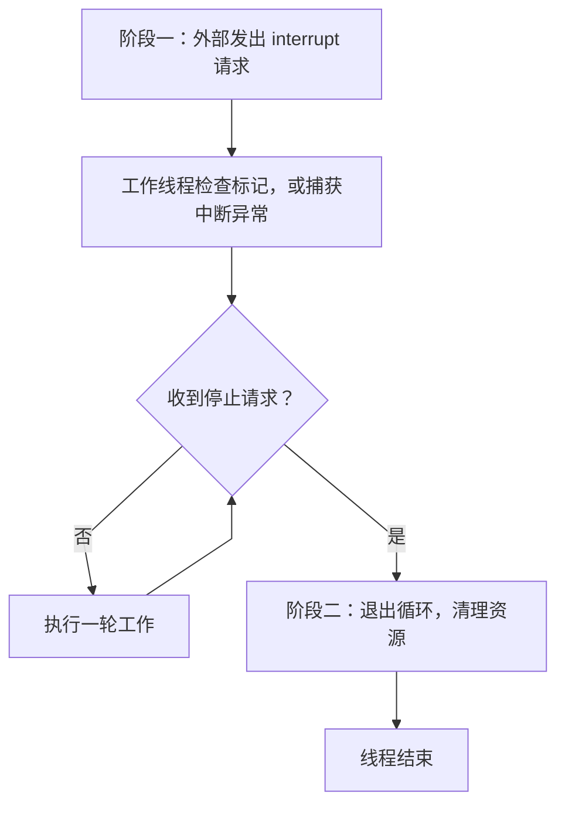

避免使用废弃的 `stop()`、`suspend()`、`resume()`：强行停止或暂停可能破坏数据、导致死锁。`System.exit()` 退出的是整个 JVM，不能用于只停止一个线程。

## 五、线程状态

### 5.1 六种线程状态

别先背英文，先问：他没开始干、能干、被钥匙挡住、在等事情，还是已经结束？

| 状态名 | 店里的画面 | Java 中的典型情况 |
| --- | --- | --- |
| `NEW`：新建 | 员工安排好了，还没叫他上班 | `new Thread(...)` 后，尚未调用 `start()` |
| `RUNNABLE`：可运行 | 已经上岗，正在用设备，或等设备轮到自己 | 可能正在执行，也可能等待 CPU 执行机会 |
| `BLOCKED`：等监视器锁 | 想进账房，但钥匙被别人拿着 | 等待进入或重新进入 `synchronized` 保护的区域 |
| `WAITING`：不设超时地等 | 等一个具体信号或等另一个员工结束 | 无超时的 `wait()`、`join()`、`park()` 等 |
| `TIMED_WAITING`：设了时限的等 | 休息一段时间，或只等一会儿 | `sleep()`、带正数超时的 `wait()`、`join()` 等 |
| `TERMINATED`：结束 | 这次工作已经结束 | `run()` 正常返回，或因未捕获异常结束 |

这是 Java 对线程的分类，不等同于操作系统线程状态。[Thread.State 文档](https://docs.oracle.com/en/java/javase/21/docs/api/java.base/java/lang/Thread.State.html)明确区分了六种状态。

### 5.2 RUNNABLE 可运行

你已经准备好煎蛋，只差灶台轮到自己。你有工作能力，暂时没获得设备。

Java 把“正在执行”和“等待 CPU 执行机会”的情况都放进 `RUNNABLE`。所以看到这个状态，不能断言“它这一瞬间一定在 CPU 上跑”。

### 5.3 BLOCKED 与 WAITING

**`BLOCKED`**：我想进账房工作，但拿不到 `synchronized` 对应的钥匙。

**`WAITING`**：我主动等一个事件，例如另一个员工做完、条件变化或收到放行票。

日常说“线程阻塞了”是泛指暂时走不下去；Java 的 `BLOCKED` 则有特定含义。比如等待 `ReentrantLock` 时，可能看到 `WAITING`，不能把所有等锁都归成 `BLOCKED`。

`WAITING` 也不等于只能由 `notify()` 唤醒：`join()` 可以因为目标线程结束而返回，`park()` 可以因为 `unpark()` 或中断返回。采用什么等待方式，就要看对应的恢复条件。

### 5.4 sleep 与 wait

这是下一篇的内容，这里先认识区别：

| 操作 | 早餐店里的画面 | 对锁的影响 |
| --- | --- | --- |
| `Thread.sleep(...)` | 我自己暂停一会儿 | 不会因此释放已持有的监视器锁 |
| `obj.wait()` | 暂时交回这间账房的钥匙，等条件变化 | 必须先持有 obj 的监视器锁；等待时释放这把锁 |

`wait()` 不会顺手释放你持有的其他锁。收到通知后，也得重新拿到对应锁，才能从 `wait()` 返回；通知不是直接把钥匙交给你。

### 5.5 线程状态转换

```text
安排员工 NEW
    └─ start() → 可以工作 RUNNABLE
                    ├─ sleep(正数时间) → TIMED_WAITING
                    ├─ 等另一个尚未结束的线程 join() → WAITING
                    ├─ 拿不到 synchronized 的锁 → BLOCKED
                    └─ run() 结束 → TERMINATED
```

等待结束通常意味着可以重新竞争执行机会，不保证立刻执行。`wait()` 被通知后，如果还拿不到锁，还可能先进入 `BLOCKED`。

线程结束后，不能把同一个对象重新 `start()`，就像这次工作记录已经结单，下一次要新建安排。

## 六、线程原理

### 6.1 栈、栈帧与程序计数器

小李正在执行“准备早餐”，里面又调用“煎蛋”，煎蛋里面又要“打蛋”。他得记住：当前做哪一步，做完后回到哪里。

可以想成一摞便签：

```text
最上面：打蛋()      ← 当前正在处理
中间：  煎蛋()      ← 等打蛋返回后继续
最下面：准备早餐()  ← 等煎蛋返回后继续
```

| 名词 | 生活画面 | 实际作用 |
| --- | --- | --- |
| Java 虚拟机栈 | 每位员工自己的一摞便签 | 保存这个线程的方法调用信息 |
| 栈帧 | 一次方法调用对应的一张便签 | 保存局部变量、计算中的中间信息等 |
| 当前栈帧 | 最上面正在处理的那张 | 对应当前执行的方法 |
| 程序计数器（PC） | 当前步骤的定位标记 | 执行非 native 方法时，记录当前 JVM 指令的位置 |
| 局部变量 | 当前便签上的临时数字 | 例如这个方法里使用的计数值 |
| 操作数栈 | 便签旁的临时计算区 | 暂存参与计算的值和中间结果 |

方法调用时放上新便签，方法结束时撤下这张，回到下一张继续。这是理解调用栈的记忆画面，实际定义见 [JVM 规范的运行时数据区与栈帧](https://docs.oracle.com/javase/specs/jvms/se21/html/jvms-2.html#jvms-2.5)。

“每个线程有自己的局部信息”不代表它访问的对象也一定独占。便签上可以写着同一个公共账本的位置，两个人仍可能操作同一对象。

### 6.2 上下文切换

小李用了一会儿灶台，系统安排小王接着用。换之前，要保留小李的执行位置等状态；以后轮回来，才能接着做。

这叫**上下文切换**。可以把“上下文”翻译为：**继续工作所需的现场信息。**

线程用完本次运行机会、主动等待，或系统安排其他线程运行，都可能发生切换。保存和恢复执行状态有成本，所以不是线程越多越快。

不要想成每次都把 Java 栈完整复印一遍，也不要把 JVM 的 PC、Java 栈和操作系统保存的机器寄存器混成同一层东西。这个类比只负责解释“恢复工作需要记住现场”。

### 6.3 线程调度

**抢占式调度**：由系统安排运行机会，就像商场管理员可以说“这一轮到小王”。本篇使用的平台线程通常由操作系统调度，不要求正在工作的线程主动让出后，别人才有机会。

**协作式调度**：主要依靠执行者在约定位置主动交还机会，就像员工说“我先等送货，你来用”。具体是否会饿死别人、是否需要同步，要看实现和共享数据，不能说协作式就没有同步问题。

线程优先级好比向管理员表达“这单比较急”。不能依赖 `setPriority()` 保证谁先开始、谁先完成，也不能依赖 `yield()` 实现稳定排序。

原文的“用户态/内核态”可以先理解为：**普通员工的工作权限和系统管理员的管理权限不同。** 操作系统管理平台线程需要相应的系统机制，但不能由此推出“任何 Java 方法调用或状态变化都必然切换一次权限”。

### 6.4 虚拟线程与协程

原文把这部分写成“未来优化”，现在需要补一个时间范围：**Java 21 已正式提供虚拟线程。**

- 本篇 `new Thread(...)` 创建的是平台线程，通常对应操作系统线程。
- Java 21 的虚拟线程由 Java 运行时调度到承载它们的平台线程上，不能再把所有 Java 线程都说成“与操作系统线程一对一”。

沿用店里的场景：可以把虚拟线程想成很多份独立的员工工作进度记录，由少量实际值班人员承接；某份工作等待送货时，在支持释放承载线程的场景中，可以先让其他工作继续。

这只是理解调度层次的补充类比。虚拟线程不会增加 CPU 核心，主要适合大量等待 I/O 的任务，不能保证让纯计算任务更快。依据为 [Java 21 Thread 文档的平台线程与虚拟线程说明](https://docs.oracle.com/en/java/javase/21/docs/api/java.base/java/lang/Thread.html)。

“协程”可以先理解成能暂停、恢复的执行过程。“有栈”保留调用栈，“无栈”通常用状态记录保存执行进度；“纤程”是某些实现采用的相关称呼。它们不是所有语言通用的一套固定分类，更不能一概说成“多个任务只能映射到一个内核线程”。第一次学本篇，知道这条路存在即可。

### 6.5 进程通信

同店员工能共用账本，不同店通常不能直接访问对方的普通内存。它们需要约好的通信方式，简称 **IPC：进程间通信**。

| 方式 | 生活例子 | 先知道什么 |
| --- | --- | --- |
| 管道 | 一条按顺序传内容的传递通道 | Linux 普通管道是单向字节流；双向交流通常需要两条 |
| 命名管道（FIFO） | 给传递通道设一个大家能找到的地址 | 无亲缘关系的进程也能按路径找到它；不能理解成普通磁盘文件里存消息 |
| 消息队列 | 把一张张订单放进收件箱 | 按消息交换；具体读取规则与存续期取决于采用哪种实现 |
| 共享内存 | 双方约定使用同一块公共公告板 | 能共同访问数据，但仍要协调谁何时修改 |
| 信号量 | 入口发有限数量的通行牌 | 主要用于协调进入人数、资源使用，不是传整份订单内容 |
| Socket：套接字 | 店之间建立联络端点 | 可以用于网络，也有用于同机进程通信的 Unix 域套接字 |

匿名管道常见于相关进程之间；命名管道提供可寻址的路径。管道与 FIFO 的具体行为可看 [Linux pipe 手册](https://man7.org/linux/man-pages/man7/pipe.7.html)，共享内存见 [shm_overview](https://man7.org/linux/man-pages/man7/shm_overview.7.html)，本地套接字见 [unix](https://man7.org/linux/man-pages/man7/unix.7.html)。

跨机器交流通常经网络并遵守约定的协议，例如 HTTP。Socket 也能本地通信，所以不能说“它只能用于不同机器”。

同进程的线程可以共享对象，再通过锁、等待/通知、`join()` 等安排协作。`volatile` 主要解决可见性和一定的顺序约束，不能保证所有共享操作安全；`InheritableThreadLocal` 主要在子线程创建时传递初始值，也不能当成两个线程随时交流的公共账本。这些留到 [[04-Java内存模型]] 与 [[06-ThreadLocal]] 继续学。

## 七、代码示例

### 7.1 运行环境

使用 JDK 8 或更高版本，不需要 Spring、Maven、第三方依赖，也不需要创建复杂项目。

如果使用 IntelliJ IDEA，在现有学习项目的 `src` 中分别新建下面的类，粘贴完整代码，运行对应 `main()` 即可。每个示例独立运行。

如果使用终端，将文件放在同一个学习目录，按各示例下的命令编译运行。代码没有声明包名；如果你的 IDE 自动添加了 `package`，按项目原有包结构放置即可。

### 7.2 创建线程：start、run、join

要解决的问题：煎蛋和准备豆浆可以分头推进，你先接单，最后等两样都做好再交付。

这里顺便对比三件事：直接 `run()`、继承 `Thread` 启动员工、把 `Runnable` 任务交给线程。文件名为 `BreakfastDemo.java`。

```java
public class BreakfastDemo {
    // 方式一：继承 Thread，把“员工”和“煎蛋任务”写在一个类里。
    static class EggCook extends Thread {
        EggCook() {
            super("煎蛋员工"); // 设置名字，方便看清每行由谁执行。
        }

        @Override
        public void run() {
            // currentThread：取得真正执行到这里的线程。
            // getName：查看它的名字，不是只看当前对象叫什么。
            System.out.println(Thread.currentThread().getName() + "：开始煎蛋");
            try {
                // sleep：只为模拟耗时，不负责保证两个线程的先后顺序。
                Thread.sleep(300);
            } catch (InterruptedException e) {
                // 收到停工通知后，恢复标记并退出，不继续假装做完。
                Thread.currentThread().interrupt();
                return;
            }
            System.out.println(Thread.currentThread().getName() + "：煎蛋完成");
        }
    }

    public static void main(String[] args) throws InterruptedException {
        System.out.println("先试直接调用 run()：");
        EggCook direct = new EggCook();
        direct.run(); // 普通方法调用，输出的执行者是 main。
        System.out.println("直接 run 后，对象状态：" + direct.getState());

        System.out.println("再试启动两位员工：");
        EggCook egg = new EggCook();

        // 方式二：Runnable 只描述任务，由 Thread 执行。
        Runnable soyTask = () -> {
            System.out.println(Thread.currentThread().getName() + "：准备豆浆");
        };
        Thread soy = new Thread(soyTask, "豆浆员工");

        egg.start(); // 启动另一条执行路线，之后由它执行 run。
        soy.start(); // 启动豆浆员工，不能保证谁先输出。
        System.out.println("main：我先接下一位顾客的订单");

        egg.join(); // main 等煎蛋员工结束，其他线程仍可以工作。
        soy.join(); // main 等豆浆员工结束；如果已结束，直接返回。
        System.out.println("main：早餐齐了，可以交付");
        System.out.println("煎蛋员工状态：" + egg.getState());
    }
}
```

终端运行方式：

```bash
javac -encoding UTF-8 BreakfastDemo.java
java -Dfile.encoding=UTF-8 BreakfastDemo
```

无需输入。观察下面三个确定的现象：

1. 第一段虽然调用了 `EggCook` 的 `run()`，执行者名字却是 `main`。直接调用没有启动该线程，因此 `direct` 仍是 `NEW`。
2. 第二段出现“煎蛋员工”“豆浆员工”，说明启动了新线程。它们与 main 的部分输出顺序可能变化。
3. “早餐齐了”一定在两个员工的任务结束后输出；正常结束后的 `egg` 为 `TERMINATED`。

> [!info] 从结果反推概念
> `run()` 是工作内容，`start()` 是启动执行路线，`join()` 是调用者等待目标结束。
> 删掉 `join()` 后，“早餐齐了”就没有保证等两位员工做完。不要用某一次碰巧出现的打印顺序当规则。

### 7.3 获取结果：Callable、FutureTask

要解决的问题：你不仅想知道小李结束了，还想拿到他做好的那份早餐。

这里用 `Callable<String>` 表示会交回字符串的任务，用 `FutureTask<String>` 保存任务完成状态和结果。文件名为 `BreakfastResultDemo.java`。

```java
import java.util.concurrent.Callable;
import java.util.concurrent.ExecutionException;
import java.util.concurrent.FutureTask;

public class BreakfastResultDemo {
    public static void main(String[] args)
            throws InterruptedException, ExecutionException {
        // Callable：任务完成时返回结果；这里交回一段早餐描述。
        Callable<String> order = () -> {
            Thread.sleep(300); // 模拟准备过程，可抛出 InterruptedException。
            return "一份煎蛋和豆浆";
        };

        // FutureTask：既能当 Runnable 交给线程，也能让调用者取结果。
        FutureTask<String> receipt = new FutureTask<>(order);
        Thread cook = new Thread(receipt, "套餐员工");
        cook.start(); // 开始异步准备；只创建 receipt 不会执行任务。

        System.out.println("main：员工准备早餐，我先接下一单");

        // get：任务完成就取结果，没完成则 main 在这里等待。
        // 任务执行失败时抛出 ExecutionException，可从其 cause 查看原异常。
        String breakfast = receipt.get();
        System.out.println("main：拿到 " + breakfast);
    }
}
```

终端运行方式：

```bash
javac -encoding UTF-8 BreakfastResultDemo.java
java -Dfile.encoding=UTF-8 BreakfastResultDemo
```

无需输入，预期输出：

```text
main：员工准备早餐，我先接下一单
main：拿到 一份煎蛋和豆浆
```

这段代码实际做的是：另一个线程执行任务，main 先输出接单消息，然后在 `get()` 处等待并取得字符串。**任务异步执行，取结果时仍可以同步等待。**

`Runnable.run()` 不允许声明新增的受检异常，但仍可能抛出运行时异常；不能概括成“run 不能抛异常”。普通新线程里的异常，也不会自动被 `main` 包住 `start()` 的 `try/catch` 接住。通过 `FutureTask` 执行时，它会记录任务失败，再由 `get()` 报告。

### 7.4 停止线程：interrupt 与收尾

要解决的问题：后台员工每隔一秒检查一次库存，你希望通知他结束，并等他把最后的整理做完。

这里的员工只是打印模拟信息，不会读写数据库或文件。文件名为 `ClosingDemo.java`。

```java
public class ClosingDemo {
    public static void main(String[] args) throws InterruptedException {
        Thread monitor = new Thread(() -> {
            // currentThread：保存正在执行任务的线程，便于检查中断标记。
            Thread self = Thread.currentThread();
            try {
                // isInterrupted：只读取中断标记，不会清除。
                while (!self.isInterrupted()) {
                    try {
                        System.out.println("库存员工：检查一次库存");
                        Thread.sleep(1000); // 当前员工暂时休息。
                    } catch (InterruptedException e) {
                        // sleep 被中断时会清除标记，所以重新标记。
                        // 下一次检查循环条件时，就能退出工作循环。
                        self.interrupt();
                    }
                }
            } finally {
                // 模拟收尾。在正常协作退出时，会先执行这里再结束线程。
                // 此处不依赖 sleep，不需要继续等待外部资源。
                System.out.println("库存员工：整理记录，归还物品，下班");
            }
        }, "库存员工");

        monitor.start(); // 第一阶段开始前，先让员工正常工作。
        Thread.sleep(2200); // 只用于演示一段营业时间，不用它保证员工已就绪。
        System.out.println("main：准备打烊");
        monitor.interrupt(); // 第一阶段：发出停工请求。
        monitor.join(); // 等员工退出循环、完成第二阶段收尾并结束。
        System.out.println("main：员工已收工");
    }
}
```

终端运行方式：

```bash
javac -encoding UTF-8 ClosingDemo.java
java -Dfile.encoding=UTF-8 ClosingDemo
```

无需输入。库存检查次数受实际调度影响，不必死记；正常运行时最后会看到“整理记录，归还物品，下班”，之后才是“main：员工已收工”。

代码同时处理了两种时机：正常执行期间收到中断，在循环检查时退出；休眠期间收到中断，先进入 `catch`，恢复标记后再退出。**重新设置标记，是为了让本例统一走循环外的收尾逻辑。** 不是所有 `catch` 都必须照抄这套写法。

### 7.5 查看进程与线程

先给线程起清楚的名字，再查看状态，比只看“程序不动了”容易定位。

在安装了 JDK 的本机终端，可以使用这些只读命令：

```bash
# 列出可见的本机 Java 进程，找到目标进程的数字编号 PID。
jps -l

# 示例：如果目标编号是 12345，查看它的线程快照。
# 运行前将 12345 替换为实际 PID；程序必须仍在运行。
jstack 12345

# 打开图形工具，再选择要观察的本机 Java 进程。
jconsole
```

在 `jstack` 中，先找线程名，再看状态和方法调用记录。例如 `ClosingDemo` 暂停期间，可能看到“库存员工”在 `TIMED_WAITING`，调用位置包含 `Thread.sleep`。

三个示例都很短，可能来不及查看就已结束。若要观察 `ClosingDemo`，可以临时把 main 的营业时间改长，例如 30000 毫秒；观察后仍由 main 发中断并等待收工。

Windows 也可以先用任务管理器看进程；Linux 常用 `ps -ef` 查看进程，`ps -T -p 12345` 查看指定进程的线程，或用 `top -H -p 12345` 动态观察。把示例 PID 换成真实编号即可；这些系统工具的选项不要直接混用到 macOS。

### 7.6 常见运行问题

| 现象 | 先检查什么 |
| --- | --- |
| 提示找不到 `javac` | 终端是否配置了 JDK；IDE 是否选择了可用 JDK |
| 提示 public 类名和文件名不一致 | 文件名是否和 `public class` 完全一致 |
| 提示找不到主类 | 是否在编译输出目录运行；是否添加了 package 却仍用无包名命令 |
| 提示找不到 Callable、FutureTask 等 | 是否保留了示例顶部的 import |
| 终端中文变成问号或乱码 | 保留命令中的 `-Dfile.encoding=UTF-8`；IDE 的文件与控制台编码也选 UTF-8 |
| 两个线程打印顺序和预想不同 | 没有顺序约束的部分，本来就不能保证先后 |
| 重复调用 start 抛异常 | 同一个线程对象只能启动一次 |
| get 一直等不到结果 | FutureTask 是否真的交给线程执行并启动，任务是否能结束 |
| 发中断后线程仍一直工作 | 任务是否检查标记，是否把中断异常吞掉后又继续循环 |
| jstack 提示进程不存在 | 示例是否已结束，PID 是否正确 |

## 八、面试问答

### 8.1 回答思路

**先说资源归谁 → 再说谁执行 → 说明共享与隔离 → 补上并发不等于并行。**

### 8.2 回答示例

进程可以理解为程序运行起来的一份实例，它有自己的运行资源。线程是进程中的执行路线，同一个进程可以有多个线程，它们共享进程内的许多资源，但各自有自己的栈和执行位置等信息。多线程方便任务分工，也会带来共享数据的安全问题。另外，多线程不一定同时执行：任务在一段时间内交替推进属于并发，同一时刻实际一起执行才是并行。

讲不顺时，就回想：**店有自己的资源，员工分头干活，共用账本要守规则。**

### 8.3 常见追问

**直接调用 run，为什么没有新线程？**

因为它仍是当前线程的一次普通方法调用。`start()` 才负责启动新的执行路线，由新线程执行任务；不能把工作内容和启动动作混为一谈。

**join 到底让谁等？**

当前调用者等目标线程结束。例如 main 调用 `cook.join()`，等的是 main，目标 cook 仍按正常调度运行，其他线程也可以继续执行。

**interrupt 能立即停止线程吗？**

不能保证。普通执行代码需要主动检查中断标记；`sleep()` 等可中断等待会抛出异常，任务也要正确处理。它是一种协作机制。

## 九、重点回顾

1. **哪家店在营业？** —— 进程，管理一套运行资源。
2. **具体谁在干活？** —— 线程，按自己的执行路线推进。
3. **轮流做，还是这一刻一起做？** —— 区分并发与并行。
4. **交代完能继续做别的，还是后续必须等？** —— 区分这次任务调用的异步与同步。
5. **卡在哪儿：等 CPU、等钥匙、等消息，还是休息？** —— 根据原因理解线程状态。

常用操作就回想这几句话：

> `start` 叫人来干，`run` 是干什么。
> `sleep` 自己暂停，`join` 等别人结束，`get` 等结果。
> `interrupt` 发通知，线程配合才收工。
> 让出 CPU 和归还锁，是两件不同的事。

接下来读 [[02-线程同步与通信]] 时，继续沿用这家店：重点看“公共账本怎样轮流改，等消息时钥匙该怎么交”。

## 十、参考资料

本文保留原笔记的入门主题，按 Oracle 并发教程的“进程与线程 → 启动线程 → 暂停 → 中断 → 等待结束”主线展开，并把状态、运行原理作为补充。生活故事用于记忆；Java 行为以对应官方说明为依据。

- [Oracle Java 并发教程目录](https://docs.oracle.com/javase/tutorial/essential/concurrency/index.html)：基础顺序参考；该版教程面向 JDK 8。
- [进程与线程](https://docs.oracle.com/javase/tutorial/essential/concurrency/procthread.html)、[定义与启动线程](https://docs.oracle.com/javase/tutorial/essential/concurrency/runthread.html)、[sleep](https://docs.oracle.com/javase/tutorial/essential/concurrency/sleep.html)、[interrupt](https://docs.oracle.com/javase/tutorial/essential/concurrency/interrupt.html)、[join](https://docs.oracle.com/javase/tutorial/essential/concurrency/join.html)：基础行为。
- [Java 8 Thread API](https://docs.oracle.com/javase/8/docs/api/java/lang/Thread.html)、[Object 的 wait/notify](https://docs.oracle.com/javase/8/docs/api/java/lang/Object.html)、[旧线程控制方法为何废弃](https://docs.oracle.com/javase/8/docs/technotes/guides/concurrency/threadPrimitiveDeprecation.html)：配合基础示例、监视器等待与旧方法说明。
- [Java 21 Thread API](https://docs.oracle.com/en/java/javase/21/docs/api/java.base/java/lang/Thread.html)、[Thread.State](https://docs.oracle.com/en/java/javase/21/docs/api/java.base/java/lang/Thread.State.html)、[FutureTask](https://docs.oracle.com/en/java/javase/21/docs/api/java.base/java/util/concurrent/FutureTask.html)、[LockSupport](https://docs.oracle.com/en/java/javase/21/docs/api/java.base/java/util/concurrent/locks/LockSupport.html)：状态、任务结果、等待工具，以及虚拟线程和旧 API 的版本边界。
- [JVM 规范：运行时数据区、栈帧](https://docs.oracle.com/javase/specs/jvms/se21/html/jvms-2.html#jvms-2.5)：执行进度的内存结构。
- Linux 手册：[管道与 FIFO](https://man7.org/linux/man-pages/man7/pipe.7.html)、[共享内存](https://man7.org/linux/man-pages/man7/shm_overview.7.html)、[Unix 域套接字](https://man7.org/linux/man-pages/man7/unix.7.html)：进程通信补充，具体细节具有操作系统边界。

原笔记的课程来源：[黑马程序员 Java 并发课程](https://www.bilibili.com/video/BV16J411h7Rd)。本次改写未逐段复核视频，以文中已查阅的官方资料校正具体结论。资料核对日期：2026-11-05。
