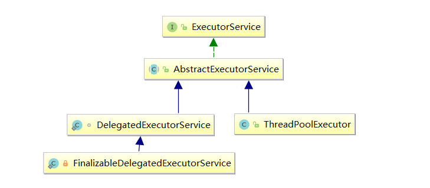

# 08-线程池使用与原理

[返回 JUC 导航](00-目录.md)

## 线程池

### 基本概述

线程池：一个容纳多个线程的容器，容器中的线程可以重复使用，省去了频繁创建和销毁线程对象的操作

线程池作用：

1. 降低资源消耗，减少了创建和销毁线程的次数，每个工作线程都可以被重复利用，可执行多个任务
2. 提高响应速度，当任务到达时，如果有线程可以直接用，不会出现系统僵死
3. 提高线程的可管理性，如果无限制的创建线程，不仅会消耗系统资源，还会降低系统的稳定性，使用线程池可以进行统一的分配，调优和监控

线程池的核心思想：**线程复用**，同一个线程可以被重复使用，来处理多个任务

池化技术 (Pool) ：一种编程技巧，核心思想是资源复用，在请求量大时能优化应用性能，降低系统频繁建连的资源开销


***


### 操作Pool

#### 创建方式

##### Executor

存放线程的容器：

```java
private final HashSet<Worker> workers = new HashSet<Worker>();
```

构造方法：

```java
public ThreadPoolExecutor(int corePoolSize,
                          int maximumPoolSize,
                          long keepAliveTime,
                          TimeUnit unit,
                          BlockingQueue<Runnable> workQueue,
                          ThreadFactory threadFactory,
                          RejectedExecutionHandler handler)
```

参数介绍：

* corePoolSize：核心线程数，定义了最小可以同时运行的线程数量

* maximumPoolSize：最大线程数，当队列中存放的任务达到队列容量时，当前可以同时运行的数量变为最大线程数，创建线程并立即执行最新的任务，与核心线程数之间的差值又叫救急线程数

* keepAliveTime：救急线程最大存活时间，当线程池中的线程数量大于 `corePoolSize` 的时候，如果这时没有新的任务提交，核心线程外的线程不会立即销毁，而是会等到 `keepAliveTime` 时间超过销毁

* unit：`keepAliveTime` 参数的时间单位

* workQueue：阻塞队列，存放被提交但尚未被执行的任务

* threadFactory：线程工厂，创建新线程时用到，可以为线程创建时起名字

* handler：拒绝策略，线程到达最大线程数仍有新任务时会执行拒绝策略

  RejectedExecutionHandler 下有 4 个实现类：

  * AbortPolicy：让调用者抛出 RejectedExecutionException 异常，**默认策略**
  * CallerRunsPolicy：让调用者运行的调节机制，将某些任务回退到调用者，从而降低新任务的流量
  * DiscardPolicy：直接丢弃任务，不予任何处理也不抛出异常
  * DiscardOldestPolicy：放弃队列中最早的任务，把当前任务加入队列中尝试再次提交当前任务

  补充：其他框架拒绝策略

  * Dubbo：在抛出 RejectedExecutionException 异常前记录日志，并 dump 线程栈信息，方便定位问题
  * Netty：创建一个新线程来执行任务
  * ActiveMQ：带超时等待（60s）尝试放入队列
  * PinPoint：它使用了一个拒绝策略链，会逐一尝试策略链中每种拒绝策略

工作原理：


1. 创建线程池，这时没有创建线程（**懒惰**），等待提交过来的任务请求，调用 execute 方法才会创建线程

2. 当调用 execute() 方法添加一个请求任务时，线程池会做如下判断：
   * 如果正在运行的线程数量小于 corePoolSize，那么马上创建线程运行这个任务
   * 如果正在运行的线程数量大于或等于 corePoolSize，那么将这个任务放入队列
   * 如果这时队列满了且正在运行的线程数量还小于 maximumPoolSize，那么会创建非核心线程**立刻运行这个任务**，对于阻塞队列中的任务不公平。这是因为创建每个 Worker（线程）对象会绑定一个初始任务，启动 Worker 时会优先执行
   * 如果队列满了且正在运行的线程数量大于或等于 maximumPoolSize，那么线程池会启动饱和**拒绝策略**来执行
3. 当一个线程完成任务时，会从队列中取下一个任务来执行

4. 当一个线程空闲超过一定的时间（keepAliveTime）时，线程池会判断：如果当前运行的线程数大于 corePoolSize，那么这个线程就被停掉，所以线程池的所有任务完成后最终会收缩到 corePoolSize 大小


图片来源：https://space.bilibili.com/457326371/


***


##### Executors

Executors 提供了四种线程池的创建：newCachedThreadPool、newFixedThreadPool、newSingleThreadExecutor、newScheduledThreadPool

* newFixedThreadPool：创建一个拥有 n 个线程的线程池

  ```java
  public static ExecutorService newFixedThreadPool(int nThreads) {
      return new ThreadPoolExecutor(nThreads, nThreads, 0L, TimeUnit.MILLISECONDS,
                                    new LinkedBlockingQueue<Runnable>());
  }
  ```

  * 核心线程数 == 最大线程数（没有救急线程被创建），因此也无需超时时间
  * LinkedBlockingQueue 是一个单向链表实现的阻塞队列，默认大小为 `Integer.MAX_VALUE`，也就是无界队列，可以放任意数量的任务，在任务比较多的时候会导致 OOM（内存溢出）
  * 适用于任务量已知，相对耗时的长期任务

* newCachedThreadPool：创建一个可扩容的线程池

  ```java
  public static ExecutorService newCachedThreadPool() {
      return new ThreadPoolExecutor(0, Integer.MAX_VALUE, 60L, TimeUnit.SECONDS,
                                    new SynchronousQueue<Runnable>());
  }
  ```

  * 核心线程数是 0， 最大线程数是 29 个 1，全部都是救急线程（60s 后可以回收），可能会创建大量线程，从而导致 **OOM**
  * SynchronousQueue 作为阻塞队列，没有容量，对于每一个 take 的线程会阻塞直到有一个 put 的线程放入元素为止（类似一手交钱、一手交货）

  * 适合任务数比较密集，但每个任务执行时间较短的情况

* newSingleThreadExecutor：创建一个只有 1 个线程的单线程池

  ```java
  public static ExecutorService newSingleThreadExecutor() {
      return new FinalizableDelegatedExecutorService
          (new ThreadPoolExecutor(1, 1,0L, TimeUnit.MILLISECONDS,
                                  new LinkedBlockingQueue<Runnable>()));
  }
  ```

  * 保证所有任务按照**指定顺序执行**，线程数固定为 1，任务数多于 1 时会放入无界队列排队，任务执行完毕，这唯一的线程也不会被释放


对比：

* 创建一个单线程串行执行任务，如果任务执行失败而终止那么没有任何补救措施，线程池会新建一个线程，保证池的正常工作

* Executors.newSingleThreadExecutor() 线程个数始终为 1，不能修改。FinalizableDelegatedExecutorService 应用的是装饰器模式，只对外暴露了 ExecutorService 接口，因此不能调用 ThreadPoolExecutor 中特有的方法

  原因：父类不能直接调用子类中的方法，需要反射或者创建对象的方式，可以调用子类静态方法

* Executors.newFixedThreadPool(1) 初始时为 1，可以修改。对外暴露的是 ThreadPoolExecutor 对象，可以强转后调用 setCorePoolSize 等方法进行修改




***


##### 开发要求

阿里巴巴 Java 开发手册要求：

- **线程资源必须通过线程池提供，不允许在应用中自行显式创建线程**

  - 使用线程池的好处是减少在创建和销毁线程上所消耗的时间以及系统资源的开销，解决资源不足的问题
  - 如果不使用线程池，有可能造成系统创建大量同类线程而导致消耗完内存或者过度切换的问题

- 线程池不允许使用 Executors 去创建，而是通过 ThreadPoolExecutor 的方式，这样的处理方式更加明确线程池的运行规则，规避资源耗尽的风险

  Executors 返回的线程池对象弊端如下：

  - FixedThreadPool 和 SingleThreadPool：请求队列长度为 Integer.MAX_VALUE，可能会堆积大量的请求，从而导致 OOM
  - CacheThreadPool 和 ScheduledThreadPool：允许创建线程数量为 Integer.MAX_VALUE，可能会创建大量的线程，导致 OOM

创建多大容量的线程池合适？

* 一般来说池中**总线程数是核心池线程数量两倍**，确保当核心池有线程停止时，核心池外有线程进入核心池

* 过小会导致程序不能充分地利用系统资源、容易导致饥饿

* 过大会导致更多的线程上下文切换，占用更多内存
  
  上下文切换：当前任务在执行完 CPU 时间片切换到另一个任务之前会先保存自己的状态，以便下次再切换回这个任务时，可以再加载这个任务的状态，任务从保存到再加载的过程就是一次上下文切换

核心线程数常用公式：

- **CPU 密集型任务 (N+1)：** 这种任务消耗的是 CPU 资源，可以将核心线程数设置为 N (CPU 核心数) + 1，比 CPU 核心数多出来的一个线程是为了防止线程发生缺页中断，或者其它原因导致的任务暂停而带来的影响。一旦任务暂停，CPU 某个核心就会处于空闲状态，而在这种情况下多出来的一个线程就可以充分利用 CPU 的空闲时间

  CPU 密集型简单理解就是利用 CPU 计算能力的任务比如在内存中对大量数据进行分析

- **I/O 密集型任务：** 这种系统 CPU 处于阻塞状态，用大部分的时间来处理 I/O 交互，而线程在处理 I/O 的时间段内不会占用 CPU 来处理，这时就可以将 CPU 交出给其它线程使用，因此在 I/O 密集型任务的应用中，我们可以多配置一些线程，具体的计算方法是 2N 或 CPU 核数/ (1-阻塞系数)，阻塞系数在 0.8~0.9 之间

  IO 密集型就是涉及到网络读取，文件读取此类任务 ，特点是 CPU 计算耗费时间相比于等待 IO 操作完成的时间来说很少，大部分时间都花在了等待 IO 操作完成上


***


#### 提交方法

ExecutorService 类 API：

| 方法                                                         | 说明                                                         |
| ------------------------------------------------------------ | ------------------------------------------------------------ |
| void execute(Runnable command)                               | 执行任务（Executor 类 API）                                  |
| Future<?> submit(Runnable task)                              | 提交任务 task()                                              |
| Future submit(Callable<T> task)                              | 提交任务 task，用返回值 Future 获得任务执行结果              |
| List<Future<T>> invokeAll(Collection<? extends Callable<T>> tasks) | 提交 tasks 中所有任务                                        |
| List<Future<T>> invokeAll(Collection<? extends Callable<T>> tasks, long timeout, TimeUnit unit) | 提交 tasks 中所有任务，超时时间针对所有task，超时会取消没有执行完的任务，并抛出超时异常 |
| T invokeAny(Collection<? extends Callable<T>> tasks)         | 提交 tasks 中所有任务，哪个任务先成功执行完毕，返回此任务执行结果，其它任务取消 |

execute 和 submit 都属于线程池的方法，对比：

* execute 只能执行 Runnable 类型的任务，没有返回值； submit 既能提交 Runnable 类型任务也能提交 Callable 类型任务，底层是**封装成 FutureTask，然后调用 execute 执行**

* execute 会直接抛出任务执行时的异常，submit 会吞掉异常，可通过 Future 的 get 方法将任务执行时的异常重新抛出


***


#### 关闭方法

ExecutorService 类 API：

| 方法                                                  | 说明                                                         |
| ----------------------------------------------------- | ------------------------------------------------------------ |
| void shutdown()                                       | 线程池状态变为 SHUTDOWN，等待任务执行完后关闭线程池，不会接收新任务，但已提交任务会执行完，而且也可以添加线程（不绑定任务） |
| List<Runnable> shutdownNow()                          | 线程池状态变为 STOP，用 interrupt 中断正在执行的任务，直接关闭线程池，不会接收新任务，会将队列中的任务返回 |
| boolean isShutdown()                                  | 不在 RUNNING 状态的线程池，此执行者已被关闭，方法返回 true   |
| boolean isTerminated()                                | 线程池状态是否是 TERMINATED，如果所有任务在关闭后完成，返回 true |
| boolean awaitTermination(long timeout, TimeUnit unit) | 调用 shutdown 后，由于调用线程不会等待所有任务运行结束，如果它想在线程池 TERMINATED 后做些事情，可以利用此方法等待 |


***


#### 处理异常

execute 会直接抛出任务执行时的异常，submit 会吞掉异常，有两种处理方法

方法 1：主动捉异常

```java
ExecutorService executorService = Executors.newFixedThreadPool(1);
pool.submit(() -> {
    try {
        System.out.println("task1");
        int i = 1 / 0;
    } catch (Exception e) {
        e.printStackTrace();
    }
});
```

方法 2：使用 Future 对象

```java
ExecutorService executorService = Executors.newFixedThreadPool(1);
Future<?> future = pool.submit(() -> {
    System.out.println("task1");
    int i = 1 / 0;
    return true;
});
System.out.println(future.get());
```


***


### 工作原理

#### 状态信息

ThreadPoolExecutor 使用 int 的**高 3 位来表示线程池状态，低 29 位表示线程数量**。这些信息存储在一个原子变量 ctl 中，目的是将线程池状态与线程个数合二为一，这样就可以用一次 CAS 原子操作进行赋值

* 状态表示：

  ```java
  // 高3位：表示当前线程池运行状态，除去高3位之后的低位：表示当前线程池中所拥有的线程数量
  private final AtomicInteger ctl = new AtomicInteger(ctlOf(RUNNING, 0));
  // 表示在 ctl 中，低 COUNT_BITS 位，是用于存放当前线程数量的位
  private static final int COUNT_BITS = Integer.SIZE - 3;
  // 低 COUNT_BITS 位所能表达的最大数值，000 11111111111111111111 => 5亿多
  private static final int CAPACITY   = (1 << COUNT_BITS) - 1;
  ```

  

* 四种状态：

  ```java
  // 111 000000000000000000，转换成整数后其实就是一个【负数】
  private static final int RUNNING    = -1 << COUNT_BITS;
  // 000 000000000000000000
  private static final int SHUTDOWN   =  0 << COUNT_BITS;
  // 001 000000000000000000
  private static final int STOP       =  1 << COUNT_BITS;
  // 010 000000000000000000
  private static final int TIDYING    =  2 << COUNT_BITS;
  // 011 000000000000000000
  private static final int TERMINATED =  3 << COUNT_BITS;
  ```

  | 状态       | 高3位 | 接收新任务 | 处理阻塞任务队列 | 说明                                      |
  | ---------- | ----- | ---------- | ---------------- | ----------------------------------------- |
  | RUNNING    | 111   | Y          | Y                |                                           |
  | SHUTDOWN   | 000   | N          | Y                | 不接收新任务，但处理阻塞队列剩余任务      |
  | STOP       | 001   | N          | N                | 中断正在执行的任务，并抛弃阻塞队列任务    |
  | TIDYING    | 010   | -          | -                | 任务全执行完毕，活动线程为 0 即将进入终结 |
  | TERMINATED | 011   | -          | -                | 终止状态                                  |

* 获取当前线程池运行状态：

  ```java
  // ~CAPACITY = ~000 11111111111111111111 = 111 000000000000000000000（取反）
  // c == ctl = 111 000000000000000000111
  // 111 000000000000000000111
  // 111 000000000000000000000
  // 111 000000000000000000000	获取到了运行状态
  private static int runStateOf(int c)     { return c & ~CAPACITY; }
  ```

* 获取当前线程池线程数量：

  ```java
  //        c = 111 000000000000000000111
  // CAPACITY = 000 111111111111111111111
  //            000 000000000000000000111 => 7
  private static int workerCountOf(int c)  { return c & CAPACITY; }
  ```

* 重置当前线程池状态 ctl：

  ```java
  // rs 表示线程池状态，wc 表示当前线程池中 worker（线程）数量，相与以后就是合并后的状态
  private static int ctlOf(int rs, int wc) { return rs | wc; }
  ```

* 比较当前线程池 ctl 所表示的状态：

  ```java
  // 比较当前线程池 ctl 所表示的状态，是否小于某个状态 s
  // 状态对比：RUNNING < SHUTDOWN < STOP < TIDYING < TERMINATED
  private static boolean runStateLessThan(int c, int s) { return c < s; }
  // 比较当前线程池 ctl 所表示的状态，是否大于等于某个状态s
  private static boolean runStateAtLeast(int c, int s) { return c >= s; }
  // 小于 SHUTDOWN 的一定是 RUNNING，SHUTDOWN == 0
  private static boolean isRunning(int c) { return c < SHUTDOWN; }
  ```

* 设置线程池 ctl：

  ```java
  // 使用 CAS 方式 让 ctl 值 +1 ，成功返回 true, 失败返回 false
  private boolean compareAndIncrementWorkerCount(int expect) {
      return ctl.compareAndSet(expect, expect + 1);
  }
  // 使用 CAS 方式 让 ctl 值 -1 ，成功返回 true, 失败返回 false
  private boolean compareAndDecrementWorkerCount(int expect) {
      return ctl.compareAndSet(expect, expect - 1);
  }
  // 将 ctl 值减一，do while 循环会一直重试，直到成功为止
  private void decrementWorkerCount() {
      do {} while (!compareAndDecrementWorkerCount(ctl.get()));
  }
  ```


****


#### 成员属性

成员变量

* **线程池中存放 Worker 的容器**：线程池没有初始化，直接往池中加线程即可

  ```java
  private final HashSet<Worker> workers = new HashSet<Worker>();
  ```

* 线程全局锁：

  ```java
  // 增加减少 worker 或者时修改线程池运行状态需要持有 mainLock
  private final ReentrantLock mainLock = new ReentrantLock();
  ```

* 可重入锁的条件变量：

  ```java
  // 当外部线程调用 awaitTermination() 方法时，会等待当前线程池状态为 Termination 为止
  private final Condition termination = mainLock.newCondition()
  ```

* 线程池相关参数：

  ```java
  private volatile int corePoolSize;				// 核心线程数量
  private volatile int maximumPoolSize;			// 线程池最大线程数量
  private volatile long keepAliveTime;			// 空闲线程存活时间
  private volatile ThreadFactory threadFactory;	// 创建线程时使用的线程工厂，默认是 DefaultThreadFactory
  private final BlockingQueue<Runnable> workQueue;// 【超过核心线程提交任务就放入 阻塞队列】
  ```

  ```java
  private volatile RejectedExecutionHandler handler;	// 拒绝策略，juc包提供了4中方式
  private static final RejectedExecutionHandler defaultHandler = new AbortPolicy();// 默认策略
  ```

* 记录线程池相关属性的数值：

  ```java
  private int largestPoolSize;		// 记录线程池生命周期内线程数最大值
  private long completedTaskCount;	// 记录线程池所完成任务总数，当某个 worker 退出时将完成的任务累加到该属性
  ```

* 控制**核心线程数量内的线程是否可以被回收**：

  ```java
  // false（默认）代表不可以，为 true 时核心线程空闲超过 keepAliveTime 也会被回收
  // allowCoreThreadTimeOut(boolean value) 方法可以设置该值
  private volatile boolean allowCoreThreadTimeOut;
  ```

内部类：

* Worker 类：**每个 Worker 对象会绑定一个初始任务**，启动 Worker 时优先执行，这也是造成线程池不公平的原因。Worker 继承自 AQS，本身具有锁的特性，采用独占锁模式，state = 0 表示未被占用，> 0 表示被占用，< 0 表示初始状态不能被抢锁

  ```java
  private final class Worker extends AbstractQueuedSynchronizer implements Runnable {
  	final Thread thread;			// worker 内部封装的工作线程
      Runnable firstTask;				// worker 第一个执行的任务，普通的 Runnable 实现类或者是 FutureTask
      volatile long completedTasks;	// 记录当前 worker 所完成任务数量
      
      // 构造方法
      Worker(Runnable firstTask) {
          // 设置AQS独占模式为初始化中状态，这个状态不能被抢占锁
         	setState(-1);
          // firstTask不为空时，当worker启动后，内部线程会优先执行firstTask，执行完后会到queue中去获取下个任务
          this.firstTask = firstTask;
          // 使用线程工厂创建一个线程，并且【将当前worker指定为Runnable】，所以thread启动时会调用 worker.run()
          this.thread = getThreadFactory().newThread(this);
      }
      // 【不可重入锁】
      protected boolean tryAcquire(int unused) {
          if (compareAndSetState(0, 1)) {
              setExclusiveOwnerThread(Thread.currentThread());
              return true;
          }
          return false;
      }
  }
  ```
  
  ```java
  public Thread newThread(Runnable r) {
      // 将当前 worker 指定为 thread 的执行方法，线程调用 start 会调用 r.run()
      Thread t = new Thread(group, r, namePrefix + threadNumber.getAndIncrement(), 0);
      if (t.isDaemon())
          t.setDaemon(false);
      if (t.getPriority() != Thread.NORM_PRIORITY)
          t.setPriority(Thread.NORM_PRIORITY);
      return t;
  }
  ```
  
* 拒绝策略相关的内部类


***


#### 成员方法

##### 提交方法

* AbstractExecutorService#submit()：提交任务，**把 Runnable 或 Callable 任务封装成 FutureTask 执行**，可以通过方法返回的任务对象，调用 get 阻塞获取任务执行的结果或者异常，源码分析在笔记的 Future 部分

  ```java
  public Future<?> submit(Runnable task) {
      // 空指针异常
      if (task == null) throw new NullPointerException();
      // 把 Runnable 封装成未来任务对象，执行结果就是 null，也可以通过参数指定 FutureTask#get 返回数据
      RunnableFuture<Void> ftask = newTaskFor(task, null);
      // 执行方法
      execute(ftask);
      return ftask;
  }
  public <T> Future<T> submit(Callable<T> task) {
      if (task == null) throw new NullPointerException();
      // 把 Callable 封装成未来任务对象
      RunnableFuture<T> ftask = newTaskFor(task);
      // 执行方法
      execute(ftask);	
      // 返回未来任务对象，用来获取返回值
      return ftask;
  }
  ```

  ```java
  protected <T> RunnableFuture<T> newTaskFor(Runnable runnable, T value) {
      // Runnable 封装成 FutureTask，【指定返回值】
      return new FutureTask<T>(runnable, value);
  }
  protected <T> RunnableFuture<T> newTaskFor(Callable<T> callable) {
      // Callable 直接封装成 FutureTask
      return new FutureTask<T>(callable);
  }
  ```

* execute()：执行任务，**但是没有返回值，没办法获取任务执行结果**，出现异常会直接抛出任务执行时的异常。根据线程池中的线程数，选择添加任务时的处理方式

  ```java
  // command 可以是普通的 Runnable 实现类，也可以是 FutureTask，不能是 Callable
  public void execute(Runnable command) {
      // 非空判断
      if (command == null)
          throw new NullPointerException();
    	// 获取 ctl 最新值赋值给 c，ctl 高 3 位表示线程池状态，低位表示当前线程池线程数量。
      int c = ctl.get();
      // 【1】当前线程数量小于核心线程数，此次提交任务直接创建一个新的 worker，线程池中多了一个新的线程
      if (workerCountOf(c) < corePoolSize) {
          // addWorker 为创建线程的过程，会创建 worker 对象并且将 command 作为 firstTask，优先执行
          if (addWorker(command, true))
              return;
          
          // 执行到这条语句，说明 addWorker 一定是失败的，存在并发现象或者线程池状态被改变，重新获取状态
          // SHUTDOWN 状态下也有可能创建成功，前提 firstTask == null 而且当前 queue 不为空（特殊情况）
          c = ctl.get();
      }
      // 【2】执行到这说明当前线程数量已经达到核心线程数量 或者 addWorker 失败
      // 	判断当前线程池是否处于running状态，成立就尝试将 task 放入到 workQueue 中
      if (isRunning(c) && workQueue.offer(command)) {
          int recheck = ctl.get();
          // 条件一成立说明线程池状态被外部线程给修改了，可能是执行了 shutdown() 方法，该状态不能接收新提交的任务
          // 所以要把刚提交的任务删除，删除成功说明提交之后线程池中的线程还未消费（处理）该任务
          if (!isRunning(recheck) && remove(command))
              // 任务出队成功，走拒绝策略
              reject(command);
          // 执行到这说明线程池是 running 状态，获取线程池中的线程数量，判断是否是 0
          // 【担保机制】，保证线程池在 running 状态下，最起码得有一个线程在工作
          else if (workerCountOf(recheck) == 0)
              addWorker(null, false);
      }
      // 【3】offer失败说明queue满了
      // 如果线程数量尚未达到 maximumPoolSize，会创建非核心 worker 线程直接执行 command，【这也是不公平的原因】
      // 如果当前线程数量达到 maximumPoolSiz，这里 addWorker 也会失败，走拒绝策略
      else if (!addWorker(command, false))
          reject(command);
  }
  ```


***


##### 添加线程

* prestartAllCoreThreads()：**提前预热**，创建所有的核心线程

  ```java
  public int prestartAllCoreThreads() {
      int n = 0;
      while (addWorker(null, true))
          ++n;
      return n;
  }
  ```

* addWorker()：**添加线程到线程池**，返回 true 表示创建 Worker 成功，且线程启动。首先判断线程池是否允许添加线程，允许就让线程数量 + 1，然后去创建 Worker 加入线程池

  注意：SHUTDOWN 状态也能添加线程，但是要求新加的 Woker 没有 firstTask，而且当前 queue 不为空，所以创建一个线程来帮助线程池执行队列中的任务

  ```java
  // core == true 表示采用核心线程数量限制，false 表示采用 maximumPoolSize
  private boolean addWorker(Runnable firstTask, boolean core) {
      // 自旋【判断当前线程池状态是否允许创建线程】，允许就设置线程数量 + 1
      retry:
      for (;;) {
          // 获取 ctl 的值
          int c = ctl.get();
          // 获取当前线程池运行状态
          int rs = runStateOf(c);	
          
          // 判断当前线程池状态【是否允许添加线程】
          
          // 当前线程池是 SHUTDOWN 状态，但是队列里面还有任务尚未处理完，需要处理完 queue 中的任务
          // 【不允许再提交新的 task，所以 firstTask 为空，但是可以继续添加 worker】
          if (rs >= SHUTDOWN && !(rs == SHUTDOWN && firstTask == null && !workQueue.isEmpty()))
              return false;
          for (;;) {
              // 获取线程池中线程数量
              int wc = workerCountOf(c);
              // 条件一一般不成立，CAPACITY是5亿多，根据 core 判断使用哪个大小限制线程数量，超过了返回 false
              if (wc >= CAPACITY || wc >= (core ? corePoolSize : maximumPoolSize))
                  return false;
              // 记录线程数量已经加 1，类比于申请到了一块令牌，条件失败说明其他线程修改了数量
              if (compareAndIncrementWorkerCount(c))
                  // 申请成功，跳出了 retry 这个 for 自旋
                  break retry;
              // CAS 失败，没有成功的申请到令牌
              c = ctl.get();
              // 判断当前线程池状态是否发生过变化，被其他线程修改了，可能其他线程调用了 shutdown() 方法
              if (runStateOf(c) != rs)
                  // 返回外层循环检查是否能创建线程，在 if 语句中返回 false
                  continue retry;
             
          }
      }
      
      //【令牌申请成功，开始创建线程】
      
  	// 运行标记，表示创建的 worker 是否已经启动，false未启动  true启动
      boolean workerStarted = false;
      // 添加标记，表示创建的 worker 是否添加到池子中了，默认false未添加，true是添加。
      boolean workerAdded = false;
      Worker w = null;
      try {
          // 【创建 Worker，底层通过线程工厂 newThread 方法创建执行线程，指定了首先执行的任务】
          w = new Worker(firstTask);
          // 将新创建的 worker 节点中的线程赋值给 t
          final Thread t = w.thread;
          // 这里的判断为了防止 程序员自定义的 ThreadFactory 实现类有 bug，创造不出线程
          if (t != null) {
              final ReentrantLock mainLock = this.mainLock;
              // 加互斥锁，要添加 worker 了
              mainLock.lock();
              try {
                  // 获取最新线程池运行状态保存到 rs
                  int rs = runStateOf(ctl.get());
  				// 判断线程池是否为RUNNING状态，不是再【判断当前是否为SHUTDOWN状态且firstTask为空，特殊情况】
                  if (rs < SHUTDOWN || (rs == SHUTDOWN && firstTask == null)) {
                      // 当线程start后，线程isAlive会返回true，这里还没开始启动线程，如果被启动了就需要报错
                      if (t.isAlive())
                          throw new IllegalThreadStateException();
                      
                      //【将新建的 Worker 添加到线程池中】
                      workers.add(w);
                      int s = workers.size();
  					// 当前池中的线程数量是一个新高，更新 largestPoolSize
                      if (s > largestPoolSize)
                          largestPoolSize = s;
                      // 添加标记置为 true
                      workerAdded = true;
                  }
              } finally {
                  // 解锁啊
                  mainLock.unlock();
              }
              // 添加成功就【启动线程执行任务】
              if (workerAdded) {
                  // Thread 类中持有 Runnable 任务对象，调用的是 Runnable 的 run ，也就是 FutureTask
                  t.start();
                  // 运行标记置为 true
                  workerStarted = true;
              }
          }
      } finally {
          // 如果启动线程失败，做清理工作
          if (! workerStarted)
              addWorkerFailed(w);
      }
      // 返回新创建的线程是否启动
      return workerStarted;
  }
  ```

* addWorkerFailed()：清理任务

  ```java
  private void addWorkerFailed(Worker w) {
      final ReentrantLock mainLock = this.mainLock;
      // 持有线程池全局锁，因为操作的是线程池相关的东西
      mainLock.lock();
      try {
          //条件成立需要将 worker 在 workers 中清理出去。
          if (w != null)
              workers.remove(w);
          // 将线程池计数 -1，相当于归还令牌。
          decrementWorkerCount();
          // 尝试停止线程池
          tryTerminate();
      } finally {
          //释放线程池全局锁。
          mainLock.unlock();
      }
  }
  ```


****


##### 运行方法

* Worker#run：Worker 实现了 Runnable 接口，当线程启动时，会调用 Worker 的 run() 方法

  ```java
  public void run() {
      // ThreadPoolExecutor#runWorker()
      runWorker(this);
  }
  ```

* runWorker()：线程启动就要**执行任务**，会一直 while 循环获取任务并执行

  ```java
  final void runWorker(Worker w) {
      Thread wt = Thread.currentThread();	
      // 获取 worker 的 firstTask
      Runnable task = w.firstTask;
      // 引用置空，【防止复用该线程时重复执行该任务】
      w.firstTask = null;
      // 初始化 worker 时设置 state = -1，表示不允许抢占锁
      // 这里需要设置 state = 0 和 exclusiveOwnerThread = null，开始独占模式抢锁
      w.unlock();
      // true 表示发生异常退出，false 表示正常退出。
      boolean completedAbruptly = true;
      try {
          // firstTask 不是 null 就直接运行，否则去 queue 中获取任务
          // 【getTask 如果是阻塞获取任务，会一直阻塞在take方法，直到获取任务，不会走返回null的逻辑】
          while (task != null || (task = getTask()) != null) {
              // worker 加锁，shutdown 时会判断当前 worker 状态，【根据独占锁状态判断是否空闲】
              w.lock();
              
  			// 说明线程池状态大于 STOP，目前处于 STOP/TIDYING/TERMINATION，此时给线程一个中断信号
              if ((runStateAtLeast(ctl.get(), STOP) ||
                   // 说明线程处于 RUNNING 或者 SHUTDOWN 状态，清除打断标记
                   (Thread.interrupted() && runStateAtLeast(ctl.get(), STOP))) && !wt.isInterrupted())
                  // 中断线程，设置线程的中断标志位为 true
                  wt.interrupt();
              try {
                  // 钩子方法，【任务执行的前置处理】
                  beforeExecute(wt, task);
                  Throwable thrown = null;
                  try {
                      // 【执行任务】
                      task.run();
                  } catch (Exception x) {
                   	//.....
                  } finally {
                      // 钩子方法，【任务执行的后置处理】
                      afterExecute(task, thrown);
                  }
              } finally {
                  task = null;		// 将局部变量task置为null，代表任务执行完成
                  w.completedTasks++;	// 更新worker完成任务数量
                  w.unlock();			// 解锁
              }
          }
          // getTask()方法返回null时会走到这里，表示queue为空并且线程空闲超过保活时间，【当前线程执行退出逻辑】
          completedAbruptly = false;	
      } finally {
          // 正常退出 completedAbruptly = false
         	// 异常退出 completedAbruptly = true，【从 task.run() 内部抛出异常】时，跳到这一行
          processWorkerExit(w, completedAbruptly);
      }
  }
  ```

* unlock()：重置锁

  ```java
  public void unlock() { release(1); }
  // 外部不会直接调用这个方法 这个方法是 AQS 内调用的，外部调用 unlock 时触发此方法
  protected boolean tryRelease(int unused) {
      setExclusiveOwnerThread(null);		// 设置持有者为 null
      setState(0);						// 设置 state = 0
      return true;
  }
  ```

* getTask()：获取任务，线程空闲时间超过 keepAliveTime 就会被回收，判断的依据是**当前线程阻塞获取任务超过保活时间**，方法返回 null 就代表当前线程要被回收了，返回到 runWorker 执行线程退出逻辑。线程池具有担保机制，对于 RUNNING 状态下的超时回收，要保证线程池中最少有一个线程运行，或者任务阻塞队列已经是空

  ```java
  private Runnable getTask() {
      // 超时标记，表示当前线程获取任务是否超时，true 表示已超时
      boolean timedOut = false; 
      for (;;) {
          int c = ctl.get();
          // 获取线程池当前运行状态
          int rs = runStateOf(c);
  		
          // 【tryTerminate】打断线程后执行到这，此时线程池状态为STOP或者线程池状态为SHUTDOWN并且队列已经是空
          // 所以下面的 if 条件一定是成立的，可以直接返回 null，线程就应该退出了
          if (rs >= SHUTDOWN && (rs >= STOP || workQueue.isEmpty())) {
              // 使用 CAS 自旋的方式让 ctl 值 -1
              decrementWorkerCount();
              return null;
          }
          
  		// 获取线程池中的线程数量
          int wc = workerCountOf(c);
  
          // 线程没有明确的区分谁是核心或者非核心线程，是根据当前池中的线程数量判断
          
          // timed = false 表示当前这个线程 获取task时不支持超时机制的，当前线程会使用 queue.take() 阻塞获取
          // timed = true 表示当前这个线程 获取task时支持超时机制，使用 queue.poll(xxx,xxx) 超时获取
          // 条件一代表允许回收核心线程，那就无所谓了，全部线程都执行超时回收
          // 条件二成立说明线程数量大于核心线程数，当前线程认为是非核心线程，有保活时间，去超时获取任务
          boolean timed = allowCoreThreadTimeOut || wc > corePoolSize;
          
  		// 如果线程数量是否超过最大线程数，直接回收
          // 如果当前线程【允许超时回收并且已经超时了】，就应该被回收了，由于【担保机制】还要做判断：
          // 	  wc > 1 说明线程池还用其他线程，当前线程可以直接回收
          //    workQueue.isEmpty() 前置条件是 wc = 1，【如果当前任务队列也是空了，最后一个线程就可以退出】
          if ((wc > maximumPoolSize || (timed && timedOut)) && (wc > 1 || workQueue.isEmpty())) {
              // 使用 CAS 机制将 ctl 值 -1 ,减 1 成功的线程，返回 null，代表可以退出
              if (compareAndDecrementWorkerCount(c))
                  return null;
              continue;
          }
  
          try {
              // 根据当前线程是否需要超时回收，【选择从队列获取任务的方法】是超时获取或者阻塞获取
              Runnable r = timed ?
                  workQueue.poll(keepAliveTime, TimeUnit.NANOSECONDS) : workQueue.take();
              // 获取到任务返回任务，【阻塞获取会阻塞到获取任务为止】，不会返回 null
              if (r != null)
                  return r;
              // 获取任务为 null 说明超时了，将超时标记设置为 true，下次自旋时返 null
              timedOut = true;
          } catch (InterruptedException retry) {
              // 阻塞线程被打断后超时标记置为 false，【说明被打断不算超时】，要继续获取，直到超时或者获取到任务
              // 如果线程池 SHUTDOWN 状态下的打断，会在循环获取任务前判断，返回 null
              timedOut = false;
          }
      }
  }
  ```
  
* processWorkerExit()：**线程退出线程池**，也有担保机制，保证队列中的任务被执行

  ```java
  // 正常退出 completedAbruptly = false，异常退出为 true
  private void processWorkerExit(Worker w, boolean completedAbruptly) {
      // 条件成立代表当前 worker 是发生异常退出的，task 任务执行过程中向上抛出异常了
      if (completedAbruptly) 
          // 从异常时到这里 ctl 一直没有 -1，需要在这里 -1
          decrementWorkerCount();
  
      final ReentrantLock mainLock = this.mainLock;
      // 加锁
      mainLock.lock();
      try {
          // 将当前 worker 完成的 task 数量，汇总到线程池的 completedTaskCount
          completedTaskCount += w.completedTasks;
  		// 将 worker 从线程池中移除
          workers.remove(w);
      } finally {
          mainLock.unlock();	// 解锁
      }
  	// 尝试停止线程池，唤醒下一个线程
      tryTerminate();
  
      int c = ctl.get();
      // 线程池不是停止状态就应该有线程运行【担保机制】
      if (runStateLessThan(c, STOP)) {
          // 正常退出的逻辑，是对空闲线程回收，不是执行出错
          if (!completedAbruptly) {
              // 根据是否回收核心线程确定【线程池中的线程数量最小值】
              int min = allowCoreThreadTimeOut ? 0 : corePoolSize;
              // 最小值为 0，但是线程队列不为空，需要一个线程来完成任务担保机制
              if (min == 0 && !workQueue.isEmpty())
                  min = 1;
              // 线程池中的线程数量大于最小值可以直接返回
              if (workerCountOf(c) >= min)
                  return;
          }
          // 执行 task 时发生异常，有个线程因为异常终止了，需要添加
          // 或者线程池中的数量小于最小值，这里要创建一个新 worker 加进线程池
          addWorker(null, false);
      }
  }
  ```
  
  

****


##### 停止方法

* shutdown()：停止线程池

  ```java
  public void shutdown() {
      final ReentrantLock mainLock = this.mainLock;
      // 获取线程池全局锁
      mainLock.lock();
      try {
          checkShutdownAccess();
          // 设置线程池状态为 SHUTDOWN，如果线程池状态大于 SHUTDOWN，就不会设置直接返回
          advanceRunState(SHUTDOWN);
          // 中断空闲线程
          interruptIdleWorkers();
          // 空方法，子类可以扩展
          onShutdown(); 
      } finally {
          // 释放线程池全局锁
          mainLock.unlock();
      }
      tryTerminate();
  }
  ```

* interruptIdleWorkers()：shutdown 方法会**中断所有空闲线程**，根据是否可以获取 AQS 独占锁判断是否处于工作状态。线程之所以空闲是因为阻塞队列没有任务，不会中断正在运行的线程，所以 shutdown 方法会让所有的任务执行完毕

  ```java
  // onlyOne == true 说明只中断一个线程 ，false 则中断所有线程
  private void interruptIdleWorkers(boolean onlyOne) {
      final ReentrantLock mainLock = this.mainLock;
      / /持有全局锁
      mainLock.lock();
      try {
          // 遍历所有 worker
          for (Worker w : workers) {
              // 获取当前 worker 的线程
              Thread t = w.thread;
              // 条件一成立：说明当前迭代的这个线程尚未中断
              // 条件二成立：说明【当前worker处于空闲状态】，阻塞在poll或者take，因为worker执行task时是要加锁的
              //           每个worker有一个独占锁，w.tryLock()尝试加锁，加锁成功返回 true
              if (!t.isInterrupted() && w.tryLock()) {
                  try {
                      // 中断线程，处于 queue 阻塞的线程会被唤醒，进入下一次自旋，返回 null，执行退出相逻辑
                      t.interrupt();
                  } catch (SecurityException ignore) {
                  } finally {
                      // 释放worker的独占锁
                      w.unlock();
                  }
              }
              // false，代表中断所有的线程
              if (onlyOne)
                  break;
          }
  
      } finally {
          // 释放全局锁
          mainLock.unlock();
      }
  }
  ```

* shutdownNow()：直接关闭线程池，不会等待任务执行完成

  ```java
  public List<Runnable> shutdownNow() {
      // 返回值引用
      List<Runnable> tasks;
      final ReentrantLock mainLock = this.mainLock;
      // 获取线程池全局锁
      mainLock.lock();
      try {
          checkShutdownAccess();
          // 设置线程池状态为STOP
          advanceRunState(STOP);
          // 中断线程池中【所有线程】
          interruptWorkers();
          // 从阻塞队列中导出未处理的task
          tasks = drainQueue();
      } finally {
          mainLock.unlock();
      }
  
      tryTerminate();
      // 返回当前任务队列中 未处理的任务。
      return tasks;
  }
  ```

* tryTerminate()：设置为 TERMINATED 状态 if either (SHUTDOWN and pool and queue empty) or (STOP and pool empty)

  ```java
  final void tryTerminate() {
      for (;;) {
          // 获取 ctl 的值
          int c = ctl.get();
          // 线程池正常，或者有其他线程执行了状态转换的方法，当前线程直接返回
          if (isRunning(c) || runStateAtLeast(c, TIDYING) ||
              // 线程池是 SHUTDOWN 并且任务队列不是空，需要去处理队列中的任务
              (runStateOf(c) == SHUTDOWN && ! workQueue.isEmpty()))
              return;
          
          // 执行到这里说明线程池状态为 STOP 或者线程池状态为 SHUTDOWN 并且队列已经是空
          // 判断线程池中线程的数量
          if (workerCountOf(c) != 0) {
              // 【中断一个空闲线程】，在 queue.take() | queue.poll() 阻塞空闲
              // 唤醒后的线程会在getTask()方法返回null，
              // 执行 processWorkerExit 退出逻辑时会再次调用 tryTerminate() 唤醒下一个空闲线程
              interruptIdleWorkers(ONLY_ONE);
              return;
          }
  		// 池中的线程数量为 0 来到这里
          final ReentrantLock mainLock = this.mainLock;
          // 加全局锁
          mainLock.lock();
          try {
              // 设置线程池状态为 TIDYING 状态，线程数量为 0
              if (ctl.compareAndSet(c, ctlOf(TIDYING, 0))) {
                  try {
                      // 结束线程池
                      terminated();
                  } finally {
                      // 设置线程池状态为TERMINATED状态。
                      ctl.set(ctlOf(TERMINATED, 0));
                      // 【唤醒所有调用 awaitTermination() 方法的线程】
                      termination.signalAll();
                  }
                  return;
              }
          } finally {
  			// 释放线程池全局锁
              mainLock.unlock();
          }
      }
  }
  ```


****


#### Future

##### 线程使用

FutureTask 未来任务对象，继承 Runnable、Future 接口，用于包装 Callable 对象，实现任务的提交

```java
public static void main(String[] args) throws ExecutionException, InterruptedException {
    FutureTask<String> task = new FutureTask<>(new Callable<String>() {
        @Override
        public String call() throws Exception {
            return "Hello World";
        }
    });
    new Thread(task).start();	//启动线程
    String msg = task.get();	//获取返回任务数据
    System.out.println(msg);
}
```

构造方法：

```java
public FutureTask(Callable<V> callable){
	this.callable = callable;	// 属性注入
    this.state = NEW; 			// 任务状态设置为 new
}
```

```java
public FutureTask(Runnable runnable, V result) {
    // 适配器模式
    this.callable = Executors.callable(runnable, result);
    this.state = NEW;       
}
public static <T> Callable<T> callable(Runnable task, T result) {
    if (task == null) throw new NullPointerException();
    // 使用装饰者模式将 runnable 转换成 callable 接口，外部线程通过 get 获取
    // 当前任务执行结果时，结果可能为 null 也可能为传进来的值，【传进来什么返回什么】
    return new RunnableAdapter<T>(task, result);
}
static final class RunnableAdapter<T> implements Callable<T> {
    final Runnable task;
    final T result;
    // 构造方法
    RunnableAdapter(Runnable task, T result) {
        this.task = task;
        this.result = result;
    }
    public T call() {
        // 实则调用 Runnable#run 方法
        task.run();
        // 返回值为构造 FutureTask 对象时传入的返回值或者是 null
        return result;
    }
}
```


***


##### 成员属性

FutureTask 类的成员属性：

* 任务状态：

  ```java
  // 表示当前task状态
  private volatile int state;
  // 当前任务尚未执行
  private static final int NEW          = 0;
  // 当前任务正在结束，尚未完全结束，一种临界状态
  private static final int COMPLETING   = 1;
  // 当前任务正常结束
  private static final int NORMAL       = 2;
  // 当前任务执行过程中发生了异常，内部封装的 callable.run() 向上抛出异常了
  private static final int EXCEPTIONAL  = 3;
  // 当前任务被取消
  private static final int CANCELLED    = 4;
  // 当前任务中断中
  private static final int INTERRUPTING = 5;
  // 当前任务已中断
  private static final int INTERRUPTED  = 6;
  ```

* 任务对象：

  ```java
  private Callable<V> callable;	// Runnable 使用装饰者模式伪装成 Callable
  ```

* **存储任务执行的结果**，这是 run 方法返回值是 void 也可以获取到执行结果的原因：

  ```java
  // 正常情况下：任务正常执行结束，outcome 保存执行结果，callable 返回值
  // 非正常情况：callable 向上抛出异常，outcome 保存异常
  private Object outcome; 
  ```

* 执行当前任务的线程对象：

  ```java
  private volatile Thread runner;	// 当前任务被线程执行期间，保存当前执行任务的线程对象引用
  ```

* **线程阻塞队列的头节点**：

  ```java
  // 会有很多线程去 get 当前任务的结果，这里使用了一种数据结构头插头取（类似栈）的一个队列来保存所有的 get 线程
  private volatile WaitNode waiters;
  ```

* 内部类：

  ```java
  static final class WaitNode {
      // 单向链表
      volatile Thread thread;
      volatile WaitNode next;
      WaitNode() { thread = Thread.currentThread(); }
  }
  ```

  


***


##### 成员方法

FutureTask 类的成员方法：

* **FutureTask#run**：任务执行入口

  ```java
  public void run() {
      //条件一：成立说明当前 task 已经被执行过了或者被 cancel 了，非 NEW 状态的任务，线程就不需要处理了
      //条件二：线程是 NEW 状态，尝试设置当前任务对象的线程是当前线程，设置失败说明其他线程抢占了该任务，直接返回
      if (state != NEW ||
          !UNSAFE.compareAndSwapObject(this, runnerOffset, null, Thread.currentThread()))
          return;
      try {
          // 执行到这里，当前 task 一定是 NEW 状态，而且【当前线程也抢占 task 成功】
          Callable<V> c = callable;
          // 判断任务是否为空，防止空指针异常；判断 state 状态，防止外部线程在此期间 cancel 掉当前任务
          // 【因为 task 的执行者已经设置为当前线程，所以这里是线程安全的】
          if (c != null && state == NEW) {
              V result;
              // true 表示 callable.run 代码块执行成功 未抛出异常
              // false 表示 callable.run 代码块执行失败 抛出异常
              boolean ran;
              try {
  				// 【调用自定义的方法，执行结果赋值给 result】
                  result = c.call();
                  // 没有出现异常
                  ran = true;
              } catch (Throwable ex) {
                  // 出现异常，返回值置空，ran 置为 false
                  result = null;
                  ran = false;
                  // 设置返回的异常
                  setException(ex);
              }
              // 代码块执行正常
              if (ran)
                  // 设置返回的结果
                  set(result);
          }
      } finally {
          // 任务执行完成，取消线程的引用，help GC
          runner = null;
          int s = state;
          // 判断任务是不是被中断
          if (s >= INTERRUPTING)
              // 执行中断处理方法
              handlePossibleCancellationInterrupt(s);
      }
  }
  ```
  
  FutureTask#set：设置正常返回值，首先将任务状态设置为 COMPLETING 状态代表完成中，逻辑执行完设置为 NORMAL 状态代表任务正常执行完成，最后唤醒 get() 阻塞线程
  
  ```java
  protected void set(V v) {
      // CAS 方式设置当前任务状态为完成中，设置失败说明其他线程取消了该任务
      if (UNSAFE.compareAndSwapInt(this, stateOffset, NEW, COMPLETING)) {
          // 【将结果赋值给 outcome】
          outcome = v;
          // 将当前任务状态修改为 NORMAL 正常结束状态。
          UNSAFE.putOrderedInt(this, stateOffset, NORMAL);
          finishCompletion();
      }
  }
  ```
  
  FutureTask#setException：设置异常返回值
  
  ```java
  protected void setException(Throwable t) {
      if (UNSAFE.compareAndSwapInt(this, stateOffset, NEW, COMPLETING)) {
          // 赋值给返回结果，用来向上层抛出来的异常
          outcome = t;
          // 将当前任务的状态 修改为 EXCEPTIONAL
          UNSAFE.putOrderedInt(this, stateOffset, EXCEPTIONAL);
          finishCompletion();
      }
  }
  ```
  
  FutureTask#finishCompletion：**唤醒 get() 阻塞线程**
  
  ```java
  private void finishCompletion() {
      // 遍历所有的等待的节点，q 指向头节点
      for (WaitNode q; (q = waiters) != null;) {
          // 使用cas设置 waiters 为 null，防止外部线程使用cancel取消当前任务，触发finishCompletion方法重复执行
          if (UNSAFE.compareAndSwapObject(this, waitersOffset, q, null)) {
              // 自旋
              for (;;) {
                  // 获取当前 WaitNode 节点封装的 thread
                  Thread t = q.thread;
                  // 当前线程不为 null，唤醒当前 get() 等待获取数据的线程
                  if (t != null) {
                      q.thread = null;
                      LockSupport.unpark(t);
                  }
                  // 获取当前节点的下一个节点
                  WaitNode next = q.next;
                  // 当前节点是最后一个节点了
                  if (next == null)
                      break;
                  // 断开链表
                  q.next = null; // help gc
                  q = next;
              }
              break;
          }
      }
      done();
      callable = null;	// help GC
  }
  ```
  
  FutureTask#handlePossibleCancellationInterrupt：任务中断处理
  
  ```java
  private void handlePossibleCancellationInterrupt(int s) {
      if (s == INTERRUPTING)
          // 中断状态中
          while (state == INTERRUPTING)
              // 等待中断完成
              Thread.yield();
  }
  ```
  
* **FutureTask#get**：获取任务执行的返回值，执行 run 和 get 的不是同一个线程，一般有多个线程 get，只有一个线程 run

  ```java
  public V get() throws InterruptedException, ExecutionException {
      // 获取当前任务状态
      int s = state;
      // 条件成立说明任务还没执行完成
      if (s <= COMPLETING)
          // 返回 task 当前状态，可能当前线程在里面已经睡了一会
          s = awaitDone(false, 0L);
      return report(s);
  }
  ```

  FutureTask#awaitDone：**get 线程封装成 WaitNode 对象进入阻塞队列阻塞等待**

  ```java
  private int awaitDone(boolean timed, long nanos) throws InterruptedException {
      // 0 不带超时
      final long deadline = timed ? System.nanoTime() + nanos : 0L;
      // 引用当前线程，封装成 WaitNode 对象
      WaitNode q = null;
      // 表示当前线程 waitNode 对象，是否进入阻塞队列
      boolean queued = false;
      // 【三次自旋开始休眠】
      for (;;) {
          // 判断当前 get() 线程是否被打断，打断返回 true，清除打断标记
          if (Thread.interrupted()) {
              // 当前线程对应的等待 node 出队，
              removeWaiter(q);
              throw new InterruptedException();
          }
  		// 获取任务状态
          int s = state;
          // 条件成立说明当前任务执行完成已经有结果了
          if (s > COMPLETING) {
              // 条件成立说明已经为当前线程创建了 WaitNode，置空 help GC
              if (q != null)
                  q.thread = null;
              // 返回当前的状态
              return s;
          }
          // 条件成立说明当前任务接近完成状态，这里让当前线程释放一下 cpu ，等待进行下一次抢占 cpu
          else if (s == COMPLETING) 
              Thread.yield();
          // 【第一次自旋】，当前线程还未创建 WaitNode 对象，此时为当前线程创建 WaitNode对象
          else if (q == null)
              q = new WaitNode();
          // 【第二次自旋】，当前线程已经创建 WaitNode 对象了，但是node对象还未入队
          else if (!queued)
              // waiters 指向队首，让当前 WaitNode 成为新的队首，【头插法】，失败说明其他线程修改了新的队首
              queued = UNSAFE.compareAndSwapObject(this, waitersOffset, q.next = waiters, q);
          // 【第三次自旋】，会到这里，或者 else 内
          else if (timed) {
              nanos = deadline - System.nanoTime();
              if (nanos <= 0L) {
                  removeWaiter(q);
                  return state;
              }
              // 阻塞指定的时间
              LockSupport.parkNanos(this, nanos);
          }
          // 条件成立：说明需要阻塞
          else
              // 【当前 get 操作的线程被 park 阻塞】，除非有其它线程将唤醒或者将当前线程中断
              LockSupport.park(this);
      }
  }
  ```
  
  FutureTask#report：封装运行结果，可以获取 run() 方法中设置的成员变量 outcome，**这是 run 方法的返回值是 void 也可以获取到任务执行的结果的原因**
  
  ```java
  private V report(int s) throws ExecutionException {
      // 获取执行结果，是在一个 futuretask 对象中的属性，可以直接获取
      Object x = outcome;
      // 当前任务状态正常结束
      if (s == NORMAL)
          return (V)x;	// 直接返回 callable 的逻辑结果
      // 当前任务被取消或者中断
      if (s >= CANCELLED)
          throw new CancellationException();		// 抛出异常
      // 执行到这里说明自定义的 callable 中的方法有异常，使用 outcome 上层抛出异常
      throw new ExecutionException((Throwable)x);	
  }
  ```
  
* FutureTask#cancel：任务取消，打断正在执行该任务的线程

  ```java
  public boolean cancel(boolean mayInterruptIfRunning) {
      // 条件一：表示当前任务处于运行中或者处于线程池任务队列中
      // 条件二：表示修改状态，成功可以去执行下面逻辑，否则返回 false 表示 cancel 失败
      if (!(state == NEW &&
            UNSAFE.compareAndSwapInt(this, stateOffset, NEW,
                                     mayInterruptIfRunning ? INTERRUPTING : CANCELLED)))
          return false;
      try {
          // 如果任务已经被执行，是否允许打断
          if (mayInterruptIfRunning) {
              try {
                  // 获取执行当前 FutureTask 的线程
                  Thread t = runner;
                  if (t != null)
                      // 打断执行的线程
                      t.interrupt();
              } finally {
                  // 设置任务状态为【中断完成】
                  UNSAFE.putOrderedInt(this, stateOffset, INTERRUPTED);
              }
          }
      } finally {
          // 唤醒所有 get() 阻塞的线程
          finishCompletion();
      }
      return true;
  }
  ```


****


