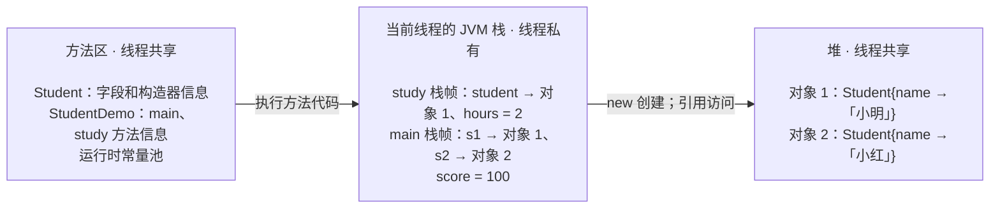

## 一、💡 一句话理解

> [!tip] 核心结论
> **堆放对象，栈管方法调用；方法区放类的信息；PC 寄存器记录执行位置；本地方法栈服务 `native` 方法。**

JVM 规范描述的是抽象结构，并不规定具体的物理内存布局。常见的“元空间、年轻代、老年代”等概念，大多属于 HotSpot 虚拟机的具体实现。

> [!info] JVM 基础阅读顺序：第 1 篇
> 建议先读本文，建立“运行中的数据放在哪里”的整体地图；再读 [[2. JVM的类加载机制]]，理解类如何被加载、链接和初始化。

## 二、🧭 理论：它是什么

### 2.1 JVM 运行时数据区全景

JVM 运行 Java 程序时，需要用不同区域保存对象、类信息和方法调用现场。按照 JVM 规范，可以先分成“线程共享”和“线程私有”两组。

> [!tip] 什么是线程共享
> **线程共享就是：同一个 JVM 进程里的多个线程，都能访问这块内存中的数据。**例如，多个线程可以持有并访问堆中同一个对象的引用。共享只表示“都能访问”，不代表并发访问天然安全；同时修改共享数据时，仍可能需要 `synchronized`、`volatile`、原子类或锁。

相对地，“线程私有”表示每个线程都有自己独立的一份数据。例如，每个线程都有自己的 JVM 栈和 PC 寄存器，其他线程不能直接使用其中的栈帧和局部变量。

```text
JVM 进程
│
├── 线程共享
│   ├── 堆 Heap
│   └── 方法区 Method Area
│       └── 运行时常量池 Runtime Constant Pool
│
└── 每个线程私有
    ├── 程序计数器 PC Register
    ├── JVM 栈
    │   └── 一个个栈帧 Frame
    └── 本地方法栈 Native Method Stack
```

先把 JVM 想成一间教室，把每个线程想成一名正在完成学习任务的学生。下面统一使用“小明做作业”的例子，具体存放内容留到后文逐个展开：

| 数据区 | 是否线程共享 | 生活类比 | 先记住什么 |
| --- | --- | --- | --- |
| PC 寄存器 | 否 | 小明记录“当前做到第几题”的进度标记 | 记录当前线程执行到哪条指令 |
| JVM 栈 | 否 | 小明书桌上按顺序叠放的作业纸 | 每调用一次方法，就在最上面放一张新作业纸 |
| 堆 | 是 | 全班共同使用的学生资料柜 | 存放真正创建出来的 `Student` 资料卡等对象和数组 |
| 方法区 | 是 | 老师保存资料卡模板和学习规则的柜子 | 存放 `Student` 类有哪些字段和方法 |
| 运行时常量池 | 是 | 模板柜里的目录和名称索引 | 帮助找到常量、类、字段和方法 |
| 本地方法栈 | 否 | 学生去实验室操作特殊设备时使用的实验台 | 支持 `native` 方法调用本地系统能力 |

在这套类比中：**线程是正在做作业的学生，方法调用是一张新作业纸，栈帧就是这张作业纸，对象是资料柜中的实际资料卡，类信息是老师规定的资料卡模板。**“线程私有”表示每名学生都有自己的答题进度和作业纸；“线程共享”表示所有学生都能使用公共资料柜和模板柜。

对应后面的 `StudentDemo`，可以先记住这个过程：

1. 开始执行 `main()`：小明桌上先放一张 `main` 作业纸；
2. 执行 `new Student("小明")`：公共资料柜里新增一张真正的 `Student` 资料卡，`main` 作业纸上的 `s1` 记着它的位置；
3. 调用 `study(s1)`：小明在 `main` 作业纸上面再放一张 `study` 作业纸；
4. `study()` 结束：拿走最上面的 `study` 作业纸，继续完成下面的 `main` 作业纸。

> [!info] 到底是五个还是六个区域
> 通常概括为五大区域：PC 寄存器、JVM 栈、堆、方法区和本地方法栈。运行时常量池从方法区分配，不必硬算成第六个完全独立的区域。

### 2.2 规范概念和 HotSpot 实现

JVM 规范定义虚拟机必须表现出什么行为，但允许不同实现自行决定内存布局、垃圾回收算法和内部优化。

因此学习时要分清两层：

| JVM 规范概念 | 常见 HotSpot 实现概念 |
| --- | --- |
| 堆 | Eden、Survivor、老年代、G1 Region |
| 方法区 | 元空间 Metaspace |
| JVM 执行方法代码 | JIT、Code Cache |

## 三、⚙️ 理论：它是怎么工作的

> [!example] 理解下面的概念，请先看这个 Demo
> 后面的 PC 寄存器、JVM 栈、堆、方法区、运行时常量池和本地方法栈，都使用这一套 `StudentDemo` 解释，不再更换示例。

```java
public class StudentDemo {

    public static void main(String[] args) {
        // score 是基本类型局部变量。
        int score = 100;

        // s1 是局部引用；new Student("小明") 才是创建对象。
        Student s1 = new Student("小明");

        // total 是 Student 类共享的静态字段。
        System.out.println("当前学生人数：" + Student.total);

        // 调用 study 时会创建一个新的方法栈帧。
        study(s1);
    }

    private static void study(Student student) {
        // hours 是基本类型局部变量。
        int hours = 2;
        System.out.println(student.name + "学习了" + hours + "小时");
    }
}

class Student {
    // 静态字段属于 Student 类，所有 Student 对象共享一份。
    static int total = 0;

    // 普通实例字段属于具体对象，每个 Student 对象各有一份。
    String name;

    Student(String name) {
        this.name = name;
        total++;
    }

    // 这里只用于演示 native 方法的声明，不在本例中调用。
    native void nativeWork();
}
```

这段代码中最容易混淆的是：

```java
Student s1 = new Student("小明");
```

它不是整体放在某一个区域，而是拆开理解：

```text
当前线程的 main 栈帧                    堆
┌────────────────────┐                ┌────────────────────┐
│ s1：Student 对象引用 ├──────────────→│ Student 对象        │
│ score：100          │                │ name：字符串对象的引用│
└────────────────────┘                └─────────┬──────────┘
                                               ↓
                                      String 对象“小明”

方法区：保存 Student 是什么类、有哪些字段和方法等类级别信息
```

这里的“字符串对象”具体就是 `"小明"` 对应的 `String` 对象。可以分三层理解：

1. `s1` 是局部变量，保存 `Student` 对象的引用；
2. `Student` 对象中的 `name` 字段，也保存一个引用；
3. `name` 最终指向堆中的 `String` 对象 `"小明"`。

同一段代码中的 `"学习了"` 和 `"小时"` 也是字符串字面量，也会对应相应的 `String` 对象。`.class` 文件常量池保存这些字面量的常量信息；程序运行时实际使用的 `String` 对象，在现代 HotSpot 中位于堆里。

### 3.1 PC 寄存器：小明的答题进度标记

PC 是 Program Counter，即程序计数器。每个线程都有自己的 PC，用来记录当前执行到哪条 JVM 指令。

PC 寄存器主要记录：

1. 当前线程正在执行的 JVM 字节码指令位置；
2. 线程恢复执行时应该继续的位置。

在 `StudentDemo` 中，它会随着程序执行依次指向创建 `Student` 对象、调用构造器、调用 `study()` 等指令。PC 不保存 `s1`、`score` 或 `Student` 对象本身。

```text
线程 A 的 PC → 第 18 条指令
线程 B 的 PC → 第 42 条指令
```

线程被暂停又恢复后，可以据此继续执行。当前方法不是 `native` 方法时，PC 保存当前 JVM 指令的地址；执行 `native` 方法时，其值在规范中未定义。

### 3.2 JVM 栈：保存方法调用现场

每个 Java 线程都有自己的 JVM 栈。每调用一次方法，就会创建一个栈帧；方法正常返回或抛出未被处理的异常后，对应栈帧被销毁。

JVM 栈直接存放的是**一个个栈帧**：

1. 调用 `main()` 时，JVM 栈中放入一个 `main` 栈帧；
2. `main()` 调用 `study()` 时，再把一个 `study` 栈帧压到栈顶；
3. `study()` 结束时，弹出 `study` 栈帧，继续执行下面的 `main` 栈帧；
4. `main()` 结束时，再弹出 `main` 栈帧。

```text
当前线程的 JVM 栈

栈顶
┌────────────────────┐
│ study 栈帧         │ ← 后调用，先结束
├────────────────────┤
│ main 栈帧          │ ← 先调用，后结束
└────────────────────┘
栈底
```

> [!info] 注意层级
> JVM 栈直接存放栈帧；`args`、`score`、`s1`、`student`、`hours` 等局部变量，则存放在各自栈帧内部的局部变量表中。`Student` 对象本身不在 JVM 栈里，而在堆中。

#### 3.2.1 栈帧是什么

栈帧可以理解为**一次方法调用专属的临时工作区**。

程序进入 `main` 并执行完 `s1` 初始化后，当前线程的 JVM 栈如下：

```text
当前线程的 JVM 栈

┌─────────────────────────┐
│ main 栈帧               │
│                         │
│ args：数组引用           │
│ score：100              │
│ s1：Student 对象引用     │
└─────────────────────────┘
```

执行到：

```java
study(s1);
```

JVM 会为这一次 `study()` 调用创建新的栈帧：

```text
栈顶
┌─────────────────────────┐
│ study 栈帧              │ ← 当前正在执行
│                         │
│ student：Student 对象引用│
│ hours：2                │
├─────────────────────────┤
│ main 栈帧               │
│                         │
│ args：数组引用           │
│ score：100              │
│ s1：Student 对象引用     │
└─────────────────────────┘
栈底
```

#### 3.2.2 一个栈帧里有什么

每个栈帧主要存放：

1. **局部变量表**：方法参数、基本类型局部变量和对象引用。在示例中，`main` 栈帧保存 `args`、`score` 和 `s1`，`study` 栈帧保存 `student` 和 `hours`；
2. **操作数栈**：JVM 指令计算时临时压入和取出的数据，例如读取 `student.name`、拼接输出文字时使用的中间值；
3. **动态链接信息**：指向当前类运行时常量池的引用，帮助找到要访问的字段和要调用的方法；
4. **方法返回信息**：记录方法结束后回到调用者的位置，并协助处理返回值和异常。

```java
private static void study(Student student) {
    // student 和 hours 都属于本次 study 调用的栈帧。
    int hours = 2;
    System.out.println(student.name + "学习了" + hours + "小时");
}
```

如果递归调用太深，栈帧不断增加，最终会抛出 `StackOverflowError`。如果动态扩展栈或创建新线程的初始栈时无法获得足够内存，也可能抛出 `OutOfMemoryError`。

> [!warning] “栈里存方法”并不准确
> 方法的代码和描述属于类级别信息；JVM 栈保存的是**一次方法调用的运行现场**，也就是栈帧。

#### 3.2.3 JVM 栈和栈帧的区别

> [!tip] 核心区别
> **JVM 栈是属于某个线程的容器，栈帧是这个容器中一次方法调用的临时工作区。**一个线程拥有自己的 JVM 栈；每调用一次方法，就向这个栈中压入一个新的栈帧。

| 对比项 | JVM 栈 | 栈帧 |
| --- | --- | --- |
| 是什么 | 一个线程保存方法调用现场的空间 | 一次方法调用的临时工作区 |
| 属于谁 | 属于某个线程 | 属于某一次方法调用 |
| 什么时候创建 | 线程创建时 | 方法被调用时 |
| 什么时候销毁 | 线程结束时 | 方法正常返回或异常结束时 |
| 里面有什么 | 按调用顺序压入的多个栈帧 | 局部变量表、操作数栈、动态链接和返回信息 |

沿用学生做作业的例子，可以这样记：

```text
JVM 栈 = 小明书桌上叠放的全部作业纸
栈帧   = 其中一张具体的作业纸
```

### 3.3 堆：全班共同使用的学生资料柜

堆由所有 JVM 线程共享，用于分配类实例和数组，也是垃圾收集器主要管理的区域。

堆主要存放：

1. **类实例**：示例中 `new Student("小明")` 创建的 `Student` 对象；
2. **数组对象**：例如 JVM 传给 `main` 的 `String[] args` 数组；
3. **字符串对象**：示例中的 `"小明"`、`"学习了"` 和 `"小时"` 所对应的 `String` 对象；
4. **对象的实例字段**：例如 `Student` 对象内部的 `name` 字段；该字段保存对 `"小明"` 字符串对象的引用。

#### 3.3.1 数组对象：`args`

假设使用下面的命令启动程序：

```bash
java StudentDemo 小明 18
```

`main` 栈帧中的 `args` 保存数组引用；真正的 `String[]` 数组对象和字符串对象位于堆中：

```text
main 栈帧                         堆（只有一个共享区域）
┌──────────────────┐            ┌────────────────────────────────────────┐
│ args：数组引用 ───┼───────────→│ ┌──────────────────────┐               │
└──────────────────┘            │ │ String[] 数组对象     │               │
                                │ │ length = 2           │               │
                                │ │ [0]：字符串引用 ──────┼──→ “小明”对象 │
                                │ │ [1]：字符串引用 ──────┼──→ “18”对象   │
                                │ └──────────────────────┘               │
                                └────────────────────────────────────────┘
```

这里只有一个堆，但堆中存在多个对象：一个 `String[]` 数组对象，以及 `"小明"`、`"18"` 两个 `String` 对象。这里也不是栈和堆各保存了一份 `args`：栈帧保存的是局部变量 `args` 中的引用，堆中保存的是这个引用指向的真正数组对象；数组元素又分别引用对应的 `String` 对象。

#### 3.3.2 类实例、实例字段和操作数栈

```java
Student s1 = new Student("小明");
study(s1);
```

`s1` 被传入 `study()` 后，参数 `student` 保存同一个 `Student` 对象的引用。当 JVM 执行下面这行代码时：

```java
System.out.println(student.name + "学习了" + hours + "小时");
```

内存关系可以这样理解：

```text
study 栈帧                         堆
┌────────────────────┐           ┌─────────────────────┐
│ 局部变量表          │           │ Student 对象        │
│ student：对象引用 ──┼──────────→│ name：字符串引用 ────┼──→ String 对象“小明”
├────────────────────┤           └─────────────────────┘
│ 操作数栈            │
│ “小明”的对象引用    │ ← 临时用于后续打印
└────────────────────┘
```

这里要分清两种用途：

1. **堆中的实例字段负责长期保存对象状态**：`name` 是 `Student` 对象的一部分，保存对 `"小明"` 字符串对象的引用；
2. **操作数栈只在计算时临时使用数据**：执行 `student.name` 时，JVM 读取堆中的 `name` 字段，再把其中的字符串引用临时放入操作数栈，供后续字符串拼接和打印使用；
3. **对象没有从堆移动到栈**：操作数栈中只是临时复制了一份引用，真正的 `Student` 和 `String` 对象仍然位于堆中。

用学生资料卡的例子理解：堆中的 `name` 是资料卡上长期记录的姓名；操作数栈中的引用，是做题时临时把姓名抄到草稿纸上。草稿纸使用完就可以清掉，资料卡仍然留在资料柜中。

因此，`s1` 引用位于 `main` 栈帧，`student` 引用位于 `study` 栈帧，而它们指向的同一个 `Student` 对象以及 `"小明"` 字符串对象位于堆。对象不再可达时，GC 才可以回收其空间。

“引用在栈、对象在堆”适合入门记忆，但不是所有场景的绝对物理描述。JIT 可能通过逃逸分析和标量替换消除实际的对象分配；这属于实现优化，不改变规范提供的抽象模型。

#### 3.3.3 年轻代和老年代

年轻代、Eden、Survivor 和老年代通常是垃圾收集器管理堆的实现方式，并不是 JVM 规范要求的固定布局。

```text
一种常见的分代模型
Java 堆
├── 年轻代
│   ├── Eden
│   ├── Survivor 0
│   └── Survivor 1
└── 老年代
```

不同垃圾收集器的布局不同。例如 G1 把堆划分成许多 Region，再动态赋予这些 Region 不同用途。

### 3.4 方法区：老师保存资料卡模板的柜子

方法区由所有线程共享，用来存放每个类的结构，例如：

1. **类的基本结构信息**：示例中的 `StudentDemo`、`Student` 是什么类；
2. **字段信息**：例如 `Student` 有静态字段 `total` 和实例字段 `name`；
3. **方法和构造器信息**：例如 `main()`、`study()`、`Student(String)` 和 `nativeWork()` 的名称、参数及返回类型；
4. **方法代码**：例如 `main()`、`study()` 和构造器编译后的方法代码；
5. **运行时常量池**：保存当前类需要使用的常量和符号引用。

示例中，`new Student("小明")` 创建的具体 `Student` 对象位于堆；而 `Student` 类有哪些字段和方法，则是由方法区管理的类级别信息。类信息进入 JVM 的过程可以继续阅读 [[2. JVM的类加载机制]]。

#### 3.4.1 JVM 栈、堆和方法区是什么关系

先看最直接的关系：**方法区保存“类的模板信息”，堆保存“按照模板创建出来的对象”，JVM 栈保存“当前线程使用对象和执行方法的现场”。**

例如，JVM 执行：

```java
Student s1 = new Student("小明");
Student s2 = new Student("小红");
study(s1);
```

在创建对象之前，JVM 必须先有 `Student` 的类信息，才能知道一个 `Student` 对象需要哪些实例字段、字段类型是什么，以及构造器和方法如何执行。随后，每执行一次 `new Student(...)`，堆中就会出现一个新的 `Student` 对象，而当前方法栈帧中的局部变量保存对象引用。



这张图表达了五层关系：

1. **先有类信息，后有对象**：`Student` 类被加载后，JVM 才能根据它的结构创建 `Student` 对象；
2. **一份类信息可以创建多个对象**：方法区不为 `s1`、`s2` 分别复制一套方法代码和字段描述；
3. **对象只保存自己的实例状态**：`s1`、`s2` 各自保存一份 `name`，因此姓名可以不同；
4. **栈帧通过引用找到堆中对象**：`main` 栈帧中的 `s1` 和 `study` 栈帧中的 `student` 保存两份引用，但指向同一个 `Student` 对象；
5. **方法调用使用共同的类信息**：执行构造器或 `study()` 时，需要使用方法区中对应的方法信息和代码，而不是在栈帧或每个对象里各放一份方法代码。

整个过程可以按时间顺序记成：

```text
加载 Student 类
    ↓
方法区有了 Student 类信息
    ↓
执行 new，根据类信息在堆中创建 Student 对象
    ↓
把对象引用保存到当前方法的栈帧
    ↓
调用 study，创建新的 study 栈帧并复制对象引用
    ↓
根据方法区中的方法信息执行代码，通过引用访问堆中对象
```

用老师的资料卡继续类比：

```text
方法区 = 老师柜子中的 Student 空白模板和填写规则
堆     = 学生资料柜中按模板填写好的“小明”“小红”资料卡
JVM 栈 = 某个学生自己的作业纸叠放区
栈帧   = 一次作业任务对应的一张作业纸
对象引用 = 作业纸上记录的资料卡存放位置
```

空白模板说明“每张卡必须有姓名”，但不会保存某个学生的具体姓名；具体姓名写在堆中的每张资料卡上。学生每开始一个方法调用，就在自己的作业纸叠放区上面放一张新作业纸；方法结束后，再拿走最上面的那张。作业纸不会复制整张资料卡，只记录资料卡放在哪里。修改某个对象的 `name`，只是修改资料柜中的那张资料卡，不会修改类模板，也不会影响其他 `Student` 对象。

> [!warning] “方法区在堆里”该怎么理解
> JVM 规范说方法区在**逻辑上属于堆的一部分**，同时又把“堆”和“方法区”作为不同职责的运行时数据区分别描述；规范并不强制它们采用某种物理布局。学习现代 HotSpot 时，通常把两者分开理解：Java 堆主要放对象和数组，方法区中的类元数据主要由本地内存里的元空间实现。因此，不能因为“逻辑上属于堆”就认为类元数据也一定存放在 Java 堆中。

> [!tip] 一句话记忆
> **方法区回答“这类对象长什么样、能做什么”，堆回答“现在有哪些具体对象”，JVM 栈回答“当前线程正在调用什么方法、通过哪些引用使用对象”。**

#### 3.4.2 普通变量、实例字段、静态字段和运行时常量池

##### 3.4.2.1 三种变量先分清

在同一个 `StudentDemo` 中加入静态字段后，核心代码是：

```java
public class StudentDemo {
    public static void main(String[] args) {
        // 局部变量：属于这一次 main 方法调用。
        int score = 100;
        Student s1 = new Student("小明");

        // 通过类名访问所有 Student 对象共享的静态字段。
        System.out.println(Student.total);
    }
}

class Student {
    // 静态字段：属于 Student 类，所有 Student 对象共享一份。
    static int total = 0;

    // 实例字段：属于具体 Student 对象，每个对象各有一份。
    String name;

    Student(String name) {
        this.name = name;
        total++;
    }
}
```

| 种类 | 示例 | 属于谁 | 有几份 | 先这样理解存放位置 |
| --- | --- | --- | --- | --- |
| 局部变量 | `score`、`s1` | 某一次方法调用 | 每次调用各有一份 | 当前方法的栈帧 |
| 实例字段 | `name` | 某个 `Student` 对象 | 每个对象各有一份 | 随对象一起位于堆 |
| 静态字段 | `total` | `Student` 类 | 每个已加载的类一份 | 属于类；具体物理布局由 JVM 实现决定 |

##### 3.4.2.2 普通实例字段和静态字段的图

假设创建两个学生：

```java
Student s1 = new Student("小明");
Student s2 = new Student("小红");
```

结果是：`s1.name` 和 `s2.name` 各有一份，而 `Student.total` 只有一份，最终为 `2`。

```text
HotSpot 元空间（存放类元数据）                   堆
┌──────────────────────────┐                  ┌──────────────────────────┐
│ Student 类的元数据        │                  │ Student.class 对象       │
│                           │                  │ static total = 2         │
│ 实例字段描述：name:String  │                  └──────────────────────────┘
│ 静态字段描述：total:int    │
│ 构造器和方法信息           │                  ┌──────────────────────────┐
└──────────────────────────┘                  │ s1 指向的 Student 对象    │
                                              │ name → String 对象“小明” │
                                              └──────────────────────────┘

                                              ┌──────────────────────────┐
                                              │ s2 指向的 Student 对象    │
                                              │ name → String 对象“小红” │
                                              └──────────────────────────┘
```

这张图按照现代 HotSpot 给出便于理解的示意：

1. 方法区保存 `Student` 类的元数据，例如有哪些字段、字段类型和方法；
2. 每个 `Student` 对象在堆中各自保存一个 `name` 实例字段；
3. `total` 是静态字段，所有 `Student` 对象共享一份；现代 HotSpot 中可以把它理解为与堆里的 `Student.class` 对象关联；
4. JVM 规范只规定静态字段的共享语义，不强制所有 JVM 采用完全相同的物理布局。

如果静态字段保存的不是 `int`，而是一个对象引用，那么静态字段保存的是引用，引用指向的真正对象仍然位于堆中。

> [!tip] 最简单的判断方法
> `s1.name` 是“这个学生的姓名”，每个学生可以不同；`Student.total` 是“全班学生总数”，所有学生看到的是同一份。

##### 3.4.2.3 运行时常量池到底是什么

运行时常量池不是用来存放 `Student` 对象的仓库。它更像当前类的一张**名称索引表**：字节码需要使用某个类、字段或方法时，先通过表中的名称找到目标。

每个类或接口都有自己的运行时常量池。类加载后，JVM 根据 `.class` 文件中的常量池创建它，并从方法区分配。

`StudentDemo` 的运行时常量池可以粗略理解为：

```text
StudentDemo 的运行时常量池（方法区中）
┌──────────────────────────────────────────┐
│ 1. 字符串字面量："小明"、"学习了"、"小时" │
│ 2. 类名：Student、String、System          │
│ 3. 字段名：Student.total、Student.name    │
│ 4. 方法名：Student.<init>、study、println │
│ 5. 方法参数和返回值类型                   │
└───────────────────┬──────────────────────┘
                    │ 根据名称解析、查找
                    ↓
       已加载的类、真正的字段和可执行的方法
```

例如执行：

```java
Student s1 = new Student("小明");
study(s1);
```

JVM 需要通过运行时常量池中的符号引用找到：

1. `Student` 是哪个类；
2. `Student(String)` 是哪个构造器；
3. `StudentDemo.study(Student)` 是哪个方法；
4. `"小明"` 是哪个字符串字面量。

这里的“符号引用”可以先理解成“用名称描述目标”，例如 `Student.name`、`Student.total`、`StudentDemo.study`，而不是提前写死某个内存地址。

> [!warning] 常量池和字符串对象不是一回事
> 运行时常量池中保存 `"小明"` 的字面量信息；程序真正使用的 `String` 对象仍然位于堆中。

| 名称 | 含义 |
| --- | --- |
| Class 文件常量池 | 编译后写在 `.class` 文件中的表 |
| 运行时常量池 | 类加载后由 JVM 创建，属于方法区 |
| 字符串常量池 | HotSpot 用来复用字符串对象的机制；实际 `String` 对象位于堆 |

#### 3.4.3 方法区、HotSpot 和元空间的关系

先把三个词分开：

1. **方法区**：JVM 规范要求存在的逻辑区域，用来保存类级别的信息；
2. **HotSpot**：一种具体的 JVM 实现，OpenJDK、Oracle JDK 等常用 JDK 通常使用它；
3. **元空间 Metaspace**：现代 HotSpot 用来保存类元数据的具体机制。

可以使用学校档案室继续理解：

```text
JVM 规范：学校必须有保存资料卡模板的档案室
    ↓
HotSpot：一所具体执行这项规定的学校
    ↓
元空间：这所学校实际建造和使用的档案室
```

因此不要直接死记：

```text
方法区 = 元空间
```

更准确的关系是：

```text
方法区 = JVM 规范提出的逻辑概念
元空间 = HotSpot 存放类元数据的具体机制
```

以 `Student` 为例，元空间主要保存“这个类长什么样”的元数据：

```text
HotSpot 元空间
┌──────────────────────────┐
│ Student 类的元数据        │
│                          │
│ 类名：Student             │
│ 实例字段：name:String     │
│ 静态字段：total:int       │
│ 构造器：Student(String)   │
│ 方法：nativeWork()        │
│ 运行时常量池等类级别信息   │
└──────────────────────────┘
```

元空间保存的是 `Student` 类的模板信息，不是 `new Student("小明")` 创建出来的具体对象：

```text
HotSpot 元空间                    Java 堆
┌──────────────────────┐        ┌────────────────────────┐
│ Student 类的元数据    │        │ Student 对象           │
│ 有 name、total 字段   │        │ name → String 对象“小明”│
│ 有构造器和方法        │        └────────────────────────┘
└──────────────────────┘
```

“元数据”就是“描述数据的数据”：

```text
Student 对象                      → 真正的数据
Student 类有哪些字段、方法和构造器 → 描述这些数据的元数据
```

元空间使用本地内存，也就是 Java 堆以外、由操作系统提供给 JVM 进程的内存：

```text
JVM 进程使用的内存
├── Java 堆
│   ├── Student 对象
│   ├── String 对象
│   └── 数组对象
│
└── 本地内存
    └── HotSpot 元空间
        └── Student 等类的元数据
```

HotSpot 在不同 Java 版本中采用过不同实现：

1. Java 7 及以前主要使用永久代 PermGen；
2. Java 8 起移除永久代，改用元空间 Metaspace。

如果加载的类过多、动态生成大量类、类加载器一直不能被回收，或者元空间上限太小，可能出现：

```text
java.lang.OutOfMemoryError: Metaspace
```

> [!tip] 一句话记忆
> **方法区是设计要求，HotSpot 是具体 JVM，元空间是 HotSpot 使用本地内存建造的“类信息档案室”。**

### 3.5 本地方法栈：实验室里的特殊设备操作台

JVM 实现可以使用通常称为 C Stack 的本地方法栈，支持用 Java 以外语言编写的 `native` 方法或 JVM 内部解释器。

本地方法栈可能保存：

1. 本次 `native` 方法调用使用的参数；
2. 本地代码执行时使用的局部数据和中间结果；
3. 本地方法完成后返回 Java 调用者所需的执行信息。

这些内容的具体布局属于 JVM 实现细节，JVM 规范没有规定必须采用某一种固定结构。示例中的 `nativeWork()` 只做声明而没有调用，因此程序运行时不会为它产生本地方法调用现场。

```java
// Student 类中已经声明的方法。
native void nativeWork();
```

如果虚拟机既不支持 `native` 方法，也不依赖传统本地栈，规范允许它不提供本地方法栈。日常 Java 业务开发主要接触 JVM 栈，不需要手动操作本地方法栈。

### 3.6 堆外内存不等于运行时数据区

JVM 进程除了规范定义的运行时数据区，还可能使用很多本地内存：

1. 直接内存 Direct Memory；
2. JIT 编译后的机器码缓存 Code Cache；
3. GC 数据结构；
4. 线程和 JVM 自身数据；
5. JNI 或本地库分配的内存。

本篇的 `StudentDemo` 没有申请直接内存，这部分只是为了说明：除了示例中已经看到的堆、栈和方法区，JVM 进程本身还可能使用其他本地内存。因此：

```text
JVM 进程总内存 ≠ 只有 Java 堆
```

## 四、🚀 实践：从准备到验证

### 4.1 前置准备

本例只需要一个可以使用 `javac`、`java` 和 `javap` 的 JDK。先检查：

```bash
java -version
javac -version
javap -version
```

示例不依赖 Maven、Gradle、账号或外部服务，JDK 8 及以上版本均可理解和运行。

### 4.2 可以拿来干什么

#### 4.2.1 判断局部引用和对象的位置

```java
// s1 是 main 方法中的局部变量，保存对象引用。
// new Student("小明") 创建的是堆中的对象。
Student s1 = new Student("小明");
```

这个区别有助于理解：方法已经返回，并不代表堆中对象一定立刻消失。只要其他地方仍然持有对象引用，对象就仍可能存活。

#### 4.2.2 根据错误判断排查方向

| 错误信息 | 优先排查 |
| --- | --- |
| `StackOverflowError` | 递归过深、方法调用链异常 |
| `OutOfMemoryError: Java heap space` | 堆太小、对象存活过多、内存泄漏 |
| `OutOfMemoryError: Metaspace` | 类加载过多、类加载器无法卸载、元空间限制过小 |
| 无明确 Java 堆错误但进程内存很高 | 直接内存、线程栈、元空间、JNI、本地库 |

`OutOfMemoryError` 不一定等于“堆内存泄漏”，应先阅读错误详情，确认耗尽的是堆、元空间还是本地内存。

#### 4.2.3 查看 JVM 本地内存分类

HotSpot 的 Native Memory Tracking 默认关闭，需要在 JVM 启动时开启：

```bash
java -XX:NativeMemoryTracking=summary \
     -XX:+UnlockDiagnosticVMOptions \
     -XX:+PrintNMTStatistics \
     StudentDemo
```

因为 `StudentDemo` 很快就会运行结束，这里使用 `PrintNMTStatistics` 在 JVM 退出时打印统计结果。

对于持续运行的目标进程，可以使用：

```bash
jcmd <PID> VM.native_memory summary
```

它能显示 Java Heap、Class、Thread、Code 等分类，但只跟踪 JVM/HotSpot 管理的部分本地内存，不代表整个操作系统进程的所有内存。

### 4.3 完整实践：代码、启动和验证

新建 `StudentDemo.java`。这里继续使用全文同一套示例：

```java
public class StudentDemo {
    public static void main(String[] args) {
        // score 是基本类型局部变量，位于 main 栈帧中。
        int score = 100;

        // s1 是局部引用，位于 main 栈帧中；
        // new Student("小明") 创建的 Student 对象位于堆中。
        Student s1 = new Student("小明");

        // total 是 Student 类共享的静态字段。
        System.out.println("当前学生人数：" + Student.total);

        // 调用 study 时，当前线程的 JVM 栈会创建 study 栈帧。
        study(s1);
    }

    private static void study(Student student) {
        // student 是对象引用，hours 是基本类型局部变量；
        // 二者都位于本次 study 调用的栈帧中。
        int hours = 2;
        System.out.println(student.name + "学习了" + hours + "小时");
    }
}

class Student {
    // 静态字段属于 Student 类，所有 Student 对象共享一份。
    static int total = 0;

    // 普通实例字段属于具体对象，每个 Student 对象各有一份。
    String name;

    Student(String name) {
        // 构造器执行时，this 和参数 name 位于构造器栈帧中；
        // this.name 是堆中 Student 对象内部的字段。
        this.name = name;
        total++;
    }

    // 这里只用于演示 native 方法的声明，不在本例中调用。
    native void nativeWork();
}
```

编译并运行：

```bash
javac StudentDemo.java
java StudentDemo
```

预期输出：

```text
当前学生人数：1
小明学习了2小时
```

继续查看编译后的字节码：

```bash
javap -c -p StudentDemo
```

输出中可以重点查找：

```text
new           创建对象
invokespecial 调用构造器
invokestatic  调用静态方法
getstatic     读取 Student.total 静态字段
getfield      读取 Student 对象的 name 字段
```

这些指令把所有区域串了起来：

```text
PC 记录当前执行到哪条指令
        ↓
调用方法时创建栈帧
        ↓
栈帧使用局部变量表和操作数栈
        ↓
new 指令创建堆中的对象
        ↓
执行指令需要使用运行时常量池中的符号引用
        ↓
类结构和运行时常量池属于方法区
```

> [!warning] 报错排查
> `javac: command not found` 表示当前环境没有安装完整 JDK，或者 JDK 的 `bin` 目录没有加入 `PATH`。如果 `javac` 成功但 `java StudentDemo` 报找不到主类，应确认当前目录存在 `StudentDemo.class` 和 `Student.class`，并检查类名、文件名的大小写完全一致。

## 五、📌 总结

- PC 寄存器、JVM 栈和本地方法栈是线程私有的；堆和方法区由线程共享。
- 对象和数组位于堆；一次方法调用对应 JVM 栈中的一个栈帧。
- 方法区保存类级别结构，堆保存根据类信息创建的对象；一份类信息可以对应多个对象。
- 方法区在 JVM 规范中逻辑上属于堆的一部分，但具体位置不由规范强制；元空间是现代 HotSpot 存放类元数据的实现机制。
- 运行时常量池属于方法区，不是完全独立的第六大区域。
- 年轻代、老年代、直接内存和 Code Cache 都不能简单地与五大运行时数据区并列。

> [!tip] 记忆句
> **对象进堆，调用进栈；类档案进方法区；PC 记执行位置；`native` 交给本地方法栈。**

## 六、🔗 官方资料

- [Java SE 25 JVM 规范：运行时数据区与栈帧](https://docs.oracle.com/javase/specs/jvms/se25/html/jvms-2.html#jvms-2.5)
- [Oracle Java SE 25：StackOverflowError](https://docs.oracle.com/en/java/javase/25/docs/api/java.base/java/lang/StackOverflowError.html)
- [Oracle Java SE 25：OutOfMemoryError](https://docs.oracle.com/en/java/javase/25/docs/api/java.base/java/lang/OutOfMemoryError.html)
- [Oracle Java SE 25：排查内存泄漏](https://docs.oracle.com/en/java/javase/25/troubleshoot/troubleshooting-memory-leaks.html)
- [Oracle Java SE 25：Native Memory Tracking](https://docs.oracle.com/en/java/javase/25/vm/native-memory-tracking.html)
