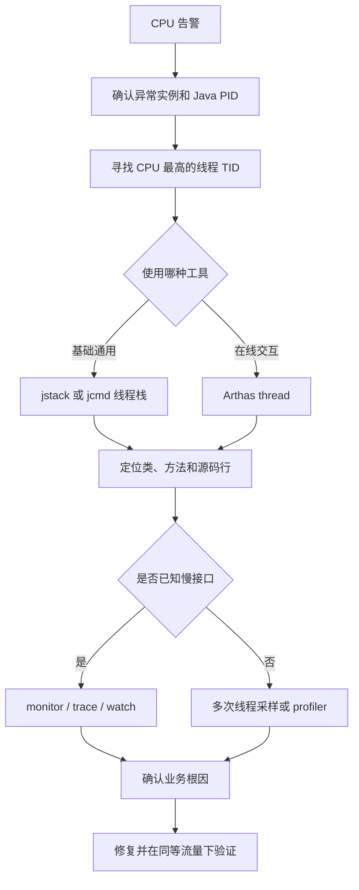

## 一、💡 一句话理解

> [!tip] 核心结论
> Java 服务 CPU 突然升高时，先从“业务代码、并发、内存与 GC”三类原因判断方向，再通过高 CPU 进程找到高 CPU 线程，最后用 `jstack` 或 Arthas 把线程定位到具体方法和代码。

实际排查主线：

```text
确认 CPU 告警和发生时间
→ 找到高 CPU Java 进程
→ 找到进程里的高 CPU 线程
→ 查看线程栈正在执行的方法
→ 结合接口耗时记录、jstack 或 Arthas 继续下钻
→ 检查死循环、锁竞争、计算密集、线程过多、频繁 GC 等问题
→ 修复后在相同流量下验证
```

相关知识：[[线程]]、[[1. JVM运行时数据区]]、[[15.GC是什么]]。

## 二、🧭 理论：CPU 高到底表示什么

CPU 高只能说明处理器正在忙，不能直接说明是哪一行代码有问题。常见情况包括：

- 某个线程进入死循环，一直执行同一段代码；
- 大量请求同时进行复杂计算；
- 线程数量过多，操作系统频繁切换线程；
- 对象创建速度过快，JVM 频繁执行 GC；
- 锁竞争代码使用忙等待或自旋，不断消耗 CPU；
- 内存压力导致 GC 或交换活动异常。

要确认根因，必须把监控中的 CPU 使用率逐层映射到：

```text
服务器或容器
└── Java 进程 PID
    └── Java 线程 TID
        └── 线程栈中的类和方法
            └── 源码中的循环、锁、计算或对象创建
```

> [!warning] CPU 高和接口慢不是同一件事
> 接口慢可能只是在等待数据库、锁或远程服务，此时 CPU 不一定高；CPU 高也可能由定时任务、MQ 消费或后台线程造成，接口耗时记录里未必有明显异常。

## 三、⚙️ 理论：CPU 高的三大类、九种场景

### 3.1 业务代码类问题

#### 3.1.1 死循环

最典型的情况是循环退出条件永远无法满足：

```java
while (true) {
    // 没有阻塞、sleep 或 break，会持续占用 CPU。
    calculate();
}
```

另一种更隐蔽：代码看起来存在退出条件，但某些分支从未更新控制变量。

```java
boolean finished = false;

while (!finished) {
    // 如果 process() 的某些分支既不修改 finished，也不抛异常，
    // 线程就可能一直执行这个循环。
    process();
}
```

常见特征：

- 单个业务线程长期接近占满一个 CPU 核心；
- 多次线程栈都停在同一方法或相邻代码行；
- 请求量没有明显上涨，但 CPU 突然升高；
- 重启后暂时恢复，遇到相同数据又复现。

#### 3.1.2 锁竞争、忙等待和自旋

这里必须区分两个概念：

| 情况 | 线程表现 | 是否通常直接消耗大量 CPU |
| --- | --- | --- |
| 普通死锁 | 多个线程互相等待，常见为 `BLOCKED` | 通常不会持续吃满 CPU，但服务会卡住 |
| 忙等待或长时间自旋 | 线程反复检查条件或抢锁，常见为 `RUNNABLE` | 可能持续消耗 CPU |

例如下面的忙等待：

```java
while (!ready) {
    // 不断读取 ready，没有阻塞等待，CPU 会持续执行循环。
}
```

因此“发生死锁就一定导致 CPU 100%”并不准确。真正需要警惕的是忙等待、自旋重试，以及高并发下激烈的锁竞争。

#### 3.1.3 不必要的同步代码块或重复代码

同步范围过大不会必然让 CPU 100%，但会降低并发能力，并可能造成大量线程竞争、唤醒和上下文切换。

```java
// 同步范围过大：远程查询也被包含在锁内。
synchronized (lock) {
    Result result = remoteQuery();
    updateLocalState(result);
}
```

更合理的方向是把真正需要保护的共享状态缩小到最小范围：

```java
Result result = remoteQuery();

synchronized (lock) {
    // 只保护共享状态修改。
    updateLocalState(result);
}
```

还要检查循环里是否存在重复序列化、重复排序、重复查询或可以提前计算的代码。

### 3.2 并发类问题

#### 3.2.1 大量计算密集型任务

图片处理、加解密、压缩、复杂规则匹配、大集合排序和报表计算都会真实消耗 CPU。

如果请求量上涨时 CPU 同步上涨，而且线程栈分布在正常的计算方法中，这更像容量或算法效率问题，不一定是程序异常。

处理方向：

- 优化算法和数据结构；
- 缓存可复用结果；
- 拆分或异步化非实时计算；
- 限制单次任务的数据规模；
- 在容量确实不足时扩容。

#### 3.2.2 大量并发线程

线程不是越多越快。CPU 密集型任务创建远超 CPU 核数的线程，通常不会获得等比例吞吐提升，反而会增加调度、栈内存和竞争成本。

常见来源：

- 每个请求都手动 `new Thread()`；
- 线程池最大线程数配置过大；
- 多个线程池各自扩张；
- MQ 消费并发度突然调高；
- 下游变慢，大量请求线程堆积。

#### 3.2.3 大量上下文切换

操作系统只能让有限数量的线程同时在 CPU 核心上执行。可运行线程太多时，需要频繁保存当前线程状态并切换到另一个线程，这就是上下文切换。

上下文切换本身会消耗 CPU，而且会破坏 CPU 缓存局部性。最终可能出现：线程更多了，业务吞吐却没有提高。

### 3.3 内存和 GC 类问题

#### 3.3.1 内存不足

这里有两层内存压力：

- **Java 堆不足**：JVM 为腾出空间频繁 GC；
- **操作系统内存不足**：可能发生换页和交换，带来额外的内核和 I/O 开销。

内存不足不一定直接表现为用户态 CPU 100%，但可能通过频繁 GC、内核开销和系统抖动导致整体性能恶化。

#### 3.3.2 频繁 GC

业务不断创建大量短生命周期对象，会提高对象分配速率，使 Young GC 更频繁。例如：

- 循环中反复创建临时集合；
- 大量字符串拼接和 JSON 转换；
- 高频创建异常并打印堆栈；
- 缓存没有命中，重复构建大对象。

如果 GC 线程消耗大量 CPU，应结合 GC 日志、对象分配热点和 [[15.GC是什么]] 继续排查。

#### 3.3.3 内存泄漏或对象长期滞留

Java 中常见的“内存泄漏”是对象已经没有业务用途，却仍然被强引用，导致 GC 无法回收。例如：

- 静态集合只增加不删除；
- 缓存没有容量上限或过期策略；
- `ThreadLocal` 使用后没有清理；
- 监听器、回调或类加载器被长期引用。

老年代占用不断升高后，JVM 可能更频繁地执行代价较高的 GC，间接推高 CPU。

### 3.4 九种场景快速对照表

| 大类 | 场景 | 典型观察结果 | 优先工具 |
| --- | --- | --- | --- |
| 业务代码 | 死循环 | 单线程持续高 CPU，多次栈相同 | `jstack`、`thread` |
| 业务代码 | 忙等待或锁竞争 | `RUNNABLE` 自旋、线程竞争明显 | `thread`、`profiler` |
| 业务代码 | 不必要同步或重复代码 | 锁范围大、循环内重复工作 | `trace`、源码、`jad` |
| 并发 | 计算密集任务 | 多线程执行计算方法 | `thread`、`profiler` |
| 并发 | 并发线程过多 | 线程总数异常、线程池扩张 | `dashboard`、`thread` |
| 并发 | 上下文切换频繁 | 可运行线程多、吞吐没有提升 | 系统监控、`thread` |
| 内存 | 内存不足 | GC 或系统交换活动异常 | GC 日志、系统监控 |
| 内存 | 频繁 GC | GC 线程活跃、对象分配快 | `dashboard`、GC 日志、`profiler` |
| 内存 | 对象长期滞留 | 老年代持续上涨、Full GC 增多 | GC 日志、堆分析 |

## 四、🚀 实践：从准备到验证

### 4.1 前置准备

#### 4.1.1 先保存故障时间线

记录以下信息：

- CPU 从什么时候开始升高；
- 哪台机器、哪个容器或哪个实例异常；
- 同期 QPS、接口 RT 和错误率是否变化；
- 最近是否发布、修改配置或调整线程池；
- 是否有定时任务、批处理或 MQ 积压；
- 是否只有单个实例异常。

#### 4.1.2 生产环境注意事项

- 优先保留 3～5 份线程栈，再决定是否重启；
- 已经严重影响用户时，先扩容、限流、摘流或回滚；
- Arthas 使用完整类名和方法名，避免宽泛匹配整个包；
- 使用 `-n` 限制命令捕获次数；
- `watch` 输出参数前确认不包含隐私和密钥；
- JDK 工具尽量与目标 JVM 使用相同版本和相同操作系统用户。

### 4.2 CPU 100% 的统一解决方法论



无论使用哪种工具，都在回答四个问题：

1. 哪个 Java 进程在吃 CPU？
2. 进程里的哪个线程在吃 CPU？
3. 线程正在执行哪个类和方法？
4. 这个方法为什么在此时消耗大量 CPU？

### 4.3 第一件神器：使用 jstack 定位高 CPU 线程

#### 4.3.1 第一步：找到 Java 进程 PID

```bash
# 查看 Java 进程及其启动类。
jps -l

# 或者按 CPU 从高到低查看进程。
ps -eo pid,ppid,comm,%cpu,%mem --sort=-%cpu | head -20
```

假设发现 Java 进程 PID 是 `12345`。

#### 4.3.2 第二步：找到高 CPU 线程 TID

```bash
# -H：按线程显示；-p：只观察指定进程。
top -H -p 12345
```

假设 CPU 最高的线程 TID 是 `23456`。持续观察几次，确认它不是只在某一瞬间排在前面。

#### 4.3.3 第三步：将线程 ID 转为十六进制

Java 线程栈中的本地线程 ID `nid` 通常以十六进制显示：

```bash
# 把十进制 TID 23456 转换为十六进制。
printf '%x\n' 23456
```

假设结果是：

```text
5ba0
```

#### 4.3.4 第四步：采集多份线程栈

```bash
# -l：额外打印 java.util.concurrent 锁信息。
jstack -l 12345 > /tmp/jstack-1.log
sleep 5
jstack -l 12345 > /tmp/jstack-2.log
sleep 5
jstack -l 12345 > /tmp/jstack-3.log
```

Oracle JDK 25 文档将 `jstack` 标记为实验性、非受支持工具，并提示未来版本可能不再提供。当前 JDK 也可以使用：

```bash
# 官方诊断命令，打印全部线程栈和锁信息。
jcmd 12345 Thread.print -l > /tmp/thread-dump.log
```

#### 4.3.5 第五步：根据 nid 找到线程栈

```bash
# 搜索高 CPU 线程的十六进制 nid，并显示后续 40 行。
grep -n -A 40 'nid=0x5ba0' /tmp/jstack-1.log
```

预期会看到类似结果：

```text
"http-nio-8080-exec-12" #82 prio=5 tid=... nid=0x5ba0 runnable
   java.lang.Thread.State: RUNNABLE
        at com.example.order.PromotionService.matchRules(PromotionService.java:87)
        at com.example.order.OrderService.calculatePrice(OrderService.java:142)
        at com.example.order.OrderController.calculate(OrderController.java:56)
```

此时已经把 CPU 告警定位到了：

```text
PromotionService.matchRules 第 87 行附近
```

> [!info] 行号为什么可能看不到
> `jstack` 会在可用时打印源码行号。如果构建时没有保留行号调试信息，线程栈可能只有类名和方法名，没有准确行号。

#### 4.3.6 第六步：对比三份线程栈

如果三份线程栈中的同一个高 CPU 线程都停在 `PromotionService.matchRules`，死循环或超大计算的可能性很高。

如果线程栈不断变化：

- 可能是正常计算经过多个方法；
- 可能是热点分散；
- 单次线程快照不够，应使用 Arthas `profiler` 做一段时间采样。

#### 4.3.7 第七步：根据线程状态判断方向

| 线程状态或栈特征 | 判断方向 |
| --- | --- |
| `RUNNABLE` 且多次停在同一循环 | 死循环或大计算 |
| 大量 `BLOCKED` | 锁竞争；继续找持锁线程 |
| `WAITING`、`TIMED_WAITING` | 正在等待，通常不是直接 CPU 热点 |
| GC 线程 CPU 高 | 分配速率或堆压力问题 |
| 线程池工作线程数量很多 | 并发度或线程池配置问题 |
| 出现 `Found one Java-level deadlock` | 确认 Java 级死锁，但不等于它一定导致高 CPU |

### 4.4 第二件神器：使用 Arthas 定位具体代码

#### 4.4.1 路线一：只有 CPU 告警，先找高 CPU 线程

```bash
# 查看 JVM 的线程、内存和 GC 概况。
dashboard

# 在 1000ms 采样窗口内，显示 CPU 最忙的五个线程及其栈。
thread -n 5 -i 1000
```

如果输出给出了线程 ID，例如 `42`：

```bash
# 再次查看指定线程当前的完整线程栈。
thread 42
```

Arthas 的 `thread` 已经完成了“找高 CPU 线程 + 打印线程栈”的组合，因此通常比手动执行 `top`、转换十六进制和搜索 `jstack` 更方便。

如果怀疑大量线程在等待同一把锁：

```bash
# 查找当前阻塞其他线程的持锁线程。
thread -b
```

#### 4.4.2 路线二：已经从接口耗时记录找到慢接口

假设耗时记录为：

```text
POST /order/calculate
cost=2380ms
traceId=8d97f...
```

入口方法是：

```text
com.example.order.OrderController#calculate
```

先确认它是否持续很慢：

```bash
# 每五秒统计一次调用次数、成功率、失败率和平均 RT。
monitor -c 5 com.example.order.OrderController calculate
```

再找入口方法中的慢调用：

```bash
# 只输出总耗时超过 500ms 的调用，最多捕获五次。
trace com.example.order.OrderController calculate '#cost > 500' -n 5
```

假设结果显示：

```text
OrderController.calculate
└── OrderService.calculatePrice       2310ms
```

继续向下一层追踪：

```bash
trace com.example.order.OrderService calculatePrice '#cost > 500' -n 5
```

又发现：

```text
OrderService.calculatePrice
├── PromotionService.matchRules      2250ms
└── PriceRepository.query              40ms
```

于是继续追踪 `PromotionService.matchRules`，不要先优化只占 40ms 的数据库查询。

> [!warning] `trace` 的准确理解
> `trace` 展示的是目标方法内部直接调用的子方法及耗时，默认一次只跟踪一层。它不是直接测出源码某一行的 CPU 时间。找到最慢子方法后，要继续 `trace` 下钻，最后结合源码或 `jad` 检查具体代码。

#### 4.4.3 使用 watch 找到触发问题的特殊数据

```bash
# 观察慢调用的参数、返回值和异常。
# -x 2：对象最多展开两层。
# -n 5：最多捕获五次。
watch com.example.order.PromotionService matchRules \
  '{params,returnObj,throwExp}' \
  '#cost > 500' -x 2 -n 5
```

重点检查：

- 是否只有超大集合会变慢；
- 是否某类字符串触发正则回溯；
- 是否异常数据让循环退出条件失效；
- 是否持续抛异常并被立即重试；
- 返回对象是否异常庞大。

#### 4.4.4 使用 jad 查看线上实际代码

```bash
# 反编译 JVM 当前实际加载的类。
jad com.example.order.PromotionService
```

结合线程栈、`trace` 和 `watch` 的结果，检查：

- `while`、`for` 的退出条件；
- 双重或多重循环；
- 循环中的数据库和 RPC 调用；
- 重复排序、复制、序列化和正则匹配；
- 无限重试或没有退避的重试；
- 同步代码块是否包住了不必要的耗时操作。

#### 4.4.5 线程栈不稳定时使用 profiler

```bash
# 默认采样 CPU 热点。
profiler start

# 等待问题请求出现或主动复现一次。

# 停止采样并生成结果文件。
profiler stop
```

火焰图中横向越宽的方法，被采样到的次数通常越多。先找最宽的业务方法，再结合调用关系和源码判断原因。

#### 4.4.6 结束排查后清理增强

```bash
# 还原 Arthas 增强过的类。
reset
```

### 4.5 完整案例：从 CPU 100% 找到双重循环

#### 4.5.1 现象

```text
order-service 单实例 CPU 接近 100%
/order/calculate 接口 RT 从 120ms 上升到 2380ms
请求量没有明显上涨
```

#### 4.5.2 Arthas 找高 CPU 线程

```bash
thread -n 5 -i 1000
```

多次结果都指向：

```text
PromotionService.matchRules(PromotionService.java:87)
```

#### 4.5.3 trace 确认慢方法

```bash
trace com.example.order.OrderController calculate '#cost > 500' -n 5
trace com.example.order.OrderService calculatePrice '#cost > 500' -n 5
trace com.example.order.PromotionService matchRules '#cost > 500' -n 5
```

#### 4.5.4 watch 发现异常数据量

```bash
watch com.example.order.PromotionService matchRules \
  '{params,returnObj,throwExp}' \
  '#cost > 500' -x 2 -n 5
```

发现慢请求包含数万条规则和大量商品。

#### 4.5.5 查看代码确认根因

```java
for (Rule rule : rules) {
    // 每条规则都重新遍历全部商品。
    // 当规则数量和商品数量同时增长时，计算量成倍增加。
    for (Item item : items) {
        match(rule, item);
    }
}
```

这不是死循环，因为它最终能结束；它是数据量增大后暴露出来的双重循环计算问题。

#### 4.5.6 修复后验证

通过预建立索引、减少重复扫描等方式优化后，在相同数据和接近流量下验证：

```text
接口 RT：2380ms → 120ms
实例 CPU：接近 100% → 35%
错误率：恢复正常
trace：matchRules 耗时明显下降
```

完整证据链是：

```text
CPU 告警
→ thread 定位高 CPU 线程
→ trace 定位慢方法
→ watch 发现异常数据规模
→ 源码确认双重循环
→ 优化后 CPU 和 RT 同时恢复
```

## 五、🧩 根据结果快速判断根因

| 观察结果 | 更可能的原因 | 下一步 |
| --- | --- | --- |
| 单线程持续接近一个核心，栈长期不变 | 死循环或超大计算 | 查看循环退出条件和输入规模 |
| 多个业务线程执行同一计算方法 | 流量或计算密集任务 | 评估算法、缓存和容量 |
| 大量线程 `BLOCKED` | 锁竞争 | `thread -b` 找持锁线程 |
| 大量线程但吞吐没有提升 | 线程池过大、上下文切换 | 收敛线程池并发度 |
| GC 线程活跃，Young GC 很频繁 | 对象分配过快 | 查临时对象和分配热点 |
| 老年代持续增长，Full GC 增多 | 对象长期滞留或泄漏 | GC 日志和堆分析 |
| trace 显示 RPC 或数据库耗时高 | I/O 或下游慢，不是纯 CPU 计算 | 排查连接池、SQL 和下游 |
| 只在特定参数下变慢 | 数据相关的循环、正则或分支 | 使用 `watch` 捕获参数 |
| 线程栈每次都不同 | 热点分散或采样不稳定 | 使用 `profiler` 火焰图 |

## 六、🎤 面试时怎么流利地说

### 6.1 回答路线

```text
先确认范围
→ 把原因分成业务、并发、内存三类
→ 定位进程和线程
→ 用 jstack 或 Arthas 找方法
→ 结合参数和源码确认根因
→ 修复后对比验证
```

### 6.2 30 秒标准回答

线上 CPU 过高时，我不会先猜代码，而是先确认异常实例和时间窗口，再找到高 CPU 的 Java 进程和线程。原因通常分为三类：业务代码问题，比如死循环或忙等待；并发问题，比如计算密集、线程过多和上下文切换；内存问题，比如对象分配过快导致频繁 GC。定位时可以用 `top -H` 找线程，再通过 `jstack` 对照十六进制 `nid`；也可以直接用 Arthas 的 `thread -n` 找高 CPU 线程。如果已经知道慢接口，我会从接口耗时记录出发，用 `trace` 逐层找慢方法，用 `watch` 看异常参数，最后结合源码确认根因，并在相同流量下验证 CPU 和 RT 是否恢复。

### 6.3 1—2 分钟展开回答

我会先看 CPU 告警发生在哪个实例，同时对照 QPS、接口 RT、错误率、发布记录和定时任务，判断是流量增长还是异常计算。CPU 高常见有三类原因：第一类是业务代码，例如死循环、忙等待、同步范围过大和重复计算；第二类是并发问题，例如大量计算密集任务、线程池开得过大以及频繁上下文切换；第三类是内存问题，例如大量短命对象导致频繁 GC，或者对象长期被引用导致老年代压力。

具体定位时，我会先找到 Java PID，再用 `top -H -p PID` 找高 CPU 的线程 TID，把 TID 转成十六进制，在多份 `jstack` 中搜索对应 `nid`。如果多次线程栈都停在同一个方法，说明它很可能是热点。线上有 Arthas 时会更直接，用 `thread -n 5 -i 1000` 找最忙线程。如果接口耗时记录已经指出慢接口，我会用 `monitor` 看调用趋势，用 `trace` 从 Controller 逐层下钻，用 `watch` 判断是不是特殊参数导致，最后通过源码或 `jad` 检查循环、正则、重试和锁。需要注意，普通死锁通常让线程阻塞，不一定把 CPU 拉满；真正容易造成高 CPU 的是死循环、忙等待、自旋和大量计算。修复后还要在相同流量和数据规模下对比 CPU、RT、错误率和热点方法耗时，才能确认问题解决。

### 6.4 高频追问与短答

#### 6.4.1 为什么要把线程 ID 转成十六进制

`top -H` 显示的 TID 通常是十进制，而 `jstack` 中本地线程 ID `nid` 通常以十六进制显示。转换后才能把操作系统线程和 Java 线程栈对应起来。

#### 6.4.2 为什么要连续采集多份线程栈

单份栈只是一个瞬间，线程可能刚好经过某个方法。多份栈都停在相同调用链，才能更有把握地判断它是持续热点或死循环。

#### 6.4.3 trace 能不能直接定位源码哪一行

不能完全这么理解。`trace` 主要展示方法内部的调用节点和耗时，而且默认一次只跟踪一层。要对最慢子方法继续下钻，再结合线程栈的行号、源码或 `jad` 确认具体代码。

#### 6.4.4 死锁一定会导致 CPU 100% 吗

不一定。普通死锁中的线程通常处于阻塞等待状态，CPU 可能并不高。忙等待、自旋抢锁或错误重试才更容易持续消耗 CPU。

## 七、⚠️ 常见误区

### 7.1 看到 CPU 高就立即重启

重启可能暂时恢复，但会丢失最有价值的现场。故障可控时先保留多份线程栈；已经严重影响用户时，则先扩容、摘流或回滚，再继续分析。

### 7.2 只看一份 jstack

单份线程栈不能证明某个方法持续消耗 CPU。应该在短间隔内采集多份，并与高 CPU 线程对应。

### 7.3 把接口耗时当成 CPU 时间

接口耗时包含计算、锁等待、数据库和网络时间。`trace` 显示某个 RPC 耗时两秒，不代表它计算了两秒。

### 7.4 看到 RUNNABLE 就认为一定在吃 CPU

`RUNNABLE` 是 JVM 线程状态，不保证线程此刻一定占用 CPU。要与 `top -H` 或 Arthas `thread` 的 CPU 采样结合。

### 7.5 一开始就 trace 整个包

宽泛匹配会增强大量类并产生大量输出。应从明确的入口类和方法开始，每次只追踪必要的一层。

## 八、📚 官方资料

- [Oracle JDK 25：jstack 命令](https://docs.oracle.com/en/java/javase/25/docs/specs/man/jstack.html)
- [Oracle JDK 25：jcmd 与 Thread.print](https://docs.oracle.com/en/java/javase/25/troubleshoot/troubleshooting-guide.pdf)
- [Arthas：thread 命令](https://arthas.aliyun.com/doc/thread.html)
- [Arthas：trace 命令](https://arthas.aliyun.com/doc/trace.html)
- [Arthas：monitor 命令](https://arthas.aliyun.com/en/doc/monitor.html)
- [Arthas：watch 命令](https://arthas.aliyun.com/doc/en/watch)
- [Arthas：profiler 命令](https://arthas.aliyun.com/en/doc/profiler.html)
- [Arthas：命令列表与 jad](https://arthas.aliyun.com/doc/commands.html)

## 九、📌 总结

- CPU 高的原因先分成业务代码、并发、内存与 GC 三类。
- 九种常见场景包括死循环、忙等待、同步范围过大、计算密集、线程过多、上下文切换、内存不足、频繁 GC 和对象长期滞留。
- `jstack` 路线是“PID → TID → 十六进制 nid → 线程栈 → 源码行”。
- Arthas 路线是“`thread` 找线程 → `trace` 找慢方法 → `watch` 看异常数据 → `jad` 看实际代码”。
- 已知慢接口时，从接口耗时记录开始；没有入口时，从高 CPU 线程或火焰图开始。
- 普通死锁不一定导致 CPU 100%，忙等待、自旋和大量计算才更典型。
- 修复后必须在相同流量和数据规模下对比 CPU、RT 和错误率。

> [!tip] 最终口诀
> **三类原因先分类，进程线程逐层找；jstack 对 nid，Arthas 用 thread；trace 找慢方法，watch 看异常数据，源码确认根因，复测才算完成。**
