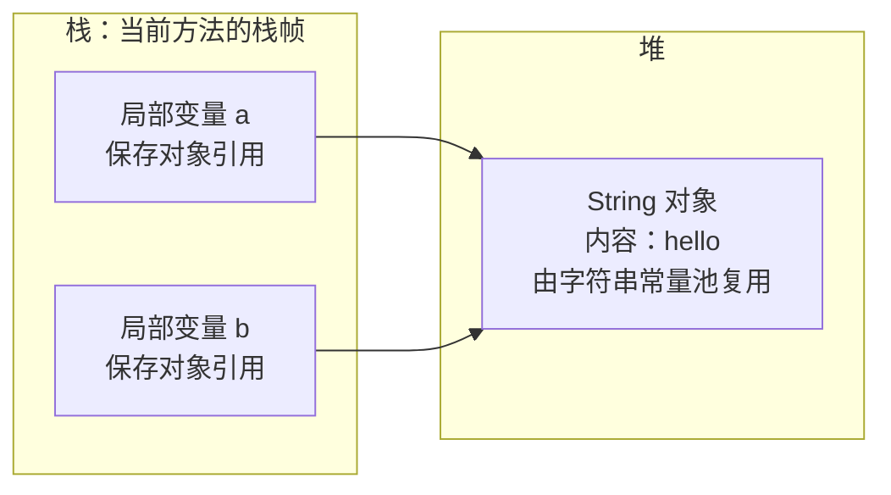
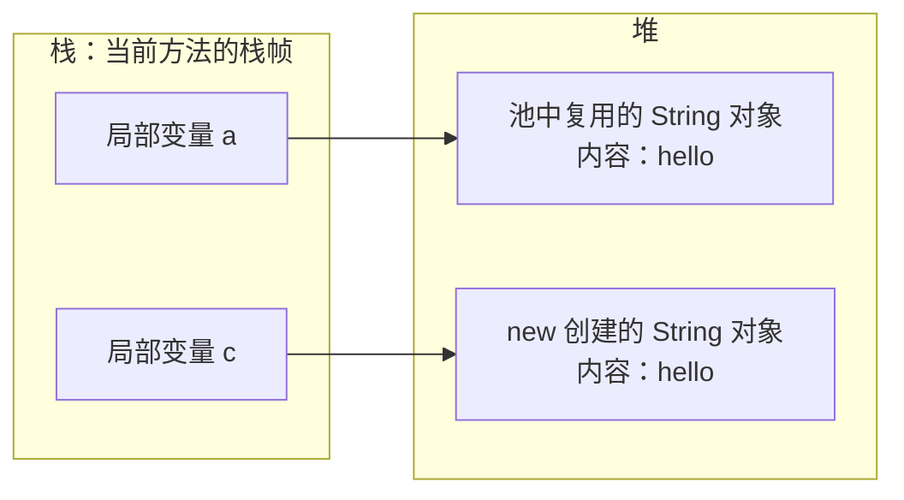
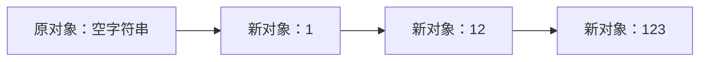
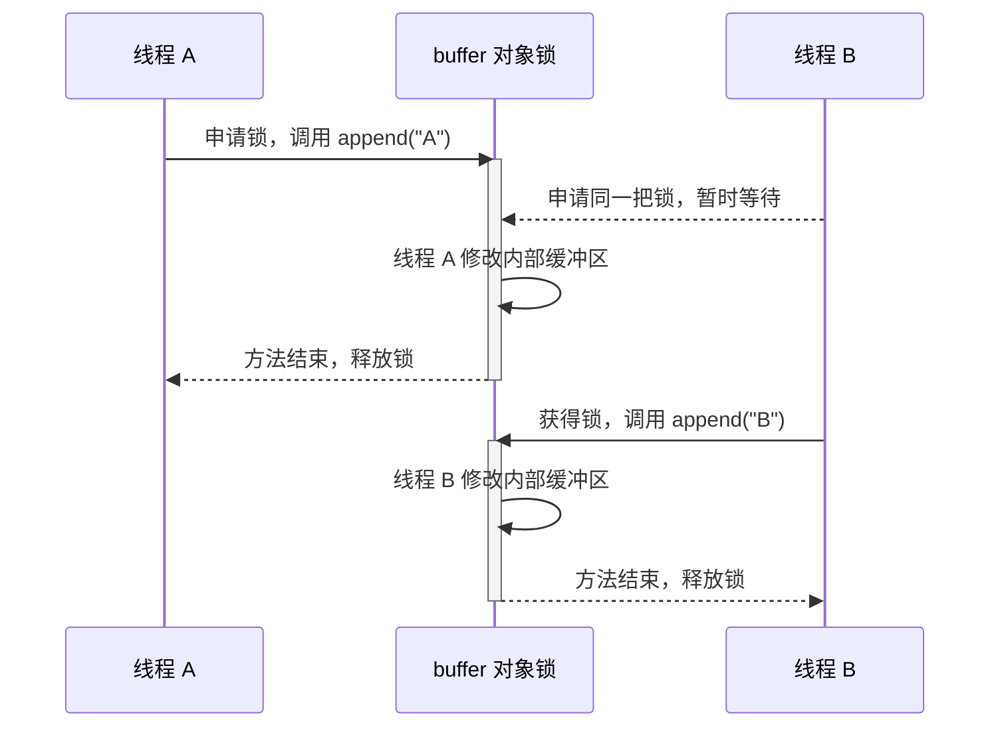

## 一、💡 一句话理解

> [!tip] 核心结论
> `String` 是 Java 中表示字符串的类。它的对象一旦创建，内容就不能改变；所谓“修改字符串”，实际上是生成了一个新字符串。

## 二、🧭 理论：它是什么

### 2.1 String 是对象，不是基本类型

```java
String name = "Afyke";
```

`"Afyke"` 是字符串字面量，也是一个 `String` 对象。`String` 类位于 `java.lang` 包中，不需要手动导入。

### 2.2 String 不可变

```java
String text = "Java";
text = text + " String";
```

第二行没有修改原来的 `"Java"`，而是创建了新的 `"Java String"`，再让变量 `text` 指向新对象。

不可变带来的主要好处是：字符串可以安全共享，也适合用作 `HashMap` 的键。这里可以结合 [[1.HashMap]] 理解。

## 三、⚙️ 理论：它是怎么工作的

### 3.1 字符串常量池

先看这段代码：

```java
String a = "hello";
String b = "hello";

System.out.println(a == b); // true：a 和 b 指向同一个 String 对象
```

在这个例子中，`a` 和 `b` 是当前方法的局部变量。它们都保存引用，并共同指向堆中的同一个 `String` 对象：



图中的关系只有三步：

1. `a` 保存一个对象引用。
2. `b` 也保存一个对象引用。
3. 两个引用最终指向堆中的**同一个** `"hello"` 对象，因此 `a == b` 是 `true`。

> [!info] 常量池不是另一个对象存放区
> 在现代 HotSpot JVM 中，被池化的 `String` 对象本身仍在堆中。可以把字符串常量池理解成 JVM 用来查找和复用这些对象的一张表。

再看显式使用 `new` 的情况：

```java
String c = new String("hello");

System.out.println(a == c);      // false：a 和 c 指向不同对象
System.out.println(a.equals(c)); // true：比较的是字符串内容
```

这一次，`new` 会在堆中另外创建一个 `String` 对象：



`a` 和 `c` 指向两个不同的对象。虽然对象内容都是 `"hello"`，但是：

- `a == c` 是 `false`：比较引用，两个引用指向不同对象。
- `a.equals(c)` 是 `true`：比较内容，两个对象的内容相同。

> [!warning] 比较口诀
> `==` 比较“是不是同一个对象”，`equals()` 比较“内容是否相同”。业务代码比较字符串内容时，通常使用 `equals()`。

### 3.2 为什么循环拼接常用 StringBuilder

关键区别是：**`String` 不可变，`StringBuilder` 可变。**

假设循环执行三次：

```java
String result = "";

for (int i = 1; i <= 3; i++) {
    result = result + i;
}
```

从代码语义上看，每次拼接都不能修改原来的 `String`，只能创建一个新字符串，再让 `result` 改为指向新对象：



前面的中间字符串不用后会等待垃圾回收。循环次数很多时，可能产生许多短命的中间对象。

`StringBuilder` 内部维护了一个**可以修改的字符缓冲区**。`append()` 会把新内容追加到当前缓冲区，并返回当前这个 `StringBuilder` 对象：

```java
StringBuilder builder = new StringBuilder();

// append：修改当前 builder 中的内容，然后仍返回这个 builder。
builder.append("1");
builder.append("2");
builder.append("3");

// 最后需要 String 时，再生成最终结果。
String result = builder.toString();
```

整个过程可以理解为：


> [!tip] 为什么它可以修改
> `StringBuilder` 的设计目标就是保存“可变字符序列”。`append()` 修改的是它管理的缓冲区；缓冲区容量不足时会自动扩容。因此它不是完全不分配内存，而是避免每次拼接都创建一个新的 `String` 中间结果。

| 对比项 | `String` 使用 `+` | `StringBuilder.append()` |
| --- | --- | --- |
| 内容是否可变 | 不可变 | 可变 |
| 连续拼接 | 产生新的字符串结果 | 持续修改同一个 builder |
| 适用场景 | 少量、简单拼接 | 循环或大量拼接 |
| 线程安全 | 对象不可变，便于共享 | 非线程安全，通常用于单线程局部变量 |

少量、简单的拼接直接使用 `+` 更清楚；循环或大量追加时再使用 `StringBuilder`。

### 3.3 StringBuffer 是什么

`StringBuffer` 也是一个**可变字符序列**，使用方式与 `StringBuilder` 基本相同：

```java
StringBuffer buffer = new StringBuffer();

// append：修改当前 buffer 的内容，并返回当前对象。
buffer.append("Java");
buffer.append(" StringBuffer");

String result = buffer.toString();
```

它们的核心区别是：`StringBuffer` 会在需要的位置进行同步，让多个线程对同一个对象的单次方法调用按照某种串行顺序执行；`StringBuilder` 不提供这种同步保证。

#### 3.3.1 它是怎么实现线程安全的

是的，核心实现就是**加锁**。OpenJDK 在 `append()`、`delete()`、`insert()`、`length()` 等关键方法上使用了 `synchronized`。

下面是经过精简的 `append()` 实现：

```java
public synchronized StringBuffer append(String str) {
    // 真正的追加逻辑由父类完成，会修改当前对象管理的缓冲区。
    super.append(str);

    // 返回当前 StringBuffer，所以可以继续链式调用。
    return this;
}
```

这里是实例方法，所以 `synchronized` 锁住的是当前 `StringBuffer` 对象，也就是 `this`。它可以近似理解成：

```java
public StringBuffer append(String str) {
    synchronized (this) {
        super.append(str);
        return this;
    }
}
```

当线程 A 和线程 B 同时调用同一个 `buffer.append()` 时：



因此，同一时刻只有一个线程能进入同一个 `StringBuffer` 对象的同步方法。锁还会保证：前一个线程释放锁前完成的修改，对后面获得同一把锁的线程可见。

> [!info] StringBuilder 为什么更快
> `StringBuilder` 与 `StringBuffer` 都通过父类 `AbstractStringBuilder` 管理可变缓冲区，但 `StringBuilder` 的常用方法不使用这种同步锁。单线程使用时，它省去了竞争和同步成本。

| 类型 | 是否可变 | 线程安全 | 主要使用场景 |
| --- | --- | --- | --- |
| `String` | 否 | 不可变，适合共享 | 保存和传递最终字符串 |
| `StringBuilder` | 是 | 否 | 单线程中的循环或大量拼接 |
| `StringBuffer` | 是 | 是 | 多个线程确实要共同修改同一个缓冲区 |

#### 3.3.2 为什么复合操作仍要自己加锁

> [!warning] 线程安全的边界
> `StringBuffer` 能保证单次同步方法调用的安全，但多个方法组合起来不一定是一个不可分割的整体。例如先调用 `length()` 再调用 `deleteCharAt()`，两次调用之间仍可能有其他线程修改内容。

如果必须让“先判断、再删除”整体不可分割，可以使用同一个 `buffer` 对象作为锁：

```java
synchronized (buffer) {
    // length 和 deleteCharAt 必须作为一个整体完成。
    if (buffer.length() > 0) {
        buffer.deleteCharAt(0);
    }
}
```

通常优先使用 `StringBuilder`。只有确实需要多个线程共享并修改同一个字符缓冲区时，才考虑 `StringBuffer`。

## 四、🚀 实践：从准备到验证

### 4.1 前置准备

安装 JDK 17 或更高版本即可。本例不需要第三方依赖。

### 4.2 可以拿来干什么

`String` 常用于保存用户名、请求参数和日志文本。常用方法包括：

| 方法 | 用途 | 示例结果 |
| --- | --- | --- |
| `length()` | 获取长度 | `"Java".length()` 得到 `4` |
| `contains()` | 判断是否包含内容 | `"Java String".contains("Java")` 得到 `true` |
| `substring()` | 截取字符串 | `"Java".substring(1, 3)` 得到 `"av"` |
| `trim()` | 去掉首尾普通空白 | `" Java ".trim()` 得到 `"Java"` |
| `split()` | 按规则拆分 | `"a,b".split(",")` 得到两个元素 |

### 4.3 完整实践：代码、启动和验证

新建 `StringDemo.java`：

```java
public class StringDemo {
    public static void main(String[] args) {
        String input = "  Java,String  ";

        // trim：去掉字符串首尾的普通空白，并返回一个新字符串。
        String cleaned = input.trim();

        // split：以逗号为分隔规则拆分字符串。
        String[] parts = cleaned.split(",");

        // equals：比较实际内容，不比较两个变量是否指向同一个对象。
        boolean isJava = "Java".equals(parts[0]);

        // StringBuilder：适合连续追加多个片段。
        StringBuilder result = new StringBuilder();
        result.append("第一段：").append(parts[0]);
        result.append("，第二段：").append(parts[1]);

        System.out.println(result);
        System.out.println("第一段是否为 Java：" + isJava);
    }
}
```

编译并运行：

```bash
javac StringDemo.java
java StringDemo
```

预期输出：

```text
第一段：Java，第二段：String
第一段是否为 Java：true
```

## 五、🎤 面试时怎么流利地说

### 5.1 30 秒标准回答

`String` 是 Java 中表示字符串的不可变类。对象创建后内容不能修改，拼接或替换都会返回新字符串。字符串字面量可以由常量池复用；`==` 比较引用，`equals()` 比较内容。少量拼接可以使用 `+`，循环或大量拼接一般使用 `StringBuilder`。

### 5.2 高频追问

- **为什么 String 不可变？** `String` 类本身是 `final`，并且没有提供修改其内部内容的公开方法。不可变让字符串更容易安全共享，也能稳定地计算和使用哈希值。`final` 可参考 [[4.final]]。
- **`new String("abc")` 创建几个对象？** 不能脱离上下文固定回答。若常量池中还没有 `"abc"`，可能涉及常量池对象和堆中新对象；若已经存在，则只需再创建堆中的新对象。

## 六、📌 总结

- `String` 是对象，并且不可变。
- 字符串字面量可以复用常量池中的对象。
- 比较内容用 `equals()`，不要误用 `==`。
- 多次拼接优先考虑 `StringBuilder`。
- 多线程共享并修改同一个缓冲区时，才考虑 `StringBuffer`。

## 七、📚 官方资料

- [Oracle Java SE 21：String API](https://docs.oracle.com/en/java/javase/21/docs/api/java.base/java/lang/String.html)
- [Oracle Java SE 21：StringBuilder API](https://docs.oracle.com/en/java/javase/21/docs/api/java.base/java/lang/StringBuilder.html)
- [Oracle Java SE 21：StringBuffer API](https://docs.oracle.com/en/java/javase/21/docs/api/java.base/java/lang/StringBuffer.html)
- [OpenJDK：StringBuffer 源码](https://github.com/openjdk/jdk/blob/master/src/java.base/share/classes/java/lang/StringBuffer.java)
- [Oracle Java 教程：Strings](https://docs.oracle.com/javase/tutorial/java/data/strings.html)（教程基于 JDK 8，本文仅参考其中仍适用的基础概念）
