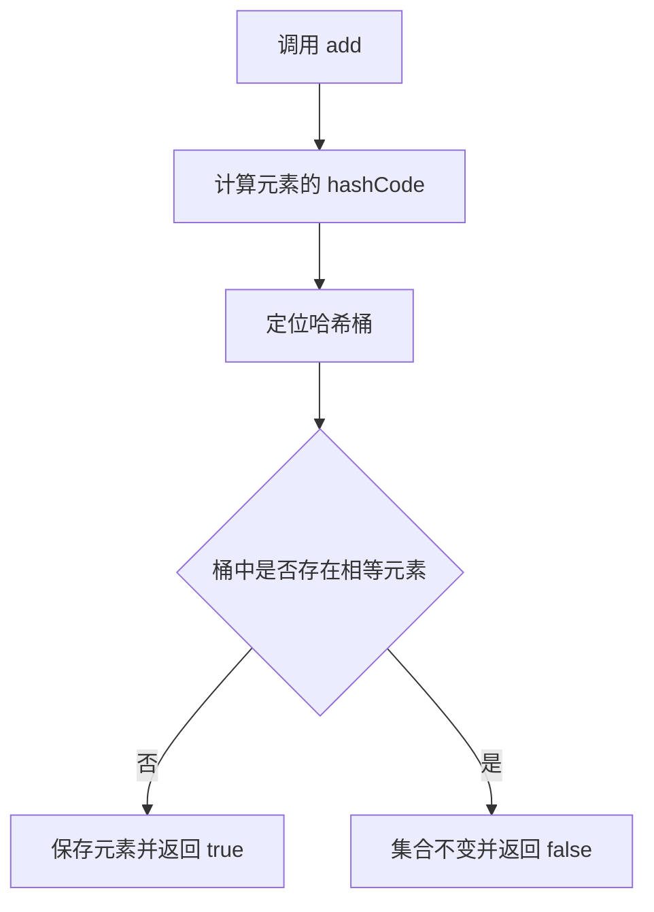

## 一、💡 一句话理解

> [!tip] 核心结论
> `HashSet` 是一个**元素不重复、没有索引、遍历顺序不保证固定**的集合。它内部借助哈希表快速判断元素是否已经存在，适合去重和快速查找。

## 二、🧭 理论：它是什么

### 2.1 Set 与 HashSet 的关系

`Set` 是接口，规定集合中不能出现重复元素；`HashSet` 是 `Set` 最常用的实现之一。

```text
Collection
   └── Set                 规定：元素不可重复
       └── HashSet         使用哈希表实现
```

可以把 `HashSet` 想成一个活动签到名单：同一个人重复签到，名单中仍然只保留一份。

这个类比对应的真实概念是：再次调用 `add()` 添加相等元素时，集合不会改变，并返回 `false`。

```java
Set<String> names = new HashSet<>();

System.out.println(names.add("张三")); // true：第一次添加成功
System.out.println(names.add("张三")); // false：已经存在，不再添加
System.out.println(names.size());      // 1
```

### 2.2 HashSet 的核心特点

| 特点 | 含义 |
|---|---|
| 元素不重复 | 相等的元素最多保留一份 |
| 没有索引 | 不能使用 `set.get(0)` |
| 顺序不保证 | 遍历顺序不一定等于插入顺序，也不保证长期不变 |
| 允许 `null` | `HashSet` 最多保存一个 `null` |
| 查询通常很快 | 哈希分布合理时，`add`、`remove`、`contains`、`size` 通常为 `O(1)` |
| 非线程安全 | 多线程并发修改时不能直接共享使用 |

> [!warning] 不要依赖遍历顺序
> 如果必须保留插入顺序，使用 `LinkedHashSet`；如果需要排序，通常使用 `TreeSet`。

### 2.3 HashSet、ArrayList、LinkedHashSet 与 TreeSet 怎么选

| 集合 | 是否允许重复 | 是否保证顺序 | 常见用途 |
|---|---:|---|---|
| `ArrayList` | 是 | 保留插入顺序，并支持索引 | 按位置读写、允许重复数据 |
| `HashSet` | 否 | 不保证 | 去重、快速判断是否存在 |
| `LinkedHashSet` | 否 | 保留插入顺序 | 去重后仍要保持原顺序 |
| `TreeSet` | 否 | 按规则排序 | 去重并排序 |

## 三、⚙️ 理论：它是怎么工作的

### 3.1 HashSet 内部借助 HashMap

Java 官方资料说明，`HashSet` 由哈希表支持，实际内部使用一个 `HashMap`。可以把集合元素理解成存进了 `HashMap` 的 Key，而内部 Value 只是实现细节。

```text
HashSet.add(element)
        │
        ▼
把 element 当作 HashMap 的 Key
        │
        ▼
Key 不能重复，所以 HashSet 元素不能重复
```

因此，理解 `HashSet` 时可以复用 [[HashMap]] 的三步主线：

1. 根据元素的 `hashCode()` 计算哈希位置。
2. 找到对应的桶。
3. 再用 `equals()` 判断桶中的对象是否相等。

### 3.2 添加元素时怎样判断重复

执行下面的代码：

```java
set.add(element);
```

可以用这条简化流程理解：



这里只看 `hashCode()` 不够，因为不同对象可能拥有相同的哈希值，这叫**哈希冲突**。因此还要通过 `equals()` 确认它们是否真的相等。

> [!info] 判断重复的关键约定
> 如果两个对象通过 `equals()` 判断相等，它们就必须返回相同的 `hashCode()`。自定义对象用作 `HashSet` 元素时，通常要同时正确实现这两个方法。

### 3.3 为什么自定义对象容易“去重失败”

假设业务规定“用户编号相同就是同一个用户”，那么 `equals()` 和 `hashCode()` 都应按照用户编号判断。

```java
import java.util.Objects;

final class User {
    private final int id;
    private final String name;

    User(int id, String name) {
        this.id = id;
        this.name = name;
    }

    @Override
    public boolean equals(Object object) {
        // 同一个引用一定相等。
        if (this == object) {
            return true;
        }

        // 类型不同或对方为 null，一定不相等。
        if (!(object instanceof User other)) {
            return false;
        }

        // 当前业务只把 id 当作用户身份。
        return id == other.id;
    }

    @Override
    public int hashCode() {
        // 必须使用与 equals 相同的身份字段。
        return Objects.hash(id);
    }
}
```

如果不重写这两个方法，两个字段看起来相同的普通对象，默认仍可能被当成不同对象保存。

### 3.4 为什么元素放入后不应修改关键字段

对象进入 `HashSet` 后，集合会按照当时的哈希值安排它的位置。如果之后修改参与 `equals()` 或 `hashCode()` 的字段，新哈希值可能指向另一个位置，导致 `contains()` 或 `remove()` 找不到这个对象。

```text
放入时：id = 1 → 位于 A 桶
修改后：id = 2 → 查询时去 B 桶
结果：对象实际仍在 A 桶，但集合去 B 桶查找
```

实践中优先使用不可变对象，至少不要在元素存入期间修改参与相等判断的字段。

### 3.5 性能、容量与遍历成本

哈希函数分布合理时，以下基本操作通常具有常数时间性能：

- `add()`：添加元素。
- `contains()`：判断元素是否存在。
- `remove()`：删除元素。
- `size()`：获取元素数量。

遍历成本则与“元素数量 + 内部容量”有关。初始容量设置得过大，可能让遍历白白检查许多空桶；负载因子设置得过低，也可能造成类似问题。因此没有实际性能依据时，通常使用默认构造方法即可。

### 3.6 线程安全与 fail-fast 迭代器

`HashSet` 本身不同步。多个线程共享同一个集合，并且至少一个线程会修改它时，需要在外部同步，或选择适合并发场景的数据结构。

官方 API 给出的包装方式是：

```java
Set<String> synchronizedSet = Collections.synchronizedSet(new HashSet<>());
```

迭代过程中，如果不是通过迭代器自己的 `remove()` 修改集合，迭代器通常会快速抛出 `ConcurrentModificationException`。这种 fail-fast 行为只用于尽早发现错误，不能作为程序正确性的保证。

## 四、🚀 实践：从准备到验证

### 4.1 前置准备

本例只使用 JDK 自带的集合类，不需要 Maven、Gradle 或第三方依赖。

- 推荐环境：JDK 17 或更高版本。
- 最低语法要求：示例中的 `instanceof` 模式匹配需要 JDK 16 或更高版本。
- 检查命令：`java -version` 与 `javac -version`。

### 4.2 可以拿来干什么

#### 4.2.1 给数据去重

前置对象是一个允许重复的 `List<String>`。把它传给 `HashSet` 构造方法，就可以只保留不同元素。

```java
List<String> rawTags = List.of("Java", "MySQL", "Java", "Redis");
Set<String> uniqueTags = new HashSet<>(rawTags);

System.out.println(uniqueTags.size()); // 3
```

输入包含两个 `Java`，处理后集合大小为 `3`。适合处理标签、编号、用户名等不应重复的数据；但输出顺序不确定。

如果去重后仍要保持原始顺序，可改用：

```java
Set<String> uniqueTags = new LinkedHashSet<>(rawTags);
```

#### 4.2.2 快速判断元素是否出现过

前置对象是一个保存“已处理订单号”的集合。`contains()` 负责查询，`add()` 的返回值还可以把“判断并记录”合并为一步。

```java
Set<String> processedOrderIds = new HashSet<>();

if (processedOrderIds.add("ORDER-1001")) {
    System.out.println("第一次处理，可以继续");
} else {
    System.out.println("订单已处理，拒绝重复操作");
}
```

第一次输入 `ORDER-1001` 时，`add()` 返回 `true`；再次输入时返回 `false`。适合重复提交检查、访问记录和数据导入去重等场景。

> [!warning] 业务幂等不能只靠内存 HashSet
> 单机示例可以帮助理解；真实的分布式系统还要考虑进程重启、多实例和并发一致性，通常需要数据库唯一约束或共享存储。

#### 4.2.3 计算两个集合的交集、并集和差集

前置对象是两个 `Set<String>`。先复制一个集合，再调用批量操作，避免修改原始数据。

```java
Set<String> backend = Set.of("Java", "MySQL", "Redis");
Set<String> candidate = Set.of("Java", "Redis", "Vue");

Set<String> intersection = new HashSet<>(backend);
intersection.retainAll(candidate); // 只保留双方都有的元素

Set<String> union = new HashSet<>(backend);
union.addAll(candidate);           // 合并双方所有不同元素

Set<String> difference = new HashSet<>(backend);
difference.removeAll(candidate);  // 删除对方也有的元素
```

结果分别表示共同技能、全部技能和只在 `backend` 中出现的技能，适合权限、标签和用户群体计算。

### 4.3 完整实践：代码、启动和验证

下面的程序完整演示字符串去重、自定义对象去重、查询、删除与 `add()` 返回值。

文件位置：新建 `HashSetDemo.java`。

```java
import java.util.ArrayList;
import java.util.HashSet;
import java.util.List;
import java.util.Objects;
import java.util.Set;

public class HashSetDemo {

    public static void main(String[] args) {
        // 1. 原始列表允许保存重复元素。
        List<String> rawTags = List.of(
                "Java", "MySQL", "Java", "Redis", "MySQL"
        );

        // 2. HashSet(Collection) 会把集合中的重复字符串去掉。
        Set<String> uniqueTags = new HashSet<>(rawTags);

        // 不直接验证 HashSet 的输出顺序，因为官方没有保证顺序。
        System.out.println("原始数量：" + rawTags.size());
        System.out.println("去重数量：" + uniqueTags.size());
        System.out.println("包含 Redis：" + uniqueTags.contains("Redis"));

        // 3. add() 不只负责添加，还会告诉我们集合是否发生了改变。
        boolean firstAdd = uniqueTags.add("Spring");
        boolean repeatedAdd = uniqueTags.add("Spring");
        System.out.println("首次添加 Spring：" + firstAdd);
        System.out.println("重复添加 Spring：" + repeatedAdd);

        // 4. 为了得到稳定、便于验证的显示结果，复制后再排序。
        List<String> sortedTags = new ArrayList<>(uniqueTags);
        sortedTags.sort(String::compareTo);
        System.out.println("排序后查看：" + sortedTags);

        // 5. 两个 User 的姓名不同，但 id 相同。
        // User 的 equals 和 hashCode 都只使用 id，所以它们被视为同一用户。
        Set<User> users = new HashSet<>();
        boolean addFirstUser = users.add(new User(1, "张三"));
        boolean addSameIdUser = users.add(new User(1, "张三的新名字"));

        System.out.println("首次添加用户：" + addFirstUser);
        System.out.println("添加相同 id 用户：" + addSameIdUser);
        System.out.println("用户数量：" + users.size());

        // 6. contains() 会使用查询对象的 hashCode 和 equals。
        boolean containsSameId = users.contains(new User(1, "任意名字"));
        System.out.println("包含 id=1 的用户：" + containsSameId);

        // 7. remove() 返回是否真的删除了元素。
        boolean removed = users.remove(new User(1, "删除时名字不重要"));
        System.out.println("删除 id=1 的用户：" + removed);
        System.out.println("删除后的用户数量：" + users.size());
    }

    /**
     * 用户编号是业务身份，因此定义成 final，避免加入 HashSet 后被修改。
     */
    private static final class User {
        private final int id;
        private final String name;

        private User(int id, String name) {
            this.id = id;
            this.name = name;
        }

        @Override
        public boolean equals(Object object) {
            // 引用相同，肯定是同一个对象。
            if (this == object) {
                return true;
            }

            // instanceof 同时完成 null 和类型检查，并得到 other 变量。
            if (!(object instanceof User other)) {
                return false;
            }

            // 业务规则：只要用户编号相同，就认为是同一个用户。
            return id == other.id;
        }

        @Override
        public int hashCode() {
            // hashCode 必须使用与 equals 相同的身份字段。
            return Objects.hash(id);
        }

        @Override
        public String toString() {
            // 方便调试时观察对象；不参与 HashSet 的去重判断。
            return "User{id=" + id + ", name='" + name + "'}";
        }
    }
}
```

在 `HashSetDemo.java` 所在目录执行：

```bash
javac HashSetDemo.java
java HashSetDemo
```

预期输出：

```text
原始数量：5
去重数量：3
包含 Redis：true
首次添加 Spring：true
重复添加 Spring：false
排序后查看：[Java, MySQL, Redis, Spring]
首次添加用户：true
添加相同 id 用户：false
用户数量：1
包含 id=1 的用户：true
删除 id=1 的用户：true
删除后的用户数量：0
```

#### 4.3.1 常见报错与排查

| 现象 | 常见原因 | 处理方法 |
|---|---|---|
| `cannot find symbol: class HashSet` | 没有导入类 | 添加 `import java.util.HashSet;` |
| 自定义对象没有去重 | 没有同时正确实现 `equals()` 和 `hashCode()` | 按同一组身份字段实现两个方法 |
| 放入后 `contains()` 返回 `false` | 修改了参与哈希计算的字段 | 使用不可变身份字段，或先删除、修改后再加入 |
| 遍历结果顺序变化 | `HashSet` 不保证顺序 | 使用 `LinkedHashSet` 或 `TreeSet` |
| 遍历时抛出 `ConcurrentModificationException` | foreach 过程中直接修改集合 | 使用迭代器的 `remove()`，或先记录、遍历后再修改 |
| 多线程下结果异常 | `HashSet` 不是线程安全集合 | 外部同步，或根据场景选择并发集合 |

## 五、📌 总结

- `HashSet` 最适合做**去重**和**快速存在性判断**。
- 它实现 `Set` 接口，内部借助 `HashMap` 的 Key 唯一性保存元素。
- 判断重复依赖 `hashCode()` 定位，再依赖 `equals()` 确认。
- 自定义元素通常要同时正确实现 `equals()` 和 `hashCode()`。
- 不要依赖 `HashSet` 的遍历顺序，也不要修改已存元素的哈希关键字段。
- `HashSet` 非线程安全；并发修改时要使用合适的同步或并发方案。

> [!tip] 记忆句
> `HashSet`：不重复、无索引、顺序不保证；先看哈希位置，再用 equals 确认。

## 六、📚 官方资料

- [Java 官方教程：Set、SortedSet 与 NavigableSet](https://dev.java/learn/api/collections-and-streams/collections-framework/sets/)
- [Java SE 25 API：HashSet](https://docs.oracle.com/en/java/javase/25/docs/api/java.base/java/util/HashSet.html)
- [Java SE 25 API：Set](https://docs.oracle.com/en/java/javase/25/docs/api/java.base/java/util/Set.html)

> 本文依据上述 Java 官方教程与 Java SE 25 API 整理，查阅日期：2026-10-12。实践代码只使用 JDK 标准库。
