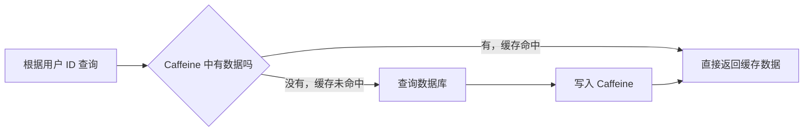
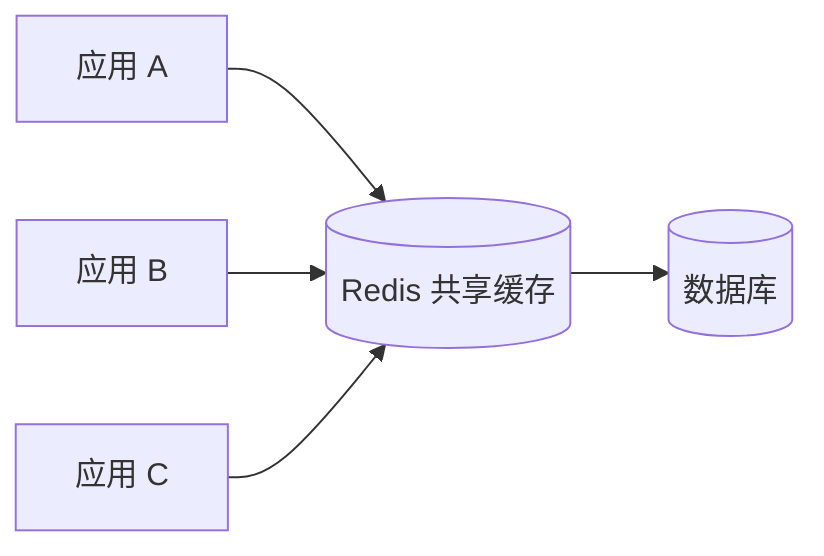
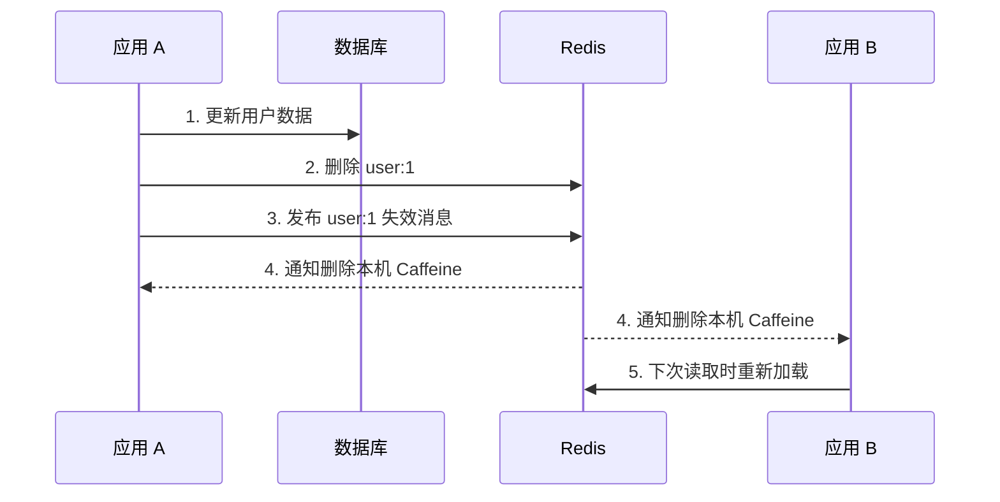

相关基础：[[Java/基础/1.HashMap|HashMap]]、[[Java/基础/2.ConcurrentHashMap|ConcurrentHashMap]]

## 一、💡 一句话理解

> [!tip] 核心结论
> Caffeine 是 Java 的第三方**本地内存缓存库**。它把经常使用的数据暂存在当前 Java 进程的内存中，让后续请求少查数据库或少调用远程接口。

Caffeine **不是 Java 基础语法、不是 JDK 自带功能，也不是完整框架**。它属于 Java 生态中的缓存工具库。

Java 版本需要注意：

| Java 版本 | Caffeine 版本 |
|---|---|
| Java 8 | Caffeine 2.x，常用最终版本为 2.9.3 |
| Java 11 及以上 | Caffeine 3.x |

## 二、🧭 理论：它是什么

### 2.1 从一个用户查询场景开始

假设一个接口需要根据用户 ID 查询用户姓名：

```text
GET /users/1
```

如果每次请求都查询数据库，相同数据会被反复读取：

```text
请求 1 ──> 数据库
请求 2 ──> 数据库
请求 3 ──> 数据库
```

加入 Caffeine 后，第一次请求查询数据库并把结果放进缓存。后续请求可以直接从内存取值：



由于读取内存通常比访问数据库或远程服务快，所以接口响应会更快，下游系统的压力也会更小。

### 2.2 场景与真实概念的对应关系

| 场景角色 | 真实技术对象 |
|---|---|
| 用户 ID | 缓存的 Key |
| 用户姓名或用户对象 | 缓存的 Value |
| 内存中的临时记录 | Caffeine 缓存条目（Entry） |
| 找到了记录 | 缓存命中（Hit） |
| 没找到记录 | 缓存未命中（Miss） |
| 再去查询数据库 | 数据加载（Load） |
| 太久不用或数量超限后清走 | 过期或淘汰（Expiration / Eviction） |

这个类比的边界是：Caffeine 不只是一个普通 Map。它还提供容量限制、过期、自动加载、异步处理、统计等缓存能力。

### 2.3 Caffeine 和 Java 基础的关系

Caffeine 的使用建立在 Java 基础之上：

- 泛型：通过 `Cache<K, V>` 指定 Key 和 Value 的类型。
- Lambda：缓存没有数据时，可以用 Lambda 加载数据。
- 并发：缓存通常会被多个线程同时访问。
- 集合：使用体验类似 Map，但语义和能力更适合缓存。

因此，学习顺序可以是：

```text
HashMap → ConcurrentHashMap → 缓存基本概念 → Caffeine
```

## 三、⚙️ 理论：它是怎么工作的

### 3.1 先查缓存，未命中时再加载

Caffeine 最核心的流程是：

```text
读取 Key
  ↓
缓存命中？── 是 ──> 返回缓存值
  │
  否
  ↓
执行加载逻辑，例如查询数据库
  ↓
把结果写入缓存
  ↓
返回结果
```

记忆口诀：**先查缓存，没中再查库；查完放缓存，下次直接取。**

### 3.2 三种常见缓存类型

| 类型 | 特点 | 适用场景 |
|---|---|---|
| `Cache<K, V>` | 手动缓存，应用自己决定如何加载数据 | 加载逻辑因业务而异，需要灵活控制 |
| `LoadingCache<K, V>` | 创建缓存时统一指定加载函数 | 每个 Key 的加载方式相同 |
| `AsyncCache<K, V>` / `AsyncLoadingCache<K, V>` | 异步加载，返回 `CompletableFuture` | 加载过程耗时，且业务适合异步处理 |

初学时先掌握 `Cache<K, V>` 即可。

### 3.3 容量限制与淘汰

缓存不能无限占用内存。`maximumSize(1000)` 表示缓存最多保留大约 1000 条记录；达到容量上限后，Caffeine 会根据访问情况淘汰价值较低的条目。

```java
Cache<String, String> cache = Caffeine.newBuilder()
        // maximumSize：限制缓存条目数量，防止缓存无限增长。
        .maximumSize(1_000)
        .build();
```

> [!warning] 不要遗漏容量限制
> 本地缓存使用的是 JVM 内存。如果缓存无限增长，可能增加垃圾回收压力，严重时可能导致 `OutOfMemoryError`。

### 3.4 过期策略

常用时间策略有两种：

| 策略 | 含义 | 例子 |
|---|---|---|
| `expireAfterWrite` | 写入或更新一段时间后过期 | 商品信息写入 10 分钟后重新加载 |
| `expireAfterAccess` | 最后一次访问一段时间后过期 | 30 分钟没访问的会话数据被清理 |

```java
Cache<String, String> cache = Caffeine.newBuilder()
        // 写入 10 分钟后，该条目会被视为过期。
        .expireAfterWrite(10, TimeUnit.MINUTES)
        .maximumSize(1_000)
        .build();
```

过期时间不是“数据一定正确”的保证。它只决定缓存多久重新加载一次。数据能否接受短时间不一致，需要根据业务判断。

### 3.5 命中、未命中与统计

开启 `recordStats()` 后，可以查看缓存命中次数、未命中次数和命中率：

```java
Cache<String, String> cache = Caffeine.newBuilder()
        // recordStats：开启缓存运行指标统计；不开启时不会记录这些指标。
        .recordStats()
        .maximumSize(1_000)
        .build();

System.out.println(cache.stats().hitCount());
System.out.println(cache.stats().missCount());
System.out.println(cache.stats().hitRate());
```

命中率高不一定代表设计合理。例如缓存了过期很久的数据，命中率可能很高，但业务结果是错误的。指标必须结合数据新鲜度、内存占用和数据库压力一起判断。

### 3.6 Caffeine、ConcurrentHashMap 和 Redis 的区别

| 对比项 | ConcurrentHashMap | Caffeine | Redis |
|---|---|---|---|
| 定位 | Java 并发集合 | Java 本地缓存库 | 独立的远程数据服务 |
| 数据位置 | 当前 JVM 内存 | 当前 JVM 内存 | Redis 服务端内存 |
| 多台应用共享 | 不支持 | 不支持 | 支持 |
| 过期和淘汰 | 需要自己实现 | 内置丰富策略 | 内置丰富策略 |
| 应用重启后保留 | 不保留 | 不保留 | 取决于 Redis 持久化配置 |
| 网络开销 | 无 | 无 | 有 |

> [!info] 使用边界
> 单体应用、单个实例或允许各实例分别缓存时，Caffeine 很合适。多台服务必须共享同一份缓存数据时，通常考虑 Redis；也可以使用 Caffeine + Redis 组成多级缓存，但一致性处理会更复杂。

### 3.7 多台服务器怎样让缓存保持一致

#### 3.7.1 “不一致”到底是什么

假设系统部署了应用 A 和应用 B，每台应用都有自己的 Caffeine：

```text
数据库：张三的手机号是 138...
应用 A 的 Caffeine：138...
应用 B 的 Caffeine：旧号码 139...
```

同一个用户请求应用 A 和应用 B，却得到不同结果，这就是缓存不一致。

它发生的原因很简单：**两台应用各自拥有一块独立内存，修改其中一份，另一份不会自动变化。**

#### 3.7.2 只使用 Redis：所有实例读取同一份缓存

最容易理解的办法，是不在每台应用中保存业务缓存，而是让所有应用都访问同一个 Redis：



这样应用 A 修改或删除 Redis 中的 `user:1` 后，应用 B 下次读取的也是同一个 Redis Key，不会继续读取自己进程中的旧副本。

但是，**共享 Redis 只解决了“应用实例之间不共享内存”的问题，不会自动保证 Redis 与数据库一致。**数据库和 Redis 仍然是两个不同的存储位置。

常用的 Cache Aside（旁路缓存）流程是：

```text
读取：先读 Redis
      ├─ 命中：直接返回
      └─ 未命中：查数据库 → 写入 Redis → 返回

修改：先更新数据库 → 再删除 Redis 中的旧缓存
```

为什么修改时通常选择“删除缓存”，而不是直接“更新缓存”？因为删除后，下一次读取会以数据库为准重新构建缓存，可以减少并发更新时旧值覆盖新值的风险。

> [!warning] Redis 也不等于绝对强一致
> 在“数据库更新成功、Redis 删除尚未完成”的短暂窗口内，其他请求仍可能读到旧缓存。如果删除失败，旧数据还可能保留更久。因此通常还要设置 TTL，并对删除失败进行重试或补偿。

#### 3.7.3 Caffeine + Redis：为什么还需要失效通知

为了减少访问 Redis 的网络开销，可以把缓存分成两层：

| 层级 | 技术 | 数据位置 | 速度 |
|---|---|---|---|
| 一级缓存（L1） | Caffeine | 每台应用自己的 JVM | 最快，无网络请求 |
| 二级缓存（L2） | Redis | 所有应用共享的 Redis | 较快，需要网络请求 |
| 最终数据源 | 数据库 | 数据库服务 | 通常最慢 |

读取顺序是：

```text
Caffeine → Redis → 数据库
```

问题在于：Redis 中的数据即使已经删除，应用 B 的 Caffeine 里仍可能保留旧值。此时需要“失效通知”：



这里的“通知”并不是把新数据复制给所有机器，而是告诉它们：

> 你本机保存的 `user:1` 可能已经过期，请删掉，下次重新查询。

#### 3.7.4 为什么有通知还要设置 TTL

Redis Pub/Sub 可以广播失效消息，但它采用 **at-most-once（最多一次）** 投递：订阅者如果断线或正在重启，消息不会保存下来供它恢复后重新消费。

例如：

```text
应用 B 重启中
    ↓
应用 A 发布 user:1 失效消息
    ↓
应用 B 没收到
    ↓
如果旧缓存没有 TTL，就可能一直保留
```

因此，多级缓存通常同时使用以下保护：

1. **失效通知**：正常情况下尽快删除各节点的本地缓存。
2. **较短的本地 TTL**：即使漏掉通知，旧值也会在限定时间后失效。
3. **删除失败重试或补偿**：避免数据库更新成功但 Redis 删除失败。
4. **可持久化消息**：不能接受消息丢失时，使用 Redis Streams、MQ 或数据库变更订阅，而不是只依赖 Pub/Sub。

这是一种“通知负责快，TTL 负责兜底”的设计。

#### 3.7.5 最终一致性和强一致性

| 一致性目标 | 含义 | 常见做法 |
|---|---|---|
| 最终一致性 | 短时间内可能读到旧数据，但最终会恢复一致 | 删除缓存、失效通知、TTL、重试补偿 |
| 强一致性 | 更新成功后，任何读取都必须立即得到最新结果 | 关键读取直接访问权威数据源，或使用事务、锁等更严格方案 |

大部分用户资料、商品介绍和字典数据可以接受几秒钟的最终一致性。余额、库存扣减、支付状态等关键判断则不能只相信缓存，数据库或其他权威数据源才是最终依据。

> [!tip] 记忆句
> Redis 解决“大家读同一份”，失效通知解决“本地副本赶紧删”，TTL 解决“通知漏了也能恢复”；它们通常实现的是最终一致，而不是绝对的强一致。

## 四、🚀 实践：从准备到验证

### 4.1 前置准备

本例使用：

- JDK 8
- Maven 3.6 或更高版本
- Caffeine 2.9.3

项目结构：

```text
caffeine-demo/
├── pom.xml
└── src/main/java/com/example/CaffeineDemo.java
```

#### 4.1.1 Maven 依赖

文件位置：`caffeine-demo/pom.xml`

```xml
<?xml version="1.0" encoding="UTF-8"?>
<project xmlns="http://maven.apache.org/POM/4.0.0"
         xmlns:xsi="http://www.w3.org/2001/XMLSchema-instance"
         xsi:schemaLocation="http://maven.apache.org/POM/4.0.0
                             https://maven.apache.org/xsd/maven-4.0.0.xsd">
    <modelVersion>4.0.0</modelVersion>

    <groupId>com.example</groupId>
    <artifactId>caffeine-demo</artifactId>
    <version>1.0-SNAPSHOT</version>

    <properties>
        <!-- 本例使用 Java 8 编译。 -->
        <maven.compiler.source>8</maven.compiler.source>
        <maven.compiler.target>8</maven.compiler.target>
        <project.build.sourceEncoding>UTF-8</project.build.sourceEncoding>
    </properties>

    <dependencies>
        <dependency>
            <groupId>com.github.ben-manes.caffeine</groupId>
            <artifactId>caffeine</artifactId>
            <!-- Caffeine 2.x 支持 Java 8；3.x 要求 Java 11 及以上。 -->
            <version>2.9.3</version>
        </dependency>
    </dependencies>

    <build>
        <plugins>
            <plugin>
                <groupId>org.codehaus.mojo</groupId>
                <artifactId>exec-maven-plugin</artifactId>
                <version>3.1.0</version>
                <configuration>
                    <mainClass>com.example.CaffeineDemo</mainClass>
                </configuration>
            </plugin>
        </plugins>
    </build>
</project>
```

### 4.2 可以拿来干什么

#### 4.2.1 缓存数据库查询结果

假设 `queryUserFromDatabase` 是一个耗时的数据库查询。`cache.get` 会先查缓存：命中就直接返回；未命中才执行加载函数。

```java
String user = cache.get("user:1", key -> queryUserFromDatabase(key));
```

- 输入：缓存 Key `user:1`。
- 过程：先查缓存，未命中才执行数据库查询。
- 输出：用户数据，同时将查询结果写入缓存。
- 适用场景：用户资料、字典数据、配置数据等读多写少的数据。

#### 4.2.2 主动删除已经变化的数据

当业务已经修改数据库中的用户资料时，可以主动删除旧缓存：

```java
// 数据库更新成功后，删除对应缓存。
cache.invalidate("user:1");
```

下一次读取时缓存未命中，程序会重新查询数据库，从而得到新数据。这种做法常被称为“更新数据库后删除缓存”。真实项目还要考虑并发写入、失败重试和多实例一致性。

#### 4.2.3 缓存计算成本较高的结果

Caffeine 不只能缓存数据库数据。只要结果可以由 Key 唯一确定，也可以缓存复杂计算、文件解析或远程接口结果：

```java
String report = cache.get("report:2026-10", key -> generateReport(key));
```

前提是该结果允许在一段时间内重复使用，并且要合理设置容量和过期时间。

#### 4.2.4 多级缓存更新时怎样操作

假设 `user:1` 同时保存在数据库、Redis 和各应用的 Caffeine 中，一次常见的更新流程可以写成：

```text
1. 更新数据库中的 user:1
2. 数据库提交成功后，删除 Redis 的 user:1
3. 发布 user:1 的本地缓存失效消息
4. 每台应用收到消息后执行 caffeine.invalidate("user:1")
5. 下一次读取依次查询 Caffeine、Redis、数据库，并重新填充缓存
```

还需要补上三个失败保护：

- 第 2 步失败：记录任务并重试删除 Redis。
- 第 3 步消息丢失：依靠 Caffeine 的较短 TTL 自动恢复。
- 业务不能接受消息丢失：改用 Redis Streams、MQ 或数据库变更事件等可持久化方案。

这只是通用流程。真实项目要根据允许的旧数据时间、请求量和故障恢复要求选择方案，不能把缓存当成唯一正确的数据源。

### 4.3 完整实践：代码、启动和验证

文件位置：`caffeine-demo/src/main/java/com/example/CaffeineDemo.java`

```java
package com.example;

import com.github.benmanes.caffeine.cache.Cache;
import com.github.benmanes.caffeine.cache.Caffeine;

import java.util.concurrent.TimeUnit;
import java.util.concurrent.atomic.AtomicInteger;

public class CaffeineDemo {

    // 用计数器模拟并记录“数据库”实际被查询了多少次。
    private static final AtomicInteger DATABASE_QUERY_COUNT = new AtomicInteger();

    public static void main(String[] args) throws InterruptedException {
        Cache<String, String> userCache = Caffeine.newBuilder()
                // maximumSize：缓存最多保留 100 条数据，避免无限占用 JVM 内存。
                .maximumSize(100)
                // expireAfterWrite：写入 2 秒后过期，便于在演示中观察重新加载。
                .expireAfterWrite(2, TimeUnit.SECONDS)
                // recordStats：记录命中、未命中等统计信息。
                .recordStats()
                // build：创建一个需要我们手动提供加载逻辑的 Cache。
                .build();

        System.out.println("第一次读取：缓存中没有，会查询数据库");
        String first = userCache.get("user:1", CaffeineDemo::queryUserFromDatabase);
        System.out.println("结果：" + first);

        System.out.println("\n第二次读取：缓存命中，不会重复查询数据库");
        String second = userCache.get("user:1", CaffeineDemo::queryUserFromDatabase);
        System.out.println("结果：" + second);
        System.out.println("数据库查询次数：" + DATABASE_QUERY_COUNT.get());

        System.out.println("\n等待缓存过期……");
        Thread.sleep(2_500L);

        System.out.println("第三次读取：原数据已过期，会重新查询数据库");
        String third = userCache.get("user:1", CaffeineDemo::queryUserFromDatabase);
        System.out.println("结果：" + third);
        System.out.println("数据库查询次数：" + DATABASE_QUERY_COUNT.get());

        // invalidate：主动删除指定 Key 的缓存。
        userCache.invalidate("user:1");
        System.out.println("\n主动删除后读取：" + userCache.getIfPresent("user:1"));

        System.out.println("缓存命中次数：" + userCache.stats().hitCount());
        System.out.println("缓存未命中次数：" + userCache.stats().missCount());
        System.out.println("缓存命中率：" + userCache.stats().hitRate());
    }

    /**
     * 模拟根据 Key 查询数据库。
     * 真实项目中，这里通常会调用 Repository、Mapper 或远程接口。
     */
    private static String queryUserFromDatabase(String key) {
        int queryNumber = DATABASE_QUERY_COUNT.incrementAndGet();
        System.out.println("  -> 第 " + queryNumber + " 次查询数据库，Key=" + key);
        return "张三";
    }
}
```

进入 `caffeine-demo` 目录后运行：

```bash
mvn clean compile exec:java
```

关键预期结果：

```text
第一次读取：查询数据库
第二次读取：直接命中缓存
数据库查询次数：1

等待 2.5 秒后第三次读取：再次查询数据库
数据库查询次数：2

主动删除后读取：null
```

这个结果说明：同一个 Key 在缓存有效期内只加载一次；过期后再次访问会重新加载；调用 `invalidate` 可以主动删除缓存。

### 4.4 常见问题排查

#### 4.4.1 Java 8 使用 Caffeine 3.x 编译失败

原因：Caffeine 3.x 要求 Java 11 或更高版本。

处理方式：

```xml
<version>2.9.3</version>
```

或者把项目 JDK 升级到 Java 11 及以上，再使用 Caffeine 3.x。

#### 4.4.2 为什么 `getIfPresent` 返回 `null`

`getIfPresent(key)` 只读取已经存在且未过期的数据，不会自动调用数据库查询。需要“没有就加载”时，可以使用：

```java
cache.get(key, this::loadData);
```

#### 4.4.3 为什么应用重启后缓存没了

Caffeine 的数据保存在当前 JVM 内存中。应用停止或重启后，进程内存被释放，缓存自然消失。这是本地缓存的正常行为，不是数据持久化方案。

#### 4.4.4 为什么两台服务器读到的缓存不一样

每个应用实例都有自己的 JVM，也就有自己独立的 Caffeine 缓存。Caffeine 不会自动在多台服务器之间同步。需要共享缓存时，应考虑 Redis 等分布式方案，或者专门设计多级缓存与失效通知机制。

## 五、📌 总结

- Caffeine 是第三方 Java 本地缓存库，不是 Java 基础，也不是 JDK 内置类。
- Java 8 使用 Caffeine 2.x；Caffeine 3.x 要求 Java 11 及以上。
- 核心流程是“先查缓存，未命中再加载，加载后写回缓存”。
- `maximumSize` 控制容量，过期策略控制数据保留时间，`recordStats` 用于观察缓存效果。
- Caffeine 数据只存在于当前 JVM，应用重启会丢失，多实例之间不会自动共享。
- Caffeine 适合低延迟的本地缓存；跨实例共享数据通常使用 Redis 等分布式缓存。
- 多级缓存通过“删除 Redis + 通知各节点删除 Caffeine + TTL 兜底”实现最终一致性。
- 余额、库存和支付状态等关键判断不能只依赖缓存，应以权威数据源为准。

> [!tip] 最后记一句
> Caffeine 就是一个专门做缓存的高性能线程安全 Map：它比普通 Map 多了容量控制、过期淘汰、自动加载和统计等能力，但数据只属于当前 Java 进程。

## 六、🔗 官方资料

- [Caffeine 官方仓库](https://github.com/ben-manes/caffeine)
- [Caffeine 官方 Wiki](https://github.com/ben-manes/caffeine/wiki)
- [缓存数据填充方式：Population](https://github.com/ben-manes/caffeine/wiki/Population)
- [缓存统计：Statistics](https://github.com/ben-manes/caffeine/wiki/Statistics)
- [Caffeine 2.9.3 API 文档](https://javadoc.io/doc/com.github.ben-manes.caffeine/caffeine/2.9.3/index.html)
- [Redis 官方文档：Client-side caching](https://redis.io/docs/latest/develop/reference/client-side-caching/)
- [Redis 官方文档：Pub/Sub](https://redis.io/docs/latest/develop/pubsub/)
