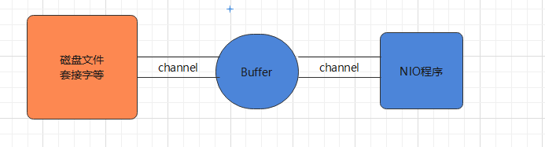

# 04-NIO基础与缓冲区

[返回网络与 IO 导航](IO学习导航.md)

## NIO

### 基本介绍

**NIO的介绍**：

Java NIO（New IO、Java non-blocking IO），从 Java 1.4 版本开始引入的一个新的 IO API，可以替代标准的 Java IO API，NIO 支持面向缓冲区的、基于通道的 IO 操作，以更加高效的方式进行文件的读写操作

* NIO 有三大核心部分：**Channel（通道），Buffer（缓冲区），Selector（选择器）**
* NIO 是非阻塞 IO，传统 IO 的 read 和 write 只能阻塞执行，线程在读写 IO 期间不能干其他事情，比如调用 socket.accept()，如果服务器没有数据传输过来，线程就一直阻塞，而 NIO 中可以配置 Socket 为非阻塞模式
* NIO 可以做到用一个线程来处理多个操作的。假设有 1000 个请求过来，根据实际情况可以分配 20 或者 80 个线程来处理，不像之前的阻塞 IO 那样分配 1000 个

NIO 和 BIO 的比较：

* BIO 以流的方式处理数据，而 NIO 以块的方式处理数据，块 I/O 的效率比流 I/O 高很多

* BIO 是阻塞的，NIO 则是非阻塞的

* BIO 基于字节流和字符流进行操作，而 NIO 基于 Channel 和 Buffer 进行操作，数据从通道读取到缓冲区中，或者从缓冲区写入到通道中。Selector 用于监听多个通道的事件（比如：连接请求，数据到达等），因此使用单个线程就可以监听多个客户端通道

  | NIO                       | BIO                 |
  | ------------------------- | ------------------- |
  | 面向缓冲区（Buffer）      | 面向流（Stream）    |
  | 非阻塞（Non Blocking IO） | 阻塞IO(Blocking IO) |
  | 选择器（Selectors）       |                     |


***


### 实现原理

NIO 三大核心部分：Channel (通道)、Buffer (缓冲区)、Selector (选择器)

* Buffer 缓冲区

  缓冲区本质是一块可以写入数据、读取数据的内存，**底层是一个数组**，这块内存被包装成 NIO Buffer 对象，并且提供了方法用来操作这块内存，相比较直接对数组的操作，Buffer 的 API 更加容易操作和管理

* Channel 通道

  Java NIO 的通道类似流，不同的是既可以从通道中读取数据，又可以写数据到通道，流的读写通常是单向的，通道可以非阻塞读取和写入通道，支持读取或写入缓冲区，也支持异步地读写

* Selector 选择器

  Selector 是一个 Java NIO 组件，能够检查一个或多个 NIO 通道，并确定哪些通道已经准备好进行读取或写入，这样一个单独的线程可以管理多个 channel，从而管理多个网络连接，提高效率

NIO 的实现框架：


* 每个 Channel 对应一个 Buffer
* 一个线程对应 Selector ， 一个 Selector 对应多个 Channel（连接）
* 程序切换到哪个 Channel 是由事件决定的，Event 是一个重要的概念
* Selector 会根据不同的事件，在各个通道上切换
* Buffer 是一个内存块 ， 底层是一个数组
* 数据的读取写入是通过 Buffer 完成的 , BIO 中要么是输入流，或者是输出流，不能双向，NIO 的 Buffer 是可以读也可以写， flip() 切换 Buffer 的工作模式

Java NIO 系统的核心在于：通道和缓冲区，通道表示打开的 IO 设备（例如：文件、 套接字）的连接。若要使用 NIO 系统，获取用于连接 IO 设备的通道以及用于容纳数据的缓冲区，然后操作缓冲区，对数据进行处理。简而言之，Channel 负责传输， Buffer 负责存取数据


***


### 缓冲区

#### 基本介绍

缓冲区（Buffer）：缓冲区本质上是一个**可以读写数据的内存块**，用于特定基本数据类型的容器，用于与 NIO 通道进行交互，数据是从通道读入缓冲区，从缓冲区写入通道中的



**Buffer 底层是一个数组**，可以保存多个相同类型的数据，根据数据类型不同 ，有以下 Buffer 常用子类：ByteBuffer、CharBuffer、ShortBuffer、IntBuffer、LongBuffer、FloatBuffer、DoubleBuffer 


***


#### 基本属性

* 容量（capacity）：作为一个内存块，Buffer 具有固定大小，缓冲区容量不能为负，并且创建后不能更改

* 限制 （limit）：表示缓冲区中可以操作数据的大小（limit 后数据不能进行读写），缓冲区的限制不能为负，并且不能大于其容量。写入模式，limit 等于 buffer 的容量；读取模式下，limit 等于写入的数据量

* 位置（position）：**下一个要读取或写入的数据的索引**，缓冲区的位置不能为负，并且不能大于其限制

* 标记（mark）与重置（reset）：标记是一个索引，通过 Buffer 中的 mark() 方法指定 Buffer 中一个特定的位置，可以通过调用 reset() 方法恢复到这个 position

* 位置、限制、容量遵守以下不变式： **0 <= position <= limit <= capacity**

  


***


#### 常用API

`static XxxBuffer allocate(int capacity)`：创建一个容量为 capacity 的 XxxBuffer 对象

Buffer 基本操作：

| 方法                                        | 说明                                                         |
| ------------------------------------------- | ------------------------------------------------------------ |
| public Buffer clear()                       | 清空缓冲区，不清空内容，将位置设置为零，限制设置为容量       |
| public Buffer flip()                        | 翻转缓冲区，将缓冲区的界限设置为当前位置，position 置 0      |
| public int capacity()                       | 返回 Buffer的 capacity 大小                                  |
| public final int limit()                    | 返回 Buffer 的界限 limit 的位置                              |
| public Buffer limit(int n)                  | 设置缓冲区界限为 n                                           |
| public Buffer mark()                        | 在此位置对缓冲区设置标记                                     |
| public final int position()                 | 返回缓冲区的当前位置 position                                |
| public Buffer position(int n)               | 设置缓冲区的当前位置为n                                      |
| public Buffer reset()                       | 将位置 position 重置为先前 mark 标记的位置                   |
| public Buffer rewind()                      | 将位置设为为 0，取消设置的 mark                              |
| public final int remaining()                | 返回当前位置 position 和 limit 之间的元素个数                |
| public final boolean hasRemaining()         | 判断缓冲区中是否还有元素                                     |
| public static ByteBuffer wrap(byte[] array) | 将一个字节数组包装到缓冲区中                                 |
| abstract ByteBuffer asReadOnlyBuffer()      | 创建一个新的只读字节缓冲区                                   |
| public abstract ByteBuffer compact()        | 缓冲区当前位置与其限制（如果有）之间的字节被复制到缓冲区的开头 |

Buffer 数据操作：

| 方法                                              | 说明                                            |
| ------------------------------------------------- | ----------------------------------------------- |
| public abstract byte get()                        | 读取该缓冲区当前位置的单个字节，然后位置 + 1    |
| public ByteBuffer get(byte[] dst)                 | 读取多个字节到字节数组 dst 中                   |
| public abstract byte get(int index)               | 读取指定索引位置的字节，不移动 position         |
| public abstract ByteBuffer put(byte b)            | 将给定单个字节写入缓冲区的当前位置，position+1  |
| public final ByteBuffer put(byte[] src)           | 将 src 字节数组写入缓冲区的当前位置             |
| public abstract ByteBuffer put(int index, byte b) | 将指定字节写入缓冲区的索引位置，不移动 position |

提示："\n"，占用两个字节


****


#### 读写数据

使用 Buffer 读写数据一般遵循以下四个步骤：

* 写入数据到 Buffer
* 调用 flip()方法，转换为读取模式
* 从 Buffer 中读取数据
* 调用 buffer.clear() 方法清除缓冲区（不是清空了数据，只是重置指针）

```java
public class TestBuffer {
	@Test
    public void test(){
		String str = "seazean";
		//1. 分配一个指定大小的缓冲区
		ByteBuffer buffer = ByteBuffer.allocate(1024);
		System.out.println("-----------------allocate()----------------");
		System.out.println(bufferf.position());//0
		System.out.println(buffer.limit());//1024
		System.out.println(buffer.capacity());//1024
        
        //2. 利用 put() 存入数据到缓冲区中
      	buffer.put(str.getBytes());
     	System.out.println("-----------------put()----------------");
		System.out.println(bufferf.position());//7
		System.out.println(buffer.limit());//1024
		System.out.println(buffer.capacity());//1024
        
        //3. 切换读取数据模式
        buffer.flip();
        System.out.println("-----------------flip()----------------");
        System.out.println(buffer.position());//0
        System.out.println(buffer.limit());//7
        System.out.println(buffer.capacity());//1024
        
        //4. 利用 get() 读取缓冲区中的数据
        byte[] dst = new byte[buffer.limit()];
        buffer.get(dst);
        System.out.println(dst.length);
        System.out.println(new String(dst, 0, dst.length));
        System.out.println(buffer.position());//7
        System.out.println(buffer.limit());//7
       
        //5. clear() : 清空缓冲区. 但是缓冲区中的数据依然存在，但是处于“被遗忘”状态
        System.out.println(buffer.hasRemaining());//true
        buffer.clear();
        System.out.println(buffer.hasRemaining());//true
      	System.out.println("-----------------clear()----------------");
      	System.out.println(buffer.position());//0
      	System.out.println(buffer.limit());//1024
      	System.out.println(buffer.capacity());//1024
    }
}
```


****


#### 粘包拆包

网络上有多条数据发送给服务端，数据之间使用 \n 进行分隔，但这些数据在接收时，被进行了重新组合

```java
// Hello,world\n
// I'm zhangsan\n
// How are you?\n
------ > 黏包，半包
// Hello,world\nI'm zhangsan\nHo
// w are you?\n
```

```java
public static void main(String[] args) {
    ByteBuffer source = ByteBuffer.allocate(32);
    //                     11            24
    source.put("Hello,world\nI'm zhangsan\nHo".getBytes());
    split(source);

    source.put("w are you?\nhaha!\n".getBytes());
    split(source);
}

private static void split(ByteBuffer source) {
    source.flip();
    int oldLimit = source.limit();
    for (int i = 0; i < oldLimit; i++) {
        if (source.get(i) == '\n') {
            // 根据数据的长度设置缓冲区
            ByteBuffer target = ByteBuffer.allocate(i + 1 - source.position());
            // 0 ~ limit
            source.limit(i + 1);
            target.put(source); // 从source 读，向 target 写
            // debugAll(target); 访问 buffer 的方法
            source.limit(oldLimit);
        }
    }
    // 访问过的数据复制到开头
    source.compact();
}
```


****


### 直接内存

#### 基本介绍

Byte Buffer 有两种类型，一种是基于直接内存（也就是非堆内存），另一种是非直接内存（也就是堆内存）

Direct Memory 优点：

* Java 的 NIO 库允许 Java 程序使用直接内存，使用 native 函数直接分配堆外内存
* **读写性能高**，读写频繁的场合可能会考虑使用直接内存
* 大大提高 IO 性能，避免了在 Java 堆和 native 堆来回复制数据

直接内存缺点：

* 不能使用内核缓冲区 Page Cache 的缓存优势，无法缓存最近被访问的数据和使用预读功能
* 分配回收成本较高，不受 JVM 内存回收管理
* 可能导致 OutOfMemoryError 异常：OutOfMemoryError: Direct buffer memory
* 回收依赖 System.gc() 的调用，但这个调用 JVM 不保证执行、也不保证何时执行，行为是不可控的。程序一般需要自行管理，成对去调用 malloc、free

应用场景：

- 传输很大的数据文件，数据的生命周期很长，导致 Page Cache 没有起到缓存的作用，一般采用直接 IO 的方式
- 适合频繁的 IO 操作，比如网络并发场景

数据流的角度：

* 非直接内存的作用链：本地 IO → 内核缓冲区→ 用户（JVM）缓冲区 →内核缓冲区 → 本地 IO
* 直接内存是：本地 IO → 直接内存 → 本地 IO

JVM 直接内存图解：


***


#### 通信原理

堆外内存不受 JVM GC 控制，可以使用堆外内存进行通信，防止 GC 后缓冲区位置发生变化的情况

NIO 使用的 SocketChannel 也是使用的堆外内存，源码解析：

* SocketChannel#write(java.nio.ByteBuffer) → SocketChannelImpl#write(java.nio.ByteBuffer)

  ```java
  public int write(ByteBuffer var1) throws IOException {
       do {
           var3 = IOUtil.write(this.fd, var1, -1L, nd);
       } while(var3 == -3 && this.isOpen());
  }
  ```

* IOUtil#write(java.io.FileDescriptor, java.nio.ByteBuffer, long, sun.nio.ch.NativeDispatcher)

  ```java
  static int write(FileDescriptor var0, ByteBuffer var1, long var2, NativeDispatcher var4) {
      // 【判断是否是直接内存，是则直接写出，不是则封装到直接内存】
      if (var1 instanceof DirectBuffer) {
          return writeFromNativeBuffer(var0, var1, var2, var4);
      } else {
          //....
          // 从堆内buffer拷贝到堆外buffer
          ByteBuffer var8 = Util.getTemporaryDirectBuffer(var7);
          var8.put(var1);
          //...
          // 从堆外写到内核缓冲区
  		int var9 = writeFromNativeBuffer(var0, var8, var2, var4);
  	}
  }
  ```

* 读操作相同


***


#### 分配回收

直接内存创建 Buffer 对象：`static XxxBuffer allocateDirect(int capacity)`

DirectByteBuffer 源码分析：

```java
DirectByteBuffer(int cap) { 
    //....
    long base = 0;
    try {
        // 分配直接内存
        base = unsafe.allocateMemory(size);
    }
    // 内存赋值
    unsafe.setMemory(base, size, (byte) 0);
    if (pa && (base % ps != 0)) {
        address = base + ps - (base & (ps - 1));
    } else {
        address = base;
    }
    // 创建回收函数
    cleaner = Cleaner.create(this, new Deallocator(base, size, cap));
}
private static class Deallocator implements Runnable {
    public void run() {
        unsafe.freeMemory(address);
		//...
    }
}
```

**分配和回收原理**：

* 使用了 Unsafe 对象的 allocateMemory 方法完成直接内存的分配，setMemory 方法完成赋值
* ByteBuffer 的实现类内部，使用了 Cleaner（虚引用）来监测 ByteBuffer 对象，一旦 ByteBuffer 对象被垃圾回收，那么 ReferenceHandler 线程通过 Cleaner 的 clean 方法调用 Deallocator 的 run方法，最后通过 freeMemory 来释放直接内存

```java
/**
 * 直接内存分配的底层原理：Unsafe
 */
public class Demo1_27 {
    static int _1Gb = 1024 * 1024 * 1024;

    public static void main(String[] args) throws IOException {
        Unsafe unsafe = getUnsafe();
        // 分配内存
        long base = unsafe.allocateMemory(_1Gb);
        unsafe.setMemory(base, _1Gb, (byte) 0);
        System.in.read();
        // 释放内存
        unsafe.freeMemory(base);
        System.in.read();
    }

    public static Unsafe getUnsafe() {
        try {
            Field f = Unsafe.class.getDeclaredField("theUnsafe");
            f.setAccessible(true);
            Unsafe unsafe = (Unsafe) f.get(null);
            return unsafe;
        } catch (NoSuchFieldException | IllegalAccessException e) {
            throw new RuntimeException(e);
        }
    }
}
```


****


#### 共享内存

FileChannel 提供 map 方法返回 MappedByteBuffer 对象，把文件映射到内存，通常情况可以映射整个文件，如果文件比较大，可以进行分段映射，完成映射后对物理内存的操作会被**同步**到硬盘上

FileChannel 中的成员属性：

* MapMode.mode：内存映像文件访问的方式，共三种：
  * `MapMode.READ_ONLY`：只读，修改得到的缓冲区将导致抛出异常
  * `MapMode.READ_WRITE`：读/写，对缓冲区的更改最终将写入文件，但此次修改对映射到同一文件的其他程序不一定是可见
  * `MapMode.PRIVATE`：私用，可读可写，但是修改的内容不会写入文件，只是 buffer 自身的改变

* `public final FileLock lock()`：获取此文件通道的排他锁

MappedByteBuffer，可以让文件在直接内存（堆外内存）中进行修改，这种方式叫做**内存映射**，可以直接调用系统底层的缓存，没有 JVM 和 OS 之间的复制操作，提高了传输效率，作用：

* **可以用于进程间的通信，能达到共享内存页的作用**，但在高并发下要对文件内存进行加锁，防止出现读写内容混乱和不一致性，Java 提供了文件锁 FileLock，但在父/子进程中锁定后另一进程会一直等待，效率不高
* 读写那些太大而不能放进内存中的文件，**分段映射**

MappedByteBuffer 较之 ByteBuffer 新增的三个方法：

- `final MappedByteBuffer force()`：缓冲区是 READ_WRITE 模式下，对缓冲区内容的修改**强制写入文件**
- `final MappedByteBuffer load()`：将缓冲区的内容载入物理内存，并返回该缓冲区的引用
- `final boolean isLoaded()`：如果缓冲区的内容在物理内存中，则返回真，否则返回假

```java
public class MappedByteBufferTest {
    public static void main(String[] args) throws Exception {
        // 读写模式
        RandomAccessFile ra = new RandomAccessFile("1.txt", "rw");
        // 获取对应的通道
        FileChannel channel = ra.getChannel();

        /**
         * 参数1	FileChannel.MapMode.READ_WRITE 使用的读写模式
         * 参数2	0: 文件映射时的起始位置
         * 参数3	5: 是映射到内存的大小（不是索引位置），即将 1.txt 的多少个字节映射到内存
         * 可以直接修改的范围就是 0-5
         * 实际类型 DirectByteBuffer
         */
        MappedByteBuffer buffer = channel.map(FileChannel.MapMode.READ_WRITE, 0, 5);

        buffer.put(0, (byte) 'H');
        buffer.put(3, (byte) '9');
        buffer.put(5, (byte) 'Y');	//IndexOutOfBoundsException

        ra.close();
        System.out.println("修改成功~~");
    }
}
```

从硬盘上将文件读入内存，要经过文件系统进行数据拷贝，拷贝操作是由文件系统和硬件驱动实现。通过内存映射的方法访问硬盘上的文件，拷贝数据的效率要比 read 和 write 系统调用高：

- read() 是系统调用，首先将文件从硬盘拷贝到内核空间的一个缓冲区，再将这些数据拷贝到用户空间，实际上进行了两次数据拷贝
- mmap() 也是系统调用，但没有进行数据拷贝，当缺页中断发生时，直接将文件从硬盘拷贝到共享内存，只进行了一次数据拷贝

注意：mmap 的文件映射，在 Full GC 时才会进行释放，如果需要手动清除内存映射文件，可以反射调用 sun.misc.Cleaner 方法


参考文章：https://www.jianshu.com/p/f90866dcbffc


***


