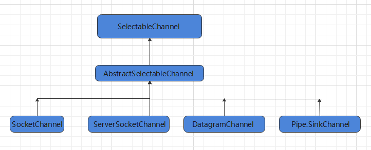

# 05-NIO通道与选择器

[返回网络与 IO 导航](IO学习导航.md)

### 通道

#### 基本介绍

通道（Channel）：表示 IO 源与目标打开的连接，Channel 类似于传统的流，只不过 Channel 本身不能直接访问数据，Channel 只能与 Buffer **进行交互**

1. NIO 的通道类似于流，但有些区别如下：
   * 通道可以同时进行读写，而流只能读或者只能写
   * 通道可以实现异步读写数据
   * 通道可以从缓冲读数据，也可以写数据到缓冲

2. BIO 中的 Stream 是单向的，NIO 中的 Channel 是双向的，可以读操作，也可以写操作

3. Channel 在 NIO 中是一个接口：`public interface Channel extends Closeable{}`

Channel 实现类：

* FileChannel：用于读取、写入、映射和操作文件的通道，**只能工作在阻塞模式下**
  * 通过 FileInputStream 获取的 Channel 只能读
  * 通过 FileOutputStream 获取的 Channel 只能写
  * 通过 RandomAccessFile 是否能读写根据构造 RandomAccessFile 时的读写模式决定
  
* DatagramChannel：通过 UDP 读写网络中的数据通道

* SocketChannel：通过 TCP 读写网络中的数据

* ServerSocketChannel：可以**监听**新进来的 TCP 连接，对每一个新进来的连接都会创建一个 SocketChannel
  
  提示：ServerSocketChanne 类似 ServerSocket、SocketChannel 类似 Socket
  
  


***


#### 常用API

获取 Channel 方式：

* 对支持通道的对象调用 `getChannel()` 方法
* 通过通道的静态方法 `open()` 打开并返回指定通道
* 使用 Files 类的静态方法 `newByteChannel()` 获取字节通道

Channel 基本操作：**读写都是相对于内存来看，也就是缓冲区**

| 方法                                       | 说明                                                     |
| ------------------------------------------ | -------------------------------------------------------- |
| public abstract int read(ByteBuffer dst)   | 从 Channel 中读取数据到 ByteBuffer，从 position 开始储存 |
| public final long read(ByteBuffer[] dsts)  | 将 Channel 中的数据分散到 ByteBuffer[]                   |
| public abstract int write(ByteBuffer src)  | 将 ByteBuffer 中的数据写入 Channel，从 position 开始写出 |
| public final long write(ByteBuffer[] srcs) | 将 ByteBuffer[] 到中的数据聚集到 Channel                 |
| public abstract long position()            | 返回此通道的文件位置                                     |
| FileChannel position(long newPosition)     | 设置此通道的文件位置                                     |
| public abstract long size()                | 返回此通道的文件的当前大小                               |

**SelectableChannel 的操作 API**：

| 方法                                                     | 说明                                                         |
| -------------------------------------------------------- | ------------------------------------------------------------ |
| SocketChannel accept()                                   | 如果通道处于非阻塞模式，没有请求连接时此方法将立即返回 NULL，否则将阻塞直到有新的连接或发生 I/O 错误，**通过该方法返回的套接字通道将处于阻塞模式** |
| SelectionKey register(Selector sel, int ops)             | 将通道注册到选择器上，并指定监听事件                         |
| SelectionKey register(Selector sel, int ops, Object att) | 将通道注册到选择器上，并在当前通道**绑定一个附件对象**，Object 代表可以是任何类型 |


****


#### 文件读写

```java
public class ChannelTest {
    @Test
	public void write() throws Exception{
 		// 1、字节输出流通向目标文件
        FileOutputStream fos = new FileOutputStream("data01.txt");
        // 2、得到字节输出流对应的通道  【FileChannel】
        FileChannel channel = fos.getChannel();
        // 3、分配缓冲区
        ByteBuffer buffer = ByteBuffer.allocate(1024);
        buffer.put("hello,黑马Java程序员！".getBytes());
        // 4、把缓冲区切换成写出模式
        buffer.flip();
        channel.write(buffer);
        channel.close();
        System.out.println("写数据到文件中！");
    }
    @Test
    public void read() throws Exception {
        // 1、定义一个文件字节输入流与源文件接通
        FileInputStream fis = new FileInputStream("data01.txt");
        // 2、需要得到文件字节输入流的文件通道
        FileChannel channel = fis.getChannel();
        // 3、定义一个缓冲区
        ByteBuffer buffer = ByteBuffer.allocate(1024);
        // 4、读取数据到缓冲区
        channel.read(buffer);
        buffer.flip();
        // 5、读取出缓冲区中的数据并输出即可
        String rs = new String(buffer.array(),0,buffer.remaining());
        System.out.println(rs);
    }
}
```


***


#### 文件复制

Channel 的方法：**sendfile 实现零拷贝**

* `abstract long transferFrom(ReadableByteChannel src, long position, long count)`：从给定的可读字节通道将字节传输到该通道的文件中
  * src：源通道
  * position：文件中要进行传输的位置，必须是非负的 
  * count：要传输的最大字节数，必须是非负的 

* `abstract long transferTo(long position, long count, WritableByteChannel target)`：将该通道文件的字节传输到给定的可写字节通道。
  * position：传输开始的文件中的位置; 必须是非负的 
  * count：要传输的最大字节数; 必须是非负的 
  * target：目标通道 

文件复制的两种方式：

1. Buffer
2. 使用上述两种方法


```java
public class ChannelTest {
    @Test
    public void copy1() throws Exception {
        File srcFile = new File("C:\\壁纸.jpg");
        File destFile = new File("C:\\Users\\壁纸new.jpg");
        // 得到一个字节字节输入流
        FileInputStream fis = new FileInputStream(srcFile);
        // 得到一个字节输出流
        FileOutputStream fos = new FileOutputStream(destFile);
        // 得到的是文件通道
        FileChannel isChannel = fis.getChannel();
        FileChannel osChannel = fos.getChannel();
        // 分配缓冲区
        ByteBuffer buffer = ByteBuffer.allocate(1024);
        while(true){
            // 必须先清空缓冲然后再写入数据到缓冲区
            buffer.clear();
            // 开始读取一次数据
            int flag = isChannel.read(buffer);
            if(flag == -1){
                break;
            }
            // 已经读取了数据 ，把缓冲区的模式切换成可读模式
            buffer.flip();
            // 把数据写出到
            osChannel.write(buffer);
        }
        isChannel.close();
        osChannel.close();
        System.out.println("复制完成！");
    }
    
	@Test
	public void copy02() throws Exception {
    	// 1、字节输入管道
   	 	FileInputStream fis = new FileInputStream("data01.txt");
   	 	FileChannel isChannel = fis.getChannel();
    	// 2、字节输出流管道
    	FileOutputStream fos = new FileOutputStream("data03.txt");
    	FileChannel osChannel = fos.getChannel();
    	// 3、复制
    	osChannel.transferFrom(isChannel,isChannel.position(),isChannel.size());
    	isChannel.close();
    	osChannel.close();
	}
    
	@Test
	public void copy03() throws Exception {
    	// 1、字节输入管道
    	FileInputStream fis = new FileInputStream("data01.txt");
    	FileChannel isChannel = fis.getChannel();
    	// 2、字节输出流管道
    	FileOutputStream fos = new FileOutputStream("data04.txt");
    	FileChannel osChannel = fos.getChannel();
    	// 3、复制
    	isChannel.transferTo(isChannel.position() , isChannel.size() , osChannel);
    	isChannel.close();
    	osChannel.close();
	}
}
```


***


#### 分散聚集

分散读取（Scatter ）：是指把 Channel 通道的数据读入到多个缓冲区中去

聚集写入（Gathering ）：是指将多个 Buffer 中的数据聚集到 Channel

```java
public class ChannelTest {
    @Test
    public void test() throws IOException{
    	// 1、字节输入管道
        FileInputStream is = new FileInputStream("data01.txt");
        FileChannel isChannel = is.getChannel();
        // 2、字节输出流管道
        FileOutputStream fos = new FileOutputStream("data02.txt");
        FileChannel osChannel = fos.getChannel();
        // 3、定义多个缓冲区做数据分散
        ByteBuffer buffer1 = ByteBuffer.allocate(4);
        ByteBuffer buffer2 = ByteBuffer.allocate(1024);
        ByteBuffer[] buffers = {buffer1 , buffer2};
        // 4、从通道中读取数据分散到各个缓冲区
        isChannel.read(buffers);
        // 5、从每个缓冲区中查询是否有数据读取到了
        for(ByteBuffer buffer : buffers){
            buffer.flip();// 切换到读数据模式
            System.out.println(new String(buffer.array() , 0 , buffer.remaining()));
        }
        // 6、聚集写入到通道
        osChannel.write(buffers);
        isChannel.close();
        osChannel.close();
        System.out.println("文件复制~~");
    }
}
```


***


### 选择器

#### 基本介绍

选择器（Selector） 是 SelectableChannle 对象的**多路复用器**，Selector 可以同时监控多个通道的状况，利用 Selector 可使一个单独的线程管理多个 Channel，**Selector 是非阻塞 IO 的核心**



* Selector 能够检测多个注册的通道上是否有事件发生（多个 Channel 以事件的方式可以注册到同一个 Selector)，如果有事件发生，就获取事件然后针对每个事件进行相应的处理，就可以只用一个单线程去管理多个通道，也就是管理多个连接和请求
* 只有在连接/通道真正有读写事件发生时，才会进行读写，就大大地减少了系统开销，并且不必为每个连接都创建一个线程，不用去维护多个线程
* 避免了多线程之间的上下文切换导致的开销


***


#### 常用API

创建 Selector：`Selector selector = Selector.open();`

向选择器注册通道：`SelectableChannel.register(Selector sel, int ops, Object att)`

* 参数一：选择器，指定当前 Channel 注册到的选择器
* 参数二：选择器对通道的监听事件，监听的事件类型用四个常量表示
  * 读 : SelectionKey.OP_READ （1）
  * 写 : SelectionKey.OP_WRITE （4）
  * 连接 : SelectionKey.OP_CONNECT （8）
  * 接收 : SelectionKey.OP_ACCEPT （16）
  * 若不止监听一个事件，使用位或操作符连接：`int interest = SelectionKey.OP_READ | SelectionKey.OP_WRITE`
* 参数三：可以关联一个附件，可以是任何对象

**Selector API**：

| 方法                                             | 说明                                        |
| ------------------------------------------------ | ------------------------------------------- |
| public static Selector open()                    | 打开选择器                                  |
| public abstract void close()                     | 关闭此选择器                                |
| public abstract int select()                     | **阻塞**选择一组通道准备好进行 I/O 操作的键 |
| public abstract int select(long timeout)         | **阻塞**等待 timeout 毫秒                   |
| public abstract int selectNow()                  | 获取一下，**不阻塞**，立刻返回              |
| public abstract Selector wakeup()                | 唤醒正在阻塞的 selector                     |
| public abstract Set<SelectionKey> selectedKeys() | 返回此选择器的选择键集                      |

SelectionKey API:

| 方法                                        | 说明                                               |
| ------------------------------------------- | -------------------------------------------------- |
| public abstract void cancel()               | 取消该键的通道与其选择器的注册                     |
| public abstract SelectableChannel channel() | 返回创建此键的通道，该方法在取消键之后仍将返回通道 |
| public final Object attachment()            | 返回当前 key 关联的附件                            |
| public final boolean isAcceptable()         | 检测此密钥的通道是否已准备好接受新的套接字连接     |
| public final boolean isConnectable()        | 检测此密钥的通道是否已完成或未完成其套接字连接操作 |
| public final boolean isReadable()           | 检测此密钥的频道是否可以阅读                       |
| public final boolean isWritable()           | 检测此密钥的通道是否准备好进行写入                 |

基本步骤：

```java
//1.获取通道
ServerSocketChannel ssChannel = ServerSocketChannel.open();
//2.切换非阻塞模式
ssChannel.configureBlocking(false);
//3.绑定连接
ssChannel.bin(new InetSocketAddress(9999));
//4.获取选择器
Selector selector = Selector.open();
//5.将通道注册到选择器上，并且指定“监听接收事件”
ssChannel.register(selector, SelectionKey.OP_ACCEPT);
```


***


### NIO实现

#### 常用API

* SelectableChannel_API

  | 方法                                                         | 说明                                         |
  | ------------------------------------------------------------ | -------------------------------------------- |
  | public final SelectableChannel configureBlocking(boolean block) | 设置此通道的阻塞模式                         |
  | public final SelectionKey register(Selector sel, int ops)    | 向给定的选择器注册此通道，并选择关注的的事件 |

* SocketChannel_API：

  | 方法                                                    | 说明                           |
  | :------------------------------------------------------ | ------------------------------ |
  | public static SocketChannel open()                      | 打开套接字通道                 |
  | public static SocketChannel open(SocketAddress remote)  | 打开套接字通道并连接到远程地址 |
  | public abstract boolean connect(SocketAddress remote)   | 连接此通道的到远程地址         |
  | public abstract SocketChannel bind(SocketAddress local) | 将通道的套接字绑定到本地地址   |
  | public abstract SocketAddress getLocalAddress()         | 返回套接字绑定的本地套接字地址 |
  | public abstract SocketAddress getRemoteAddress()        | 返回套接字连接的远程套接字地址 |

* ServerSocketChannel_API：

  | 方法                                                       | 说明                                                         |
  | ---------------------------------------------------------- | ------------------------------------------------------------ |
  | public static ServerSocketChannel open()                   | 打开服务器套接字通道                                         |
  | public final ServerSocketChannel bind(SocketAddress local) | 将通道的套接字绑定到本地地址，并配置套接字以监听连接         |
  | public abstract SocketChannel accept()                     | 接受与此通道套接字的连接，通过此方法返回的套接字通道将处于阻塞模式 |

  * 如果 ServerSocketChannel 处于非阻塞模式，如果没有挂起连接，则此方法将立即返回 null
  * 如果通道处于阻塞模式，如果没有挂起连接将无限期地阻塞，直到有新的连接或发生 I/O 错误


***


#### 代码实现

服务端 ：

1. 获取通道，当客户端连接服务端时，服务端会通过 `ServerSocketChannel.accept` 得到 SocketChannel 

2. 切换非阻塞模式

3. 绑定连接

4. 获取选择器

5. 将通道注册到选择器上，并且指定监听接收事件

6. **轮询式**的获取选择器上已经准备就绪的事件

客户端：

1. 获取通道：`SocketChannel sc = SocketChannel.open(new InetSocketAddress(HOST, PORT))`
2. 切换非阻塞模式
3. 分配指定大小的缓冲区：`ByteBuffer buffer = ByteBuffer.allocate(1024)`
4. 发送数据给服务端

37 行代码，如果判断条件改为 !=-1，需要客户端 close 一下

```java
public class Server {
    public static void main(String[] args){
        // 1、获取通道
        ServerSocketChannel serverSocketChannel = ServerSocketChannel.open();
        // 2、切换为非阻塞模式
        serverSocketChannel.configureBlocking(false);
        // 3、绑定连接的端口
        serverSocketChannel.bind(new InetSocketAddress(9999));
        // 4、获取选择器Selector
        Selector selector = Selector.open();
        // 5、将通道都注册到选择器上去，并且开始指定监听接收事件
        serverSocketChannel.register(selector, SelectionKey.OP_ACCEPT);
		// 6、使用Selector选择器阻塞等待轮已经就绪好的事件
        while (selector.select() > 0) {
            System.out.println("----开始新一轮的时间处理----");
            // 7、获取选择器中的所有注册的通道中已经就绪好的事件
            Set<SelectionKey> selectionKeys = selector.selectedKeys();
            Iterator<SelectionKey> it = selectionKeys.iterator();
            // 8、开始遍历这些准备好的事件
            while (it.hasNext()) {
                SelectionKey key = it.next();// 提取当前这个事件
                // 9、判断这个事件具体是什么
                if (key.isAcceptable()) {
                    // 10、直接获取当前接入的客户端通道
                    SocketChannel socketChannel = serverSocketChannel.accept();
                    // 11 、切换成非阻塞模式
                    socketChannel.configureBlocking(false);
                    /*
                     ByteBuffer buffer = ByteBuffer.allocate(16);
                	 // 将一个 byteBuffer 作为附件【关联】到 selectionKey 上
                	 SelectionKey scKey = sc.register(selector, 0, buffer);
                    */
                    // 12、将本客户端通道注册到选择器
                    socketChannel.register(selector, SelectionKey.OP_READ);
                } else if (key.isReadable()) {
                    // 13、获取当前选择器上的读就绪事件
                    SelectableChannel channel = key.channel();
                    SocketChannel socketChannel = (SocketChannel) channel;
                    // 14、读取数据
                    ByteBuffer buffer = ByteBuffer.allocate(1024);
                    // 获取关联的附件
                    // ByteBuffer buffer = (ByteBuffer) key.attachment();
                    int len;
                    while ((len = socketChannel.read(buffer)) > 0) {
                        buffer.flip();
                        System.out.println(socketChannel.getRemoteAddress() + ":" + new String(buffer.array(), 0, len));
                        buffer.clear();// 清除之前的数据
                    }
                }
                // 删除当前的 selectionKey，防止重复操作
                it.remove();
            }
        }
    }
}
```

```java
public class Client {
    public static void main(String[] args) throws Exception {
        // 1、获取通道
        SocketChannel socketChannel = SocketChannel.open(new InetSocketAddress("127.0.0.1", 9999));
        // 2、切换成非阻塞模式
        socketChannel.configureBlocking(false);
        // 3、分配指定缓冲区大小
        ByteBuffer buffer = ByteBuffer.allocate(1024);
        // 4、发送数据给服务端
        Scanner sc = new Scanner(System.in);
        while (true){
            System.out.print("请说：");
            String msg = sc.nextLine();
            buffer.put(("Client：" + msg).getBytes());
            buffer.flip();
            socketChannel.write(buffer);
            buffer.clear();
        }
    }
}
```


***


