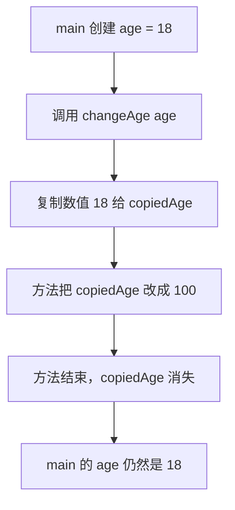
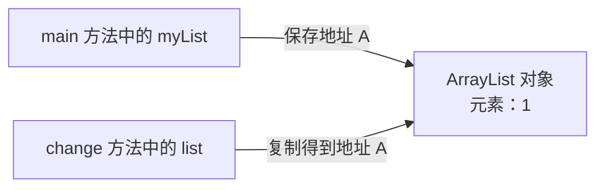
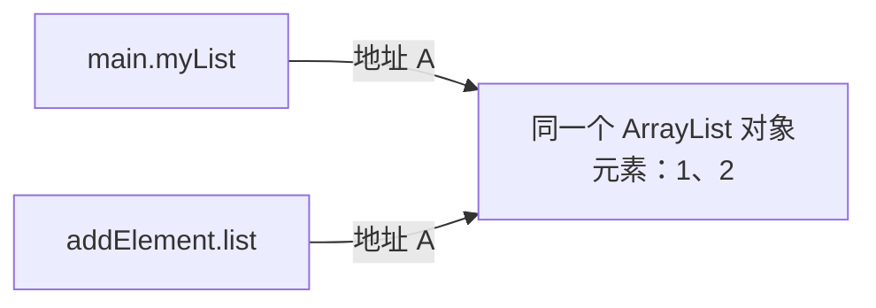
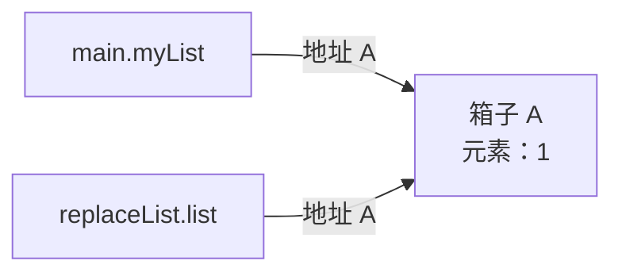
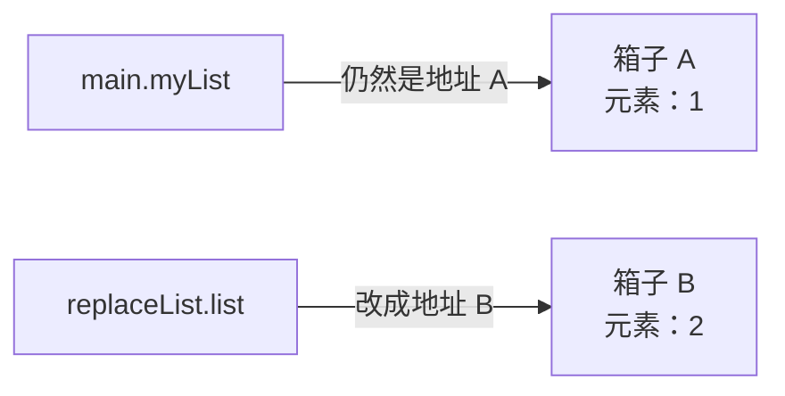
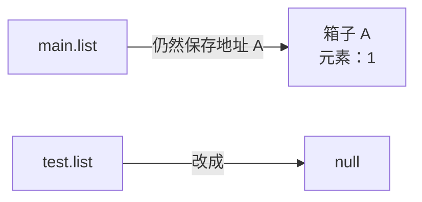

## 一、💡 先记住一句话

> [!tip] 核心结论
> Java **只有值传递**，没有真正的“引用传递”。
>
> 把 `ArrayList` 传进方法时，复制的是一份“找到这个 ArrayList 的地址”。
> 其实就是看栈和堆


先记住下面两种操作的区别：

| 方法里的代码 | 实际改了什么 | 方法外能不能看到 |
| --- | --- | --- |
| `list.add("2")` | 修改原来的集合对象 | 能看到 |
| `list = new ArrayList<>()` | 只修改方法内部那份地址 | 看不到 |
| `list = null` | 只把方法内部那份地址清空 | 看不到 |

记忆口诀：

> **改对象，外面看得见；改指向，外面看不见。**

---

## 二、🧭 先把几个词说成人话

### 2.1 什么是参数

参数，就是方法接收外部数据时使用的变量。

先看一个**完整的小例子**。下面的 `change` 不是 Java 自带的方法，而是我们自己定义的方法：

```java
import java.util.ArrayList;
import java.util.List;

public class ParameterDemo {

    // ① 定义 change 方法：规定它接收一个 List。
    // list 是形参，也就是方法内部用来接收数据的变量。
    private static void change(List<String> list) {
        list.add("2");
    }

    public static void main(String[] args) {
        // ② 创建一个集合对象，让 myList 指向它。
        List<String> myList = new ArrayList<>();

        // ③ 调用上面定义的 change 方法。
        // myList 是实参，也就是这次实际传进去的数据。
        change(myList);
    }
}
```

把“定义方法”和“调用方法”分开看：

| 代码 | 在干什么 |
| --- | --- |
| `private static void change(List<String> list)` | 定义一个叫 `change` 的方法 |
| `List<String> list` | 声明这个方法需要接收一个集合 |
| `change(myList)` | 调用 `change` 方法，把 `myList` 传进去 |
| `list.add("2")` | 方法运行后，向传进来的集合中加入 `"2"` |

> [!info] 方法定义可以写在调用代码的下面
> 在 Java 类中，方法写在 `main` 的上面或下面都可以。Java 编译时会读取整个类，不要求先后顺序。
>
> 但为了让初学者容易阅读，本篇的小例子会先告诉你“这个方法是谁、在哪里定义”，然后再展示调用代码。

可以把方法想成一个小房间：

- `myList` 是房间外面的变量；
- `list` 是房间里面新出现的变量；
- 调用方法时，Java 会把 `myList` 中保存的值复制给 `list`。

> [!info] 参数传递是什么
> “调用方法时，外面的数据怎样交给方法里面的参数”，这件事就叫参数传递。

### 2.2 什么是对象

下面这行代码创建了一个真正的集合对象：

```java
new ArrayList<>()
```

可以把这个对象想成仓库中的一个箱子。箱子里可以放元素：

```text
ArrayList 对象（箱子 A）
┌─────────────┐
│ "1"         │
└─────────────┘
```

### 2.3 什么是引用

再看完整代码：

```java
List<String> myList = new ArrayList<>();
```

这里有两个不同的东西：

- `new ArrayList<>()` 创建的是**对象**，也就是箱子；
- `myList` 是**引用变量**，它保存着找到箱子的地址。

引用不是对象本身。可以把引用理解成“箱子的门牌号”或“遥控器”：

```text
myList（门牌号） ─────> ArrayList 对象（箱子 A）
                        ┌─────────────┐
                        │ "1"         │
                        └─────────────┘
```

更正式一点说：

> 引用类型变量保存的是一个**引用值**。Java 可以通过这个引用值找到对应的对象。

### 2.4 什么是值传递

> [!tip] 先说人话
> 值传递就是：**给方法一份复印件，不把原件交给它。**

这里的“值”，就是变量盒子里面当前装着的内容。

```text
变量 age
┌─────────┐
│   18    │  ← 18 就是 age 当前保存的值
└─────────┘
```

下面分四步看。为了避免两个变量都叫 `age`，方法里的参数故意叫 `copiedAge`。

#### 2.4.1 第一步：先定义一个方法

```java
// 这是我们自己定义的方法，不是 Java 自带的方法。
// copiedAge 是这个方法自己的参数变量。
private static void changeAge(int copiedAge) {
    copiedAge = 100;
}
```

这段代码只是在告诉 Java：

> 以后有人调用 `changeAge` 时，请接收一个整数，把它放进参数 `copiedAge`。

现在还没有调用方法，也没有任何数字被传进去。

#### 2.4.2 第二步：main 创建自己的变量

```java
int age = 18;
```

此时只有一个变量：

```text
main 方法的 age
┌─────────┐
│   18    │
└─────────┘
```

#### 2.4.3 第三步：调用方法

```java
changeAge(age);
```

这行代码可以拆成两部分看：

| 部分 | 意思 |
| --- | --- |
| `changeAge` | 找到我们前面定义的 `changeAge` 方法 |
| `(age)` | 把 `age` 当前保存的值传给这个方法 |

执行这一行的一瞬间，Java 不会把 `main` 的 `age` 原件交出去，而是做一次复制：

```text
main.age                         changeAge.copiedAge
┌─────────┐       复制 18       ┌─────────┐
│   18    │  ────────────────>  │   18    │
└─────────┘                     └─────────┘
 原来的变量                       新创建的参数变量
```

现在有两个互相独立的变量。它们刚开始都装着 `18`，但不是同一个盒子。

这一步就是**值传递**：把值 `18` 复制一份，放进参数 `copiedAge`。

#### 2.4.4 第四步：方法修改自己的参数

进入方法后执行：

```java
copiedAge = 100;
```

变化如下：

```text
main.age                         changeAge.copiedAge
┌─────────┐                     ┌─────────┐
│   18    │                     │   100   │
└─────────┘                     └─────────┘
 没有变化                         只改了复印件
```

所以方法结束后，`main` 中的 `age` 仍然是 `18`。

#### 2.4.5 把完整代码连起来

```java
public class AgeDemo {

    // ① 先定义方法：copiedAge 是方法自己的变量。
    private static void changeAge(int copiedAge) {
        // ④ 这里只会修改 copiedAge，不会修改 main 中的 age。
        copiedAge = 100;
        System.out.println("方法里面：" + copiedAge); // 100
    }

    public static void main(String[] args) {
        // ② main 创建自己的变量 age。
        int age = 18;

        // ③ 调用方法：把数值 18 复制给参数 copiedAge。
        changeAge(age);

        // ⑤ main 自己的 age 没有被修改。
        System.out.println("main 里面：" + age); // 18
    }
}
```

程序执行顺序是：



#### 2.4.6 换成 ArrayList，规则仍然一样

先直接看一个可以运行的例子，再解释发生了什么：

```java
import java.util.ArrayList;
import java.util.List;

public class ListDemo {

    // ① 先定义方法。
    // copiedList 是这个方法自己的参数变量。
    private static void addItem(List<String> copiedList) {
        // ⑤ 通过 copiedList 找到集合对象，并向集合中加入 "2"。
        copiedList.add("2");
    }

    public static void main(String[] args) {
        // ② new ArrayList 创建一个真正的集合对象，我们叫它“集合 A”。
        // myList 中保存着找到集合 A 的引用值。
        List<String> myList = new ArrayList<>();

        // ③ 通过 myList 找到集合 A，放入 "1"。
        myList.add("1");

        // ④ 调用 addItem 方法。
        // Java 把 myList 中保存的引用值复制给参数 copiedList。
        addItem(myList);

        // ⑥ 打印结果是 [1, 2]。
        System.out.println(myList);
    }
}
```

不要急着看“引用值”这个词。按照执行顺序一步一步看。

##### 2.4.6.1 创建集合后是什么样

执行：

```java
List<String> myList = new ArrayList<>();
myList.add("1");
```

内存关系可以理解为：

```text
变量 myList                    集合 A
┌─────────────┐              ┌─────────────┐
│ 集合 A 门牌号 │ ──────────> │    "1"      │
└─────────────┘              └─────────────┘
```

注意，`myList` 不是集合 A 本身。`myList` 里面装的是“怎样找到集合 A”的信息。

##### 2.4.6.2 调用方法时复制了什么

接着执行：

```java
addItem(myList);
```

Java 会创建方法参数 `copiedList`，然后把 `myList` 盒子里的内容复制给它。

`myList` 盒子里装的是“集合 A 的门牌号”，所以复制后变成：

```text
main 方法                         addItem 方法

变量 myList                      参数 copiedList
┌─────────────┐   复制门牌号     ┌─────────────┐
│ 集合 A 门牌号 │ ─────────────> │ 集合 A 门牌号 │
└─────────────┘                 └─────────────┘
       │                               │
       └───────────┬───────────────────┘
                   ▼
                 集合 A
              ┌─────────┐
              │   "1"   │
              └─────────┘
```

现在有两个变量：

- `myList` 属于 `main` 方法；
- `copiedList` 属于 `addItem` 方法；
- 两个变量不是同一个变量；
- 但是它们保存着相同的门牌号，所以都能找到集合 A。

##### 2.4.6.3 为什么 `add` 后，myList 也能看到

方法里面执行：

```java
copiedList.add("2");
```

这行代码不是修改 `copiedList` 盒子里的门牌号，而是：

1. 根据 `copiedList` 保存的门牌号找到集合 A；
2. 向集合 A 中加入 `"2"`。

```text
myList ──────────┐
                 ├────> 集合 A：["1", "2"]
copiedList ──────┘
```

`myList` 也指向集合 A，所以回到 `main` 后打印：

```java
System.out.println(myList); // [1, 2]
```

方法结束后，参数 `copiedList` 会消失，但集合 A 不会消失，因为 `myList` 仍然指向它。

##### 2.4.6.4 它和 int 到底哪里一样

两者的**复制动作完全一样**，区别只是变量盒子里的内容不同：

| 变量 | 变量盒子里装的内容 | 调用方法时发生什么 |
| --- | --- | --- |
| `int age = 18` | 数字 `18` | 把数字 `18` 复制给参数 |
| `List<String> myList = ...` | 集合 A 的门牌号 | 把门牌号复制给参数 |

```text
int：       18          ──复制──> 18

ArrayList：集合 A 门牌号 ──复制──> 集合 A 门牌号
```

Java 都是在复制值，所以二者都是**值传递**。

##### 2.4.6.5 再对比一次：改集合和改门牌号

如果方法执行：

```java
copiedList.add("2");
```

它修改的是大家共同找到的集合 A，所以 `main` 能看到 `[1, 2]`。

如果方法执行：

```java
copiedList = new ArrayList<>();
```

它只是把 `copiedList` 自己盒子里的门牌号换成了“集合 B 的门牌号”。`myList` 盒子没有被动过，仍然保存着集合 A 的门牌号。

```text
myList       ─────> 集合 A：["1"]

copiedList   ─────> 集合 B：[]
```

所以：

> `add` 修改共同的集合，外面看得见；重新赋值只更换参数自己的门牌号，外面看不见。

### 2.5 那“引用传递”是什么

严格来说，**Java 没有引用传递**。

真正的引用传递，意味着方法拿到的是调用方变量本身。这样，方法给参数重新赋值时，也能直接改变调用方变量的指向。

但 Java 做不到这一点：

```java
private static void change(List<String> list) {
    // 这里只能改变方法内部的 list。
    // 改不到调用方那个 myList 变量本身。
    list = new ArrayList<>();
}
```

有些人会把“传入对象引用”简称为“引用传递”，但这个说法容易误导。面试时最好说：

> Java 只有值传递。传递对象时，传递的是引用值的副本。

### 2.6 能不能用堆和栈来理解

可以。你的理解**大方向是对的**，但最后一句需要改一下。

常见的入门图是：

```text
main 方法的栈帧                         堆

int age = 18
┌─────────────┐
│ age：18      │
└─────────────┘

List myList                            ArrayList 对象
┌─────────────┐                       ┌─────────────┐
│ 集合 A 引用值 │ ───────────────────> │  ["1"]      │
└─────────────┘                       └─────────────┘
```

调用方法时，会为被调用的方法创建新的栈帧。参数会成为新栈帧中的局部变量：

```text
main 栈帧                 addItem 栈帧                  堆

myList                    copiedList                    集合 A
┌───────────┐  复制引用值  ┌───────────┐               ┌───────────┐
│ 集合 A 引用 │ ─────────> │ 集合 A 引用 │ ───────────> │   ["1"]   │
└───────────┘             └───────────┘               └───────────┘
      │                                                    ▲
      └────────────────────────────────────────────────────┘
```

因此，通过 `copiedList.add("2")` 可以找到堆里的同一个集合 A，并把它修改成 `["1", "2"]`。

#### 2.6.1 你说对的部分

- `new ArrayList<>()` 创建的是对象；按照 JVM 的抽象模型，类实例和数组从堆中分配。
- 方法中的局部变量和参数属于各自的方法栈帧。
- 调用方法时，参数 `copiedList` 得到一份引用值的副本。
- 两份引用值能找到同一个对象，所以通过任何一份引用都能修改这个对象。

#### 2.6.2 需要修正的部分

下面这句话不够准确：

> 因为数值只在栈中，所以方法改不到它。

准确原因应该是：

> 因为传给方法的是数值的副本，所以方法只能修改自己的副本。

例如：

```java
private static void changeAge(int copiedAge) {
    copiedAge = 100;
}

public static void main(String[] args) {
    int age = 18;
    changeAge(age);
    System.out.println(age); // 18
}
```

调用后存在两个栈帧，每个栈帧里都有自己的变量：

```text
main 栈帧                       changeAge 栈帧
┌─────────────┐                ┌─────────────────┐
│ age：18      │   复制数值 18  │ copiedAge：100   │
└─────────────┘                └─────────────────┘
```

`changeAge` 改不到外面的 `age`，不是因为 `18` 有什么特殊的存放位置，而是因为两个栈帧中保存的是两份独立的数值。

#### 2.6.3 一个反例：堆里的数值也可以被改

如果“数值在栈里所以不能改”是根本原因，那么对象中存放在堆里的 `int` 应该能直接传进去修改。但实际上仍然不行：

```java
class Person {
    int age = 18;
}

private static void changeAge(int copiedAge) {
    copiedAge = 100;
}

public static void main(String[] args) {
    Person person = new Person();

    // person.age 是对象中的字段，可以把它理解为存放在堆中。
    // 但是传给 changeAge 的仍然只是数值 18 的副本。
    changeAge(person.age);

    System.out.println(person.age); // 仍然是 18
}
```

如果传入整个 `person`，再通过引用修改它的字段，调用方才能看到：

```java
private static void changePerson(Person copiedPerson) {
    // copiedPerson 和外面的 person 指向同一个对象。
    copiedPerson.age = 100;
}

public static void main(String[] args) {
    Person person = new Person();
    changePerson(person);
    System.out.println(person.age); // 100
}
```

这两个例子证明，关键不是“这个数字在堆还是栈”，而是方法收到的究竟是：

- 数字的副本；还是
- 能找到共享对象的引用值副本。

#### 2.6.4 为什么面试时不要只回答堆和栈

“引用变量在栈，对象在堆”适合作为入门示意图，但不应该当成绝对的物理内存描述：

- JVM 规范定义了栈帧、局部变量和堆等抽象运行时区域；
- 具体 JVM 可以使用寄存器、即时编译和其他优化；
- JVM 规范甚至允许栈帧采用堆分配；
- Java 语言层面的参数传递结论不依赖这些实现细节。

面试时可以这样说：

> 用常见的堆栈模型看，方法调用会创建新的栈帧。基本类型参数复制具体数值，引用类型参数复制引用值，因此两个引用可以访问堆中的同一个对象。但这道题的本质是 Java 的值传递，而不是对象究竟物理存放在哪里。

---

## 三、⚙️ 用一张总图看懂参数传递

假设代码是：

```java
List<String> myList = new ArrayList<>();
myList.add("1");
change(myList);
```

刚进入 `change` 方法时，Java 做了下面这件事：



注意：

- `myList` 和 `list` 是两个不同的变量；
- 它们恰好保存了相同的地址；
- 所以它们暂时指向同一个 `ArrayList` 对象。

可以把它想成：你复印了一张仓库门牌号，交给朋友。

- 你手里有一张门牌号；
- 朋友手里也有一张；
- 两张纸不是同一张纸；
- 但两张纸都能找到同一个仓库。

---

## 四、🔍 为什么 `add` 后，外面的集合也变了

### 4.1 示例代码

```java
private static void addElement(List<String> list) {
    list.add("2");
}
```

### 4.2 实际发生了什么

`list.add("2")` 没有改变 `list` 保存的地址。

它先顺着地址找到箱子 A，然后把 `"2"` 放进箱子 A。由于外面的 `myList` 也指向箱子 A，所以外面当然能看到变化。



调用结束后：

```java
System.out.println(myList); // [1, 2]
```

关键点不是“参数被改了”，而是：

> 方法通过参数找到并修改了大家共同指向的对象。

---

## 五、🔁 为什么重新 `new` 后，外面却没变

### 5.1 示例代码

```java
private static void replaceList(List<String> list) {
    list = new ArrayList<>();
    list.add("2");
}
```

### 5.2 第一步：刚进入方法

两个变量指向同一个箱子 A：



### 5.3 第二步：执行 `list = new ArrayList<>()`

Java 新建了箱子 B，然后只把方法里的 `list` 改成箱子 B 的地址：



这相当于：

- 你手里的纸仍写着“仓库 A”；
- 朋友把自己那张纸上的地址改成了“仓库 B”；
- 朋友没有碰到你手里的那张纸。

方法结束后，参数 `list` 消失。外面的 `myList` 从头到尾都指向箱子 A，所以：

```java
System.out.println(myList); // [1]
```

> [!tip] 再念一遍口诀
> `add` 是改共同的对象，外面看得见。
>
> `list = new ArrayList<>()` 是改方法内部参数的指向，外面看不见。

---

## 六、🚫 为什么 `list = null` 后，外面还能继续 `add`

### 6.1 `null` 改的是形参自己的引用值

第三道题的方法是：

```java
private static void test(List<String> list) {
    list = null;
}
```

刚进入方法时，`main.list` 和 `test.list` 都指向箱子 A。执行 `list = null` 后，只是把 `test.list` 这张“门牌号”清空：



`main.list` 没有变，仍然能找到原集合，所以方法返回后执行：

```java
list.add("2");
```

不会出现空指针异常，最终打印 `[1, 2]`。

### 6.2 哪些写法才会出现空指针异常

如果在 `test` 方法里把形参设为 `null` 后，马上通过它调用方法，就会出现 `NullPointerException`：

```java
private static void test(List<String> list) {
    list = null;
    list.add("2"); // NullPointerException
}
```

如果直接把 `main` 方法自己的引用设为 `null`，下一次调用 `add` 同样会报错：

```java
list = null;
list.add("2"); // NullPointerException
```

> [!warning] `list = null` 不等于清空集合
> `list = null` 是让引用不再指向对象；`list.clear()` 才是清空这个引用所指向集合中的元素。后者修改了共享对象，所以调用方能够看到。

---

## 七、🚀 完整实践：运行三道面试原题

### 7.1 前置准备

安装任意常用版本的 JDK 即可。示例不需要第三方依赖。

### 7.2 三道题的答案

| 题目 | `test` 方法里的操作 | 最终输出 |
| --- | --- | --- |
| 第一题 | `list.add("2")` | `[1, 2]` |
| 第二题 | 重新 `new`，再加入 `"3"` | `[1, 2]` |
| 第三题 | `list = null` | `[1, 2]` |

三道题输出相同，但原因不完全相同：

- 第一题的 `"2"` 是在 `test` 方法中加入原集合的；
- 第二题中的新集合和 `"3"` 只存在于 `test` 方法里，方法结束后调用方仍使用原集合，再由 `main` 加入 `"2"`；
- 第三题只把方法里的引用副本设为 `null`，调用方仍能找到原集合，再加入 `"2"`。

### 7.3 第一题原题

```java
public static void main(String[] args) {
    List<String> list = new ArrayList<>();
    list.add("1");
    test(list);
    System.out.println(list);
}

public static void test(List<String> list) {
    list.add("2");
}
```

输出：

```text
[1, 2]
```

### 7.4 第二题原题

```java
public static void main(String[] args) {
    List<String> list = new ArrayList<>();
    list.add("1");
    test(list);
    list.add("2");
    System.out.println(list);
}

public static void test(List<String> list) {
    list = new ArrayList<>();
    list.add("3");
}
```

输出：

```text
[1, 2]
```

### 7.5 第三题原题

```java
public static void main(String[] args) {
    List<String> list = new ArrayList<>();
    list.add("1");
    test(list);
    list.add("2");
    System.out.println(list);
}

public static void test(List<String> list) {
    list = null;
}
```

输出：

```text
[1, 2]
```

### 7.6 如果就是想让外面换成新集合怎么办

把新集合返回，再让调用方主动接收：

```java
private static List<String> createNewList() {
    List<String> newList = new ArrayList<>();
    newList.add("2");
    return newList;
}

public static void main(String[] args) {
    List<String> myList = new ArrayList<>();
    myList.add("1");

    // 调用方自己重新赋值，所以 myList 现在会指向新集合。
    myList = createNewList();
    System.out.println(myList); // [2]
}
```

---

## 八、🎤 面试时怎么说

### 8.1 30 秒回答

> Java 只有值传递。基本类型传递的是数值的副本，引用类型传递的是引用值的副本。调用方法后，形参和实参是两个不同变量，但它们一开始指向同一个对象，所以通过形参调用 `add` 会修改同一个集合，调用方能看到。给形参重新 `new` 或赋值为 `null`，都只会改变形参副本的指向，不会改变调用方变量的指向。

### 8.2 面试官追问：Java 是引用传递吗

不是。传入对象时，确实传了一个引用值，但传递方式仍然是值传递，因为方法拿到的是这个引用值的**副本**。

判断方法很简单：

> 如果方法给形参重新赋值，却不能改变调用方变量的指向，那就不是真正的引用传递。

### 8.3 面试官追问：`static` 会影响结果吗

不会。

`static` 只决定这个方法属于类本身，还是属于某个对象。它不会改变 Java 的参数传递规则。

---

## 九、📌 快速回顾

- 参数：方法用来接收外部数据的局部变量。
- 参数传递：调用方法时，把实参中的值复制给形参。
- 对象：`new ArrayList<>()` 真正创建出来的集合。
- 引用：用于找到对象的值，可以通俗理解成地址或门牌号。
- Java 只有值传递；对象参数复制的是引用值。
- `list.add(...)` 修改对象，调用方能看到。
- `list = new ArrayList<>()` 修改形参自己的指向，调用方看不到。
- `list = null` 同样只修改形参自己的引用值，调用方仍指向原对象。

最后只背这一句也可以：

> **复制门牌号，共享同一个箱子；改箱子，大家都看见；改自己的门牌号，别人不知道。**

相关知识：[[../基础/ArrayList 与 LinkedList 的区别和扩容机制]]。

## 十、🔗 官方资料

- [Oracle Java Tutorial：Passing Information to a Method or a Constructor](https://docs.oracle.com/javase/tutorial/java/javaOO/arguments.html)
- [Java Language Specification：Types, Values, and Variables](https://docs.oracle.com/javase/specs/jls/se26/html/jls-4.html)
- [Java Language Specification：Run-Time Evaluation of Method Invocation](https://docs.oracle.com/javase/specs/jls/se26/html/jls-15.html#jls-15.12.4)
- [Java Virtual Machine Specification：Run-Time Data Areas and Frames](https://docs.oracle.com/javase/specs/jvms/se26/html/jvms-2.html#jvms-2.5)
