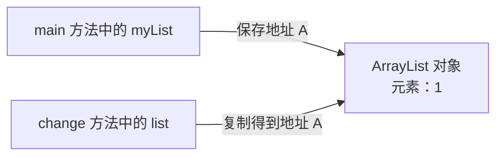
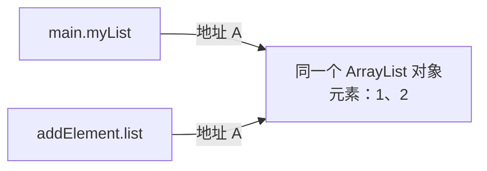
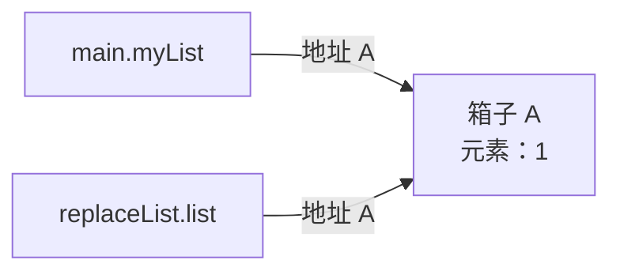
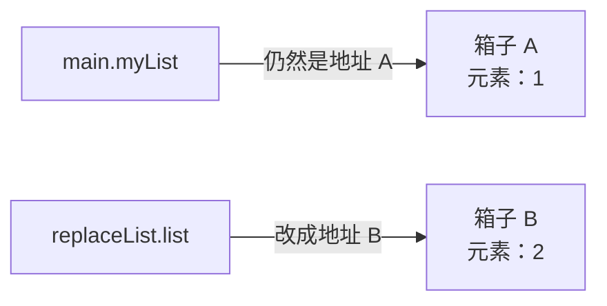
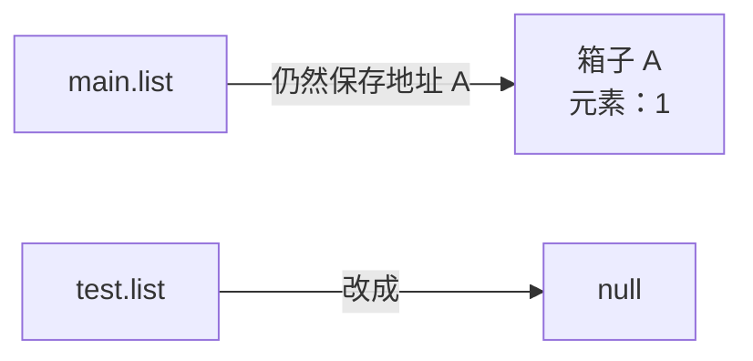

## 一、💡 先记住一句话

> [!tip] 核心结论
> Java **只有值传递**，没有真正的“引用传递”。
>
> 把 `ArrayList` 传进方法时，复制的是一份“找到这个 ArrayList 的地址”。

先记住下面两种操作的区别：

| 方法里的代码 | 实际改了什么 | 方法外能不能看到 |
| --- | --- | --- |
| `list.add("2")` | 修改原来的集合对象 | 能看到 |
| `list = new ArrayList<>()` | 只修改方法内部那份地址 | 看不到 |
| `list = null` | 只把方法内部那份地址清空 | 看不到 |

记忆口诀：

> **改对象，外面看得见；改指向，外面看不见。**

---

## 二、🧭 先把几个词说成人话

### 2.1 什么是参数

参数，就是方法接收外部数据时使用的变量。

先看一个**完整的小例子**。下面的 `change` 不是 Java 自带的方法，而是我们自己定义的方法：

```java
import java.util.ArrayList;
import java.util.List;

public class ParameterDemo {

    // ① 定义 change 方法：规定它接收一个 List。
    // list 是形参，也就是方法内部用来接收数据的变量。
    private static void change(List<String> list) {
        list.add("2");
    }

    public static void main(String[] args) {
        // ② 创建一个集合对象，让 myList 指向它。
        List<String> myList = new ArrayList<>();

        // ③ 调用上面定义的 change 方法。
        // myList 是实参，也就是这次实际传进去的数据。
        change(myList);
    }
}
```

把“定义方法”和“调用方法”分开看：

| 代码 | 在干什么 |
| --- | --- |
| `private static void change(List<String> list)` | 定义一个叫 `change` 的方法 |
| `List<String> list` | 声明这个方法需要接收一个集合 |
| `change(myList)` | 调用 `change` 方法，把 `myList` 传进去 |
| `list.add("2")` | 方法运行后，向传进来的集合中加入 `"2"` |

> [!info] 方法定义可以写在调用代码的下面
> 在 Java 类中，方法写在 `main` 的上面或下面都可以。Java 编译时会读取整个类，不要求先后顺序。
>
> 但为了让初学者容易阅读，本篇的小例子会先告诉你“这个方法是谁、在哪里定义”，然后再展示调用代码。

可以把方法想成一个小房间：

- `myList` 是房间外面的变量；
- `list` 是房间里面新出现的变量；
- 调用方法时，Java 会把 `myList` 中保存的值复制给 `list`。

> [!info] 参数传递是什么
> “调用方法时，外面的数据怎样交给方法里面的参数”，这件事就叫参数传递。

### 2.2 什么是对象

下面这行代码创建了一个真正的集合对象：

```java
new ArrayList<>()
```

可以把这个对象想成仓库中的一个箱子。箱子里可以放元素：

```text
ArrayList 对象（箱子 A）
┌─────────────┐
│ "1"         │
└─────────────┘
```

### 2.3 什么是引用

再看完整代码：

```java
List<String> myList = new ArrayList<>();
```

这里有两个不同的东西：

- `new ArrayList<>()` 创建的是**对象**，也就是箱子；
- `myList` 是**引用变量**，它保存着找到箱子的地址。

引用不是对象本身。可以把引用理解成“箱子的门牌号”或“遥控器”：

```text
myList（门牌号） ─────> ArrayList 对象（箱子 A）
                        ┌─────────────┐
                        │ "1"         │
                        └─────────────┘
```

更正式一点说：

> 引用类型变量保存的是一个**引用值**。Java 可以通过这个引用值找到对应的对象。

### 2.4 什么是值传递

值传递的意思不是“只能传普通数字”，而是：

> 调用方法时，把变量中保存的值**复制一份**，交给方法参数。

先用 `int` 看一个完整例子。`changeAge` 不是 Java 自带的方法，它就在同一个类中，由我们自己定义：

```java
public class AgeDemo {

    // ① 定义 changeAge 方法。
    // 它接收一个 int，方法内部把自己的 age 改成 100。
    private static void changeAge(int age) {
        age = 100;
        System.out.println("方法里面的 age：" + age); // 100
    }

    public static void main(String[] args) {
        // ② 创建 main 方法自己的变量 age，值是 18。
        int age = 18;

        // ③ 调用上面定义的 changeAge 方法。
        // 执行这一行时，Java 把数字 18 复制一份，交给 changeAge 的参数 age。
        changeAge(age);

        // ④ changeAge 改的是它自己的副本，不是 main 中的 age。
        System.out.println("main 里面的 age：" + age); // 18
    }
}
```

这段程序有两个都叫 `age` 的变量：

```text
main.age = 18
    │
    │ 调用 changeAge(age)，复制数字 18
    ▼
changeAge.age = 18  →  在方法内改成 100

方法结束后：main.age 仍然是 18
```

它们名字相同，但属于不同的方法，就像两个房间里各有一个同名的盒子，并不是同一个变量。

再看 `ArrayList`。前面已经定义过 `change(List<String> list)` 方法，所以这里调用它：

```java
List<String> myList = new ArrayList<>();

// 调用我们自己定义的 change 方法。
// 这次复制的不是整个集合，而是“箱子 A 的门牌号”。
change(myList);
```

> [!warning] 最容易说错的地方
> 不是把整个 `ArrayList` 复制了一份，也不是把外面的 `myList` 变量直接交给方法。
>
> Java 复制的只是 `myList` 里面保存的引用值。

### 2.5 那“引用传递”是什么

严格来说，**Java 没有引用传递**。

真正的引用传递，意味着方法拿到的是调用方变量本身。这样，方法给参数重新赋值时，也能直接改变调用方变量的指向。

但 Java 做不到这一点：

```java
private static void change(List<String> list) {
    // 这里只能改变方法内部的 list。
    // 改不到调用方那个 myList 变量本身。
    list = new ArrayList<>();
}
```

有些人会把“传入对象引用”简称为“引用传递”，但这个说法容易误导。面试时最好说：

> Java 只有值传递。传递对象时，传递的是引用值的副本。

---

## 三、⚙️ 用一张总图看懂参数传递

假设代码是：

```java
List<String> myList = new ArrayList<>();
myList.add("1");
change(myList);
```

刚进入 `change` 方法时，Java 做了下面这件事：



注意：

- `myList` 和 `list` 是两个不同的变量；
- 它们恰好保存了相同的地址；
- 所以它们暂时指向同一个 `ArrayList` 对象。

可以把它想成：你复印了一张仓库门牌号，交给朋友。

- 你手里有一张门牌号；
- 朋友手里也有一张；
- 两张纸不是同一张纸；
- 但两张纸都能找到同一个仓库。

---

## 四、🔍 为什么 `add` 后，外面的集合也变了

### 4.1 示例代码

```java
private static void addElement(List<String> list) {
    list.add("2");
}
```

### 4.2 实际发生了什么

`list.add("2")` 没有改变 `list` 保存的地址。

它先顺着地址找到箱子 A，然后把 `"2"` 放进箱子 A。由于外面的 `myList` 也指向箱子 A，所以外面当然能看到变化。



调用结束后：

```java
System.out.println(myList); // [1, 2]
```

关键点不是“参数被改了”，而是：

> 方法通过参数找到并修改了大家共同指向的对象。

---

## 五、🔁 为什么重新 `new` 后，外面却没变

### 5.1 示例代码

```java
private static void replaceList(List<String> list) {
    list = new ArrayList<>();
    list.add("2");
}
```

### 5.2 第一步：刚进入方法

两个变量指向同一个箱子 A：



### 5.3 第二步：执行 `list = new ArrayList<>()`

Java 新建了箱子 B，然后只把方法里的 `list` 改成箱子 B 的地址：



这相当于：

- 你手里的纸仍写着“仓库 A”；
- 朋友把自己那张纸上的地址改成了“仓库 B”；
- 朋友没有碰到你手里的那张纸。

方法结束后，参数 `list` 消失。外面的 `myList` 从头到尾都指向箱子 A，所以：

```java
System.out.println(myList); // [1]
```

> [!tip] 再念一遍口诀
> `add` 是改共同的对象，外面看得见。
>
> `list = new ArrayList<>()` 是改方法内部参数的指向，外面看不见。

---

## 六、🚫 为什么 `list = null` 后，外面还能继续 `add`

### 6.1 `null` 改的是形参自己的引用值

第三道题的方法是：

```java
private static void test(List<String> list) {
    list = null;
}
```

刚进入方法时，`main.list` 和 `test.list` 都指向箱子 A。执行 `list = null` 后，只是把 `test.list` 这张“门牌号”清空：



`main.list` 没有变，仍然能找到原集合，所以方法返回后执行：

```java
list.add("2");
```

不会出现空指针异常，最终打印 `[1, 2]`。

### 6.2 哪些写法才会出现空指针异常

如果在 `test` 方法里把形参设为 `null` 后，马上通过它调用方法，就会出现 `NullPointerException`：

```java
private static void test(List<String> list) {
    list = null;
    list.add("2"); // NullPointerException
}
```

如果直接把 `main` 方法自己的引用设为 `null`，下一次调用 `add` 同样会报错：

```java
list = null;
list.add("2"); // NullPointerException
```

> [!warning] `list = null` 不等于清空集合
> `list = null` 是让引用不再指向对象；`list.clear()` 才是清空这个引用所指向集合中的元素。后者修改了共享对象，所以调用方能够看到。

---

## 七、🚀 完整实践：运行三道面试原题

### 7.1 前置准备

安装任意常用版本的 JDK 即可。示例不需要第三方依赖。

### 7.2 三道题的答案

| 题目 | `test` 方法里的操作 | 最终输出 |
| --- | --- | --- |
| 第一题 | `list.add("2")` | `[1, 2]` |
| 第二题 | 重新 `new`，再加入 `"3"` | `[1, 2]` |
| 第三题 | `list = null` | `[1, 2]` |

三道题输出相同，但原因不完全相同：

- 第一题的 `"2"` 是在 `test` 方法中加入原集合的；
- 第二题中的新集合和 `"3"` 只存在于 `test` 方法里，方法结束后调用方仍使用原集合，再由 `main` 加入 `"2"`；
- 第三题只把方法里的引用副本设为 `null`，调用方仍能找到原集合，再加入 `"2"`。

### 7.3 第一题原题

```java
public static void main(String[] args) {
    List<String> list = new ArrayList<>();
    list.add("1");
    test(list);
    System.out.println(list);
}

public static void test(List<String> list) {
    list.add("2");
}
```

输出：

```text
[1, 2]
```

### 7.4 第二题原题

```java
public static void main(String[] args) {
    List<String> list = new ArrayList<>();
    list.add("1");
    test(list);
    list.add("2");
    System.out.println(list);
}

public static void test(List<String> list) {
    list = new ArrayList<>();
    list.add("3");
}
```

输出：

```text
[1, 2]
```

### 7.5 第三题原题

```java
public static void main(String[] args) {
    List<String> list = new ArrayList<>();
    list.add("1");
    test(list);
    list.add("2");
    System.out.println(list);
}

public static void test(List<String> list) {
    list = null;
}
```

输出：

```text
[1, 2]
```

### 7.6 如果就是想让外面换成新集合怎么办

把新集合返回，再让调用方主动接收：

```java
private static List<String> createNewList() {
    List<String> newList = new ArrayList<>();
    newList.add("2");
    return newList;
}

public static void main(String[] args) {
    List<String> myList = new ArrayList<>();
    myList.add("1");

    // 调用方自己重新赋值，所以 myList 现在会指向新集合。
    myList = createNewList();
    System.out.println(myList); // [2]
}
```

---

## 八、🎤 面试时怎么说

### 8.1 30 秒回答

> Java 只有值传递。基本类型传递的是数值的副本，引用类型传递的是引用值的副本。调用方法后，形参和实参是两个不同变量，但它们一开始指向同一个对象，所以通过形参调用 `add` 会修改同一个集合，调用方能看到。给形参重新 `new` 或赋值为 `null`，都只会改变形参副本的指向，不会改变调用方变量的指向。

### 8.2 面试官追问：Java 是引用传递吗

不是。传入对象时，确实传了一个引用值，但传递方式仍然是值传递，因为方法拿到的是这个引用值的**副本**。

判断方法很简单：

> 如果方法给形参重新赋值，却不能改变调用方变量的指向，那就不是真正的引用传递。

### 8.3 面试官追问：`static` 会影响结果吗

不会。

`static` 只决定这个方法属于类本身，还是属于某个对象。它不会改变 Java 的参数传递规则。

---

## 九、📌 快速回顾

- 参数：方法用来接收外部数据的局部变量。
- 参数传递：调用方法时，把实参中的值复制给形参。
- 对象：`new ArrayList<>()` 真正创建出来的集合。
- 引用：用于找到对象的值，可以通俗理解成地址或门牌号。
- Java 只有值传递；对象参数复制的是引用值。
- `list.add(...)` 修改对象，调用方能看到。
- `list = new ArrayList<>()` 修改形参自己的指向，调用方看不到。
- `list = null` 同样只修改形参自己的引用值，调用方仍指向原对象。

最后只背这一句也可以：

> **复制门牌号，共享同一个箱子；改箱子，大家都看见；改自己的门牌号，别人不知道。**

相关知识：[[../基础/ArrayList 与 LinkedList 的区别和扩容机制]]。

## 十、🔗 官方资料

- [Oracle Java Tutorial：Passing Information to a Method or a Constructor](https://docs.oracle.com/javase/tutorial/java/javaOO/arguments.html)
- [Java Language Specification：Types, Values, and Variables](https://docs.oracle.com/javase/specs/jls/se26/html/jls-4.html)
