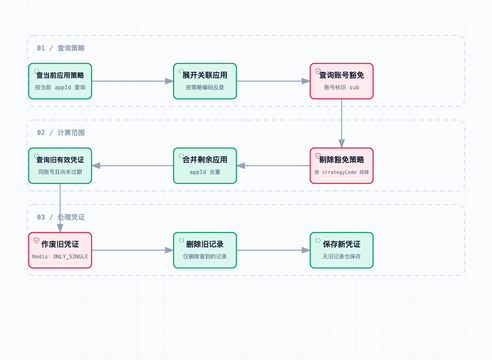

# SSO登录

本文基于 `aboss-sso` 工作区代码整理，未执行压测，也未修改代码或数据库。

**目的：** 用户提交密码或 OAuth2 授权码，系统完成身份平台交互后，生成本系统使用的 JWT，并管理新旧登录记录。

[打开独立登录交互图](../../../../archify/sso-login-flow.html)

图中按代码执行顺序展开登录过程，条件步骤已标注适用范围；认证过程另见《SSO认证鉴权》。

## 1. 登录按顺序做了什么

按上面的交互图，登录依次执行以下步骤：

1. **接收登录请求。** 调用方提交应用 ID（`appId`）和密码或 OAuth2 授权码。
2. **校验应用配置。** 根据 `appId` 查询 IDaaS 配置；不存在就提示“appId不存在!”并终止登录。
3. **获取 IDaaS Token。** 使用密码或授权码换取 Access Token 和有效期，并记录登录时间。
4. **查询 IDaaS 用户信息。** 使用 Access Token 获取用户标识、用户名等信息；查询异常则终止。
5. **更新登录时间。** 更新账号的最近登录时间。
6. **查询账户中心信息。** 按用户标识 `sub` 查询账号；不存在时，使用 IDaaS 信息继续生成外部普通账号凭证，并告警。
7. **确定 JWT 有效期。** 优先使用账号白名单配置，否则读取 Redis 默认配置；配置缺失或读取失败时使用代码默认值。
8. **生成 JWT。** 将身份、应用、登录时间和 IDaaS Token 等信息写入 JWT，设置过期时间并签名。
9. **处理重复登录。** 单设备开关开启且命中限制策略时，将相关应用下的旧有效 Token 写入失效名单。
10. **保存本次登录记录。** 删除已作废的旧记录并保存新 Token；没有旧记录也会保存。
11. **回写 Web Cookie。** 仅 Web 登录执行，将 JWT 写入 Cookie。
12. **处理灰度 Cookie。** 仅 OAuth2 Web 登录执行，命中灰度条件则写入，否则清除。
13. **返回登录结果。** 返回 Token 的 key、JWT value 和有效期 expires，供调用方后续使用。

## 2. JWT 中放了什么，如何确定有效期

`LoginTokenPipelineHandler.handle()` 将以下信息放入 JWT：

- 应用 ID、IDaaS Access Token、登录时间和渠道类型；
- 账号 ID、账号名称、角色、账号类型；
- 人员工号、人员姓名。

JWT 有效期通过 `AccountLoginWhitelistGateway.tokenTimeout()` 获取：优先使用账号白名单中的有效期，否则读取 Redis 中的默认有效期配置，缺失或读取失败时使用代码默认值。

`JwtUtils.createJWT()` 使用配置项 `jwt.secret.key` 和 HS256 算法签名，并写入签发时间、过期时间和 JWT ID。签名用于校验凭证是否被篡改，不代表 JWT 内容经过加密。代码中关于“使用用户密码作为密钥”的旧注释与实际实现不一致，应以配置密钥的实际调用为准。

随后，单设备登录处理器保存有效 Token 记录，包括账号、应用、JWT、登录时间和过期时间。即使没有开启单设备限制，也会保存记录。

## 3. 单设备开关开启后，如何匹配策略

核心规则：**先找当前应用关联的策略，再排除账号豁免的策略，最后合并剩余策略关联的应用。** 这些应用就是本次要清理旧登录的范围。

[打开单设备策略交互图](../../../../archify/sso-single-device-strategy.html)

### 3.1 按什么顺序匹配

`SingleLoginPipelineHandler.strategy()` 依次执行：

1. **查当前应用的策略。** 根据本次登录的 `appId`，查询关联的策略编码。
2. **展开策略关联应用。** 用这些策略编码，反查每个策略下的全部应用；范围可能包含其他应用。
3. **查账号的豁免策略。** 按 IDaaS 用户标识 `sub` 查询账号关联的策略。在这段逻辑中，账号关联策略表示豁免。
4. **排除豁免策略。** 按 `strategyCode` 排除整条策略对应的应用关系。
5. **合并限制范围。** 将剩余关系中的 `appId` 去重，得到本次需要限制的应用集合。

当前应用没有策略、策略没有关联应用，或剩余策略全部被豁免时，都直接保存新 Token，不清理旧登录。开关关闭时也直接保存新 Token。

### 3.2 一个简单例子

假设当前登录应用 A：

| 配置 | 关联内容 |
| --- | --- |
| 策略 P1 | 应用 A、B |
| 策略 P2 | 应用 A、C |
| 当前账号的豁免策略 | P1 |

先找到 A 关联的 P1、P2，再排除 P1，最终剩下 P2 对应的 **A、C**。本次只处理该账号在 A、C 下的旧有效 Token，B 不受影响。

注意：豁免是按策略排除，不是直接豁免应用。A 虽然属于被豁免的 P1，但仍属于未被豁免的 P2，所以仍在限制范围内。

### 3.3 匹配后如何处理旧登录

1. 查询**同一账号、限制应用集合内、数据库过期时间晚于当前时间**的旧 Token。
2. 有旧记录时，将旧 Token 写入 Redis 失效名单，原因设为 `ONLY_SINGLE`，再删除对应数据库记录。
3. 保存本次新 Token；没有旧记录也会保存。

旧设备后续再发起认证请求时会被拒绝，不会直接关闭旧设备页面。该处理器没有比较设备标识，而是按账号和应用范围作废旧凭证。

## 4. 登录阶段的数据交互

这个阶段会与 IDaaS、账户中心、策略和有效 Token 存储交互。较多的用户查询和策略处理放在登录阶段，不等于每次后续认证都要重新执行一遍。

## 5. 有效期一致性（bug）

目前存在两种有效期来源：

| 对象                  | 有效期来源                        |
| ------------------- | ---------------------------- |
| JWT 的过期时间           | 白名单配置或默认登录 Token 有效期         |
| 数据库有效 Token 记录的过期时间 | 登录时间 + IDaaS 返回的 `expiresIn` |
| Redis 失效记录 TTL      | 数据库记录过期时间 - 当前时间，换算为秒        |

举个例子：

- 旧 JWT 本身要到晚上 10 点才过期。
- 数据库里的 Token 记录却在晚上 9 点过期。
- 新设备登录时，系统只会找数据库里“还没过期”的旧记录。到了 9 点，这条记录已经过期，所以系统找不到它，也就不会把它加入 Redis 失效名单。
- 9 点到 10 点之间，旧 JWT 自身仍然有效。认证时又不查数据库，所以旧设备带着它请求时，仍可能通过认证。

所以问题在于：**数据库记录的有效期比 JWT 短，导致系统可能漏掉仍然有效的旧 JWT。**

**按当前代码，数据库记录的过期时间和 JWT 的过期时间来自不同配置：**

- JWT：优先使用账号白名单里的有效期，否则使用默认 JWT 有效期。
- 数据库记录：按登录时间加 IDaaS 返回的 `expiresIn` 计算。

所以两者可能不一致。比如 JWT 有效期是 2 小时，但 IDaaS 的 `expiresIn` 是 1 小时，数据库记录就会早 1 小时过期。

## 相关阅读

[SSO认证鉴权](<*核心3-认证鉴权.md>) · [SSO主动退出](<*核心2-主动退出.md>)
