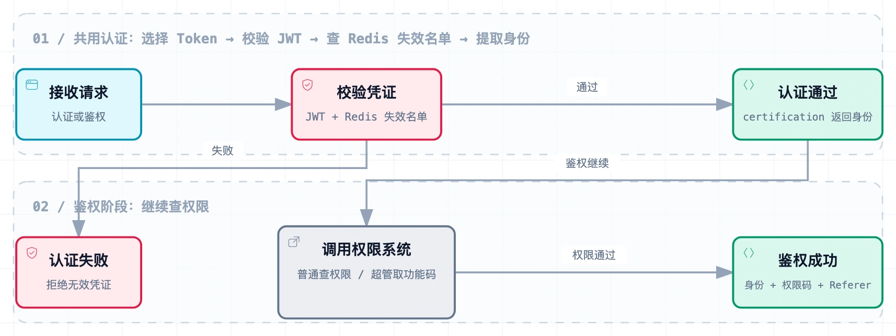

# SSO认证鉴权

本文基于 `aboss-sso` 工作区代码整理，未执行压测，也未修改代码或数据库。

## 1. 认证：检查凭证是否有效，确认用户是谁

**目的：** 校验请求携带的 JWT，并返回凭证中的身份信息。对应 `certification`。

RPC 入口为 `AuthFacadeImpl.certification()`，HTTP 入口为 `POST /platform/api/aboss/sso/certification`，两者进入同一认证逻辑。



[打开认证与鉴权交互流程图](../../../../archify/sso-authentication-authorization.html)

认证与鉴权共享凭证校验、失效检查和身份提取；鉴权在此基础上继续查询接口权限。认证成功只返回身份信息，鉴权成功还会返回权限码。

### 1.1 处理器调用链

```text
AuthFacadeImpl.certification()
  → CertificationExecutor.execute()
    → InitPipelineHandler.handle()
    → CertificationPipelineHandler.handle()
```

`CertificationExecutor` 从请求上下文提取 Token、认证方式、请求路径等信息，根据 `PipelineRouteConfig` 获取处理器列表并顺序执行。某个处理器返回失败后，不再继续后续处理。

### 1.2 选择并校验Token

`InitPipelineHandler` 根据 `cic-auth-method` 选择 Token：值为 `header` 时使用 `cic-htoken`，否则使用 `cic-ctoken`。这些值来自请求上下文，并非处理器直接读取浏览器 Cookie。

Token 为空时返回失败；不为空则调用 `JwtUtils.parserJWT()`，通过配置的密钥校验签名和有效期。JWT 过期、格式错误或签名校验异常时，返回失败，并将 `failResponseStatus` 设为 `401`。

### 1.3 检查Redis失效记录

JWT 校验通过后，执行一次 Redis GET：

```text
key：invalidTokenKey::<完整JWT>
value：包含账号及失效原因的 JSON
```

存在失效记录时，返回 `401`，同时返回 JSON 格式的失效原因。不存在时继续处理。

### 1.4 身份信息如何从 JWT 传到业务系统

这里需要连起来看两段流程：**SSO 校验 JWT 并返回身份信息；上游把身份信息随业务请求传给业务系统，业务系统再保存到当前线程供业务代码使用。** SSO 返回的 `principal.authData` 是两段流程的衔接点。

```text
用户携带 Token 发起业务请求
  ↓
上游网关调用 SSO 认证接口
  ↓
SSO：校验 JWT → 查询 Redis 失效记录 → 从 JWT 提取身份
  ↓
SSO：将身份转换为 AuthUserInfoDTO，再序列化成 JSON 字符串
  ↓
SSO 返回 AuthDTO：success=true，principal.authData=身份 JSON
  ↓
上游将 authData 放入发往 aboss-code 的 RPC 请求附加上下文
  ↓
aboss-code：带 @UserInfo 的方法执行前，触发 UserInfoAspect
  ↓
SofaRpcContext.userInfo() 从 RPC request baggage 读取 authData
  ↓
将 JSON 解析为 AuthUserInfoDTO，保存到 ThreadLocalUtils
  ↓
业务代码通过 UserInfoUtil.accountId() / disPlayName() / isAdmin() 使用身份
```

**第一段：SSO 生成并返回 `authData`。** `InitPipelineHandler` 从通过校验的 JWT 中读取账号 ID、姓名、角色、应用等信息，账号 ID 为空时拒绝。随后 `CertificationPipelineHandler` 转换得到 `AuthUserInfoDTO`，通过 `JSON.toJSONString()` 将它转为字符串，放到返回结果的 `principal` Map 中，键为 `authData`；`Referer` 是同一 Map 中的另一个键。这里的“返回”是返回给调用认证接口的上游，还没有写入业务系统的线程上下文。

**第二段：上游传递，业务系统接收。** 按当前接入流程，上游取得认证结果后，将 `authData` 附加到业务 RPC 请求。`aboss-code` 中的 `SofaRpcContext.userInfo()` 使用 `RpcInvokeContext.getContext().getRequestBaggage("authData")` 读取这段 JSON，并解析为 `AuthUserInfoDTO`。`UserInfoAspect` 在带 `@UserInfo` 的方法执行前，将非空对象存入 `ThreadLocalUtils`；后续 `UserInfoUtil` 从中读取账号 ID、姓名和角色。

因此，这几个名称对应的是同一份身份信息在不同阶段的形式：

| 位置 | 身份信息的形式 | 用途 |
| --- | --- | --- |
| JWT | 签发时写入的身份字段 | SSO 校验凭证后提取身份 |
| SSO 返回的 `principal.authData` | `AuthUserInfoDTO` 序列化后的 JSON 字符串 | 向上游交付认证得到的身份 |
| 业务 RPC 的 `authData` | 请求附加上下文中的 JSON 字符串 | 跨服务传递身份 |
| 业务系统的线程上下文 | 解析后的 `AuthUserInfoDTO` 对象 | 供当前业务代码通过 `UserInfoUtil` 读取 |

上述 SSO 生成端和 `aboss-code` 接收端均已对照代码；中间由上游将认证结果映射为业务请求上下文的步骤，依据当前提供的接入流程，具体网关实现未在本次核查范围内。`principal.authData` 不会仅凭字段同名就自动进入业务 RPC，必须有上游的传递步骤。

HTTP 认证入口还会对 `personName` 做 URL 编码，以适配后续通过 Header 传递身份信息时的中文处理。HTTP Header 与 RPC request baggage 是不同的传递位置；本例 `aboss-code` 的接收代码读取的是 RPC request baggage。

**正常认证路径不查询有效 Token 表、不查询账号表，也不调用 IDaaS。核心操作是本地 JWT 校验、一次 Redis 查询和结果组装。** 业务系统的 `@UserInfo` 前置处理负责读取、解析和保存上游传来的身份，本身不重新校验 JWT，也不重新查询账号。因而业务代码取得的身份仍来源于 JWT 签发时的内容，并不是每次从数据库获取的最新账号信息。若上游调用的是鉴权接口，返回的 `authData` 还会包含鉴权阶段取得的权限码，详见第 2 节。

### 1.5 认证阶段涉及哪些数据

| 数据或操作 | 职责 | 正常认证是否涉及 |
| --- | --- | --- |
| JWT | 携带身份，校验签名和有效期 | 是，本地处理 |
| Redis 失效名单 | 判断凭证是否被主动退出或重复登录限制提前作废 | 是，一次查询 |
| 数据库有效 Token 记录 | 管理登录凭证，支持定位需要作废的旧 Token | 否 |
| IDaaS | 登录、退出等身份平台交互 | 否 |
| 权限系统 | 判断接口访问权限 | 仅鉴权链路涉及 |

这套实现把策略计算、旧凭证查找和记录变更放在登录、退出环节，使高频认证路径保持较短。但 Redis 仍是认证链路的外部依赖，不能把它描述为完全无状态或纯本地认证。

## 2. 鉴权：检查接口访问权限

**目的：** 在确认登录身份后，根据账号和请求路径判断是否允许访问。对应 `authentication`。

### 2.1 入口与调用链

RPC 入口为 `AuthFacadeImpl.authentication()`，HTTP 入口为 `POST /platform/api/aboss/sso/authentication`。请求路径从上下文的 `x-mosn-path` 提取。

```text
AuthFacadeImpl.authentication()
  → AuthenticationExecutor.execute()
    → InitPipelineHandler：JWT 校验、Redis 失效检查、提取身份
    → CertificationPipelineHandler：组装身份信息
    → AuthenticationPipelineHandler：查询权限并组装鉴权结果
```

前两个处理器与认证共用，前置认证失败时不再继续查询权限。

### 2.2 普通账号做了什么

1. 使用账号 ID 和请求路径，调用权限系统 `getResourcePermission(accountId, path)`。
2. 检查返回的 `hasPermission`；明确无权限时返回失败，`failResponseStatus` 设为 `403`。
3. 有权限时获取 `permissionCode`，将其加入用户信息。
4. 返回包含身份信息、权限码及 Referer 的结果。

这里描述的是权限系统正常返回时的业务分支，不将外部调用异常等同于已明确返回“无权限”。

### 2.3 超管账号做了什么

超管不走普通账号的权限判断，但仍调用权限系统 `getFunctionInfoByResourceFlag(path)`，获取路径对应的功能权限码，再组装成功结果；该查询抛出异常时，当前分支返回失败并设置 `403`。

因此，“超管放行”不代表完全不访问权限系统。

### 2.4 鉴权返回什么，与认证有什么区别

鉴权返回的 `authData` 除身份信息外，还包含权限码。序列化时将值为 null 的字符串字段输出为空字符串，避免空值造成网关外部授权处理问题；HTTP 入口同样对姓名做编码。

认证主要回答“你是谁、凭证还有效吗”，鉴权进一步回答“你能访问这个接口吗”。鉴权增加了权限系统交互，不能用 `certification` 的耗时代表 `authentication` 的耗时。

## 3. 性能数据与简历表述口径

用户提供的线上数据为：平台覆盖约 100 个应用、10 万个账号，平台整体日均请求量约 4 亿次；认证接口 QPS 约 1,300～2,000，平均响应时间约 0.7～0.9 ms；部署配置为 16 个 Pod、每个 Pod 4 核 8 GB，CPU 使用率在 20% 以内、内存使用率在 55% 以内。

以上为用户提供的监控信息，未通过本次代码阅读独立验证。正式使用前需明确部署范围、资源使用率统计方式、耗时边界，以及 QPS 的采样窗口。

- 一分钟调用 80,000 次，分钟平均 QPS 约为 `80,000 ÷ 60 ≈ 1,333`。
- 现有截图中的每分钟约 8 万次请求，支撑分钟平均 QPS 约 1,300～1,400；2,000 需要其他监控记录支撑。
- 分钟平均 QPS 不等于瞬时峰值，也不等于压测容量上限。
- 平台日均 4 亿次折算为全天平均约 4,630 次/秒，是平台整体口径，不应与单个认证接口混用。

简历可以围绕以下事实组织：通过 JWT 本地校验及 Redis 失效检查处理高频认证请求；通过数据库有效 Token 记录定位旧凭证，在退出和重复登录限制场景下将其写入失效名单。个人职责应与实际参与范围一致，未验证有效期一致性前，不宜声称所有场景均已保证实时失效。

## 4. 提前失效的边界

认证通过 Redis 失效记录拦截主动退出或重复登录导致的旧凭证失效。失效记录必须覆盖 JWT 的剩余有效期，否则旧 JWT 可能在名单过期后重新通过认证。当前代码的有效期来源及待核实事项见 [SSO登录](<*核心1-登录.md>) 的“有效期一致性”。

## 5. 代码索引

以下路径均相对 `aboss-sso` 仓库根目录。

| 文件 | 主要关注点 |
| --- | --- |
| `aboss-sso-adapter/src/main/java/com/aliyun/fsi/insurance/sso/web/AuthRPCController.java` | 认证、鉴权 HTTP 入口及姓名编码 |
| `aboss-sso-app/src/main/java/com/aliyun/fsi/insurance/sso/impl/AuthFacadeImpl.java` | RPC 入口 |
| `aboss-sso-app/src/main/java/com/aliyun/fsi/insurance/sso/executor/auth/CertificationExecutor.java` | 请求上下文初始化、顺序执行处理器 |
| `aboss-sso-app/src/main/java/com/aliyun/fsi/insurance/sso/executor/auth/PipelineRouteConfig.java` | 认证和鉴权管道配置 |
| `aboss-sso-app/src/main/java/com/aliyun/fsi/insurance/sso/executor/auth/InitPipelineHandler.java` | Token 选择、JWT 校验、Redis 失效检查 |
| `aboss-sso-app/src/main/java/com/aliyun/fsi/insurance/sso/executor/auth/CertificationPipelineHandler.java` | 身份结果组装 |
| `aboss-sso-app/src/main/java/com/aliyun/fsi/insurance/sso/executor/auth/AuthenticationPipelineHandler.java` | 权限系统交互 |
| `aboss-sso-infrastructure/src/main/java/com/aliyun/fsi/insurance/sso/config/JwtUtils.java` | JWT 签发与校验 |

## 相关阅读

[SSO登录](<*核心1-登录.md>) · [SSO主动退出](<*核心2-主动退出.md>)
