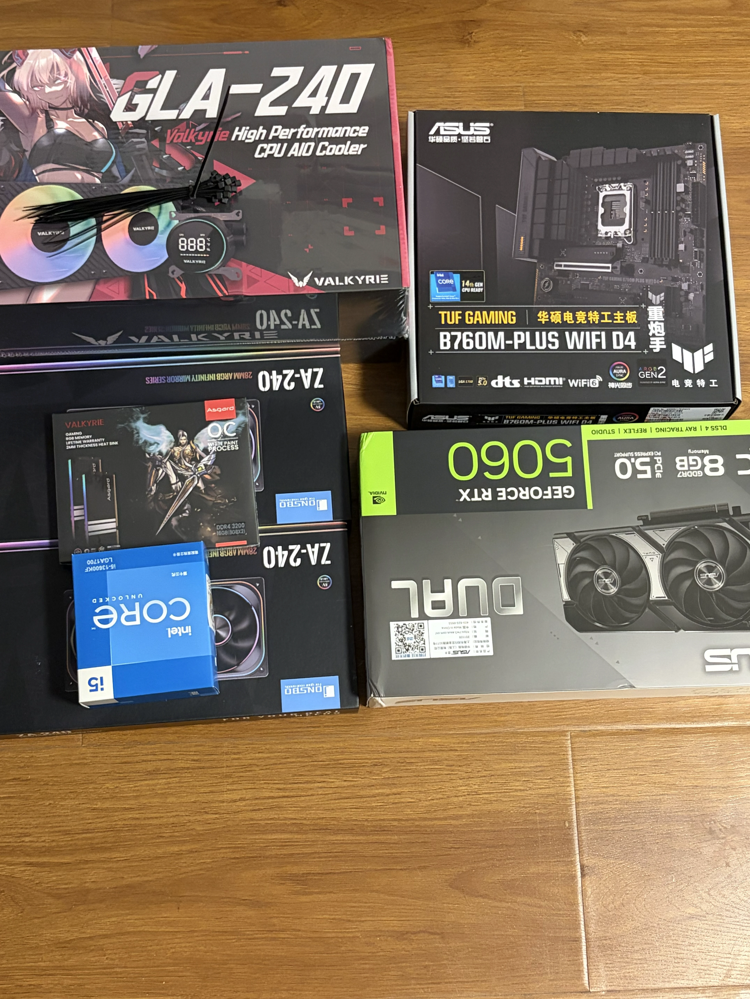
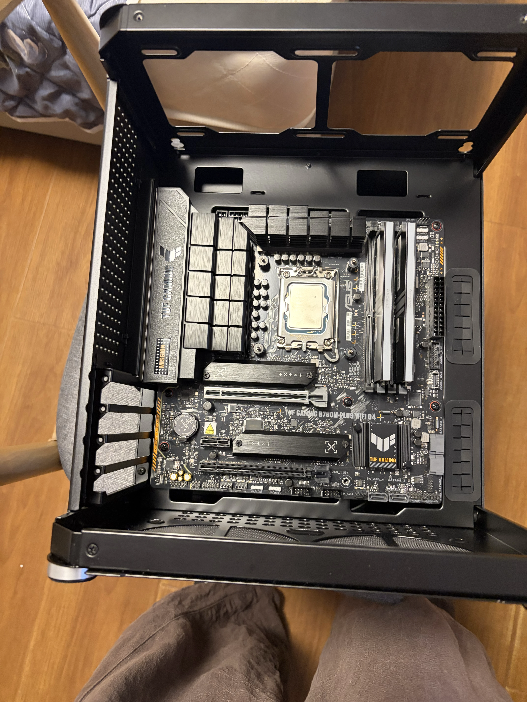
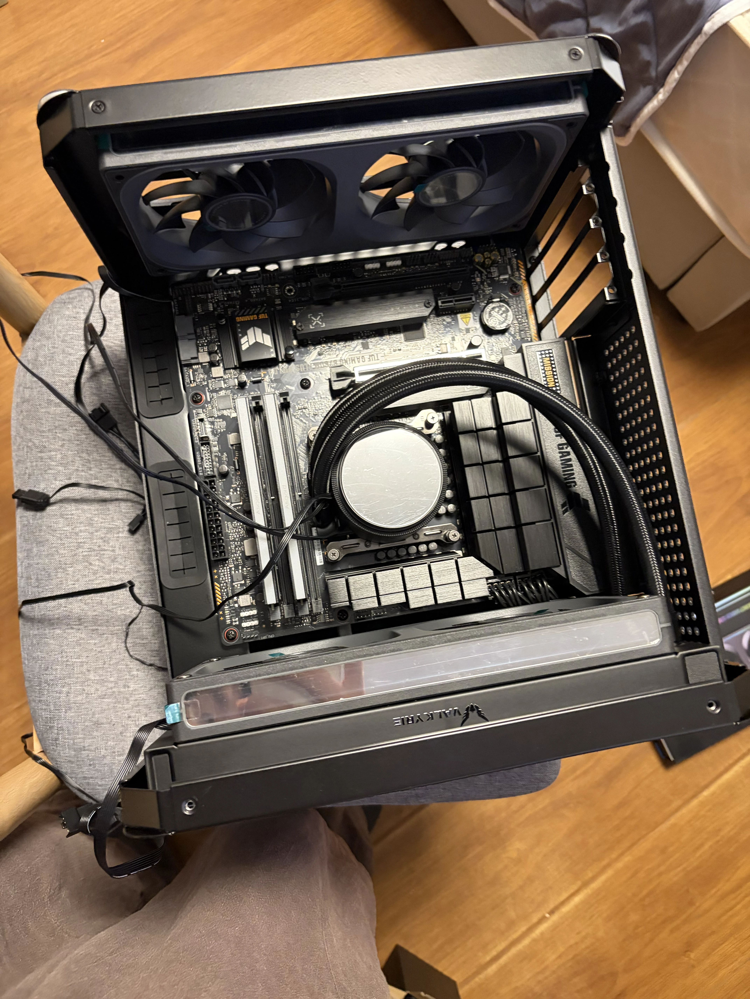
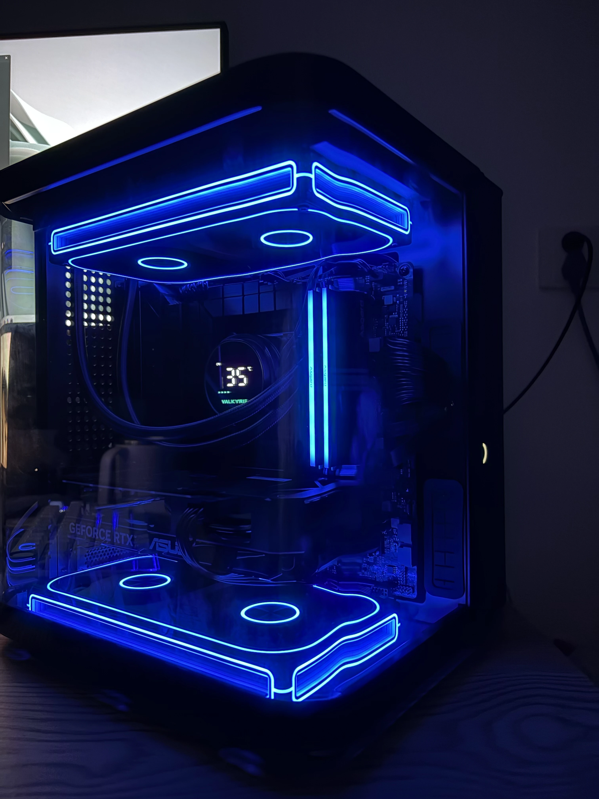
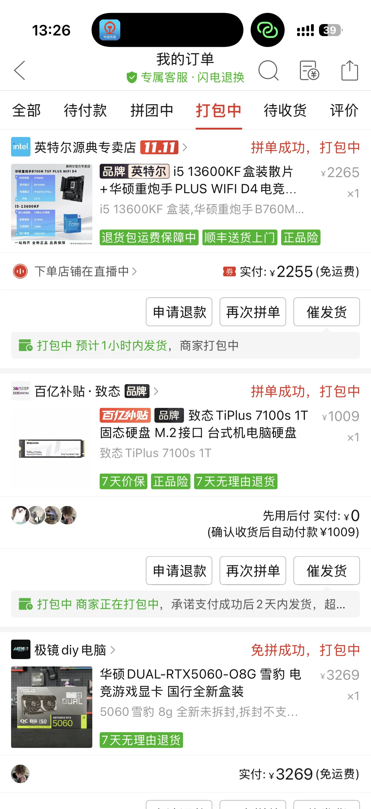
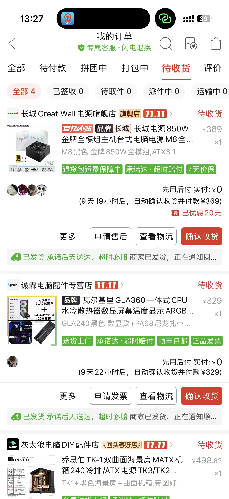
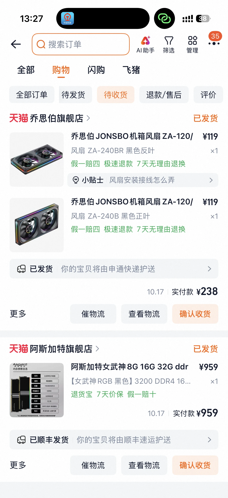

# 13600KF装机记录

这套主机采用 Intel Core i5-13600KF、华硕 B760M DDR4 主板和 RTX 5060 8GB 显卡，搭配乔思伯 TK1+ 黑色机箱。以下根据购买订单截图和装机照片整理；价格为截图中的订单记录，不代表当前市场报价。

## 配置单

| 配件      | 型号与规格                                     | 数量  |         订单金额 | 备注                                        |
| ------- | ----------------------------------------- | --- | -----------: | ----------------------------------------- |
| CPU     | Intel Core i5-13600KF                     | 1   | 与主板合计 2255 元 | 所选规格显示为盒装                                 |
| 主板      | 华硕 TUF GAMING B760M-PLUS WIFI D4（重炮手）     | 1   |  已含在 CPU 套装中 | DDR4 版本，型号由配件包装照片核对                       |
| 显卡      | 华硕 DUAL-RTX5060-O8G 雪豹，8GB                | 1   |       3269 元 | 按订单标题记录                                   |
| 内存      | 阿斯加特女武神 RGB 黑色，DDR4-3200，16GB（8GB×2），CL18 | 1 套 |        959 元 | 容量与时序按订单商品图片标注记录                          |
| 固态硬盘    | 致态 TiPlus 7100s，1TB，M.2                   | 1   |       1009 元 | 按订单所选规格记录                                 |
| 电源      | 长城 M8 黑色，850W，金牌全模组，ATX 3.1               | 1   |        369 元 | 商品标价 389 元，优惠 20 元后应付 369 元               |
| CPU 散热器 | 瓦尔基里 GLA240 黑色数显款，240mm 一体式水冷             | 1   |        329 元 | 商品标题含 GLA360，实际所选规格及包装均为 GLA240；订单含尼龙扎带赠品 |
| 机箱      | 乔思伯 TK1+ 黑色双曲面海景房机箱                       | 1   | 498.82 元（标价） | 所选规格显示为 TK1+；截图未展示最终付款金额                  |
| 机箱风扇    | 乔思伯 ZA-240BR 黑色反叶                         | 1 组 |        119 元 | 与正叶风扇订单合计 238 元                           |
| 机箱风扇    | 乔思伯 ZA-240B 黑色正叶                          | 1 组 |        119 元 | 按订单所选规格记录                                 |

**暂计总金额：8926.82 元。**

计算：2255 + 3269 + 959 + 1009 + 369 + 329 + 498.82 + 119 + 119 = 8926.82 元。

除机箱外，截图可确认的订单实付或应付金额合计为 **8428 元**。机箱暂按可见标价 498.82 元计算，最终总额以实际订单结算为准。部分订单采用先用后付，截图显示的“实付 0 元”不代表配件免费，此处使用确认收货后应付金额。显示器、键鼠、系统等未提供价格，不计入本表。

## 装机照片

### 配件合影

### 主板装入机箱

### 水冷安装过程

### 整机灯光效果

## 订单截图

### CPU、主板、固态硬盘和显卡

### 电源、水冷和机箱

### 风扇和内存

