# 14600KF与RTX5070装机记录

白色主题装机，采用 Intel Core i5-14600KF、华硕天选 B760M DDR4 主板和七彩虹 iGame RTX 5070 Ultra 显卡。本文根据装机实拍和购买订单整理，订单购买时间为 2025 年 10 月；价格为当时实付，不代表当前报价。

## 配置单

| 配件      | 型号与规格                                          | 数量  |            实付金额 | 说明                          |
| ------- | ---------------------------------------------- | --- | --------------: | --------------------------- |
| CPU     | Intel Core i5-14600KF，盒装                       | 1   | 与主板合计 1928.70 元 | 套装原价 2148 元，优惠 219.30 元     |
| 主板      | 华硕 TX GAMING B760M WIFI D4 天选                  | 1   |          已含在套装中 | 型号由包装、主板及说明书核对              |
| 显卡      | 七彩虹 iGame GeForce RTX 5070 Ultra，12GB GDDR7，白色 | 1   |       4496.82 元 |                             |
| 内存      | 光威神武 RGB DDR4-3600，32GB（16GB×2），C16            | 1 套 |           799 元 | 所选规格标注海力士原厂原字 CJR 颗粒        |
| 固态硬盘    | 致态 TiPlus 7100，2TB，PCIe 4.0 NVMe M.2           | 1   |           928 元 | 订单赠送螺丝刀                     |
| CPU 散热器 | 华硕 PRIME LC 360 ARGB 白色一体式水冷                   | 1   |           509 元 | 所选规格含 25 根扎带                |
| 电源      | 爱国者星璨 EC750W，白色，金牌全模组                          | 1   |           349 元 | 规格依据订单选择项及商品图               |
| 机箱      | 爱国者星璨辰，屏显版，白色                                  | 1   |           595 元 | 采用订单底部实付款；商品行另显示券后 595.90 元 |
| 机箱风扇    | 爱国者极光 Z13PRO，白色反叶 6 把、正叶 2 把                   | 8   |        190.89 元 | 标示单价 23.90 元，订单优惠 0.31 元后合计 |

**主机实付合计：9796.41 元。**

计算：1928.70 + 4496.82 + 799 + 928 + 509 + 349 + 595 + 190.89 = 9796.41 元。CPU 与主板只计算一次套装金额；风扇为整笔订单金额，不重复乘以数量。显卡按最终实付款 4496.82 元计入。

## 装机照片

### 配件合影

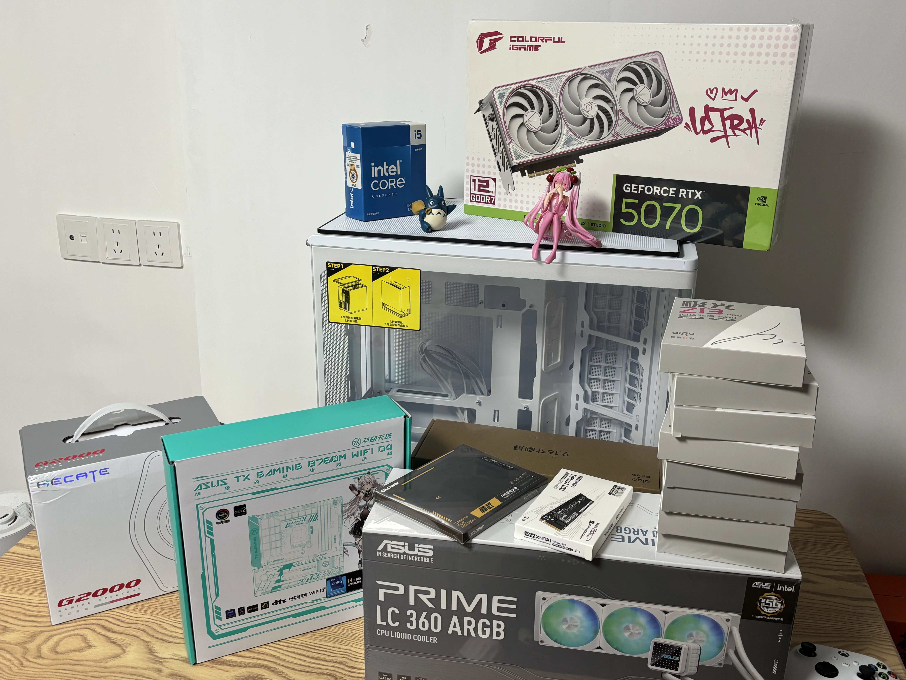

### CPU 与主板

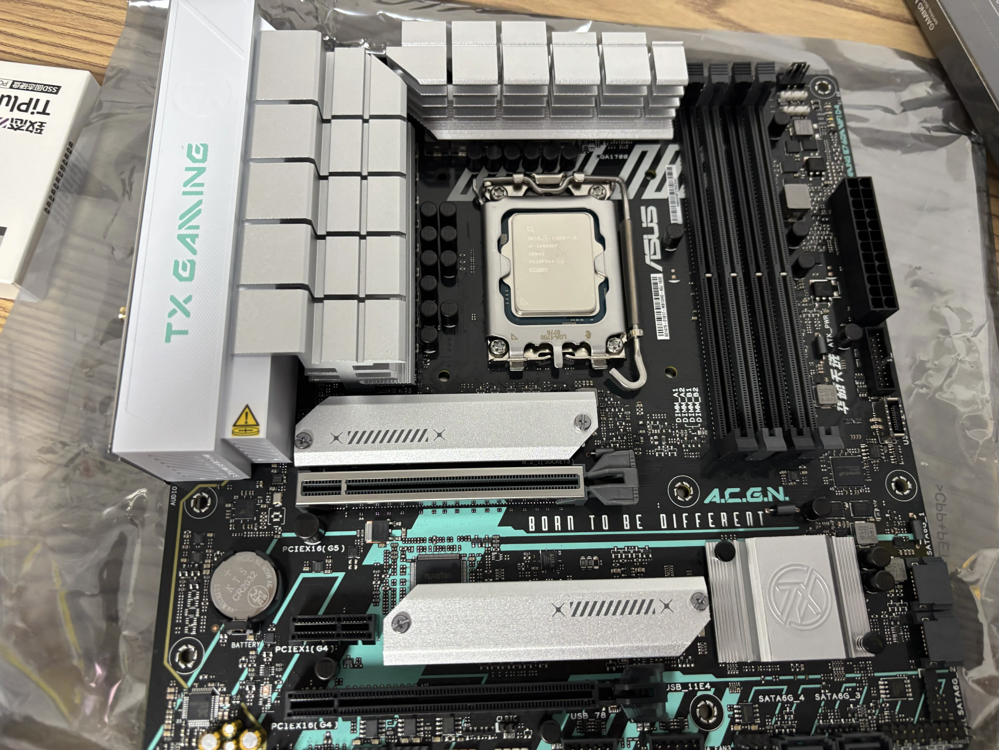

### 主板接口示意图

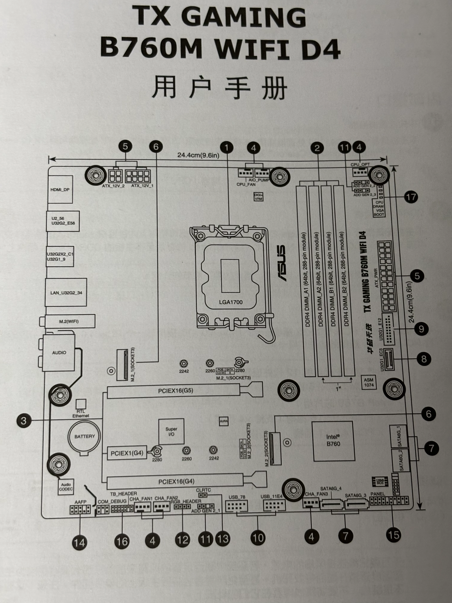

### RTX 5070 显卡

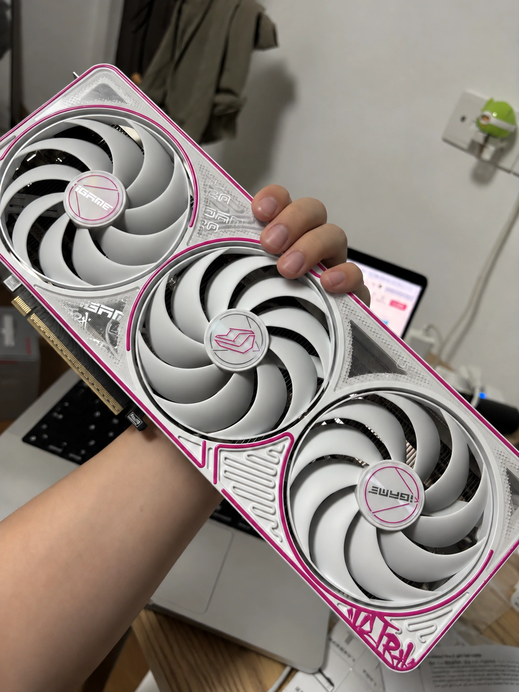

### 整机安装效果

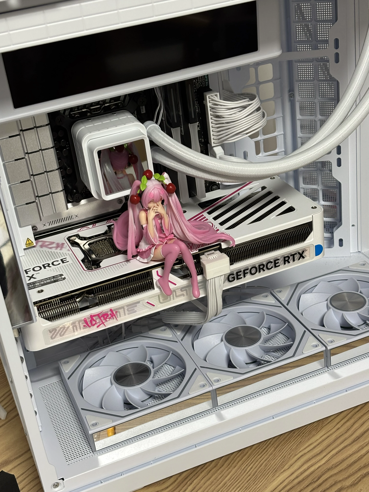

### 整机灯光效果（完整画面）

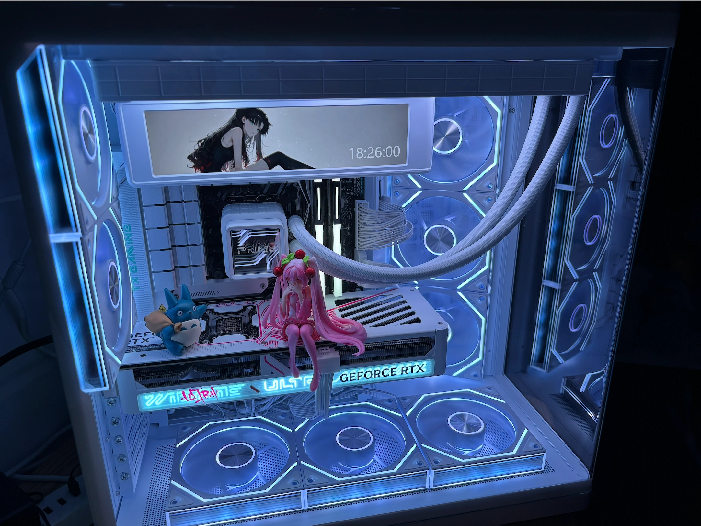

## 订单截图

以下配图仅保留商品及金额区域；未抄录订单号、物流单号、姓名、电话和收货地址。

### 水冷

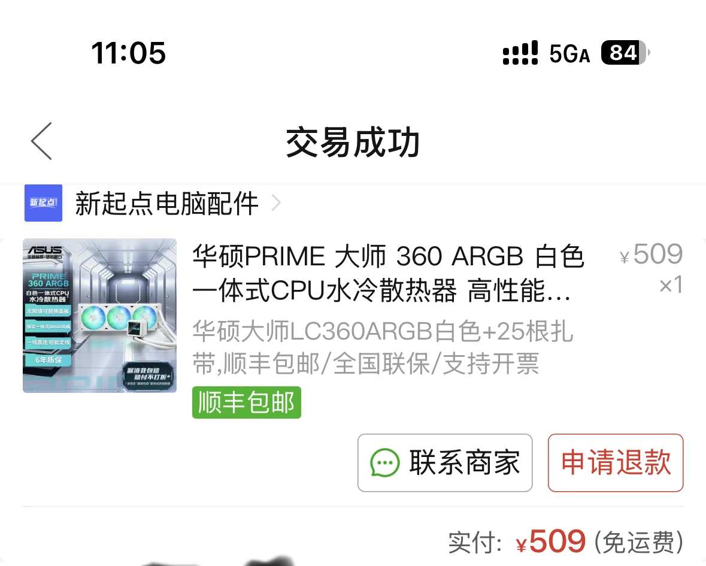

### 内存

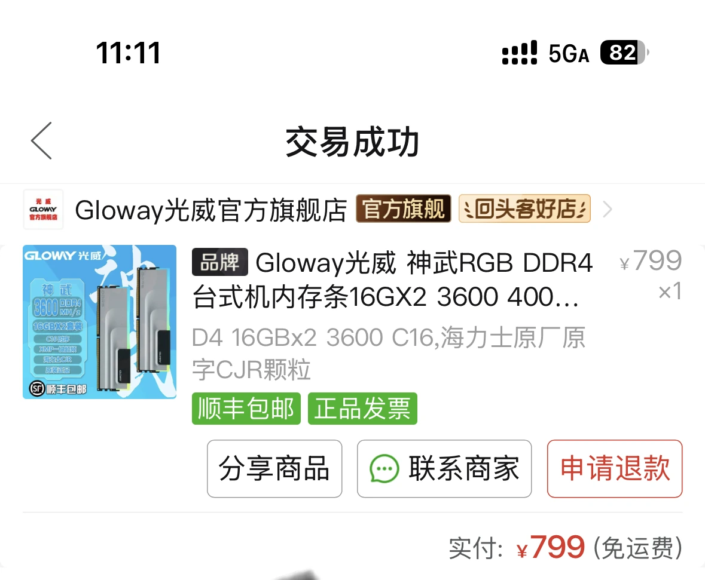

### CPU主板套装

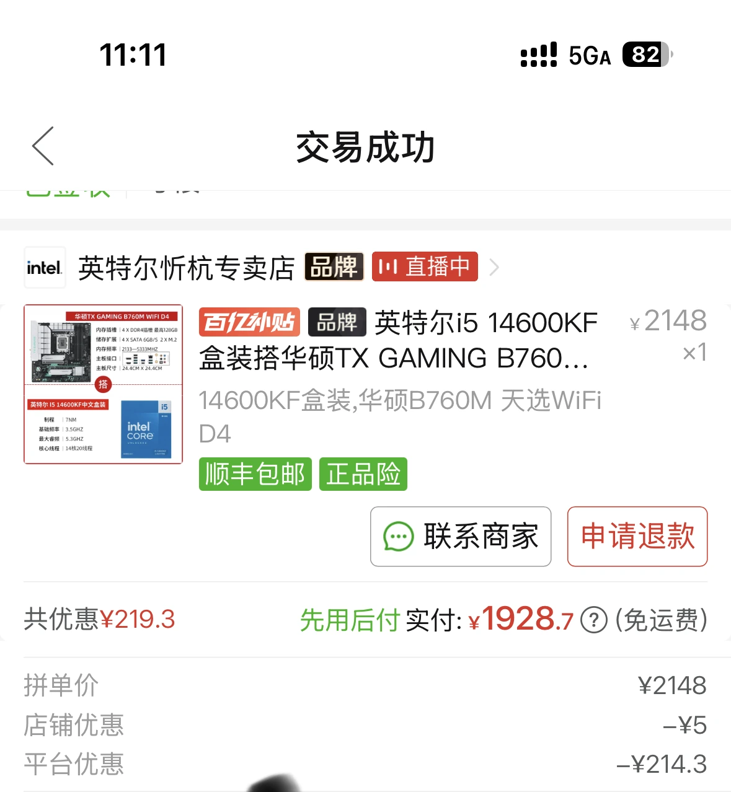

### 机箱风扇

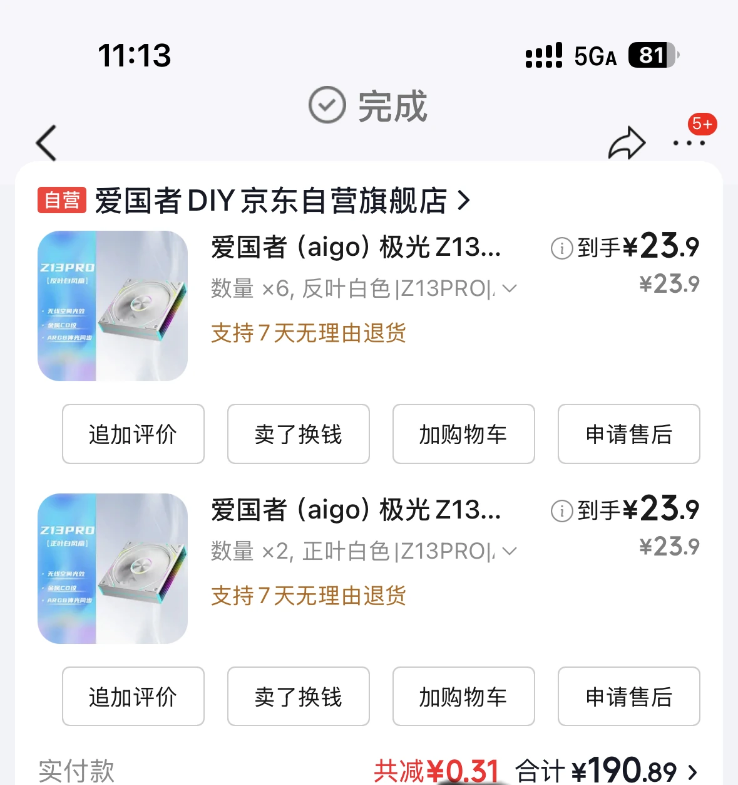

### 固态硬盘

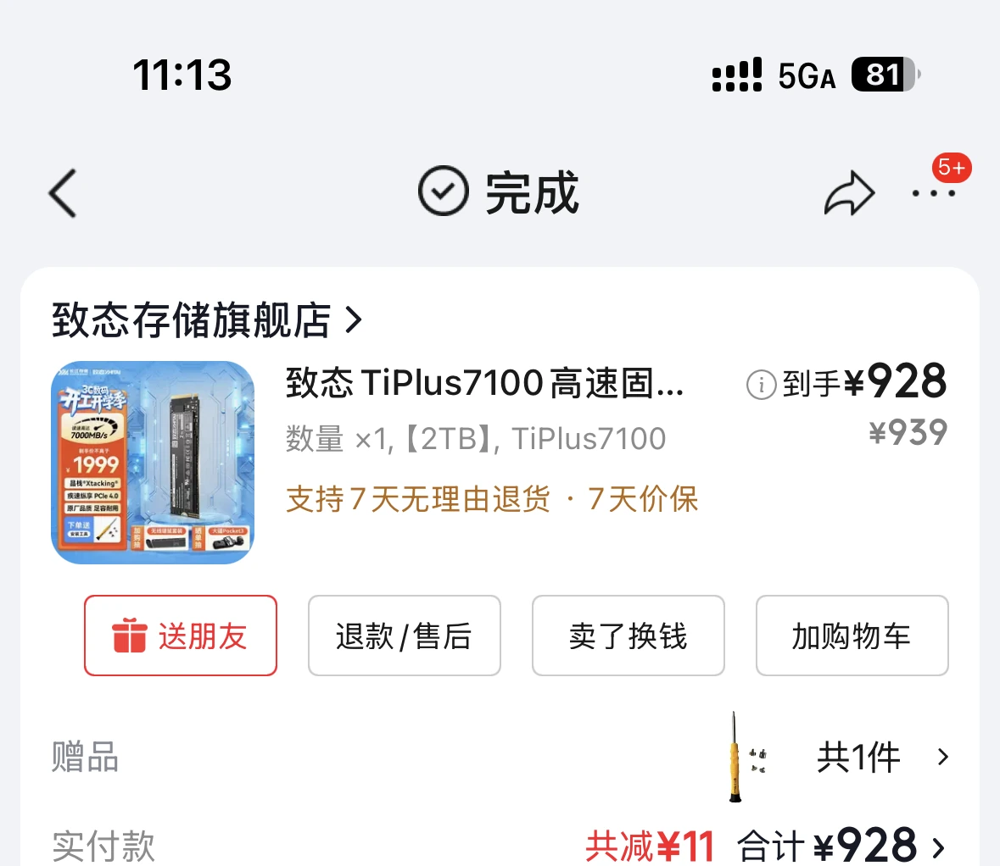

### 电源

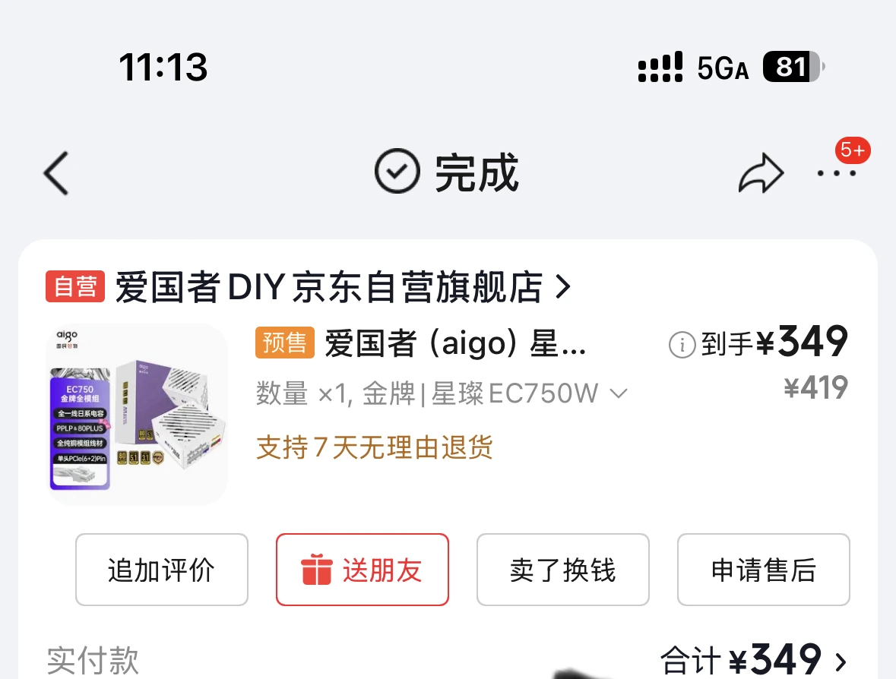

### 机箱

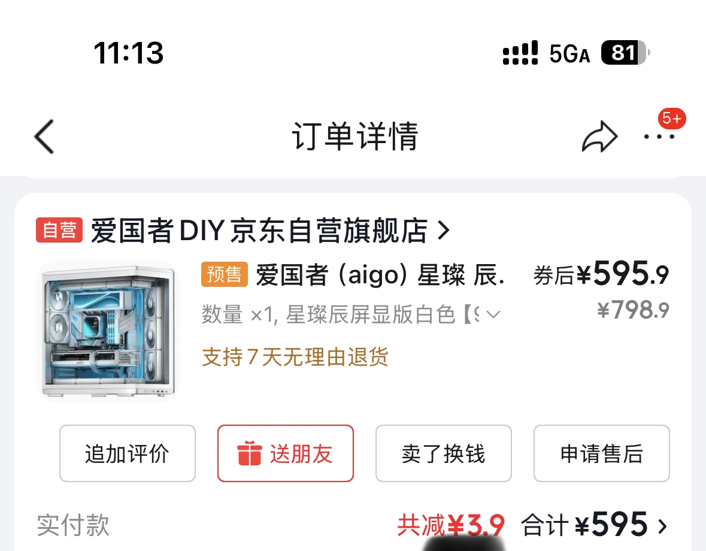

