# 捡垃圾

这是一套以办公、日常使用为目标的低预算装机记录：CPU、内存和显卡购买低价配件，主板与电源选择新购，硬盘、机箱沿用已有物品。

本文根据[原贴吧帖子](https://tieba.baidu.com/p/10293930509?pid=152997288610&lz=0&fr=personpage)的转述文字与配图整理。购买经历、价格和主观评价均来自原帖作者，不代表整理者亲自购买或测试。价格属于原帖购买时的记录，不是当前报价。

## 一、配置与实际花费

| 配件 | 型号与规格 | 原帖购买价格 | 来源或状态 |
| --- | --- | ---: | --- |
| CPU | AMD Ryzen 5 2600，6 核 12 线程 | 150 元 | 拼多多购入，是否全新未明确 |
| 主板 | 昂达 B450S+B | 259 元 | 拼多多新购 |
| 内存 | 金泰克 tigo 16GB DDR4-2666，单条 | 220 元 | 闲鱼二手，议价后购入 |
| 散热器 | AMD 原装散热器，具体型号未明确 | 15 元 | 购买渠道与新旧未明确 |
| 电源 | 玄武 400K，铭牌标注总功率 500W | 115 元 | 新购，作者称“乌龟” |
| 显卡 | 蓝戟 GUNNIR Intel Arc A380，6GB GDDR6 | 500 元 | 闲鱼二手 |
| 固态硬盘 | 致态 Ti600 1TB | 300 多元 | 2023 年购入，本次利用闲置盘 |
| 机箱 | 小幻影 M2 | 不详 | 沿用旧机箱，购买年份不详 |
| 显示器 | 配置截图为 H27T22C，27 英寸、2K、180Hz | 不详 | 正文另提到 4K，存在差异 |

**已知本次新增支出为 1259 元**：150 + 259 + 220 + 15 + 115 + 500。

硬盘和机箱属于旧物再利用，本次不计新增购置支出。如果把硬盘当年 300 多元的成本也算上，已知配件累计购入成本约为 **1500 多元**；机箱、显示器原价及运费等未提供，不能视为完整整套总价。

### 配置截图

截图扫描时间为 2025-12-12，系统为 Windows 10 专业版 64 位 22H2。内存处于单通道，运行速率约 2400MT/s，低于内存标称的 DDR4-2666；固态可用容量显示约 932GB。

截图时 CPU 约 56℃、显卡约 55℃、硬盘约 44℃，只是单次读数，不能作为满载散热表现。

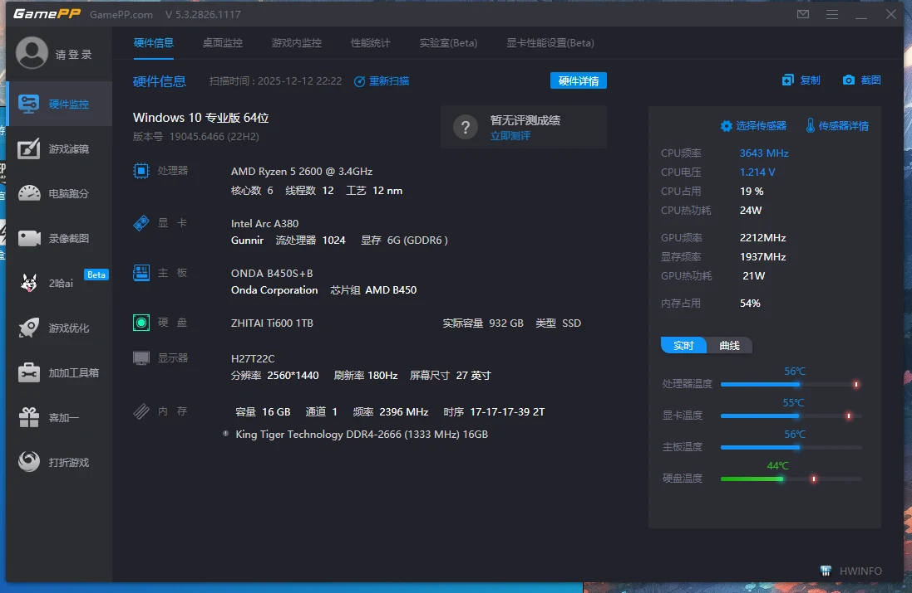

## 二、配件选择过程

### 1. CPU：150 元的 R5 2600

作者选择了 2018 年发布的 R5 2600，在拼多多花 150 元购入。原帖当时对比的价格是：R5 3600 二手约 300 元，R5 5600 约 699 元，因此选择更便宜的 R5 2600 控制成本。

作者回忆，这颗 CPU 当年的争议主要集中在内存控制器与兼容性，而不是性能。这属于作者的历史印象，本文不据此断言所有 R5 2600 平台都会出现兼容问题。

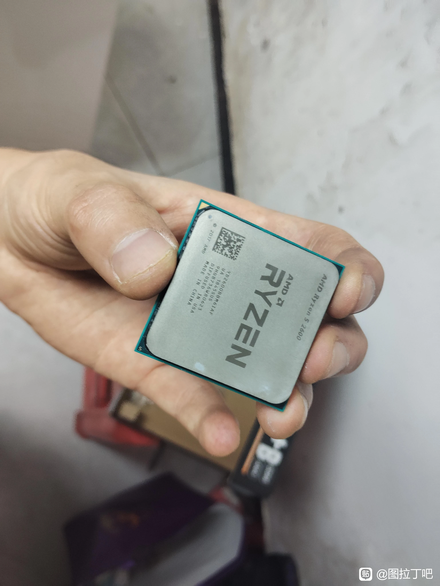

### 2. 主板：259 元的昂达 B450S+B

主板选择拼多多购买的昂达 B450S+B，价格 259 元。作者还对比过约 300 元的精粤和约 245 元的梅捷，并提到所比较的梅捷板为 3+2 相供电，最终选择昂达；其他主板的具体型号未提供。

作者认为主板承担各配件连接工作，更重视其可靠性和售后：当二手板与新板价格相差不大时，倾向于购买有保修的新板。原帖提到新板三年保修，具体条款应以购买订单和商家承诺为准。

“主板故障率在所有配件中最高”属于作者个人判断，没有统计依据，不作为本文结论；供电相数也不能单独用于判定主板品质。

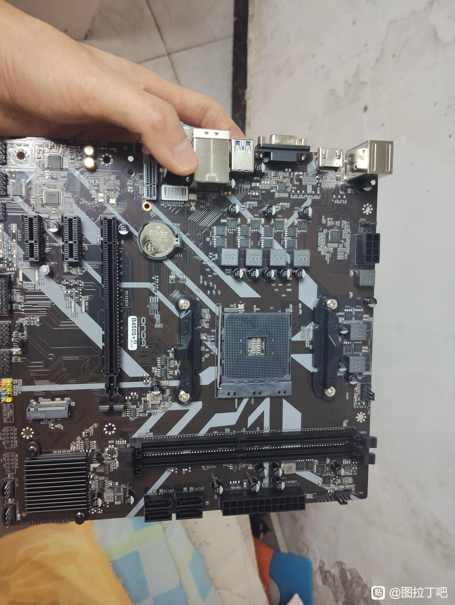

### 3. 内存：220 元的金泰克 16GB

内存是闲鱼议价后以 220 元买到的金泰克 16GB DDR4-2666。作者表示，愿意花时间蹲二手可能找到更合适的价格，也曾看到铭瑄 16GB DDR4-3200，但没抢到，未提供该条的具体价格。

作者选单条是出于减少配件数量的考虑，并认为二手内存风险相对可接受。这是个人取舍，不能由此证明单条一定更可靠。

配图标签可见 16GB、2Rx8、PC4-21300；**2Rx8 不等于双通道**。这套机器的配置截图显示为单通道。

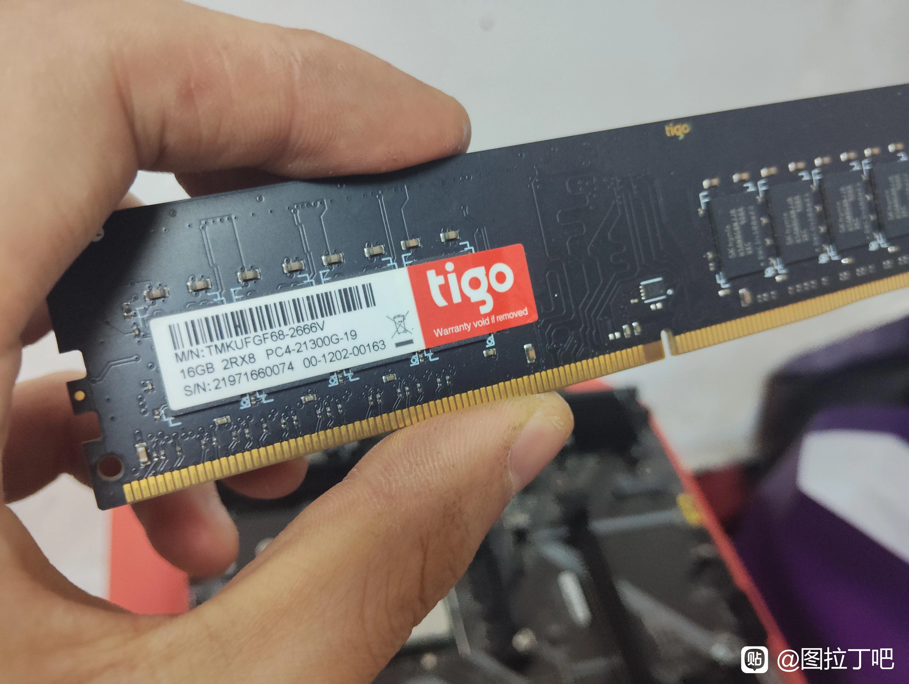

### 4. 散热器：15 元 AMD 原装散热器

散热器使用 15 元购入的 AMD 原装款，具体型号未明确。作者认为足够使用，但对预涂硅脂的状态有所担心。

照片可见底部方形硅脂层，仅凭照片不能判断其品质和老化程度；是否够用还要结合安装情况和实际负载温度。

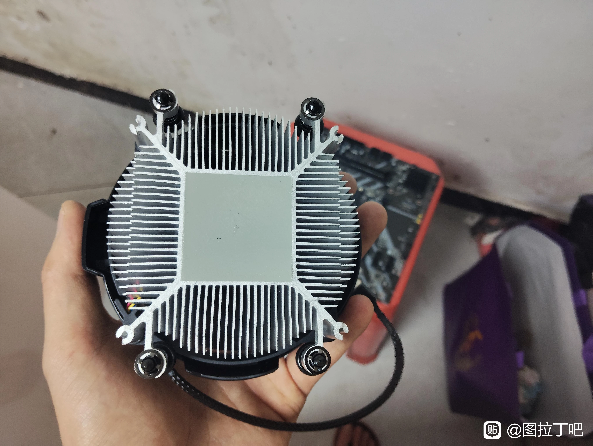

### 5. 电源：115 元玄武 400K

作者首次使用这款电源，购买价格为 115 元。让作者决定购买的是商家所说的“三年炸了包赔”，该说法作为售后承诺记录，赔付范围、限制条件和履行方式未核实。

从照片铭牌可以读到：

| 项目 | 铭牌标注 |
| --- | --- |
| 产品名称 | 玄武 400K |
| 总额定输出功率 | 500W |
| +12V 输出 | 41.5A，498W |
| +3.3V 与 +5V 合计 | 80W |
| 交流输入 | 200～240V，50Hz |

型号中的“400”不能直接当成额定功率，各路功率也不能简单相加当作总功率。上述仅是铭牌标注，不代表已做输出或保护测试。

作者描述线材有 CPU 8-pin、显卡 8-pin、主板 24-pin，以及两个 SATA 供电接口，并推测接口少、不容易把电源拉到极限。**接口数量不能直接证明电源的可靠性或保护能力**，因此仅保留为作者推测。

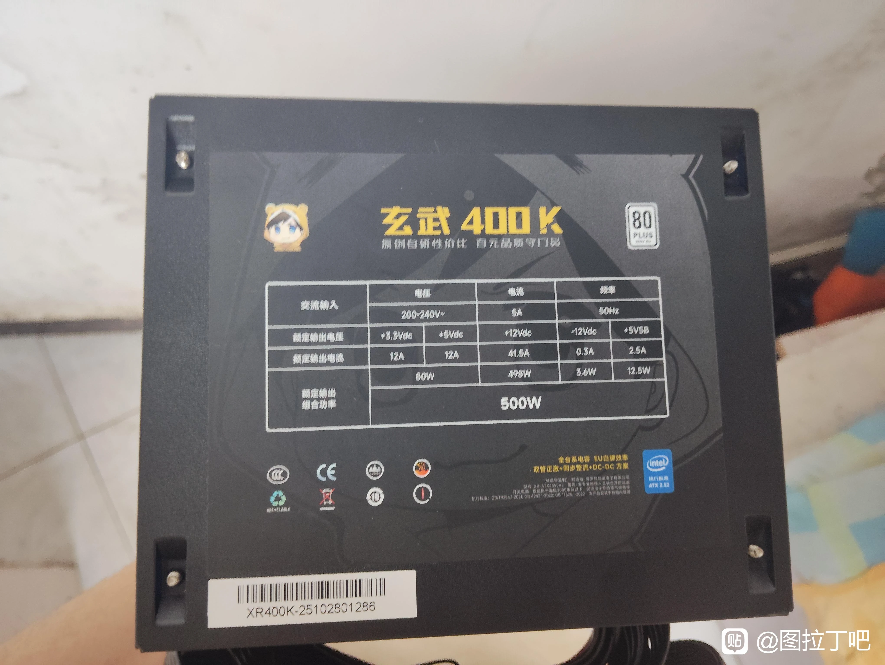

### 6. 显卡：500 元的蓝戟 A380 6GB

这台主机侧重办公和稳定使用，不追求高游戏性能。作者在 GTX 1050 Ti、6500（型号未明确）、DG1 和 A380 之间考虑，最后以 500 元在闲鱼购买蓝戟 A380 6GB，配图为双风扇版本。

原帖提到 A380 于 2022 年发布，选择理由包括 6GB 显存和 AV1 解码能力。作者认为 1050 Ti 较老，对老旧、高功耗二手显卡也更谨慎。

原帖以搭配 4K 显示器为由，认为 DG1 显存不够用；这属于作者判断，不能仅由分辨率推导显存一定不足。另一个待核对之处是，配置截图中的显示器分辨率为 2560×1440，与正文的 4K 描述不同。

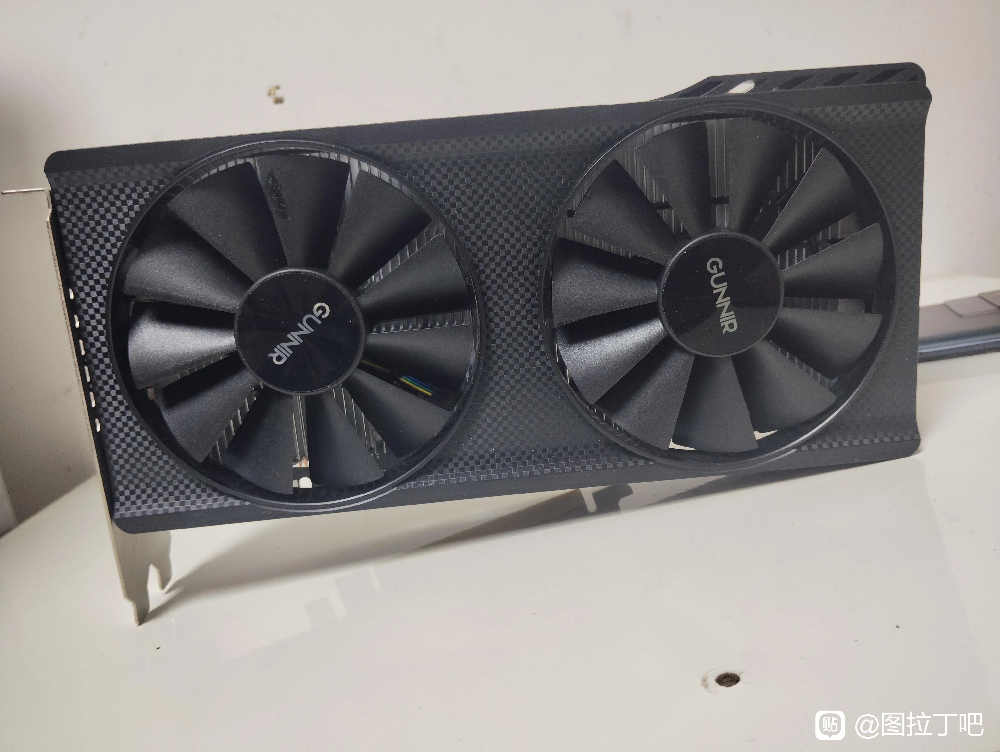

### 7. 硬盘：利用闲置的致态 Ti600

作者使用的是 2023 年花 300 多元购入的致态 Ti600，容量结合配置截图为 1TB。原帖称其采用 QLC 颗粒，曾因个人评价不高而闲置，这次装机重新利用。

这部分应记作历史购入成本，而非本次新增开支。原帖对后续存储价格的吐槽反映的是发帖时的感受，不作为当前行情结论。

照片显示装机和裸机测试状态，硬盘被散热片覆盖，具体型号以配置截图与作者描述为依据。

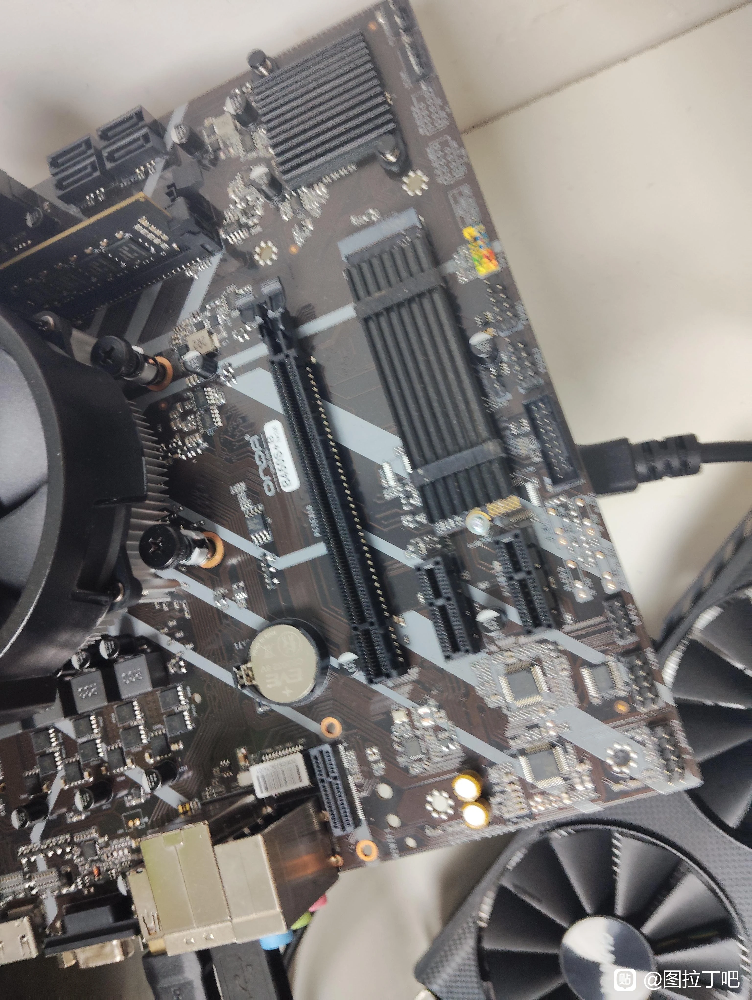

### 8. 机箱：旧的小幻影 M2

机箱沿用小幻影 M2，作者已不记得购买年份，原价未提供，本次不计新增支出。

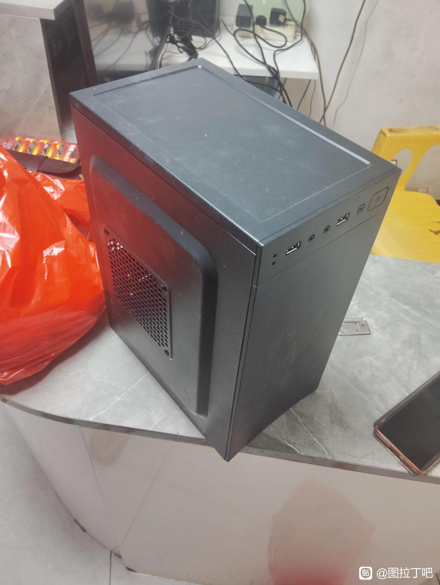

## 三、点亮与 BIOS 排查

### 1. 实际问题与处理结果

原帖作者遇到 A380 无法点亮的问题，将昂达 B450S+B 寄回商家。客服反馈：初测无法点亮，更新 BIOS 后可以正常点亮，未发现其他问题，并询问是否原样寄回。

这是本次具体机器的排查记录。客服同时对 Intel 显卡兼容性作出评价，该评价不作为所有 Intel 显卡或平台的普遍结论。

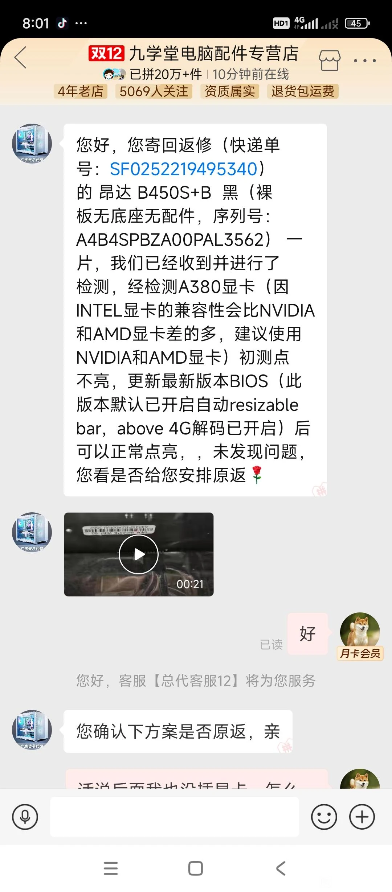

### 2. 截图中的 BIOS 设置

BIOS 页面为“高级”下的 PCI Devices Common Settings，可见：

| 设置 | 截图状态 |
| --- | --- |
| 4G 上地址空间解码 / Above 4G Decoding | 启用 |
| Re-Size BAR Support | 自动 |
| SR-IOV Support | 禁用 |

客服说明，更新后的 BIOS 默认开启 Above 4G 解码，并将 Resizable BAR 设为自动。截图没有提供具体 BIOS 版本，不能据此认定所有昂达 B450 主板出厂设置相同，也不能仅凭“自动”就确定系统中 ReBAR 已实际生效。

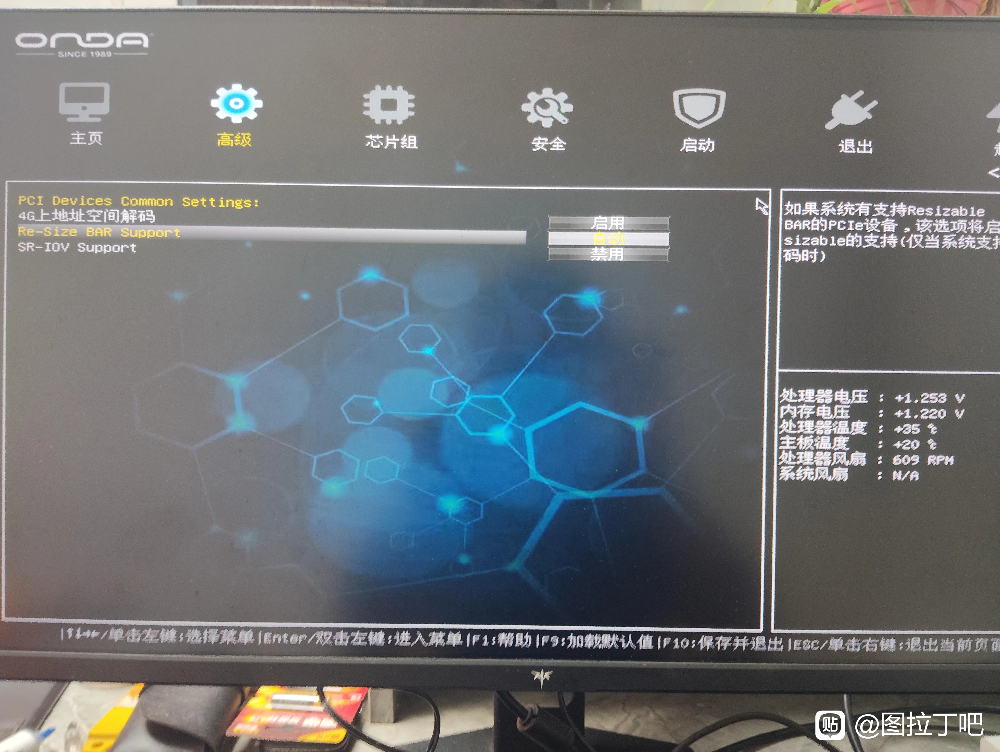

### 3. UEFI 与传统启动的经验边界

作者提醒使用 Intel 显卡时注意 UEFI 启动，并描述了传统启动下进入系统却黑屏的经历。整理时保留为该机器的经验，不把黑屏直接等同于“硬盘格式错误”。

UEFI、Legacy/CSM 属于固件启动方式；GPT、MBR 属于磁盘分区表；NTFS 等才是文件系统格式，这几个概念不应混为一谈。排查时应结合系统安装方式、启动项、分区表、BIOS 和驱动情况判断，不能只凭黑屏确定原因。

## 四、机箱前面板接线

下面是原帖提供的 JFP1 示意图。**尚未核实它就是昂达 B450S+B 的准确针脚定义，实物操作前应先核对对应主板说明书或丝印。**

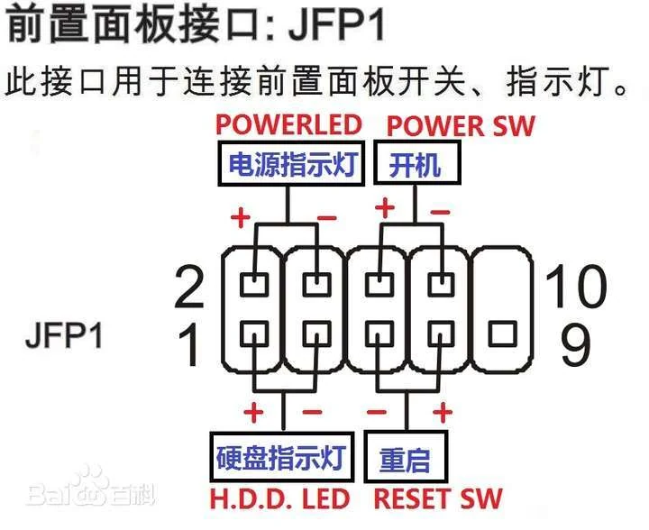

按图示方向，右上角缺针：

```text
                 左 → 右
上排：        2    4    6    8    缺针（10）
下排：        1    3    5    7    9
```

| 插头标识 | 用途 | 图中的接针 | 正负要求 |
| --- | --- | --- | --- |
| POWER LED / PLED | 电源指示灯 | 2 为正，4 为负 | 区分 |
| POWER SW | 开机按钮 | 6、8 | 不区分 |
| HDD LED | 硬盘活动指示灯 | 1 为正，3 为负 | 区分 |
| RESET SW | 重启按钮 | 5、7 | 不区分 |

第 9 针在图中未标注上述连接用途。

1. 关闭电脑，拔掉电源线。
2. 核对主板接口定义与图示方向。
3. 若只需要开机键，连接已确认的 POWER SW 针脚；本图为 6、8 两针。
4. 再连接重启键和两组指示灯。
5. 恢复供电检查；灯不亮时，可断电后调换对应 LED 插头方向。

不要带电插拔，也不要将图示直接套用到其他未经确认的接口。

## 五、前期估价留档

在收到完整购买记录之前，曾按截图粗估：主机约 1400～1800 元，含显示器约 1800～2300 元。该估值缺乏完整成交数据，且不同于原帖实际购入成本，现仅作为前期讨论记录保留，不作为当前买卖定价依据。

公开文章曾描述 A380 拆机卡约 500 元、商家报价 620 元：[行情参考](https://post.smzdm.com/p/aqr0mkx2/)。型号、成色和售后不同，不能直接视为本文这张卡的价值。

