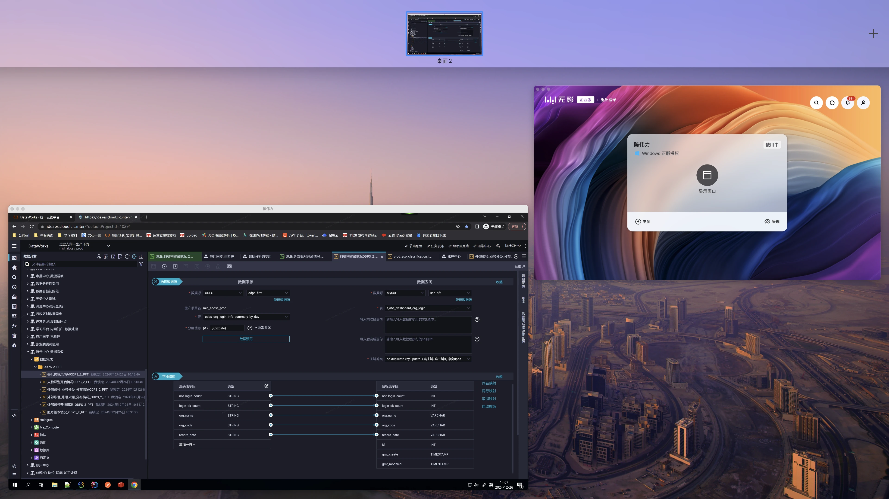

# Mac 快捷键速查

把日常编辑、浏览器操作和窗口管理放在一起，需要时快速查阅。

> [!tip] 先认识这几个键
> **⌘ Command** · **⌥ Option（Alt）** · **⌃ Control** · **⇧ Shift**  
> 下文中的 `+` 表示同时按下。Mac 上的拷贝、粘贴等常用操作通常使用 **Command**。

## ⌨️ 通用编辑

| 操作 | 快捷键 |
| :--- | :--- |
| 撤销 | `⌘ Command + Z` |
| 剪切 | `⌘ Command + X` |
| 拷贝 | `⌘ Command + C` |
| 粘贴 | `⌘ Command + V` |
| 全选 | `⌘ Command + A` |
| 保存 | `⌘ Command + S` |
| 查找 | `⌘ Command + F` |

> [!note] 从 Windows 切换过来
> 这些编辑快捷键中的 `Command`，通常对应 Windows 上的 `Ctrl`。它们是常用操作的对应关系，并不表示两个按键在所有场景下完全等价。

## 🌐 浏览器

| 操作 | 快捷键 |
| :--- | :--- |
| 定位到地址栏 | `⌘ Command + L` |
| 下一个标签页 | `⌃ Control + Tab` |
| 上一个标签页 | `⌃ Control + ⇧ Shift + Tab` |
| 放大页面 | `⌘ Command + +`（通常直接按 `Command + =`） |
| 缩小页面 | `⌘ Command + -` |

## 🖥️ 窗口与桌面

| 操作 | 快捷键 / 手势 |
| :--- | :--- |
| 打开调度中心，查看窗口与桌面空间 | `⌃ Control + ↑` |
| 进入或退出全屏（支持此操作的 App） | `⌃ Control + ⌘ Command + F` |
| 显示桌面 | `F11`，部分键盘需按 `Fn + F11` |
| 打开“强制退出应用程序”窗口 | `⌘ Command + ⌥ Option + Esc` |
| 打开右键菜单 | 按住 `⌃ Control` 并点按触控板 |

> [!important] 调度中心 ≠ 显示桌面
> `Control + ↑` 用于查看和选择窗口或桌面空间；显示桌面则使用 `F11` 等对应快捷键。功能键的实际行为取决于键盘设置。

### 调度中心示意

## 🧭 程序坞与多显示器

**切换程序坞自动隐藏：** `⌥ Option + ⌘ Command + D`

如果希望把程序坞唤回主屏，可以尝试：

1. 按下 `Option + Command + D`，开启自动隐藏（如果已经开启则跳过）。
2. 将鼠标移到主屏底部边缘，停留片刻，等待程序坞出现。
3. 如需保持显示，再按一次 `Option + Command + D`，关闭自动隐藏。

> [!note] 多屏使用说明
> 上面的操作用于尝试在主屏唤出程序坞，不能将它永久锁定到该屏幕。多屏行为还受“系统设置 → 桌面与程序坞”中的相关设置影响。

## 🛠️ 终端

终端相关命令与快捷键已整理到 [[终端常用操作]]。

## 📖 参考

- [Apple · Mac 键盘快捷键](https://support.apple.com/zh-cn/102650)
- [Apple · 在调度中心中查看窗口和空间](https://support.apple.com/zh-cn/guide/mac-help/mh35798/mac)
- [Apple · 更改“桌面与程序坞”设置](https://support.apple.com/zh-sg/guide/mac-help/mchlp1119/mac)
