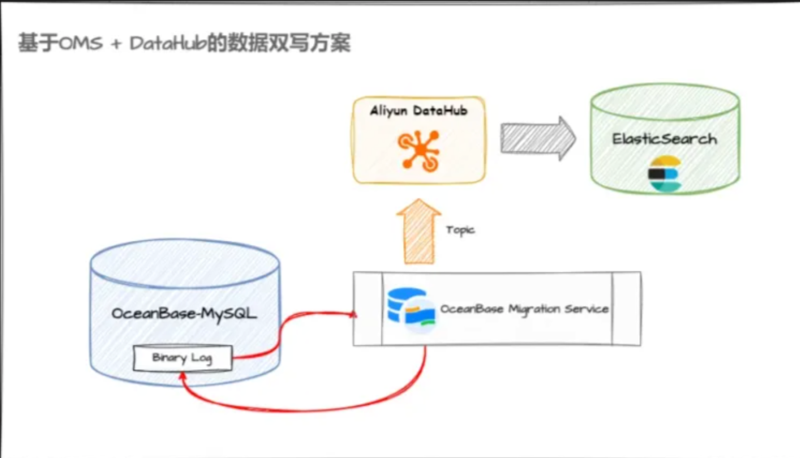
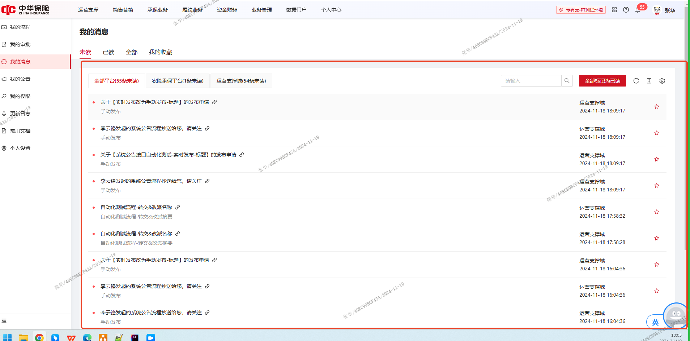
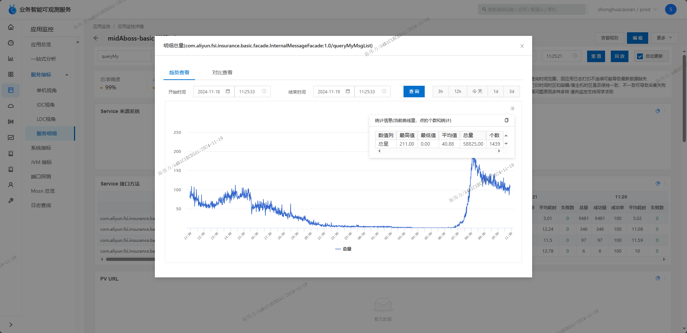
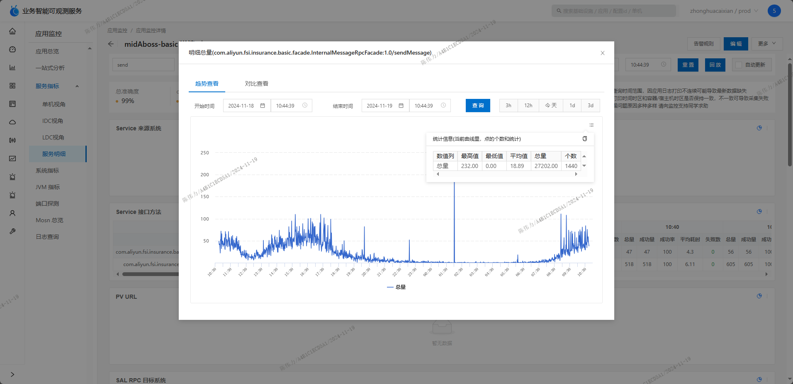
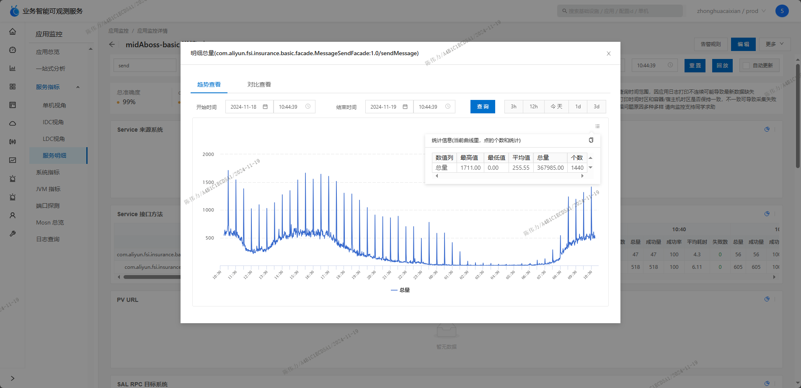

# SQL 慢查询优化：使用 Elasticsearch

> [!abstract] 文档说明
> 本文记录站内信查询从 OceanBase（OB）迁移至 Elasticsearch（ES）的数据同步、索引创建、接口改造、压测及上线步骤。

> [!warning] 操作提醒
> 文中的 `DELETE`、`DROP`、`ALTER`、`_delete_by_query` 等命令具有破坏性。执行前必须确认目标环境、备份方案和影响范围，并获得明确授权。

## 1. 数据同步方案

### 1.1 方案要解决什么问题

原查询需要实时关联消息受众表和消息发送记录表，还要搜索标题、正文并按时间排序，数据量增大后容易变慢。

新方案的核心思路是：

1. 将查询一条站内信所需的信息合并到 OB 明细表 `t_abs_message_record_detail`。
2. 将明细表数据同步到 ES。
3. 用户查询站内信时，直接查询 ES，不再实时关联原来的两张表。

可以简单理解为：**OB 保存业务数据，ES 提供快速查询，OMS 和 DataHub 负责把两边的数据变化衔接起来。**

### 1.2 各组件分别做什么

> [!tip] 先记住这句话
> OB 是保存数据的“账本”，Binlog 是账本的“改动流水”，OMS 是读取流水的“搬运工”，DataHub 是暂存和转发数据的“中转站”，ES 是方便快速查找的“搜索库”，DataWorks 是定时执行任务的“计划任务平台”。这些说法只是帮助理解的类比。

| 名称 | 正式名称 | 大白话解释 | 在本方案中的作用 |
| --- | --- | --- | --- |
| OB | OceanBase | 和 MySQL 类似的关系型数据库，用表、行和 SQL 保存业务数据 | 保存消息明细表 `t_abs_message_record_detail` |
| OB Binlog | OceanBase Binlog | 数据库自动生成的“数据改动流水”，记录数据发生了新增、修改或删除 | 让同步工具知道 OB 中哪些数据发生了变化 |
| OMS | OceanBase Migration Service | OceanBase 的数据迁移和实时同步工具，本身不是数据库 | 读取 OB 的变化并把变化传给下游 |
| DataHub | Alibaba Cloud DataHub | 用来发布、订阅和分发实时数据流的平台，类似数据中转站 | 接收 OMS 发来的变化事件，再交给 ES 同步程序处理 |
| ES | Elasticsearch | 擅长搜索、筛选和排序的搜索引擎 | 保存消息搜索文档，快速查询用户消息列表 |
| DataWorks | Alibaba Cloud DataWorks | 用来开发、编排和定时运行数据任务的平台 | 定时执行历史消息清理任务 |

#### 1.2.1 OB 是什么

OB 是 OceanBase 的简称。它首先是一个数据库，和日常使用的 MySQL 属于同一类用途：

- 数据按照“库、表、行、字段”保存。
- 可以执行 `SELECT`、`INSERT`、`UPDATE`、`DELETE` 等 SQL。
- 本方案中的 `t_abs_message_record_detail` 就是一张保存在 OB 里的表。

可以把 OB 理解为业务的正式账本。发送一条消息后，程序先把消息标题、正文、接收人、状态等内容写进这本账里。

> [!example] 对应到本方案
> 用户收到一条站内信，OB 表中就会新增一行消息记录。后续已读、收藏或清理操作，也会反映为这行数据的修改或删除。

#### 1.2.2 OB Binlog 是什么

Binlog 不是一张业务表，也不是另一个数据库。它是数据库生成的变更日志，用来描述“刚才哪些数据发生了变化”。

例如，业务程序执行：

```sql
UPDATE t_abs_message_record_detail
SET collected = 1
WHERE id = 'MSG_001';
```

可以把对应的 Binlog 变化理解为：

```text
表：t_abs_message_record_detail
记录：MSG_001
动作：UPDATE
变化：collected 从 0 变成 1
```

同步系统读取这条变化后，就知道 ES 中的 `MSG_001` 文档也需要更新，而不必反复扫描整张表。

> [!info] 正式含义
> OceanBase Binlog Service 会收集 OceanBase 的事务日志并转换为兼容 MySQL 的 Binlog，供下游进行增量数据订阅。当前项目是否直接使用该服务，应以实际环境配置为准。

#### 1.2.3 OMS 是什么

OMS 是 OceanBase Migration Service 的简称。它是数据迁移和同步工具，不负责长期保存业务数据。

OMS 可以做两类事情：

1. **全量迁移**：第一次把已有的历史数据整体搬过去。
2. **增量同步**：系统运行过程中持续捕获新增、修改和删除，并把这些变化同步到下游。

在当前方案中，可以先把 OMS 理解为“监听 OB 改动的搬运工”：它发现 Binlog 中出现新的变化后，将变化整理并传给 DataHub。

#### 1.2.4 DataHub 是什么

DataHub 是实时数据流平台。它的核心动作是发布、订阅和分发数据，而不是像 OB 一样直接给业务执行 SQL 查询。

可以把它理解为快递中转站：

```text
OMS 把数据变化送到 DataHub Topic
                    │
                    ▼
         ES 同步程序订阅这个 Topic
                    │
                    ▼
           将变化写入或删除 ES 文档
```

这里的 `Topic` 可以理解为一条专门传递某类数据的通道。OMS 是生产者，负责把变化事件写进去；ES 同步程序是消费者，负责把事件取出来处理。

DataHub 的价值在于解耦：OMS 不需要直接控制 ES，ES 暂时不可用时，变化事件也可以先保留在中转链路中，等待下游继续消费。实际保留时间、失败重试和一致性策略需以项目配置为准。

#### 1.2.5 ES 和 DataWorks 是什么

ES 是 Elasticsearch 的简称。它不是用来替代所有数据库操作，而是擅长全文搜索、条件筛选和排序。本方案把消息列表查询交给 ES，是为了避开原来较慢的跨表关联和 `%关键字%` 模糊查询。

DataWorks 则是任务开发和调度平台。可以把它理解为一个高级定时器：运维人员在里面配置“每天几点执行哪个清理任务”，它按计划触发删除历史数据的任务。

#### 1.2.6 把所有组件串起来

以“删除一条过期消息”为例：

```text
DataWorks：到时间了，执行历史数据清理任务
     ↓
OB：删除消息 MSG_001
     ↓
OB Binlog：记录 MSG_001 被 DELETE
     ↓
OMS：读取到这条删除变化
     ↓
DataHub：暂存并转发删除事件
     ↓
ES 同步程序：删除 ES 中的 MSG_001 文档
```

因此，这几个组件并不是五套重复存储：

- OB 和 ES 保存数据，但用途不同。
- Binlog 只描述数据发生了什么变化。
- OMS 负责发现并搬运变化。
- DataHub 负责中转变化。
- DataWorks 负责按计划触发任务。

#### 1.2.7 官方资料

- [OceanBase Database 官方文档](https://en.oceanbase.com/docs/oceanbase-database)
- [OceanBase Binlog Service 官方说明](https://en.oceanbase.com/docs/common-oblogproxy-10000000002742650)
- [OceanBase OMS 官方文档](https://www.oceanbase.com/docs/enterprise-oms-doc-cn-10000000000827388)
- [Alibaba Cloud DataHub 官方介绍](https://www.alibabacloud.com/help/en/datahub/product-overview/what-is-datahub)
- [Alibaba Cloud DataWorks 官方介绍](https://www.alibabacloud.com/help/en/dataworks/user-guide/what-is-dataworks)

### 1.3 新消息如何同步到 ES

预期的数据流向如下：

```text
业务系统
   │ ① 保存消息明细
   ▼
t_abs_message_record_detail（OB）
   │ ② 数据变化写入 Binlog
   ▼
OMS
   │ ③ 将变化事件写入 Topic
   ▼
DataHub
   │ ④ 消费变化事件并同步
   ▼
消息明细索引（ES）
   │ ⑤ 用户查询消息列表
   ▼
查询接口返回结果
```

以新发送一条站内信为例：

1. 业务系统先将消息明细写入 `t_abs_message_record_detail`。
2. OB 将本次写入记录到 Binlog。
3. OMS 捕获新增事件并推送至 DataHub。
4. 下游消费 DataHub 中的事件，在 ES 中新增或更新对应的消息文档。
5. 查询接口直接从 ES 获取消息列表，避免查询时再关联旧表。



> [!note] 建表 SQL
> `t_abs_message_record_detail` 的完整建表语句见 [5.1 上线表](#51-上线表-t_abs_message_record_detail)，此处不再重复。

### 1.4 历史数据如何清理

历史数据清理不是由 DataWorks 直接操作 ES，而是利用同一条数据同步链路传递删除事件：

```text
DataWorks 定时删除 OB 历史数据
               │
               ▼
        OB 产生删除 Binlog
               │
               ▼
        OMS 捕获删除事件
               │
               ▼
             DataHub
               │
               ▼
      ES 删除对应的消息文档
```

具体过程：

1. DataWorks 定时任务按照保留期限删除 OB 中的历史消息。
2. OB 为这些删除操作生成 Binlog。
3. OMS 捕获删除事件并推送到 DataHub。
4. ES 同步任务根据消息主键删除对应文档。

这样可以避免 OB 已删除、ES 仍残留数据，保证两边的数据生命周期基本一致。

### 1.5 新旧方案如何切换

切换时不应立即删除旧表和旧代码，而应采用一段时间的双链路验证：

1. 建立并启用 `t_abs_message_record_detail` 到 ES 的同步链路。
2. 保持旧查询链路继续运行，同时验证新表与 ES 的数据是否完整、一致。
3. 更新程序，将站内信列表查询切换到 ES。
4. 观察一段时间，确认查询、已读、收藏和历史清理均正常。
5. 完成数据校验和回滚准备后，再下线旧同步代码及旧表。

### 1.6 上线前需要确认的问题

> [!warning] 当前资料存在两处口径不一致
>
> 1. 数据同步目标写作 `msg_send_record_detail`，后文 ES 操作使用 `msg_record_detail`，需要确认最终索引名。
> 2. 架构图表现为 OMS 同步 OB 的数据变化，但原记录又写有“只绑定删除同步”。需要确认新增和修改事件是否也通过 OMS、DataHub 同步，还是由业务程序直接写入 ES。

如果 OMS 链路确实只同步删除事件，那么新增和修改链路应理解为：

```text
业务系统 ──写入──▶ OB
    └────同步写入──▶ ES

DataWorks 删除 OB 历史数据
    └──▶ OMS ──▶ DataHub ──▶ 删除 ES 对应文档
```

最终应根据实际生产配置，在上述两种同步方式中保留正确的一种。

## 2. ES 索引与调试命令

### 2.1 查询全部数据

```http
GET /msg_record_detail/_search
Content-Type: application/json

{
  "query": {
    "match_all": {}
  },
  "from": 0,
  "size": 20
}
```

### 2.2 按 ID 查询

```http
GET /msg_record_detail/_search
Content-Type: application/json

{
  "query": {
    "match": {
      "id": "1869277453115047937"
    }
  }
}
```

### 2.3 查看 Mapping

```http
GET /msg_record_detail/_mapping
```

### 2.4 清空索引数据

> [!danger] 高风险操作
> 以下命令会删除 `msg_record_detail` 索引中的全部文档。执行前必须确认目标集群、索引名称、备份情况和预计影响条数。

```http
POST /msg_record_detail/_delete_by_query
Content-Type: application/json

{
  "query": {
    "match_all": {}
  }
}
```

### 2.5 删除索引

> [!danger] 高风险操作
> 以下命令会删除整个 `msg_record_detail` 索引及其数据。

```http
DELETE /msg_record_detail
```

### 2.6 创建索引

```http
PUT /msg_record_detail
Content-Type: application/json

{
  "mappings": {
    "properties": {
      "id": { "type": "keyword" },
      "batch_no": { "type": "keyword" },
      "request_no": { "type": "keyword" },
      "app_id": { "type": "keyword" },
      "message_type": { "type": "keyword" },
      "templateId": { "type": "keyword" },
      "url": { "type": "keyword" },
      "send_type": { "type": "keyword" },
      "message_title": { "type": "keyword" },
      "message_content": { "type": "keyword" },
      "accepter_id": { "type": "keyword" },
      "extend_info": {
        "type": "object",
        "dynamic": "true"
      },
      "trace": { "type": "keyword" },
      "status": { "type": "byte" },
      "error_msg": { "type": "keyword" },
      "retry_count": { "type": "byte" },
      "collected": { "type": "byte" },
      "gmt_create": {
        "type": "date",
        "format": "yyyy-MM-dd HH:mm:ss"
      },
      "gmt_modified": {
        "type": "date",
        "format": "yyyy-MM-dd HH:mm:ss"
      },
      "creator": { "type": "keyword" },
      "modifier": { "type": "keyword" }
    }
  }
}
```

> [!note] 待确认
> OB 字段为 `template_id`，ES Mapping 中为 `templateId`。需确认同步任务是否已配置字段映射。

## 3. 慢 SQL 改造

### 3.1 原分页慢 SQL

原查询涉及受众表与发送记录表关联，并同时包含多个动态筛选条件和模糊查询。以下为从 `@Select` 字符串拼接中提取出的 MyBatis 动态 SQL：

```xml
<script>
  SELECT
    s.app_id,
    s.url,
    s.message_type,
    s.message_content,
    s.gmt_create,
    s.message_title,
    a.id AS msgId,
    a.status AS beenRead,
    a.collected AS collected
  FROM t_abs_message_audience AS a
  LEFT JOIN t_abs_message_send_record AS s
    ON a.record_id = s.id
  WHERE a.accepter_id = #{messageAudience.accepterId}

  <if test="messageAudience.status != null">
    AND a.`status` = #{messageAudience.status}
  </if>

  <if test="messageAudience.collected != null">
    AND a.`collected` = #{messageAudience.collected}
  </if>

  <if test="messageAudience.appId != null">
    AND s.`app_id` = #{messageAudience.appId}
  </if>

  <if test="messageAudience.keyword != null">
    AND (
      s.`message_title` LIKE CONCAT('%', #{messageAudience.keyword}, '%')
      OR s.`message_content` LIKE CONCAT('%', #{messageAudience.keyword}, '%')
    )
  </if>

  ORDER BY a.gmt_create DESC
</script>
```

#### 慢查询原因分析

> [!summary] 初步结论
> 该查询的主要性能瓶颈是跨表关联、前置模糊匹配、排序和分页叠加。以下结论基于 SQL 结构分析，最终应以生产同量级数据的 `EXPLAIN` 或 `EXPLAIN ANALYZE` 结果为准。

| 原因 | 具体表现 | 影响 |
| --- | --- | --- |
| 前置模糊匹配 | `message_title LIKE '%关键字%'`、`message_content LIKE '%关键字%'` | 普通 B-Tree 索引无法有效支持前置 `%`，容易扫描大量消息记录；`message_content` 内容较大时开销更明显 |
| 两张大表实时关联 | `t_abs_message_audience` 通过 `record_id` 关联 `t_abs_message_send_record` | 需要先查找用户消息，再逐条回表获取消息详情；用户历史消息越多，关联成本越高 |
| 查询条件分散 | 用户、已读和收藏条件位于受众表，应用、标题和内容条件位于发送记录表 | 单个联合索引无法同时完成两张表的过滤、关联和排序，可能先产生较大的中间结果集 |
| 时间排序 | `ORDER BY a.gmt_create DESC` | 如果没有与 `accepter_id` 等过滤条件匹配的联合索引，可能触发额外排序，即执行计划中的 `Using filesort` |
| 深分页 | 页码增大后通常生成较大的 `LIMIT offset, pageSize` | 数据库仍需扫描、关联并排序 offset 之前的记录，再将其丢弃，因此越往后翻页越慢 |
| 分页总数统计 | 分页组件通常会额外执行一次 `COUNT(*)` | 复杂关联和筛选可能执行两遍：一次统计总数，一次查询当前页数据 |

执行计划重点关注：

- `type` 是否为 `ALL`，即全表扫描。
- `key` 是否为空或未命中预期索引。
- `rows` 预估扫描行数是否过大。
- `Extra` 是否出现 `Using filesort`、`Using temporary` 或 `Using join buffer`。

ES 改造通过提前将消息受众信息与消息详情合并为一份文档，避免查询阶段实时 `JOIN`；同时利用倒排索引处理标题和内容检索，并通过用户、应用、状态、收藏状态及时间字段完成过滤和排序。



### 3.2 ES 查询改造

接口地址：`POST /platform/api/aboss/basic/internal/query-my-msg-list`

请求字段：

```java
/** 应用编码 */
private String appId;

/** 是否收藏：0-否，1-是 */
private Byte collect;

/** 是否已读：0-否，1-是 */
private Byte read;

/** 搜索关键字 */
private String keyword;

/** 当前账户 ID，RPC 接口必传 */
private String accId;
```

请求示例：

```json
{
  "appId": "111",
  "collect": 0,
  "read": 1,
  "keyword": "aa",
  "accId": "1010001233"
}
```



## 4. 接口压测与接口说明

### 4.1 发送普通站内信

| 项目 | 内容 |
| --- | --- |
| HTTP 接口 | `/platform/api/aboss/basic/send-message` |
| 说明 | 发送站内信消息，不依赖消息模板 |
| RPC 方法 | `com.aliyun.fsi.insurance.basic.facade.InternalMessageRpcFacade#sendMessage` |



### 4.2 发送模板站内信

| 项目 | 内容 |
| --- | --- |
| HTTP 接口 | `/platform/api/aboss/basic/send-message-with-template` |
| 说明 | 发送站内信消息，依赖消息模板 |
| RPC 方法 | `com.aliyun.fsi.insurance.basic.facade.MessageSendFacade#sendMessage` |




### 4.3 查询当前用户的站内信

#### Description

根据参数分页查询当前登录用户的站内信消息集合，最多返回 100 条记录。

#### OpenAPI

| 项目 | 内容 |
| --- | --- |
| URL | `/platform/api/aboss/basic/internal/query-my-msg-list` |
| Method | `POST` |
| Content-Type | `application/json; charset=utf-8` |
| Author | `zhanghua` |

#### Body-parameters

| Parameter | Type | Description | Required | Since |
| --- | --- | --- | --- | --- |
| `pageSize` | `int32` | 每页展示条数 | 是 | - |
| `pageIndex` | `int32` | 当前页码 | 是 | - |
| `appId` | `string` | 应用编码 | 否 | - |
| `collect` | `int8` | 是否收藏：0-否，1-是 | 否 | - |
| `read` | `int8` | 是否已读：0-否，1-是 | 否 | - |
| `keyword` | `string` | 搜索关键字 | 否 | - |
| `accId` | `string` | 当前账户 ID，RPC 接口必传 | 否 | - |

#### Request-example

```bash
curl -X POST \
  -H 'Content-Type: application/json; charset=utf-8' \
  -i '/platform/api/aboss/basic/internal/query-my-msg-list' \
  --data '{
    "pageSize": 10,
    "pageIndex": 1,
    "appId": "70",
    "collect": 0,
    "read": 1,
    "keyword": "dq2u60",
    "accId": "70"
  }'
```

#### Response-parameters

| Field | Type | Description | Since |
| --- | --- | --- | --- |
| `data` | `array` | 返回结果 | - |
| `data[].msgId` | `string` | 消息主键 | - |
| `data[].appId` | `string` | 应用编码 | - |
| `data[].appName` | `string` | 应用名称 | - |
| `data[].msgType` | `string` | 消息类型：`TEXT`-文本，`LINK`-链接 | - |
| `data[].msgTitle` | `string` | 消息标题 | - |
| `data[].msgBody` | `string` | 消息内容 | - |
| `data[].url` | `string` | 消息跳转链接 | - |
| `data[].sendDate` | `string` | 消息发送时间 | - |
| `data[].collected` | `int8` | 是否收藏：0-否，1-是 | - |
| `data[].read` | `int8` | 是否已读：0-否，1-是 | - |
| `pageIndex` | `int32` | 页码 | - |
| `totalCount` | `int32` | 总数；部分场景可能只需要分页数据，不需要总数 | - |
| `pageSize` | `int32` | 分页大小 | - |
| `status` | `int32` | 状态 | - |
| `message` | `object` | 消息 | - |
| `message.code` | `string` | 返回结果码 | - |
| `message.message` | `string` | 返回结果信息 | - |
| `message.errorContext` | `object` | 返回错误明细 | - |
| `message.errorContext.errorStack` | `array` | 错误堆栈集合 | - |
| `message.errorContext.errorStack[].version` | `string` | 结果码版本 | - |
| `message.errorContext.errorStack[].codeLevel` | `string` | 结果码级别：INFO-1、WARN-3、ERROR-5、FATAL-7，参见 `ResultCodeLevel` | - |
| `message.errorContext.errorStack[].codeType` | `string` | 结果码类型：SUCCESS-0、BIZ_ERROR-1、SYS_ERROR-2、THIRD_ERROR-3，参见 `ResultCodeType` | - |
| `message.errorContext.errorStack[].systemCode` | `string` | 系统编号，见 `SystemCode` 定义 | - |
| `message.errorContext.errorStack[].systemName` | `string` | 系统名称 | - |
| `message.errorContext.errorStack[].errorSpecific` | `string` | 具体结果码 | - |
| `message.errorContext.errorStack[].errorName` | `string` | 错误英文简称 | - |
| `message.errorContext.errorStack[].description` | `string` | 结果码信息描述，可为空 | - |
| `message.errorContext.thirdPartyError` | `string` | 第三方错误原始信息 | - |
| `message.errorContext.errorVariableMap` | `map` | 错误变量映射 | - |
| `needRetry` | `boolean` | 是否可以重试：`false`-不能重试，`true`-可选择重试 | - |
| `extendInfo` | `map` | 扩展信息 | - |

#### Response-example

```json
{
  "data": [
    {
      "msgId": "70",
      "appId": "70",
      "appName": "ali.reilly",
      "msgType": "wrfifi",
      "msgTitle": "wy1ihl",
      "msgBody": "s8fgrq",
      "url": "www.sharyn-ledner.name",
      "sendDate": "2025-06-11",
      "collected": 55,
      "read": 68
    }
  ],
  "pageIndex": 1,
  "totalCount": 103,
  "pageSize": 10,
  "status": 392,
  "message": {
    "code": "87845",
    "message": "success",
    "errorContext": {
      "errorStack": [
        {
          "version": "0.14",
          "codeLevel": "pes3il",
          "codeType": "zr1u1o",
          "systemCode": "87845",
          "systemName": "ali.reilly",
          "errorSpecific": "cvl459",
          "errorName": "ali.reilly",
          "description": "9tggjb"
        }
      ],
      "thirdPartyError": "h1gzy8",
      "errorVariableMap": {
        "mapKey": "t8mhh0"
      }
    }
  },
  "needRetry": true,
  "extendInfo": {
    "mapKey": "c8x0jy"
  }
}
```

## 5. 上线步骤

### 5.1 上线表 `t_abs_message_record_detail`

> [!warning] 数据库变更
> 以下为建表 SQL，仅作上线资料记录。执行前需确认目标数据库、表是否已存在及发布窗口，并获得明确授权。

```sql
CREATE TABLE `t_abs_message_record_detail` (
  `id` varchar(64) NOT NULL COMMENT '主键ID',
  `batch_no` varchar(64) NOT NULL COMMENT '批次号',
  `request_no` varchar(64) NOT NULL COMMENT '消息请求流水号',
  `app_id` varchar(64) DEFAULT NULL COMMENT '消息来源',
  `message_type` varchar(8) DEFAULT NULL COMMENT '消息类型(template、text、link、image、markdown、action_card)',
  `send_type` varchar(8) DEFAULT 'MC001' COMMENT '发送类型(MC001-站内信、MC002-钉钉)',
  `message_title` varchar(256) DEFAULT NULL COMMENT '消息标题',
  `message_content` varchar(40960) DEFAULT NULL COMMENT '消息内容',
  `template_id` varchar(64) DEFAULT NULL COMMENT '模板id',
  `url` varchar(512) DEFAULT NULL COMMENT 'url',
  `trace` varchar(10240) DEFAULT NULL COMMENT '请求第三方报文',
  `status` tinyint(4) DEFAULT '0' COMMENT '消息状态(0-处理中、1-成功、2-失败)',
  `retry_count` tinyint(4) DEFAULT '0' COMMENT '重试次数',
  `error_msg` varchar(1024) DEFAULT NULL COMMENT '错误信息',
  `collected` tinyint(4) DEFAULT '0' COMMENT '是否收藏(0:否，1:是)',
  `accepter_id` varchar(64) DEFAULT NULL COMMENT '接受者id',
  `gmt_create` timestamp NULL DEFAULT CURRENT_TIMESTAMP COMMENT '创建时间',
  `gmt_modified` timestamp NULL DEFAULT CURRENT_TIMESTAMP ON UPDATE CURRENT_TIMESTAMP COMMENT '修改时间',
  `modifier` varchar(32) DEFAULT NULL COMMENT '修改人',
  `creator` varchar(32) DEFAULT NULL COMMENT '创建人',
  PRIMARY KEY (`id`),
  KEY `INDEX_APP_ID` (`app_id`) BLOCK_SIZE 16384 GLOBAL,
  KEY `INDEX_BATCH_NO` (`batch_no`) BLOCK_SIZE 16384 GLOBAL,
  KEY `INDEX_REQUEST_NO` (`request_no`) BLOCK_SIZE 16384 GLOBAL,
  KEY `INDEX_ACCEPTER_ID` (`accepter_id`) BLOCK_SIZE 16384 GLOBAL,
  KEY `INDEX_GMT_CREATE` (`gmt_create`) BLOCK_SIZE 16384 GLOBAL
) DEFAULT CHARSET = utf8mb4 COMMENT = '消息发送记录详情表';
```

### 5.2 上线检查清单

- [ ] 上线 `t_abs_message_record_detail` 表。
- [ ] 切换为开启 `CLEAN_MESSAGE_RECORD_DETAIL_HANDLER` 定时任务。
- [ ] 将动态配置 `useElasticsearch` 改为 `close`。
- [ ] 确认是否必须在发布日创建索引（负责人：[@张华](https://cic_irc.yuque.com/zhanghua-yvaxa)）。
- [ ] 开启 OMS 同步数据至 ES 的流程（下一次上线开启同步流程即可）。
- [ ] 定时任务上线后停止 DataWorks 任务，避免重复清理。
- [ ] 在下一次上线前，确认并删除旧表及相关代码：
  - `t_abs_message_audience`
  - `t_abs_message_send_record`

> [!danger] 删除旧表前检查
> 删除旧表及相关代码前，应完成数据一致性校验、业务回归和可回滚备份，并确认旧链路已无流量。


附件：[antscheduler_export_2025-06-03T09_59_38.json](https://cic_irc.yuque.com/attachments/yuque/0/2025/json/46902113/1748916864372-37e66465-11bb-4ef4-9bb7-8e7e9a65c374.json)

### 5.3 索引优化：解决查询超时

> [!warning] 数据库变更
> 以下操作会删除旧索引并创建联合索引。执行前需通过只读查询确认旧索引定义、表数据量和预计锁表影响，并获得明确授权。

```sql
DROP INDEX INDEX_ACCEPTER_ID ON t_abs_message_record_detail;

ALTER TABLE t_abs_message_record_detail
ADD INDEX IDX_ACC_APP_STATUS_COLLECTED (
  accepter_id,
  app_id,
  status,
  collected
);
```

联合索引字段顺序：

```text
accepter_id → app_id → status → collected
```
