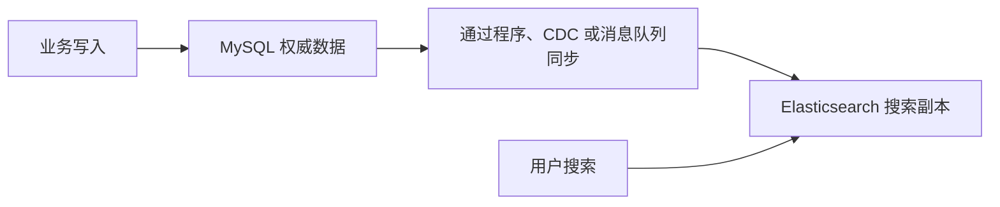
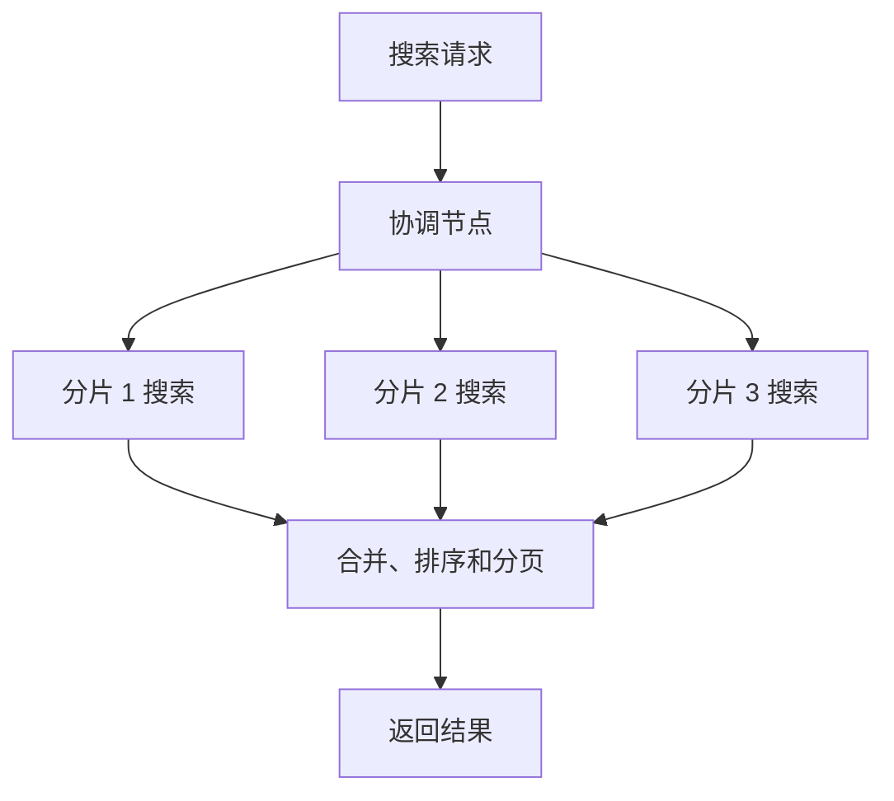

## 一、💡 一句话理解

> [!tip] 核心结论
> Elasticsearch，简称 ES，是一个专门为搜索和分析设计的分布式引擎。它不是所有查询都比 MySQL 快，而是在全文检索、相关度排序、多条件搜索和大规模横向扩展方面更有优势。

最容易记住的区别是：

```text
MySQL：根据字段值找记录
ES：根据关键词找文档
```

## 二、🧭 理论：ES 是什么

### 2.1 核心概念

ES 会把数据保存成 JSON 文档，并将文档放入索引中。

| Elasticsearch | 可以类比为 MySQL | 说明 |
| --- | --- | --- |
| Index | 表 | 一组结构相近的文档，但两者并不完全等价 |
| Document | 一行记录 | 一条 JSON 数据 |
| Field | 字段 | 文档中的一个属性 |
| Mapping | 表结构 | 定义字段类型和索引方式 |
| Query DSL | SQL | ES 的 JSON 查询语言 |

例如，一篇文章在 ES 中可能是：

```json
{
  "title": "Elasticsearch Search Tutorial",
  "author": "Afyke",
  "viewCount": 100
}
```

### 2.2 先带着一个商城搜索场景往下看

假设商城只有三件商品：

| 商品编号 | 商品名称 | 价格 | 库存 |
| --- | --- | ---: | ---: |
| 101 | 男士防水轻便羽绒服 | 599 | 23 |
| 102 | 女士加厚保暖羽绒服 | 699 | 0 |
| 103 | 户外防水冲锋衣 | 499 | 15 |

用户在搜索框输入：

```text
防水 羽绒服
```

系统真正要做的事情是：

1. 找到包含“防水”或者“羽绒服”的商品。
2. 同时包含两个词的商品 101 应该排得更靠前。
3. 商品 102 虽然包含“羽绒服”，但库存为 `0`，应该被过滤掉。
4. 用户还可能继续选择品牌、价格范围和销量排序。

这就是典型的 **全文匹配 + 条件过滤 + 相关度排序**。后面的倒排索引、分词和 `_score`，都会继续使用这个例子说明。

如果用户已经知道商品编号 `101`，只是根据主键查询这一件商品，MySQL 通常已经非常快，不需要为了这种查询专门使用 ES。

### 2.3 ES 适合解决什么问题

ES 适合：

- 根据标题、正文等大段文本搜索关键词。
- 按匹配程度给结果排序。
- 搜索日志并统计错误数量、响应时间等指标。
- 在大量数据上执行过滤、聚合和近实时分析。
- 通过节点和分片扩展搜索能力。

ES 不擅长替代关系型数据库完成：

- 转账、扣库存等强事务操作。
- 复杂的多表关联查询。
- 需要强一致性的核心业务数据写入。

常见架构是：



## 三、⚙️ 理论：为什么 ES 搜索通常更快

### 3.1 MySQL 的普通索引擅长精确值和范围查询

继续使用商城例子。以默认的 InnoDB 存储引擎为例，普通索引通常使用我们常说的 **B+Tree** 结构。它非常适合商品编号、价格范围等明确条件：

```sql
SELECT * FROM product WHERE id = 101;

SELECT * FROM product
WHERE price BETWEEN 500 AND 700;
```

但下面的查询以通配符开头，普通 B+Tree 索引通常无法有效缩小范围：

```sql
SELECT * FROM product
WHERE name LIKE '%防水%羽绒服%';
```

由于搜索内容前面带有 `%`，普通 B+Tree 索引无法像主键查询一样直接确定查找起点，商品很多时可能需要检查大量记录。

而且真实用户还可能输入“羽绒服 防水”，顺序与商品名称不同。继续堆叠 `LIKE` 会越来越难处理分词、顺序、相关度和多字段权重。更多 B+Tree 原理可以参考 [[MySQL 索引]]。

> [!info] 为什么官方文档经常写 B-tree
> MySQL 官方把这一大类索引统称为 **B-tree**，并说明这是对一类索引设计的泛称。学习 InnoDB 的具体结构时，通常称为 **B+Tree**：索引记录存放在叶子页，叶子页适合按顺序访问。两种写法出现的语境不同；这篇笔记讨论 InnoDB 的具体实现，因此统一写 B+Tree。

> [!info] 不要绝对化
> MySQL 也支持 `FULLTEXT` 全文索引，所以不是“MySQL 完全不能全文搜索”。两者应该结合业务规模、检索能力、运维成本和一致性要求进行选择。

### 3.2 ES 使用倒排索引

#### 3.2.1 先纠正一个容易误解的名字

**倒排索引不是“索引”的反义词，它本身就是索引的一种。**

“索引”是一个大类，意思是为了避免扫描全部数据，提前建立一份方便查找的目录。B+Tree 索引、倒排索引都属于索引，只是目录的组织方式和适用问题不同。

```text
索引
├── B+Tree 索引：擅长完整字段的等值、范围和前缀查询
└── 倒排索引：擅长从大段文本中寻找关键词
```

#### 3.2.2 先看 MySQL 的 B+Tree 索引

商品表原始数据如下：

| 商品编号 | 商品名称 |
| --- | --- |
| 101 | 男士防水轻便羽绒服 |
| 102 | 女士加厚保暖羽绒服 |
| 103 | 户外防水冲锋衣 |

如果给 `id` 建立 B+Tree 主键索引，可以把它简化理解为：

```text
101 → 商品 101 的完整记录
102 → 商品 102 的完整记录
103 → 商品 103 的完整记录
```

现在执行：

```sql
SELECT * FROM product WHERE id = 102;
```

MySQL 可以拿着完整的值 `102` 查目录，快速定位商品 102。

如果给商品名称建立普通 B+Tree 索引，它主要是按照**完整字段值**的顺序组织目录，适合完整值或从字段开头开始的前缀查询。例如：

```sql
WHERE name = '男士防水轻便羽绒服'

WHERE name LIKE '男士%'
```

但用户搜索的是商品名称中间的一个词：

```sql
WHERE name LIKE '%防水%'
```

因为不知道“防水”前面有什么，MySQL 无法直接从按完整名称排列的普通目录中确定起点。这就像一本通讯录按姓名第一个字排序，你却想找“名字中间含有伟的人”，只能检查很多名字。

#### 3.2.3 再看 ES 的倒排索引

ES 会先把商品名称拆成词：

| 商品编号 | 商品名称拆出的词 |
| --- | --- |
| 101 | 男士、防水、轻便、羽绒服 |
| 102 | 女士、加厚、保暖、羽绒服 |
| 103 | 户外、防水、冲锋衣 |

原始数据的阅读方向是：

```text
商品 101 → [男士, 防水, 轻便, 羽绒服]
商品 102 → [女士, 加厚, 保暖, 羽绒服]
商品 103 → [户外, 防水, 冲锋衣]
```

这是“商品指向它包含的词”。为了让用户能够根据词找商品，ES 把方向反过来，建立：

```text
防水   → [商品 101, 商品 103]
轻便   → [商品 101]
羽绒服 → [商品 101, 商品 102]
保暖   → [商品 102]
```

这就是“倒排”的含义：

```text
原始方向：文档 → 词
倒排方向：词 → 文档
```

现在搜索“防水 羽绒服”，ES 可以分别查目录：

```text
“防水”对应   → [101, 103]
“羽绒服”对应 → [101, 102]
两个词都出现 → [101]
```

商品 101 同时包含两个词，所以通常比只包含一个词的商品 102、103 更相关。

#### 3.2.4 把两种索引放在一起比较

| 对比项 | MySQL 普通 B+Tree 索引 | ES 倒排索引 |
| --- | --- | --- |
| 目录中的键 | 通常是完整字段值 | 文本经过分析后得到的词 |
| 简化结构 | `商品编号 → 一条记录` | `关键词 → 多篇文档` |
| 擅长的问题 | “编号 102 是哪件商品？” | “哪些商品包含防水？” |
| 适合查询 | `=`、范围、左前缀 | 全文搜索、相关度排序 |
| 不擅长的问题 | 在长文本任意位置找词 | 强事务、复杂多表关联 |

> [!tip] 一句话记忆
> B+Tree 像“根据完整编号找商品”的目录；倒排索引像“根据关键词找所有相关文章或商品”的目录。

倒排索引主要包含：

| 组成 | 大白话解释 |
| --- | --- |
| Term Dictionary | 排好序的关键词词典，例如“防水”“羽绒服” |
| Posting List | 每个关键词出现在哪些文档中，例如“防水 → 101、103” |
| 词频和位置等信息 | 帮助计算相关度、完成短语匹配 |

### 3.3 文本写入时会先经过分析器

文本字段写入 ES 时，会经过 Analyzer（分析器）：


查询全文字段时，查询文本也会经过相应分析，再使用产生的词项查询倒排索引。

例如商品名称“男士防水轻便羽绒服”，经过合适的中文分析器后，可能得到：

```text
原始文本：男士防水轻便羽绒服
分词结果：[男士, 防水, 轻便, 羽绒服]
```

用户输入“防水羽绒服”时，查询文本也会被分析成类似的词项：

```text
查询文本：防水羽绒服
分词结果：[防水, 羽绒服]
```

两边产生的词能对应上，ES 才能从倒排索引中找到商品 101。分析器选得不合适时，“羽绒服”可能被错误切分，搜索效果也会变差，所以中文搜索不能只安装 ES 就结束了，还需要测试分词结果。

这意味着 ES 把很多搜索准备工作提前放到了写入阶段。因此搜索更快，但代价是：

- 写入时需要分析文本并维护索引。
- 索引需要额外磁盘空间和内存。
- 更新和删除也要维护对应的索引结构。
- 新写入的数据通常是近实时可搜索，而不是绝对实时。

### 3.4 ES 会计算相关度

数据库查询通常关心“是否符合条件”，搜索引擎还需要回答“哪条结果更相关”。

ES 使用 `_score` 表示相关度，默认相似度算法是 BM25。它会综合考虑：

- 查询词在当前文档中出现的次数。
- 查询词在全部文档中是否罕见。
- 当前文档的长度。

因此，ES 不仅能找到结果，还能把更可能符合用户意图的结果排在前面。

还是搜索“防水 羽绒服”：

| 商品 | 命中情况 | 排序倾向 |
| --- | --- | --- |
| 101：男士防水轻便羽绒服 | 同时命中“防水”和“羽绒服” | 更靠前 |
| 102：女士加厚保暖羽绒服 | 只命中“羽绒服” | 靠后 |
| 103：户外防水冲锋衣 | 只命中“防水” | 靠后 |

这里的“更靠前”只是帮助理解相关度，不代表固定分数。实际 `_score` 还会受到分析器、词频、字段长度、字段权重和查询写法影响。

### 3.5 ES 可以分片并行搜索

ES 可以把一个索引拆成多个 Shard（分片），并分布到多个 Node（节点）：



Replica（副本分片）既能提供数据冗余，也能增加处理读取请求的能力。

可以把它想成排查线上日志。订单、支付、库存服务产生了大量日志，现在要搜索：

```text
payment timeout
```

如果日志分布在三个分片上，三个分片可以同时查找自己保存的日志，协调节点再合并结果。这类似让三个人同时检查三个档案柜，最后汇总结果，而不是让一个人从第一个柜子一直翻到最后一个柜子。

> [!info] 类比边界
> “三个人查档案柜”只是帮助理解并行搜索。真实 ES 还需要处理网络通信、各分片评分以及结果归并，并不是分片增加三倍就一定快到三倍。

> [!warning] 分片不是越多越好
> 分片过多会增加内存占用、调度成本和结果合并开销。生产环境需要根据数据量和访问压力规划分片，不能照搬示例。

### 3.6 ES 并不总比 MySQL 快

| 场景 | 通常更合适的选择 | 原因 |
| --- | --- | --- |
| 根据主键查询一条订单 | MySQL | InnoDB 的 B+Tree 主键索引已经很高效 |
| 转账、扣库存 | MySQL | 需要事务和强一致性 |
| 多表 JOIN | MySQL | 关系模型和查询优化器更适合 |
| 标题和正文全文搜索 | ES | 倒排索引、分词和相关度排序 |
| 日志关键词检索与聚合 | ES | 适合搜索和分析大量文档 |
| 搜索结果按相关度排序 | ES | 原生提供 `_score` 和相关度算法 |

所以，准确的说法不是“ES 比 MySQL 快”，而是：

> 在为全文检索设计好 Mapping 和查询的前提下，ES 通常比使用 MySQL 普通索引或模糊匹配搜索大段文本更合适。

## 四、🚀 实践：从准备到验证

### 4.1 前置准备

#### 4.1.1 准备 Docker

本练习需要 Docker Compose。官方推荐 Docker Compose V2 或更高版本。

下面的快速安装仅适用于本地学习和测试，不能直接用于生产环境：

```bash
curl -fsSL https://elastic.co/start-local | sh
```

启动完成后可以访问：

- Elasticsearch：`http://localhost:9200`
- Kibana：`http://localhost:5601`

进入 Kibana 后，打开 **Dev Tools**，后续请求都可以在那里执行。

#### 4.1.2 认识字段类型

本例主要使用三种类型：

| 类型 | 是否分词 | 适用场景 |
| --- | --- | --- |
| `text` | 是 | 标题、正文等全文搜索 |
| `keyword` | 否 | 作者、状态、编号等精确匹配和聚合 |
| `integer` | 不适用 | 整数范围查询和排序 |

### 4.2 可以拿来干什么

#### 4.2.1 全文搜索

前提：目标字段的 Mapping 是 `text`，并且已经写入文档。

```http
GET /articles/_search
{
  "query": {
    "match": {
      "title": "Elasticsearch Search"
    }
  }
}
```

`match` 会分析查询文本，再到倒排索引中查找词项。输出包含命中文档和 `_score`，适合文章、商品和知识库搜索。

#### 4.2.2 精确过滤

前提：需要精确匹配的字段应使用 `keyword` 等合适类型。

```http
GET /articles/_search
{
  "query": {
    "term": {
      "author": "Afyke"
    }
  }
}
```

`term` 不会像 `match` 那样对查询值进行全文分析，适合状态、标签、作者编号等精确值。

#### 4.2.3 组合全文搜索和过滤

```http
GET /articles/_search
{
  "query": {
    "bool": {
      "must": [
        {
          "match": {
            "title": "Elasticsearch"
          }
        }
      ],
      "filter": [
        {
          "range": {
            "viewCount": {
              "gte": 50
            }
          }
        }
      ]
    }
  }
}
```

当前例子会查找标题包含 `Elasticsearch`，并且浏览量大于等于 `50` 的文档。`must` 参与匹配和评分，`filter` 只判断是否满足条件。

### 4.3 完整实践：创建、写入和查询

> [!warning] 操作范围
> 以下请求会在本地 ES 中创建 `articles` 索引并写入两条测试文档。只在个人测试环境执行，不要直接用于共享或生产集群。

#### 4.3.1 创建索引和 Mapping

在 Kibana Dev Tools 中执行：

```http
PUT /articles
{
  "mappings": {
    "properties": {
      "title": {
        "type": "text"
      },
      "author": {
        "type": "keyword"
      },
      "viewCount": {
        "type": "integer"
      }
    }
  }
}
```

预期结果：

```json
{
  "acknowledged": true,
  "shards_acknowledged": true,
  "index": "articles"
}
```

#### 4.3.2 写入测试文档

`refresh=wait_for` 会等待文档变得可搜索，便于练习时立即查询。高吞吐生产写入不应在每条请求中随意使用它。

```http
POST /articles/_doc/1?refresh=wait_for
{
  "title": "Elasticsearch Search Tutorial",
  "author": "Afyke",
  "viewCount": 100
}
```

```http
POST /articles/_doc/2?refresh=wait_for
{
  "title": "MySQL Transaction Tutorial",
  "author": "Afyke",
  "viewCount": 80
}
```

响应中的 `result` 为 `created`，表示文档创建成功。

#### 4.3.3 执行全文搜索

```http
GET /articles/_search
{
  "query": {
    "match": {
      "title": "Elasticsearch Search"
    }
  }
}
```

预期命中第一篇文档。响应中重点观察：

| 字段 | 说明 |
| --- | --- |
| `took` | 本次搜索耗时，单位为毫秒 |
| `hits.total` | 命中文档数量 |
| `hits.hits` | 命中文档列表 |
| `_score` | 文档的相关度得分 |
| `_source` | 写入时保存的原始 JSON |

#### 4.3.4 查看分析结果

下面的 API 可以帮助理解“写入前会先分词”：

```http
POST /_analyze
{
  "analyzer": "standard",
  "text": "Elasticsearch Search Tutorial"
}
```

响应的 `tokens` 中可以看到分析后产生的词项。中文搜索通常还需要根据业务选择适合的中文分析方案，不能直接假设默认分析器一定满足中文分词需求。

### 4.4 常见问题排查

#### 4.4.1 `connection refused`

可能原因：ES 尚未启动，或者 `9200` 端口未监听。

检查 Docker 容器是否正常运行，并重新访问 `http://localhost:9200`。

#### 4.4.2 `resource_already_exists_exception`

表示 `articles` 索引已经存在。不要重复执行创建索引请求；如果只是继续练习，可以直接写入和查询。

#### 4.4.3 刚写入的数据搜索不到

ES 是近实时搜索。练习时可以在写入请求中使用：

```text
?refresh=wait_for
```

它会等待本次写入变得可搜索后再返回。

#### 4.4.4 `term` 查询不到看起来相同的文本

检查字段是不是 `text` 类型。`term` 查询不会分析查询文本；全文字段通常使用 `match`，精确值字段通常使用 `keyword` 配合 `term`。

## 五、📌 快速回顾

- ES 是搜索和分析引擎，不是 MySQL 的直接替代品。
- ES 通过“关键词 → 文档编号”的倒排索引加速全文搜索。
- Analyzer 负责把文本处理成可以建立索引和查询的词项。
- `_score` 用于表达结果和查询的相关程度。
- 分片让 ES 能把数据和查询压力分布到多个节点。
- MySQL 更适合事务、关系和权威数据；ES 更适合搜索副本。

一句话总结：

> MySQL 的普通索引像按字段排序的目录，ES 的倒排索引像“每个关键词出现在哪些文章中”的目录；ES 用更多写入、存储和维护成本，换取更强的全文检索能力。

## 六、🔗 官方资料

- [Elastic：Install Elasticsearch locally](https://www.elastic.co/docs/deploy-manage/deploy/self-managed/local-development-installation-quickstart)
- [Elastic：Index and search basics](https://www.elastic.co/docs/solutions/search/get-started/index-basics)
- [Elastic：Full-text search](https://www.elastic.co/docs/solutions/search/full-text)
- [Elastic：Clusters, nodes, and shards](https://www.elastic.co/docs/deploy-manage/distributed-architecture/clusters-nodes-shards)
- [MySQL 8.4：How MySQL Uses Indexes](https://dev.mysql.com/doc/refman/8.4/en/mysql-indexes.html)
- [MySQL 8.4：Comparison of B-Tree and Hash Indexes](https://dev.mysql.com/doc/refman/8.4/en/index-btree-hash.html)
- [MySQL 8.4：Full-Text Search Functions](https://dev.mysql.com/doc/refman/8.4/en/fulltext-search.html)
