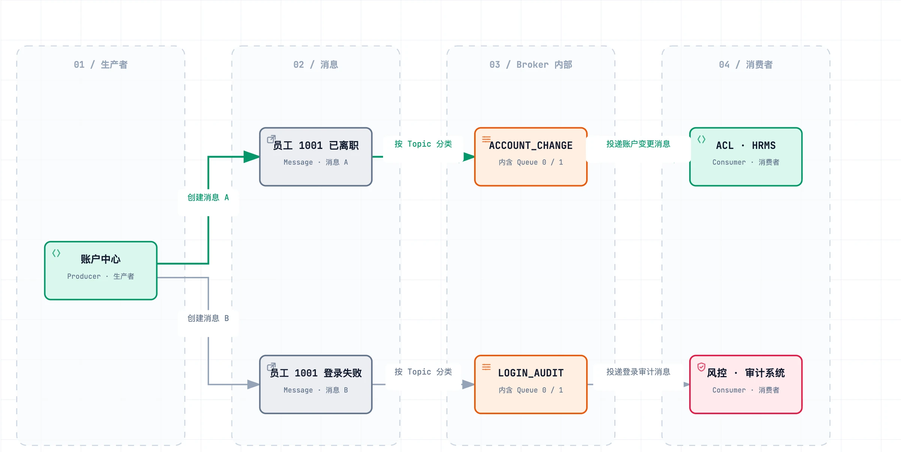

## 一、💡 一句话理解

> [!tip] 核心结论
> MQ（Message Queue，消息队列）是服务之间的“消息中转站”：发送方把通知交给 MQ，接收方再从 MQ 取得通知并处理。

先不要背英文，仍然用“员工离职”理解：

```text
账户中心发出一张“员工已离职”的通知单
        ↓
MQ 消息中心接收并保存通知单
        ↓
ACL、HRMS 等系统取走通知单，完成各自的工作
```

这条流程中的角色和存放位置，在 MQ 中有下面这些名字：

| MQ 名称 | 大白话 | 在当前例子中是什么 |
| --- | --- | --- |
| `Producer`（生产者） | 发出通知的一方 | 账户中心 |
| `Message`（消息） | 发出去的那张通知单 | “员工 1001 已离职” |
| `Broker` | 整个消息仓库，是实际运行的 MQ 服务器 | 负责接收、保存和投递所有消息的 MQ 消息中心 |
| `Topic` | 仓库里的消息分类区 | `ACCOUNT_CHANGE` 账户变更区、`LOGIN_AUDIT` 登录审计区 |
| `Queue` | 一个 Topic 里面的排队通道，消息在通道中依次存放 | 每个 Topic 都可以有自己的 0 号、1 号通道 |
| `Consumer`（消费者） | 收到通知后真正干活的一方 | ACL、HRMS、邮件系统 |

`Broker`、`Topic` 和 `Queue` 不是三个并排的系统，而是包含关系：



[打开可放大交互图](../../archify/mq-two-topics.html)

看图时从左往右看：消息先按业务类型进入对应的 `Topic`，再存入这个 Topic 下面的某一条 `Queue`，最后由消费者读取。为了让图保持简洁，Broker 内部把一个 Topic 和它下面的 Queue 合并显示在同一张卡片中：大字是 Topic 名称，小字说明它内含 `Queue 0 / 1`。

账户中心发送消息时会写明消息属于哪个 Topic，Broker 据此把两类消息分开：

```text
“员工 1001 已离职”
  → 放入 ACCOUNT_CHANGE Topic
  → 存入该 Topic 下的一条 Queue
  → 由 ACL、HRMS 消费

“员工 1001 登录失败”
  → 放入 LOGIN_AUDIT Topic
  → 存入该 Topic 下的一条 Queue
  → 由风控、审计系统消费
```

两个 Topic 就像仓库里的两个分类区。账户变更消息不会混进登录审计区，消费者也只订阅自己关心的分类。

> [!tip] 最简单的记法
> `Broker` 是整个仓库，`Topic` 是按业务划分的区域，`Queue` 是区域里的排队通道。初学阶段先记住这个包含关系即可。

## 二、🧭 MQ 解决什么问题

先不要想 MQ，先看一个具体问题。

员工办理离职时，账户中心需要完成自己的核心操作：把员工账号改成“已离职”。修改成功后，还要让其他系统做后续工作：

- ACL 回收权限。
- HRMS 更新人员状态。
- 邮件系统发送离职通知。

如果账户中心直接同步调用这三个系统，请求链路是：

```text
用户点击“确认离职”
  ↓
账户中心修改账号
  ↓ 等 ACL 回收权限
  ↓ 等 HRMS 更新状态
  ↓ 等邮件系统发送通知
  ↓
全部完成后，页面才返回成功
```

这会产生四个很具体的问题。

### 2.1 问题一（异步）：用户要等待所有系统

假设账户中心自身处理需要 `100 ms`，三个下游分别需要 `300 ms`、`500 ms` 和 `2 s`。如果依次同步调用，用户大约要等 `2.9 s`。

但用户真正关心的核心结果只是“离职是否办理成功”。发邮件等后续动作不必让用户一直等。

**MQ 的做法：**账户中心完成自己的操作，并确认“员工已离职”消息已经可靠地交给 MQ 后，就可以返回；ACL、HRMS 和邮件系统之后各自处理。

```text
用户 → 账户中心 → MQ：员工已离职 → 返回成功
                         ├→ ACL 回收权限
                         ├→ HRMS 更新状态
                         └→ 邮件系统发送通知
```

这就是**异步**：主流程不再等待所有后续工作完成。

此时页面显示“离职办理成功”，表示：

```text
已经完成：账户中心把员工账号改成“已离职”
已经完成：账户中心把后续任务交给了 MQ
正在后台处理：ACL 回收权限、HRMS 更新状态、发送邮件
```

如果 ACL 第一次回收权限失败，MQ 不会假装它已经完成，而是稍后再把任务交给 ACL。ACL 真正处理成功后，这项任务才算结束。

所以 MQ 的作用不是“发出去就不管了”，而是：

> 用户不用站在窗口前等所有部门办完；MQ 帮忙保管和转交这些待办任务，失败时还可以再次转交。

至于 MQ 怎样知道任务成功、失败后怎样重试，以及一直失败怎么办，放在 [[5. MQ 可靠性问题]] 详细讲。这里先记住：**异步只是不用当场等，不是不关心最后有没有成功。**

### 2.2 问题二（故障隔离）：一个非核心系统故障，会拖累整个请求

如果邮件系统宕机，账户中心直接调用它时可能超时。结果就会变成：账号明明已经修改成功，但页面却等待很久，甚至提示“离职办理失败”。

**MQ 的做法：**账户中心只把消息可靠地交给 MQ，不直接等待邮件系统。邮件系统恢复后再继续消费积压的消息。

> [!info] 边界
> MQ 隔开的是“账户中心”和“下游处理过程”，并不等于故障自动消失。消息发送失败、消费失败和长期堆积仍然需要重试、告警等机制。

### 2.3 问题三（解耦）：每增加一个下游，账户中心都要改代码

以后审计系统也需要知道员工离职。如果采用直接调用，账户中心通常还要新增审计系统的接口地址、调用代码、超时配置和异常处理。

下游越多，账户中心知道得越多，改动和测试范围也越大。

**MQ 的做法：**账户中心始终只发布“员工已离职”这个事件。审计系统自己订阅该消息，通常不需要账户中心增加一次直接调用。

这就是**解耦**：生产者只描述“发生了什么”，不负责安排“谁来处理”。

### 2.4 问题四（削峰）：突发流量可能压垮下游

假设批量导入产生了 `10 万` 条账户变更，但 HRMS 每秒只能处理 `100` 条。直接把请求全部打给 HRMS，可能耗尽它的线程、连接或数据库资源。

**MQ 的做法：**先把消息暂存在 Broker 中，HRMS 再按自己的处理能力逐步消费。

```text
10 万条突发消息 → MQ 暂存 → HRMS 每秒处理 100 条
```

这就是**削峰**：把短时间内到达的高峰流量，摊平成下游能够承受的处理速度。

> [!tip] 看懂这一节只记一句话
> 没有 MQ 时，账户中心既要完成自己的事，又要逐个等待、调用并照顾所有下游；有了 MQ 后，它先把“发生了什么”交给中转站，下游再按各自节奏处理。

### 2.5 MQ 解决旧问题，也会带来新问题

> [!warning] 使用边界
> 引入 MQ 后，还要处理发送失败、重复消费、顺序、堆积、重试、死信和数据一致性。同步调用已经足够简单时，不要强行使用 MQ。

这些问题统一放在 [[5. MQ 可靠性问题]] 中讲解，本篇只需要先知道：**MQ 解决了等待、耦合和流量高峰，但也增加了可靠性和运维复杂度。**

## 三、🔄 一条消息怎样流转

以账户变更为例：

```text
1. aboss-sso 完成账户修改
2. Producer 创建账户变更 Message
3. Producer 把 Message 发送给 Broker
4. Broker 根据 Topic 分类，并把消息存入该 Topic 下的一条 Queue
5. ACL、HRMS 等 Consumer 获取消息
6. Consumer 执行业务逻辑
7. 处理成功后返回 ACK
```

其中：

- `ACK` 表示消费者已经处理完成。
- 没有成功确认的消息可能被重新投递。
- 重新投递可能造成重复消费，因此业务需要保证幂等。

## 四、📚 推荐阅读顺序

不要一次读完所有内容，按下面顺序学习：

1. [[2. MQ 核心角色与代码对应]]：看懂 Message、Producer、Broker、Topic、Queue 和 Consumer。
2. [[3. MQ Consumer Group 与消费模式]]：理解为什么不同系统各消费一遍、同组实例共同分担。
3. [[4. SOFAMQ 账户变更代码实践]]：跟着真实代码走完生产和消费链路。
4. [[5. MQ 可靠性问题]]：理解消息丢失、重复、乱序、堆积和数据一致性问题。
5. [[6. 消息幂等]]：学习如何让重复消息不会重复修改业务数据。

如果学习 RabbitMQ，再分别查看：

- [[RabbitMQ/RabbitMQ基础|RabbitMQ 基础]]
- [[RabbitMQ/RabbitMQ高级|RabbitMQ 高级]]

## 五、🎤 面试时怎么说

> MQ 是服务之间传递消息的中间件。生产者把业务事件封装成消息发送给 Broker，Broker 负责存储和投递，消费者订阅并处理消息。它主要用于异步、解耦和削峰，但也会带来消息丢失、重复消费、顺序、堆积和一致性问题，所以还需要 ACK、重试、死信、监控和业务幂等配合。

## 六、📌 快速回顾

- 生产者只管发，消费者负责处理，Broker 在中间存储和转发。
- MQ 的主要价值是异步、解耦和削峰。
- MQ 提高了系统扩展性，也增加了可靠性和运维复杂度。
- 先理解角色和消费组，再学习失败重试与幂等。

## 七、🔗 官方资料

- [Apache RocketMQ 5.0：Domain Model](https://rocketmq.apache.org/docs/domainModel/01main/)
- [Apache RocketMQ 5.0：Consumer Group](https://rocketmq.apache.org/docs/domainModel/08consumergroup/)
- [RabbitMQ：AMQP 0-9-1 Model Explained](https://www.rabbitmq.com/tutorials/amqp-concepts)
