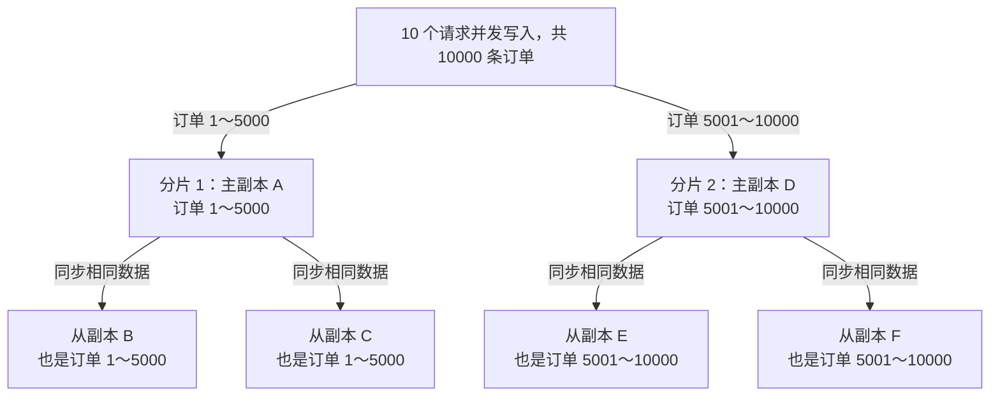
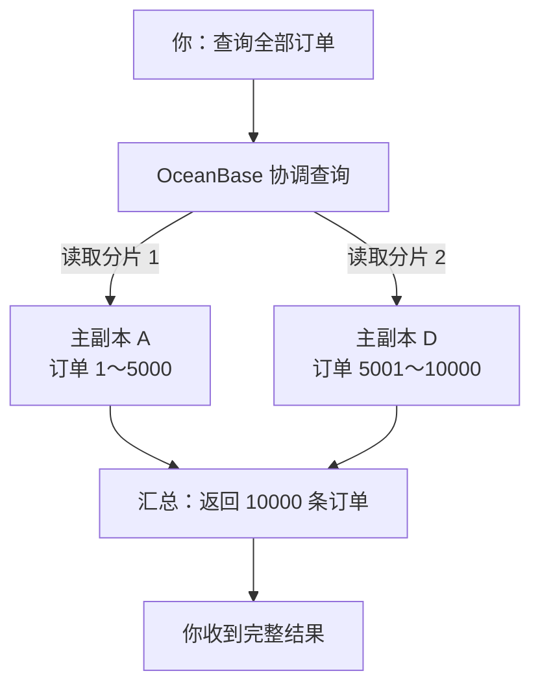

## 一、💡 OceanBase 是什么？

> [!tip] 先记住这一句
> OceanBase 是一种分布式数据库，他可以让多台机器合作，像一个数据库一样对外提供服务。

## 二、📦 “分布式”是什么意思？

假设你开了一家网店，订单越来越多。

- **一台机器扛：** 所有订单都放在一台机器上，存储空间和处理能力都有上限。
- **多台机器分工：** 可以把订单拆成几部分，分别交给不同机器保存和处理；数据库负责协调它们。

打个比方：原来一个人管所有账本，现在几个人分着管，但你查账时，仍然面对同一个服务窗口。

这里的“人”对应机器，“账本”对应数据。**重点是多台机器协同工作，不是随便装几个互不相干的数据库。**

## 三、⚙️ 多台机器有什么用？

| 做法            | 人话解释                             |
| ------------- | -------------------------------- |
| 数据拆开存（分片）     | 大家分担工作，不让一台机器扛全部数据。              |
| 同一份数据保留多份（副本） | 某台机器坏了，在满足副本和部署条件时，其他机器还能接着提供服务。 |
| 增加机器（扩容）      | 业务变大时，可以增加机器来分担存储和处理压力。          |

注意：**拆成几份是为了分工，复制几份是为了防故障，这两件事可以同时做。** 多台机器之间也要通信和协调，所以不代表每条查询都会更快。

## 四、🚦 10 个请求同时各写 1000 条，会怎样？

这叫**并发写入**：10 个请求同时提交，一共要写 1 万条。

### 4.1 数据放在哪里？

提问：“A 副本只写了一部分，B 副本只写了另一部分，查 A 就漏掉 B。”

这里混淆了两个概念：**分片是把数据拆开，副本是把同一片数据复制多份。**

假设这 1 万条订单按编号分成两片，每片保留 3 个完整数据副本。下面画的是全部写入成功并同步完成后的状态：

这是分片存储，每个分片有自己的副本，紧接着是查询
### 4.2 查全部订单时，会不会只查 A？

**查询整张订单表时，数据库会访问需要的分片，再把结果汇总给你。** 即使连接的是某一台机器，也不代表只能查那台机器本地的数据。

### 4.3 同时写的数据冲突怎么办？

- **写不同的数据：** 通常可以同时处理。
- **修改同一条数据：** 先拿到锁的先改，其他请求等待；等事务结束释放锁后再继续，也可能因等待超时而失败。
- **插入相同的唯一编号：** 会发生唯一键冲突，不能重复插入。

**数据库会协调写入，但业务规则还得自己保证。** 比如扣库存，要正确使用更新条件和事务，避免两个请求都读到 100，最后却都写回 99。

## 五、📌 总结

**OceanBase：一个能让多台机器分工存数据、查数据，并通过多份副本提高可靠性的数据库。**

你通常还是写 SQL；背后数据在哪台机器、需要哪些机器一起处理，主要由数据库来协调。

## 六、参考资料

- [OceanBase 官方介绍](https://github.com/oceanbase/oceanbase)
- [官方文档：分布式数据库对象概述](https://www.oceanbase.com/docs/common-oceanbase-database-cn-1000000001500052)
- [官方文档：日志流和副本概述](https://www.oceanbase.com/docs/common-oceanbase-database-cn-1000000000034087)
- [官方文档：主从副本与多数派同步](https://www.oceanbase.com/docs/common-oceanbase-database-cn-1000000000508575)
- [官方文档：分布式执行和并行查询](https://www.oceanbase.com/docs/enterprise-oceanbase-database-cn-10000000000363404)
