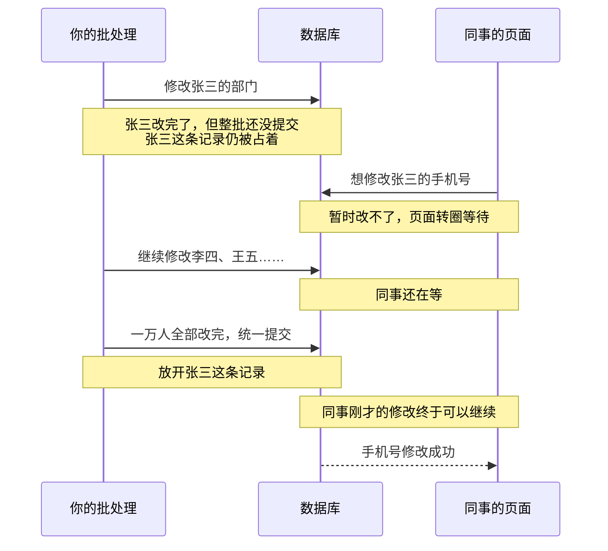

## 一、事务处理完才释放锁

下面从上往下看，越往下表示时间越晚：

**我的任务没做完，同事要一直等，不是张三改完了，我就可以改了。**

## 三、“大量更新”出现锁等待

还是刚才那个例子。你一次改的人越多，就越容易出现两件事。

**第一，更容易碰上别人也要改的人。**

你只改张三，别人改李四，通常各干各的。

你要改全公司一万人，同事随便改个人，都可能碰上你正在处理的记录。

**第二，前面改过的人，可能要等很久才能让别人接着改。**

张三排在第一个。虽然改他只花了一瞬间，但如果整批任务还要跑几十秒才提交，同事就可能跟着等几十秒。等得太久，页面就可能报超时。

所以，“大量更新可能引发锁竞争”背后的意思是：

> **你占住的记录多了，占着不放的时间也可能长了，别人就更容易被你挡住。**

但并不是更新多就一定会竞争。如果没有别人来改这些记录，就算你更新一万条，也未必有人在等锁。

反过来，哪怕每个请求只改一条，几百个人同时改同一个员工，也照样会排队。

## 四、减少锁等待的方案

其实就是减少事务处理时间

**1.能分批完成事务并提交。**

**2.事务里保持干净，快速处理完并提交，事务里不要调用慢接口。**

**3.几个任务一起跑，尽量各改各的，不要产生锁等待。**

## 五、官方资料

- [OceanBase：热点行更新](https://docs.oceanbase.com/oceanbase-database/V4.2.1-try-out-oceanbase-hot-row-update-capability)：为什么多个请求修改同一行，需要协调先后顺序。
- [OceanBase：热点表最佳实践](https://docs.oceanbase.com/best-practices/hot-tables)：怎样控制每批操作的大小，缩短占锁时间。
