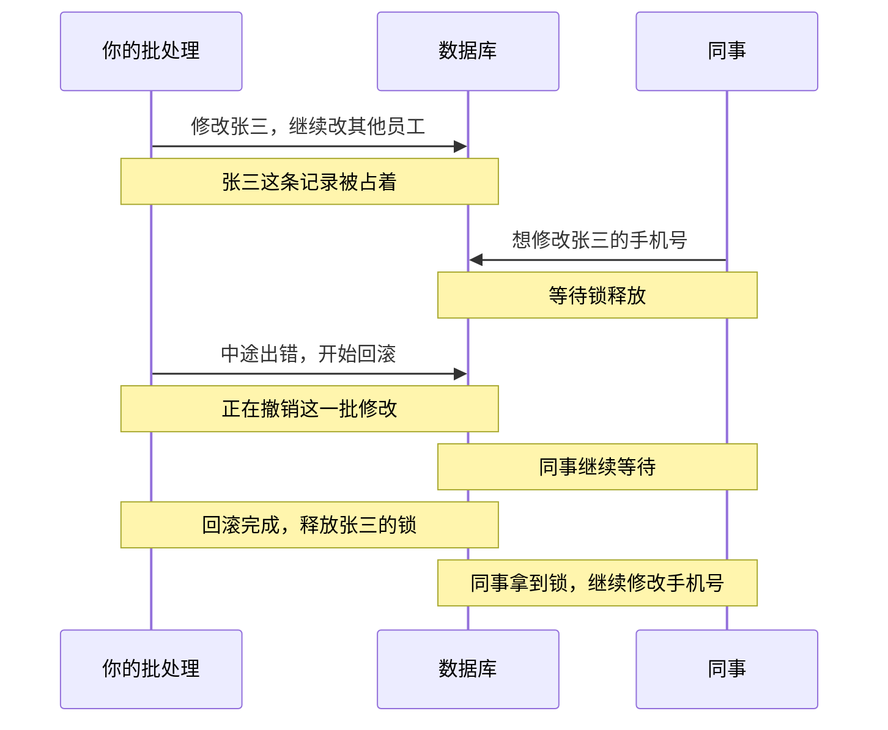

**事务回滚，就是把这一批操作里还没提交的修改撤销，当作没做过。**

比如：调整一万名员工的部门，规定“要么全部改成，要么一个都别改”。

## 一、什么情况会回滚？

1. **业务不允许，主动撤销。** 比如目标部门已经停用，程序决定整批取消，执行 `ROLLBACK`。
2. **程序报错，框架撤销。** 使用了事务管理，且异常符合配置的回滚规则，框架就会回滚。
3. **发生死锁。** 你占着张三等李四，另一个任务占着李四等张三。数据库可能回滚其中一个事务，让另一个继续。
4. **事务超时或连接断开。** 数据库检测并清理尚未提交的事务时，会撤销修改；连接断开后不一定立即清理。

## 二、回滚期间，等锁的人怎么办？



## 三、等待也算事务时间吗？

**算。等锁时，事务计时不会暂停。** 所以前一个事务长期不放锁，后面的请求可能接连超时。

而且，**等锁的人，可能也占着别人的锁。** 比如同事先改了李四，再等你放开张三；第三个人想改李四，也会被挡住：

```text
你开启事务,占着张三
    ↑
同事开启事务修改了李四，在等张三，同时占着李四
    ↑
第三个请求等李四，等三个请求也会等待
```
