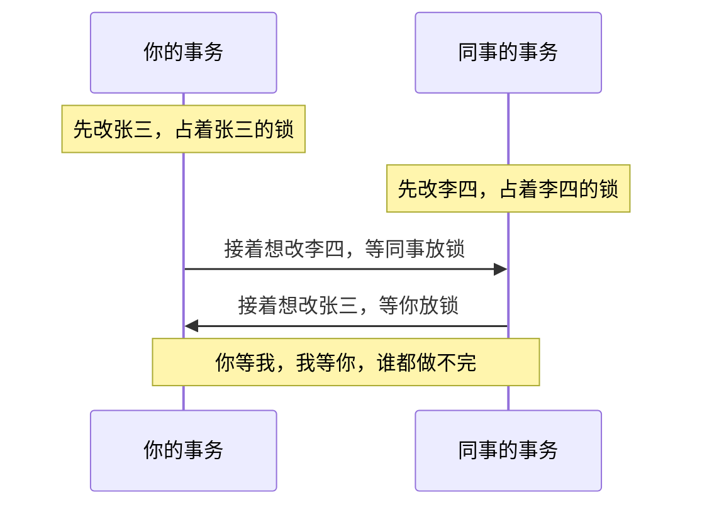
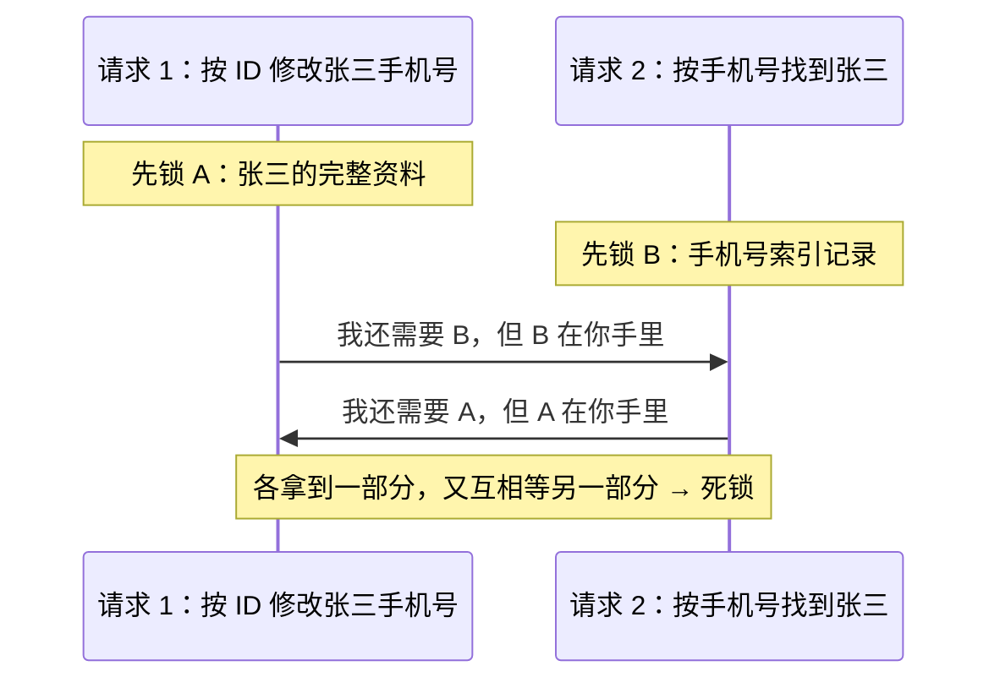

## 一、两个事务为什么会互相等锁？

**通常是执行到哪里，就按需要锁到哪里，不是一开启事务，就把后面要修改的行全部锁住。**

```text
开启事务           → 还没因为这些 UPDATE 锁住员工
执行第一条 UPDATE  → 锁住员工 1
执行第二条 UPDATE  → 再锁住员工 2，员工 1 的锁还留着
提交事务           → 释放相关锁
```

如果你和同事都要改张三、李四，但顺序相反，就可能出现死锁：



**普通等待是一条队伍，死锁是等了一圈又回到自己。**

```text
普通等待：第三个人 → 同事 → 你
死锁：你 → 同事 → 你
```

数据库检测到死锁后，通常会选择一个事务回滚，让另一个继续。大家按相同顺序更新，比如都先改张三、再改李四，可以减少这类死锁。

## 二、一条修改、一条提交，还会死锁吗？

我的想法是：不把一万条 UPDATE 放在一个大事务里，而是修改一条、提交一条。

**这样通常能缩短占锁时间，但不能保证完全没有死锁。** 开启自动提交时，每条 UPDATE 仍有自己的事务。

如果双方只是争抢同一把锁，通常就是排队：

```text
你先拿到锁 → 修改 → 提交
同事等待   → 拿到锁 → 修改 → 提交
```

同事在等你，但你没有反过来等同事，所以不会仅仅因为这次争抢就形成死锁。

## 三、只改一行，为什么也可能死锁？

> **同一行有时候会有俩个锁**

**你之前想象的是：**

```text
一个人拿到张三的全部修改权 → 另一个人等
```

**而这个例子是：**

```text
两个人各拿到一部分 → 又互相等另一部分
```

**先看张三的信息放在哪里。** 假设员工 ID 是主键，手机号也建了索引：

```text
A：张三的完整资料，存在主键索引里
   员工 1001 → 张三、13800000000

B：手机号索引里，指向张三的记录
   13800000000 → 员工 1001
```

- 所以，A把张三这一行 锁住。

- B把手机号索引锁住了；

> 我在改张三这条数据的时候既要把张三的手机号改掉，又要把手机号的索引改掉，所以就锁住了



参考：[InnoDB 数据和索引如何存储](https://dev.mysql.com/doc/refman/8.4/en/innodb-index-types.html) · [InnoDB 加锁规则](https://dev.mysql.com/doc/refman/8.4/en/innodb-locks-set.html)
