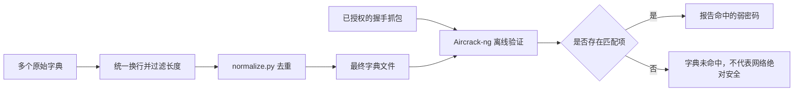

## 一、💡 一句话理解

> [!tip] 核心结论
> `wpa-dictionary` 不是一套自动破解程序，而是一组可交给 Aircrack-ng 使用的密码字典。Mac M 芯片适合整理字典和检查已经合法取得的 WPA/WPA2 抓包文件，但内置无线网卡通常不适合作为完整的监听、注入设备。

> [!warning] 使用边界
> 本文只适用于自己的 Wi-Fi、隔离实验环境或已获得网络所有者书面授权的安全审计。不要扫描、抓取、干扰或尝试访问未获授权的网络。本文不提供主动断开其他客户端的操作。

## 二、🧭 理论：它是什么

### 2.1 这个项目提供了什么

项目目录：

```text
/Users/chenweili/Documents/vscodeWorkspace/wpa-dictionary
```

主要文件如下：

| 文件 | 作用 |
| --- | --- |
| `common.txt` | 常见数字、键盘组合及常用弱密码 |
| `english.txt` | 常见英文单词和英文弱密码 |
| `birthday.txt` | `YYYYMMDD` 格式的生日组合 |
| `birthday_ddmmyyyy.txt` | `DDMMYYYY` 格式的生日组合 |
| `birthday_lddmmyyyy.txt` | 带前缀的日期组合 |
| `birthday_Uddmmyyyy.txt` | 带大写前缀的日期组合 |
| `other-0.txt`、`other-1.txt`、`other-2.txt` | 其他数字、单词和混合密码 |
| `normalize.py` | 从标准输入读取内容，过滤较短的行并去重 |

它的核心用途是把这些文本文件作为候选密码列表，交给 Aircrack-ng 逐条验证。

### 2.2 Aircrack-ng 是什么

Aircrack-ng 是一套开源的 **802.11 Wi-Fi 安全审计命令行工具**。这里的 802.11，就是 Wi-Fi 使用的一组无线网络标准。

“Aircrack-ng”这个名字有两层含义：

1. **Aircrack-ng 工具套件**：安装包的总称，里面包含多个各司其职的命令。
2. **`aircrack-ng` 命令**：套件中的核心离线验证程序，负责读取抓包和密码字典，检查候选密码是否匹配。

可以把 `aircrack-ng` 命令理解为一个“答案验算器”：

- `.cap` 抓包提供一次 Wi-Fi 认证过程留下的可验证数据。
- 字典文件提供一组待尝试的候选密码。
- `aircrack-ng` 根据网络信息逐个计算并比较，判断其中是否存在正确答案。

这不是直接解密或显示密码。它仍然需要有效的认证抓包，而且正确密码必须存在于字典中。

Homebrew 安装 `aircrack-ng` 时，实际会安装一整套相关命令：

| 命令 | 主要职责 | 本文是否使用 |
| --- | --- | --- |
| `aircrack-ng` | 使用抓包和字典进行离线密码验证 | 使用，是本文的核心命令 |
| `airodump-ng` | 从兼容无线网卡捕获原始 802.11 数据 | Mac 内置网卡通常不适合依赖 |
| `airmon-ng` | 在受支持的系统和网卡上管理监听模式 | 主要面向 Linux，本文不使用 |
| `aireplay-ng` | 在授权实验环境中注入或重放无线帧 | 本文不使用 |
| `airdecap-ng` | 使用已知密钥处理抓包中的加密数据 | 本文不使用 |

> [!info] 它在当前项目中的位置
> `wpa-dictionary` 负责提供候选密码；`aircrack-ng` 负责读取这些候选密码并执行离线验证。只下载这个字典项目不会自动安装 Aircrack-ng，必须另外通过 Homebrew 安装。

> [!warning] 它不是什么
> 它不是 Mac 图形界面软件，不会自动显示钥匙串里保存的 Wi-Fi 密码，也不会因为安装成功就让 Mac 内置无线网卡拥有完整的监听和注入能力。

### 2.3 WPA/WPA2 字典审计需要什么

根据 Aircrack-ng 官方文档，WPA/WPA2-PSK 的字典验证需要两个输入：

1. 含有有效四次握手信息的 `.cap` 或 `.pcap` 抓包文件。
2. 每行一个候选密码的字典文件。

Aircrack-ng 会根据抓包中的网络信息重新计算每个候选密码的结果，再判断是否与握手数据匹配。它不是从抓包里直接“读出”明文密码。

> [!info] 字典审计的关键限制
> 正确密码必须出现在字典里才可能被找到。密码越长、越随机，字典命中的可能性越低。

## 三、⚙️ 理论：它是怎么工作的

### 3.1 完整处理链路



整个过程可以分为三步：

1. 整理候选密码，避免重复计算。
2. 准备合法取得的握手抓包。
3. 使用 Aircrack-ng 在本机离线比较。

### 3.2 Mac M 芯片需要注意什么

Mac M1、M2、M3、M4 等机型都属于 Apple Silicon，终端中的原生架构应显示为 `arm64`。Homebrew 官方推荐的安装前缀是 `/opt/homebrew`。

Aircrack-ng 的离线计算部分可以在 ARM 处理器上运行，并会根据构建结果选择可用的 ARM SIMD 优化。但“CPU 能运行 Aircrack-ng”不等于“Mac 内置无线网卡支持 Aircrack-ng 的全部无线功能”。

| 能力 | Mac M 芯片上的情况 |
| --- | --- |
| 整理和去重密码字典 | 可以 |
| 检查现成的 `.cap` 文件 | 可以 |
| 使用 CPU 做离线字典验证 | 可以 |
| 使用 `airmon-ng` 控制内置网卡 | 通常不可用或不完整 |
| 使用内置网卡稳定监听与注入 | 不建议依赖 |
| 使用 Apple Wireless Diagnostics 排查连接 | 可以，但它不是密码审计工具 |

项目原 README 提到私有的 `airport` 命令。该工具在不同 macOS 版本中的可用性和行为可能不同，不应把它当作现代 macOS 上稳定、公开支持的抓包方案。Apple 官方当前提供的是“无线诊断”，主要用于分析连接问题。

### 3.3 `normalize.py` 实际做了什么

项目中的脚本逻辑很简单：

1. 从标准输入逐行读取。
2. 判断整行长度是否至少为 8。
3. 使用集合 `set` 去除完全相同的行。
4. 把保留下来的行输出到标准输出。

> [!warning] 当前脚本的长度判断细节
> `len(line)` 会把行尾换行符也计算进去，因此一个 7 个字符并带有 `\n` 的密码可能通过检查。不同文件若混有 `LF` 和 `CRLF` 换行，也可能影响严格去重。实践中应先删除 `\r`，再用 `awk` 按实际内容长度过滤。

## 四、🚀 实践：从准备到验证

### 4.1 前置准备

#### 4.1.1 检查芯片架构

在终端运行：

```shell
# Apple Silicon 原生终端应输出 arm64
uname -m
arch
```

预期结果：

```text
arm64
arm64
```

如果输出 `x86_64`，通常说明当前终端运行在 Rosetta 模式。关闭该终端，使用未勾选“使用 Rosetta 打开”的终端应用重新执行。

#### 4.1.2 安装或检查 Homebrew

先检查：

```shell
# 查看 brew 命令文件的完整路径
command -v brew

# 查看 Homebrew 的安装前缀
brew --prefix
```

Apple Silicon 上的预期结果分别是：

```text
# command -v brew 的输出：brew 可执行文件的完整路径
/opt/homebrew/bin/brew

# brew --prefix 的输出：Homebrew 的安装前缀
/opt/homebrew
```

> [!info] 两个路径都正确
> `/opt/homebrew/bin/brew` 是可以直接运行的 `brew` 程序；`/opt/homebrew` 是整个 Homebrew 的安装根目录。当前终端输出 `/opt/homebrew/bin/brew`，说明正在使用 Apple Silicon 原生安装。

如果尚未安装 Homebrew，先安装 Xcode Command Line Tools：

```shell
# 安装编译工具和 Git；系统会弹出确认窗口
xcode-select --install
```

然后使用 Homebrew 官方安装命令：

```shell
# 脚本会先显示将要执行的操作，并要求确认
/bin/bash -c "$(curl -fsSL https://raw.githubusercontent.com/Homebrew/install/HEAD/install.sh)"
```

安装结束后，按照终端输出把 Homebrew 加入 `~/.zprofile`。Apple Silicon 常用配置如下：

```shell
# 让 zsh 能在后续终端会话中找到 /opt/homebrew/bin/brew
echo 'eval "$(/opt/homebrew/bin/brew shellenv)"' >> ~/.zprofile
eval "$(/opt/homebrew/bin/brew shellenv)"
```

#### 4.1.3 安装 Aircrack-ng

```shell
# 更新 Homebrew 软件信息
brew update

# 安装适用于当前架构的 Aircrack-ng
brew install aircrack-ng

# 查看版本，确认命令已经进入 PATH
aircrack-ng --help

# 查看当前构建可用的 SIMD 加速类型
aircrack-ng --simd-list
```

截至 2026-09-02，本机 `brew info aircrack-ng` 显示稳定版为 `1.7`，并提供预编译包。实际安装版本应以执行下面命令时的输出为准：

```shell
# 查看当前 Homebrew 仓库中的版本、依赖和安装状态
brew info aircrack-ng
```

#### 4.1.4 进入项目目录

```shell
# 后续相对路径都以这个项目目录为起点
cd /Users/chenweili/Documents/vscodeWorkspace/wpa-dictionary

# 确认字典与脚本存在
ls common.txt english.txt birthday.txt normalize.py
```

### 4.2 可以拿来干什么

#### 4.2.1 合并并清理多个字典

用途：把项目中的多个字典合并为一个最终文件，先统一 Windows 与 macOS/Linux 的换行符，再严格保留至少 8 个字符的候选密码，最后去重。

前置条件：当前目录是 `wpa-dictionary`，并且系统自带的 `awk`、`tr` 和 Python 3 可用。

```shell
# 1. cat：按顺序合并字典，越可能命中的文件应放得越靠前
# 2. tr：删除 Windows CRLF 中的 CR 字符
# 3. awk：按候选密码实际内容过滤，只保留至少 8 个字符的行
# 4. normalize.py：按项目原有逻辑进行最终去重
# 5. 最终结果写入 mac-audit-wordlist.txt
cat common.txt \
    english.txt \
    birthday.txt \
    birthday_ddmmyyyy.txt \
    birthday_lddmmyyyy.txt \
    birthday_Uddmmyyyy.txt \
    other-0.txt \
    other-1.txt \
    other-2.txt \
  | tr -d '\r' \
  | awk 'length($0) >= 8' \
  | python3 normalize.py \
  > mac-audit-wordlist.txt
```

检查结果：

```shell
# 查看最终候选密码数量
wc -l mac-audit-wordlist.txt

# 只预览前 10 行，避免终端输出整个大文件
head -n 10 mac-audit-wordlist.txt

# 检查是否仍存在少于 8 个字符的行；正常情况下不应有输出
awk 'length($0) < 8 { print NR ":" $0 }' mac-audit-wordlist.txt | head
```

输入是项目中的九个原始字典，处理过程是统一换行、过滤和去重，输出是 `mac-audit-wordlist.txt`。

#### 4.2.2 检查 Mac 的 Wi-Fi 接口与连接问题

用途：确认系统识别到的 Wi-Fi 接口名称，并使用 Apple 官方工具诊断自己的网络连接。这里不进入监听或注入模式。

```shell
# 列出硬件端口；在 Wi-Fi 段落下查看 Device，例如 en0
networksetup -listallhardwareports

# 查看接口当前状态；把 en0 替换为上一步看到的名称
ifconfig en0
```

Apple Wireless Diagnostics 的打开方式：按住 `Option` 键，点击菜单栏或控制中心的 Wi-Fi 图标，然后选择“打开无线诊断”。它用于连接质量分析，不负责生成供密码验证使用的握手抓包。

#### 4.2.3 对合法取得的抓包做离线审计

用途：验证自己的实验网络是否使用了字典中容易猜到的密码。

前置条件：已经有一个在授权环境中取得、包含有效 WPA/WPA2 握手的 `.cap` 文件。本文用 `/绝对路径/authorized-lab.cap` 表示它，执行时必须换成真实路径。

```shell
# -a 2：明确使用 WPA/WPA2-PSK 模式
# -w：指定刚生成的候选密码字典
# 最后一个参数：已授权抓包文件的绝对路径
aircrack-ng -a 2 \
  -w mac-audit-wordlist.txt \
  /绝对路径/authorized-lab.cap
```

可能出现的结果：

- `KEY FOUND!`：字典中存在匹配项，说明实验网络密码较弱，应立即改成随机长密码。
- `Passphrase not in dictionary`：本次字典没有命中，不代表密码绝对安全。
- `No valid WPA handshakes found`：抓包中没有 Aircrack-ng 能使用的有效握手。
- 出现多个网络供选择：输入对应编号，或使用 `-b` 指定已授权实验 AP 的 BSSID。

如果抓包中的 SSID 被隐藏，可以显式提供真实 SSID：

```shell
# ESSID 会参与 WPA/WPA2 密钥计算，必须填写实验网络的真实名称
aircrack-ng -a 2 \
  -e "你的实验网络名称" \
  -w mac-audit-wordlist.txt \
  /绝对路径/authorized-lab.cap
```

#### 4.2.4 保存和恢复较长的审计任务

用途：长时间验证时保存进度，之后从同一工作目录恢复。

```shell
# 创建会话；Aircrack-ng 会定期更新 audit.session
aircrack-ng --new-session audit.session \
  -w mac-audit-wordlist.txt \
  /绝对路径/authorized-lab.cap

# 之后回到创建会话时的同一目录，再恢复任务
aircrack-ng --restore-session audit.session
```

会话恢复要求文件路径和工作目录保持一致；恢复时不能临时追加新的参数。

### 4.3 完整实践：直接使用当前项目验证安装

#### 4.3.1 实践目标

这次实践直接在当前 `wpa-dictionary` 项目中完成，不另外创建实验目录，也不下载额外的测试字典。

当前项目只缺少可用于验证的抓包文件，因此下载一份 Aircrack-ng 官方测试抓包 `wpa2.eapol.cap`。然后直接使用项目已有的 `common.txt` 进行离线验证。官方文档说明该样例的密码是 `12345678`，而这个密码正好位于 `common.txt` 的第一行。

整个实践不访问真实 Wi-Fi，也不需要无线网卡进入监听模式。

#### 4.3.2 进入并检查当前项目

```shell
# 进入当前 wpa-dictionary 项目
cd /Users/chenweili/Documents/vscodeWorkspace/wpa-dictionary

# 确认当前位置正确
pwd

# 确认项目字典和 Aircrack-ng 命令均可用
ls -lh common.txt
command -v aircrack-ng

# 查看 common.txt 的第一行；预期为 12345678
head -n 1 common.txt
```

预期能看到：

```text
/Users/chenweili/Documents/vscodeWorkspace/wpa-dictionary
/opt/homebrew/bin/aircrack-ng
12345678
```

#### 4.3.3 下载官方测试抓包到当前项目

```shell
# 当前目录保持为 wpa-dictionary
cd /Users/chenweili/Documents/vscodeWorkspace/wpa-dictionary

# 下载 Aircrack-ng 官方仓库中的 WPA2 测试抓包
# URL 必须是纯地址，不能写成 Markdown 的 [地址](地址) 形式
# --fail：服务器返回错误状态时直接失败，不把错误页面保存成抓包
# --connect-timeout：连接超过 15 秒就终止本次尝试
# --max-time：单次下载最多等待 120 秒
# --retry：因临时网络问题失败时自动重试 3 次
curl --fail --location \
  --connect-timeout 15 \
  --max-time 120 \
  --retry 3 \
  "https://raw.githubusercontent.com/aircrack-ng/aircrack-ng/master/test/wpa2.eapol.cap" \
  --output wpa2.eapol.cap

# 确认抓包已下载且不为空
ls -lh wpa2.eapol.cap
file wpa2.eapol.cap
```

正常情况下，该测试文件约为 `802 B`。如果命令中出现下面这种内容，说明复制了网页中的 Markdown 链接格式，必须删除方括号和括号，只保留其中的纯 URL：

```text
[https://example.com/file](https://example.com/file)
```

如果 GitHub 将默认分支由 `master` 改为其他名称，应从官方仓库的 `test` 目录重新复制 Raw 下载地址，不要从不明镜像下载抓包。

#### 4.3.4 使用当前项目字典执行验证

```shell
# -a 2：使用 WPA/WPA2-PSK 模式
# -w common.txt：直接使用当前项目自带的常见密码字典
# wpa2.eapol.cap：刚下载到当前项目的官方测试抓包
aircrack-ng -a 2 \
  -w common.txt \
  wpa2.eapol.cap
```

输入：当前项目中的 `common.txt` 和 `wpa2.eapol.cap`。

过程：Aircrack-ng 从抓包中读取 WPA2 握手，再从 `common.txt` 第一行开始逐个验证候选密码。

预期结果中应包含：

```text
KEY FOUND! [ 12345678 ]
```

因为 `12345678` 就在 `common.txt` 中，正常情况下很快就会命中。看到该结果说明以下三部分都已正常工作：

1. Mac M 芯片上的 Aircrack-ng 安装。
2. 当前项目中的密码字典。
3. Aircrack-ng 对 WPA2 抓包的离线读取和验证。

这不代表对任何现实网络进行了测试。

#### 4.3.5 常见报错排查

| 现象 | 原因 | 处理方法 |
| --- | --- | --- |
| `brew: command not found` | Homebrew 未安装或未进入 `PATH` | 重新执行 `eval "$(/opt/homebrew/bin/brew shellenv)"`，并检查 `~/.zprofile` |
| `aircrack-ng: command not found` | 软件未安装或当前终端未刷新环境 | 执行 `brew install aircrack-ng`，再运行 `command -v aircrack-ng` |
| `No valid WPA handshakes found` | 抓包缺少有效 EAPOL 握手 | 先用官方样例排除安装问题；现实抓包只在授权实验环境重新获取 |
| `An ESSID is required` | 抓包没有提供可用 SSID | 增加 `-e "真实实验网络名称"` |
| 字典文件找不到 | 当前目录或相对路径不正确 | 使用绝对路径，或先执行 `pwd` 和 `ls` 检查 |
| 下载文件只有几 KB 文本 | Raw 地址失效或返回网页 | 用 `file 文件名` 检查，再从 Aircrack-ng 官方仓库复制最新 Raw 地址 |
| `arch` 显示 `x86_64` | 终端运行在 Rosetta 模式 | 改用原生 arm64 终端，并确认 `brew --prefix` 是 `/opt/homebrew` |

## 五、📌 总结

- 这个仓库的主体是密码字典，不负责自动完成全部无线审计流程。
- Mac M 芯片可以原生安装 Aircrack-ng，并适合做字典整理和离线验证。
- Mac 内置无线网卡不是 Aircrack-ng 完整监听、注入流程的可靠基础。
- 合并字典时应先统一换行，再按实际字符长度过滤并去重。
- 最安全的入门验证方式是使用 Aircrack-ng 官方测试抓包。
- 字典未命中不等于密码安全；家庭网络应优先使用 WPA2/WPA3 和随机长密码。

> [!tip] 记忆句
> 字典提供“可能的密码”，抓包提供“可比较的证据”，Aircrack-ng 负责离线逐条验证；三者缺一不可。

## 六、📚 官方资料

- [Aircrack-ng 安装文档](https://www.aircrack-ng.org/install.html)
- [Aircrack-ng 命令与 WPA/WPA2 字典验证说明](https://www.aircrack-ng.org/doku.php?id=aircrack-ng)
- [Aircrack-ng 官方 GitHub 仓库](https://github.com/aircrack-ng/aircrack-ng)
- [Homebrew 官方安装文档](https://docs.brew.sh/Installation)
- [Homebrew 常见问题：Apple Silicon 默认安装路径](https://docs.brew.sh/FAQ)
- [Apple 官方：使用 Mac 无线诊断](https://support.apple.com/guide/mac-help/use-wireless-diagnostics-mchlf4de377f/mac)
