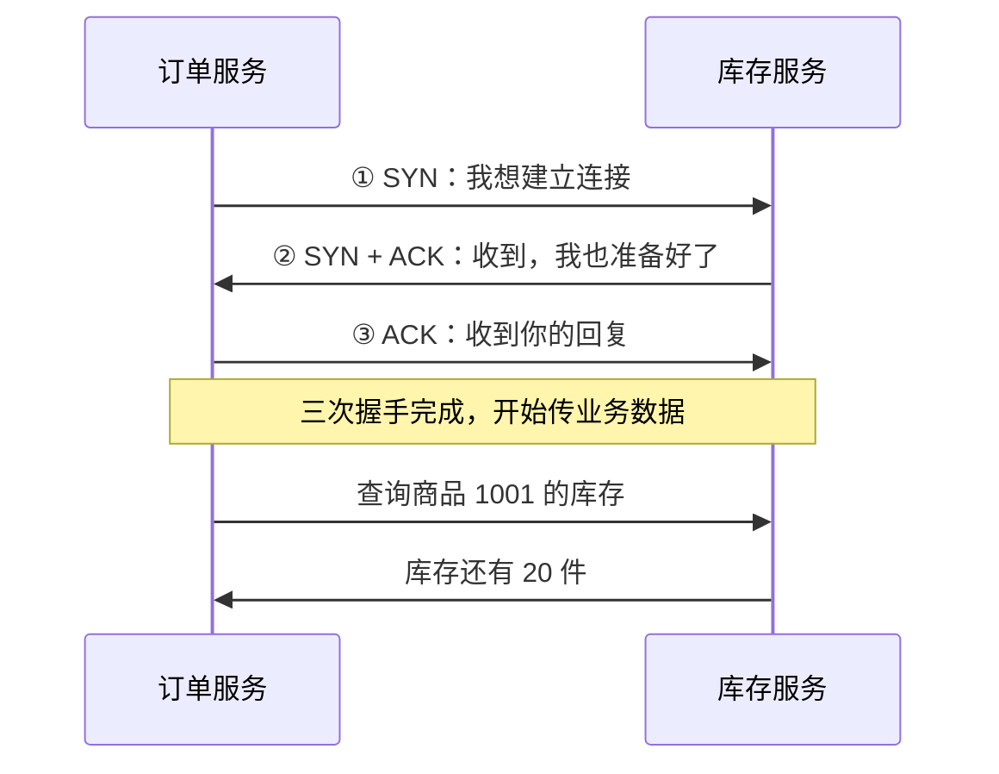
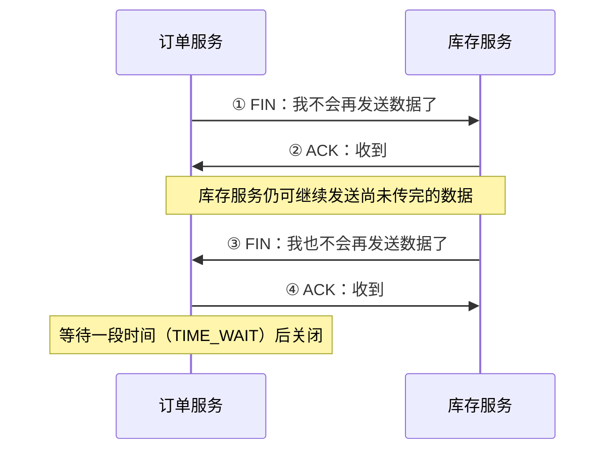

## 一、💡 一句话理解

> 进程通过网络传数据，就是把数据变成字节，通过 Socket 发给另一个进程，再由对方还原和处理。

例如：订单服务想知道商品库存，就把“查询商品 1001 的库存”发给库存服务，库存服务处理后再返回结果。

## 二、📡 需要认识的几个概念

| 概念          | 简单理解                                      |
| ----------- | ----------------------------------------- |
| IP 地址       | 指定要访问的网络地址                                |
| 端口          | 操作系统用它找到对应的通信端点，例如库存服务监听的 9000 端口；它不是进程编号 |
| Socket（套接字） | 程序使用操作系统网络能力的入口，可以通过它收发数据                 |
| TCP         | 提供可靠、有序的字节传输能力                            |
| 通信协议        | 双方约定数据的格式，以及怎样识别一条完整消息                    |

可以先记成：**IP 和端口确定去哪里，Socket 用来收发，协议规定怎么理解。**

### 2.1 Socket 是什么

**Socket 就是程序用来发送和接收网络数据的“收发口”。**

你可以把它理解成**打电话时使用的电话机**：

| 打电话 | 网络通信 |
| --- | --- |
| 对方的电话号码 | 对方的 IP 和端口 |
| 使用电话机说话、听回复 | 通过 Socket 发送、接收数据 |
| 电话网络负责传声音 | 操作系统和网络负责传字节 |

比如订单服务查询库存，就像订单服务给库存服务打电话：

```text
订单服务：通过自己的 Socket 发出“查询商品 1001 的库存”
库存服务：通过自己的 Socket 收到请求，查询库存
库存服务：通过 Socket 回复“库存还有 20 件”
订单服务：通过 Socket 收到结果
```

这里的“电话机”只是类比，Socket 实际上是操作系统提供给程序使用的通信工具。

**学 RPC 时先记住：序列化负责把对象变成可传输的数据，Socket 负责收发这些数据。RPC 框架通常会替你管理这些操作。**

### 2.2 序列化是什么，和 Serializable 有什么关系

> **先分清：序列化是一类转换操作，Serializable 是 Java 的一个接口。JSON 序列化也叫序列化，但不需要实现这个接口。**

#### 2.2.1 序列化：把对象变成可以保存或发送的数据

你的 `ApplicationDTO` 对象可能装着这些信息：

```text
appId   = "app001"
appName = "订单系统"
```

这些信息存在当前程序的内存中。要传给另一个程序，需要先转换成双方约定的数据格式，再通过网络发送。

- **序列化**：把对象转换成约定格式的数据。
- **反序列化**：根据这些数据还原对象。

可以类比写信：把信息写进信里，对方收信后读出信息。**传过去的是数据，不是把当前内存里的对象搬过去；对方会根据数据重新创建对象。**

#### 2.2.2 两种做法：JSON 序列化和 Java 原生序列化

| 对比 | JSON 序列化 | Java 原生序列化 |
| --- | --- | --- |
| 使用什么工具 | JSON 工具，例如 Jackson | Java 自带的对象输入、输出流 |
| 转换成什么 | JSON 文本，再编码为字节 | Java 原生格式的二进制字节 |
| 是否需要 Serializable | 不需要 | 需要 |
| 如何还原 | JSON 工具读取数据并创建对象 | `ObjectInputStream.readObject()` |

**① 使用 JSON：**

```text
Java 对象
   ↓ JSON 序列化
JSON 文本，例如 {"appId":"app001","appName":"订单系统"}
   ↓ UTF-8 编码
字节
   ↓ 网络传输
对方收到字节
   ↓ UTF-8 解码
JSON 文本
   ↓ JSON 反序列化
对方的对象
```

JSON 工具按自己的规则读取字段、getter 等，不要求类写 `implements Serializable`。特殊类型可能需要额外配置。

**② 使用 Java 原生序列化：**

```text
Java 对象（支持 Serializable）
   ↓ ObjectOutputStream.writeObject()：执行序列化
二进制字节，不经过 JSON 文本
   ↓ 网络传输
对方收到字节
   ↓ ObjectInputStream.readObject()：执行反序列化
对方的对象
```

两条路最终传的都是字节，双方要使用匹配的格式。除此之外，还可以使用 Protobuf 等其他方式。

如果已经有 JSON 字符串，就不用再做“对象转 JSON”，编码成字节即可发送。实际 JSON 工具也可以把序列化与编码一起完成，直接输出字节。

#### 2.2.3 Serializable 和 serialVersionUID 分别是什么

结合你的代码，只保留相关字段：

```java
import java.io.Serializable;

// 声明支持 Java 原生序列化，仅仅是声明，不会自动执行转换。
public class ApplicationDTO implements Serializable {

    // Java 原生序列化使用的类版本号，不是应用 ID 或对象编号。
    private static final long serialVersionUID = 7778426916254967740L;

    // 对象实际装着的业务数据。
    private String appId;
    private String appName;
}
```

| 代码 | 作用 | 不写会怎样 |
| --- | --- | --- |
| `implements Serializable` | 声明支持 Java 原生序列化；它是没有方法的标记接口 | 如果也没从父类继承该能力，使用 Java 原生序列化会报 `NotSerializableException` |
| `serialVersionUID` | 指定 Java 原生序列化检查的类版本号 | Java 会自动计算，但代码改动可能使自动版本号变化 |

版本号的数字没有业务含义，新类可以用 `1L`。已有类不要随便改，否则可能无法读取旧数据。

发送方和接收方都有自己的类定义，Java 原生反序列化会检查版本兼容性：

- **版本号不同**：例如发送方是 `1L`，接收方是 `2L`，会报 `InvalidClassException`。
- **版本号相同**：也不能随意修改字段类型。例如同一个 `count` 字段从 `int` 改成 `boolean`，仍然无法兼容。

对象中需要一起序列化的其他对象也要支持序列化，除非相关字段被排除。`@Data` 和 `@Accessors(chain = true)` 是 Lombok 生成方法用的注解，不负责执行序列化。

#### 2.2.4 什么时候才会真正转换

**程序执行到序列化工具的调用时，才会转换。这个调用可以由你写，也可以由框架内部完成。**

| 操作 | 是否序列化 |
| --- | --- |
| 创建对象、设置字段 | 不会 |
| 把对象传给本地普通方法 | 不会 |
| 调用 JSON 工具把对象转成 JSON | 会，执行 JSON 序列化 |
| 调用 `ObjectOutputStream.writeObject(dto)` | 会，执行 Java 原生序列化，并写入指定输出流 |
| 把 DTO 作为 RPC 参数发送到远程服务 | 通常会，由框架调用它配置的序列化工具 |

```text
调用远程方法 → RPC 框架组织请求 → 序列化、编码 → 网络发送
                                  ↑
                            在这里执行转换
```

`ObjectOutputStream` 是 Java 自带的序列化工具，`writeObject()` 就是让它执行转换并写出数据的方法。RPC 不一定使用这个工具，也可以使用 JSON 等其他方式。

**声明支持转换，和真正执行转换，是两件事。**

#### 2.2.5 存数据库为什么通常不需要 Serializable

你的 `BasicApplicationDO` 中，两处声明各管一件事：

```java
// 节选代码：只展示需要区分的声明。
// 指定 Java 类对应的数据库表。
@TableName("t_abs_basic_application")
// 额外声明支持 Java 原生序列化，不是数据库入库要求。
public class BasicApplicationDO implements Serializable {
    // Java 原生序列化的类版本号，不是数据库记录版本号。
    private static final long serialVersionUID = 1L;

    private String appId;
    private String appName;
}
```

普通 MyBatis-Plus 入库，是把对象的字段值分别写入数据库列：

```text
BasicApplicationDO 对象       数据库表 t_abs_basic_application
appId   = "app001"      →     对应的应用标识列
appName = "订单系统"      →     对应的应用名称列
```

**它不需要先用 writeObject() 把整个 DO 打包，所以普通数据库读写不依赖 Serializable。** 数据库驱动会按数据库通信协议编码、传输数据，这和 Java 原生对象序列化不是一回事。

有些 DO 写了这个接口，有些没写，可能与模板、历史习惯或其他用途有关。在当前项目已检查的 `BasicApplicationDO` 使用链路中，保存时直接调用 Mapper，查询后转换为 `Application`，没有发现必须使用它的 Java 原生序列化场景；但无法据此确定最初加接口的原因。

#### 2.2.6 哪些场景需要 Serializable

**看实际采用的序列化工具，不是看对象要存到哪里。**

| 场景                                     | 是否需要 Serializable    |
| -------------------------------------- | -------------------- |
| 普通 MyBatis 入库，字段分别存入数据库列               | 不需要                  |
| 对象转成 JSON，保存到文件、数据库或 Redis             | 不需要                  |
| 使用 Java 原生序列化，把对象写入文件、数据库 BLOB 或 Redis | 需要                   |
| Session 中的对象被容器用 Java 原生序列化保存、复制       | 需要                   |
| RPC 远程调用                               | 取决于框架选用的序列化方式，不能一概而论 |

同一个 DO 可以有不同处理方式：

```text
按字段存数据库：DO → 字段值 → 数据库列
不需要 Serializable

用 Java 原生序列化存 Redis：DO → Java 原生序列化字节 → Redis
需要 Serializable

用 JSON 存 Redis：DO → JSON 编码为字节 → Redis
不需要 Serializable，但仍然执行了 JSON 序列化
```

> **最后记住：DTO/DO 装数据，序列化工具转换数据，Socket 收发字节。不需要 Serializable，不等于不需要序列化。**

### 2.3 TCP 是什么，三次握手又是什么

**TCP（传输控制协议）是一套让两个程序先建立连接，再可靠、有序地传送字节的规则。三次握手，就是它建立连接的过程。**

以订单服务查询库存为例，先记住这三个阶段：

```text
① 建立连接：三次握手
② 传输数据：发送查询请求，收到库存结果
③ 关闭连接：通常说的四次挥手
```

#### 2.3.1 先建立连接：三次握手

可以先理解成双方确认：**“能联系上，可以开始通信。”**



图中的话是方便理解的类比，不是实际传输的文字：

| 标记 | 简单理解 |
| --- | --- |
| SYN | 发起连接，并同步起始序号；序号用来给后续传输的字节编号 |
| ACK | 确认收到了对方的信息 |
| SYN + ACK | 把发起连接和确认对方的动作放在同一份报文中 |

**为什么还要第三次？**

第二次回复之后，订单服务知道“我的消息能过去，对方的回复也能回来”。但库存服务还不知道自己的回复有没有到达订单服务。

第三次确认，就是让库存服务也收到这个确认。实际握手还会完成双方起始序号的同步，为后续按顺序传输字节做准备。

#### 2.3.2 连接建立后，再传请求和结果

```text
TCP 三次握手，先建立连接
          ↓
订单服务把请求序列化、编码成字节
          ↓
通过 Socket 交给操作系统，由 TCP 传输
          ↓
库存服务读取字节，还原请求、查询库存
          ↓
库存服务把结果按同样的方式发回来
```

**三次握手是建立连接，查询库存是连接建立后传数据。一次连接可以传很多次请求，不是每查询一次就必须握手一次。**

传数据时，TCP 会通过确认、重传和字节序号等机制处理丢失、乱序，让程序按顺序读取字节。网络长时间中断时仍然可能失败，收到字节也不代表业务已经处理成功。

TCP 不知道“哪一段是一条库存查询”，所以 RPC 等应用协议还需要约定消息边界，例如先传长度，再传正文。

#### 2.3.3 不再使用时，关闭连接：四次挥手

以订单服务主动关闭连接为例，可以理解成：



**因为连接的两个方向要分别结束发送，所以通常说“四次挥手”。** 关闭一个方向后，另一个方向还可以继续发送；实际过程中部分报文也可能合并，并非每次都恰好四个报文。

#### 2.3.4 和 Socket、序列化、RPC 怎么区分

| 概念 | 负责什么 |
| --- | --- |
| 序列化 | 把对象转换成约定格式的数据 |
| Socket | 程序收发网络数据的入口 |
| TCP | 建立连接，可靠、有序地传送字节，再关闭连接；通常由操作系统实现 |
| RPC | 组织远程方法调用，包括调用哪个方法、传什么参数、返回什么结果 |

Socket 不等于 TCP，它也可以用于其他传输协议；RPC 也不只限于一种传输方式。

> 记住：**先握手建连接，再传请求和结果，最后挥手关连接。Socket 是入口，TCP 管字节传输，RPC 管远程调用。**

## 三、⚙️ 一次通信怎样完成

以订单服务查询库存为例：

```text
订单服务
  ① 把请求转成字节
  ② 通过 Socket 发送
         ↓
  操作系统通过网络传输
         ↓
库存服务
  ③ 通过 Socket 读取字节
  ④ 还原请求，查询库存
  ⑤ 把结果按同样的方式发回
```

使用 TCP 时，库存服务先监听指定地址和端口，订单服务再发起连接，建立连接后双方就能收发数据。

这里的“转成字节”和“还原请求”，通常涉及**序列化和反序列化**：

- **序列化**：把请求、参数等数据转换成约定的可传输表示，例如 JSON，再编码为字节。
- **反序列化**：根据同样的约定，把收到的数据还原为程序能处理的请求、参数等。

注意：**TCP 传的是连续字节流，不知道哪一段是一条业务消息。** 因此双方还要约定消息边界，例如先传长度，再传正文。

## 四、🔗 这和 RPC 有什么关系

RPC 想让你调用远程服务时，写起来像调用本地方法：

```java
// 示意代码：实际需要由 RPC 框架提供远程服务代理。
stockService.queryStock(1001);
```

这行代码背后，通常会完成：

```text
方法调用
  → 组织请求：调用哪个服务、哪个方法、传什么参数
  → 序列化并编码
  → 通过网络发送
  → 对方反序列化并调用实际方法
  → 把结果通过网络返回
  → 调用方还原结果
```

**RPC 框架把这些网络通信细节封装起来，让业务代码更方便地调用远程服务。**

但远程调用仍然可能超时、断开连接，和本地方法调用的失败情况不同。RPC 也不等于 TCP，它可以建立在不同的通信协议之上。

## 五、📌 学 RPC 前记住这些就够了

- 两个进程通过网络交换的是字节，不能直接把本地对象交给对方使用。
- Socket 是程序收发网络数据的入口。
- 双方需要约定数据格式和消息边界。
- RPC 在网络通信之上，增加了“远程调用哪个方法、传什么参数、返回什么结果”的能力。

> 记忆线：**本地调用传参数；远程调用要把参数变成数据，发过去，再把结果带回来。**

## 六、📚 官方资料

- [Python 官方 Socket 教程](https://docs.python.org/3/howto/sockets.html)：Socket、连接、收发与消息边界。
- [TCP 标准 RFC 9293](https://www.rfc-editor.org/rfc/rfc9293.html)：TCP 的可靠、有序字节流语义。
- [Java 官方 Serializable 文档](https://docs.oracle.com/en/java/javase/21/docs/api/java.base/java/io/Serializable.html)：标记接口与类版本标识。
