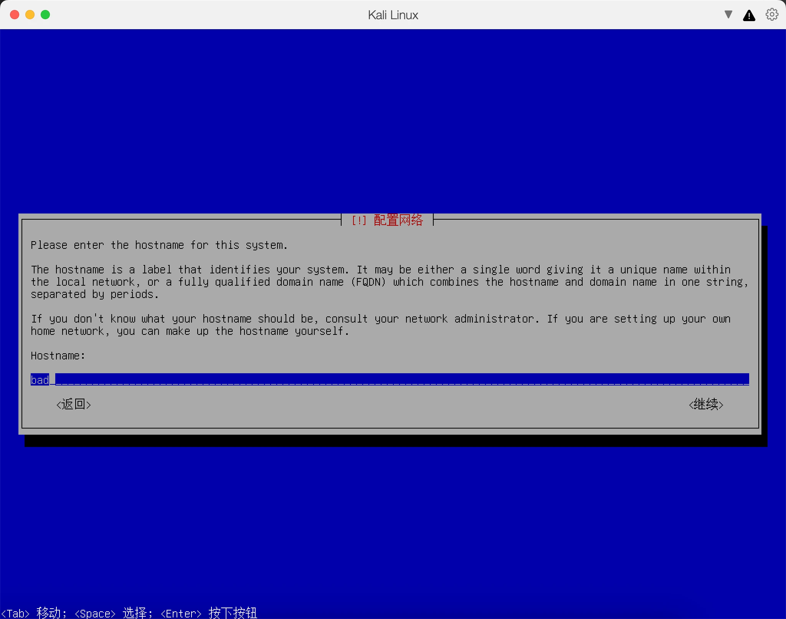
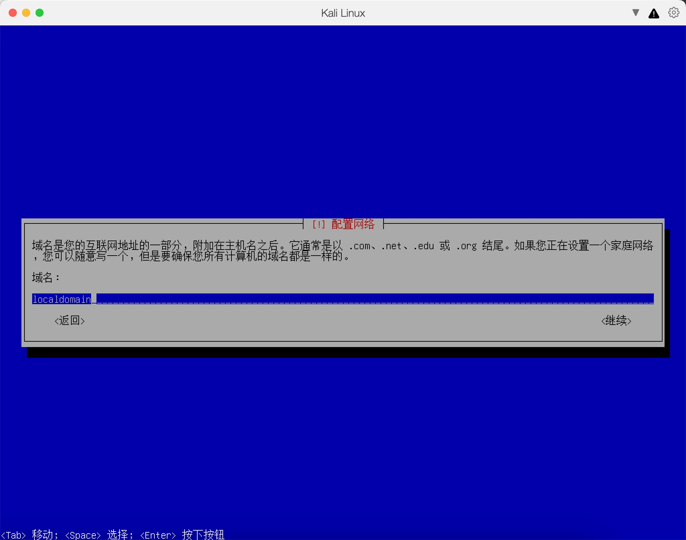
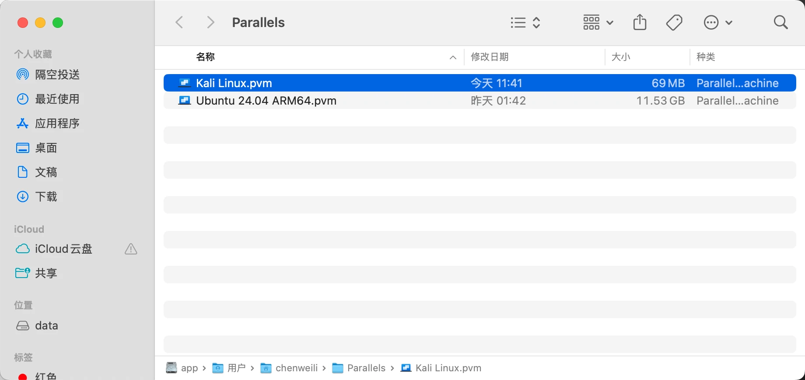
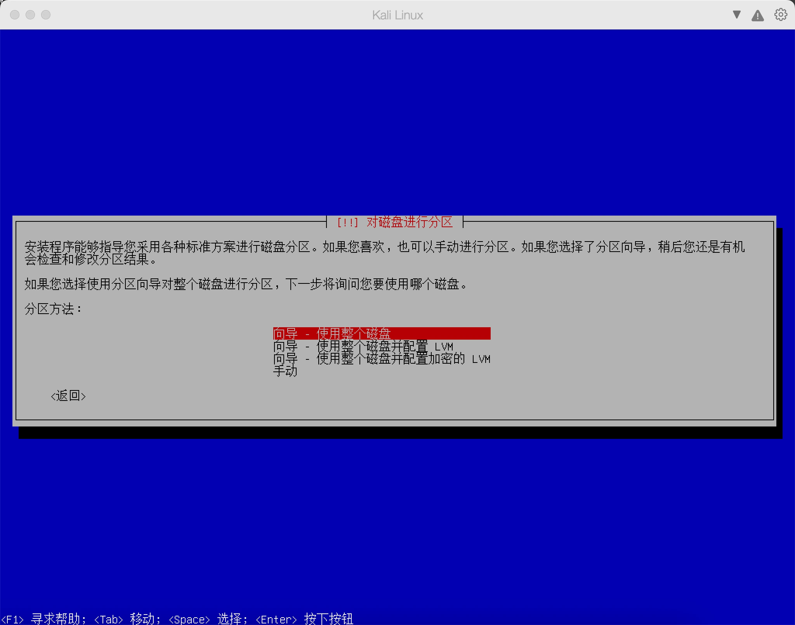
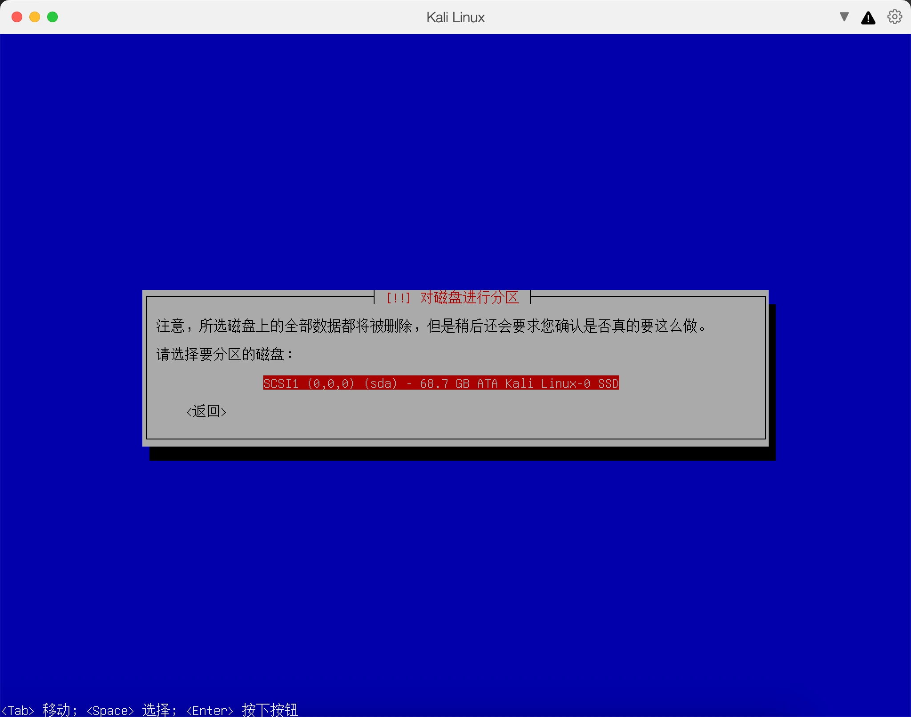
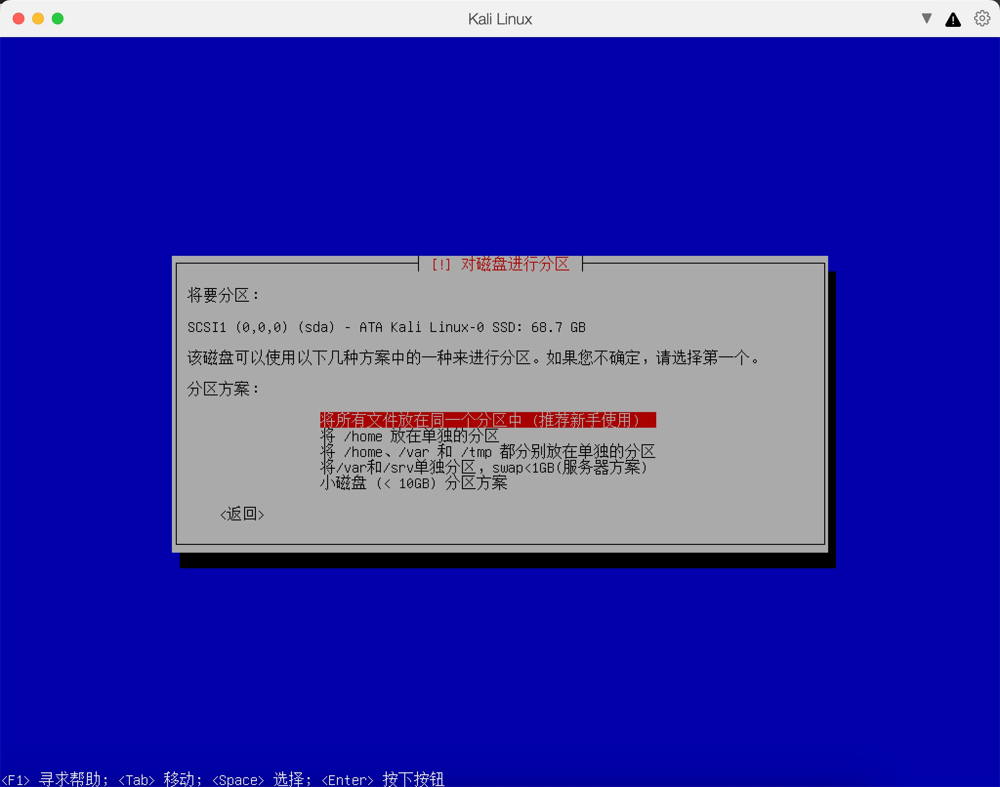
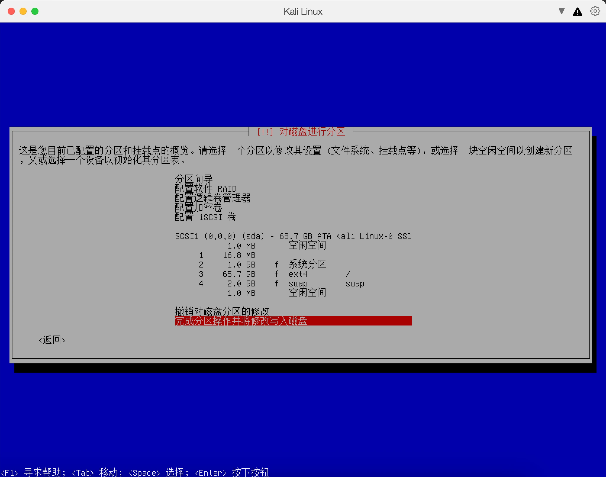
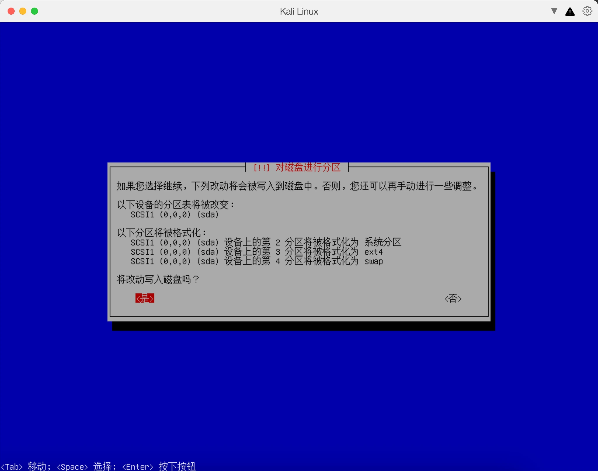

# 苹果M系列虚拟机安装Kali Linux教程

本文使用 **Parallels Desktop + Kali ARM64 安装镜像**，在 macOS 中创建一台 Kali 虚拟机。适用于苹果 M 系列 Mac，例如 M1、M2、M3、M4；实际能否运行所选 Parallels Desktop 版本，还需满足该版本的 macOS 要求。

核对日期：2026-10-26。软件界面可能随版本变化，本文保留英文选项，便于对照。

阅读顺序：第 1～7 节完成安装，第 8～11 节完成初始化、安装检查与问题排查。

## 1. 先弄清楚要下载什么

你需要下载两个东西：

| 下载内容 | 用途 | 应选版本 |
| --- | --- | --- |
| Parallels Desktop | 在 Mac 中运行虚拟机 | 支持当前 macOS 和苹果芯片的 Mac 版本 |
| Kali Linux ISO | 安装虚拟机里的操作系统 | Installer Images → Apple Silicon（ARM64）→ Installer |

M 系列采用 ARM 架构。文件名中应出现 `arm64`，不要误下 `amd64` 或 `x86_64`。树莓派等设备的专用 ARM 镜像，也不是本教程使用的安装介质。

本教程是在虚拟磁盘中安装 Kali，不需要制作启动 U 盘，也不需要给 Mac 硬盘重新分区。Kali 官方提供了专门的 [Parallels 安装指南](https://www.kali.org/docs/virtualization/install-parallels-guest-vm/)。

## 2. 准备资源

下面是本教程建议的起步配置，不是官方最低要求：

| Mac 内存 | Kali 内存 | 虚拟 CPU | 虚拟磁盘容量 |
| --- | --- | --- | --- |
| 8GB | 2～3GB | 2 核 | 32～40GB |
| 16GB | 4GB | 4 核 | 32～64GB |
| 24GB 及以上 | 4～8GB | 4 核 | 60～80GB |

- 初次学习使用 Xfce 桌面即可。
- 给 macOS 保留足够内存，不要把全部资源分配给虚拟机。
- 虚拟磁盘容量是可用上限，实际占用取决于镜像格式和写入数据；Mac 仍应预留足够空间用于下载、安装和后续更新。
- 需要运行多个大型工具时，再根据 macOS 的内存压力调整分配。

## 3. 下载并安装 Parallels Desktop

1. 打开 [Parallels Desktop 官方下载页](https://www.parallels.com/products/desktop/download/)。
2. 下载适合当前 macOS 的版本，打开安装文件，按向导完成安装。
3. 首次打开时按提示登录、激活已有许可证或开始试用。具体试用和授权条件以官网为准。
4. 如果已经安装 Parallels，可以直接新建 Kali 虚拟机，不需要重新安装软件。

Parallels 官方说明 Kali 可在 Apple Silicon Mac 上通过 ISO 安装，参见 [Linux on Mac](https://www.parallels.com/blogs/linux-on-mac/)。

## 4. 下载 Kali ARM64 ISO

1. 打开 [Kali 官方下载页](https://www.kali.org/get-kali/)。
2. 进入 **Installer Images**。
3. 切换到 **Apple Silicon（ARM64）**。
4. 选择正式发布的 **Installer**，点击直接下载按钮。
5. 下载完成后，确认文件以 `.iso` 结尾，且名称中含有 `installer-arm64`。

### 下载页面图解

第一步：点击左上角 **Installer Images**，进入安装镜像下载区。


第二步：切换为 **Apple Silicon（ARM64）**，点击中间 **Installer** 卡片左下角的下载箭头。图中的版本号和文件大小仅供参考，以实际下载页为准。


| 选项 | 含义 | 选择建议 |
| --- | --- | --- |
| Weekly | 每周构建，包含较新更新，未经正式版本同等测试 | 需要最新修复时再考虑 |
| Installer | 自带主要安装包，可离线完成常规安装 | 首次安装选这个 |
| NetInstaller | 精简联网安装镜像，安装时下载所需软件包 | 适合网络稳定的环境 |

卡片底部的 **↓** 是直接下载，**torrent** 是 BT 种子下载，**sum** 是 SHA256 校验值，**repository** 是镜像文件目录；`G`、`M` 标注表示文件大小。


示意文件名如下，版本号以下载页为准：

```text
kali-linux-版本号-installer-arm64.iso
```

### 可选：校验下载文件

在 **Mac 的终端**执行，先输入下面的命令和一个空格，再将实际 ISO 文件拖入终端，回车：

```bash
shasum -a 256
```

完整命令会类似下面这样；不要原样使用示意文件名：

```bash
shasum -a 256 ~/Downloads/kali-linux-版本号-installer-arm64.iso
```

将输出与官网中**同一文件**对应的 SHA256 比较，必须完全一致。如果不一致，先重新下载，不要继续安装。

## 5. 新建 Parallels 虚拟机

1. 打开 Parallels 的控制中心，点击 **＋** 或选择 **File → New（文件 → 新建）**。
2. 选择 **Install Windows or another OS from a DVD or image file（从 DVD 或映像文件安装 Windows 或其他操作系统）**。
3. 点击 **Choose Manually / Select a file（手动选择 / 选择文件）**，载入 Kali ARM64 ISO。
4. 如果提示无法识别操作系统，可以继续并手动选择系统类型。
5. 截至核对时，Kali 官方指南建议手动选择 **Ubuntu**，原因是 Debian 配置曾出现 Parallels Tools 兼容问题。这里选的是虚拟机配置模板，真正安装的仍是 Kali；M 系列必须载入 ARM64 ISO。若新版能直接识别 Kali，则可先使用识别结果。
6. 名称填写 `Kali Linux ARM64`，选择保存位置。
7. 勾选 **Customize settings before installation（安装前自定义设置）**。
8. 在 **Hardware → CPU & Memory（硬件 → CPU 与内存）** 中按第 2 节分配资源。
9. 在 **Hard Disk（硬盘）** 中设置容量，例如 64GB；已有 60GB 配置也可继续使用。
10. 网络先选择 **Shared Network（共享网络）**，保存配置并启动安装。

上述创建流程依据 [Kali 官方 Parallels 安装指南](https://www.kali.org/docs/virtualization/install-parallels-guest-vm/)。界面名称可能随版本变化。

## 6. 安装 Kali Linux

启动后选择 **Graphical install（图形安装）**。若图形安装无法显示，可以重启尝试 **Install（文本安装）**。文本界面通常使用方向键、Tab、空格和 Enter 操作。下面介绍常见流程，具体提示以当前安装器为准。

### 6.1 语言、地区和键盘

- 语言：新手可以选择中文；若安装器中文字显示异常，先用 English 完成安装，进入桌面后再调整。
- 地区：选择自己的实际地区。
- 键盘：普通 Mac 英文键盘通常可以选择 American English。

### 6.2 网络、主机名与域名

默认虚拟网络通常会自动获取地址。文本界面按 Tab 切换输入框与按钮，按 Enter 确认。

**主机名（Hostname）**是这台 Kali 在网络中的名称，不是登录用户名或密码。可以填写 `kali`、`kali-m4`；本次输入的 `bad` 也可以使用。建议使用英文字母、数字和短横线，避免中文与空格。



**域名（Domain name）**是主机名后面的名称后缀，个人学习环境可以留空，也可以保留安装器提供的 `localdomain`。

| 填法 | 含义（假设主机名为 kali） |
| --- | --- |
| 留空 | 不设置域名后缀，使用主机名 `kali` |
| localdomain | 设置本地域名后缀，完整名称可表示为 `kali.localdomain` |

两种选择对日常上网、下载工具基本没有区别。`localdomain` 不会注册互联网域名，也不会自动让其他设备通过这个名称找到虚拟机。



若后面提示配置 HTTP 代理，没有代理就留空。

### 6.3 创建账户

按提示设置姓名、用户名和密码，记住自己创建的用户名。

**通过 ISO 自行安装时，使用的是你在安装过程中创建的账户，不能默认认为用户名、密码就是 `kali/kali`。**

终端执行 `sudo` 输入密码时通常不会显示字符或星号，输入完成后按 Enter 即可。

### 6.4 磁盘空间与分区操作

#### 先区分虚拟容量与实际占用

**不一定要 60GB。** [Kali 官方安装要求](https://www.kali.org/docs/installation/hard-disk-install/)建议 Xfce 桌面加默认工具至少准备 20GB 磁盘空间。个人入门可以从 32GB 虚拟容量起步，后续更新和文件仍需余量；60～64GB 是更宽裕的配置。

本次安装器显示 **68.7GB**，约等于 Parallels 配置中的 **64GiB**，是单位换算差异。

如果使用 Parallels 的 **扩展磁盘（Expanding Disk）**，虚拟容量不会立即全部占用 Mac 空间，文件会随写入逐渐增大。虚拟容量不代表宿主机一定有足够剩余空间，仍需关注虚拟机所在卷。[Parallels 官方说明](https://kb.parallels.com/en/4706)

#### 查看虚拟机保存在哪里

1. 按 Control + Option（⌃⌥）释放鼠标。
2. 在 Parallels 的控制中心右键 Kali，选择“在 Finder 中显示”。
3. 在 Finder 按 Command + Option + P（⌘⌥P），显示底部路径栏。
4. 根据路径判断 `.pvm` 文件位于哪个卷；安装期间不要移动或重命名它。

本次截图中的位置是：

```text
app → 用户 → chenweili → Parallels → Kali Linux.pvm
```



当时截图显示 `app` 剩余约 170.91GB，`data` 剩余约 49.6GB；这些只是当时的状态，不是固定容量。该 Kali 文件位于 `app`，因此安装会使用 `app` 的剩余空间。截图中 `.pvm` 当时仅显示 69MB，是尚未完成安装时的大小，之后会增长。

#### “使用整个磁盘”到底会删什么

在本教程的普通 Parallels 配置下，没有把实体磁盘直通给虚拟机，安装器看到的是 `.pvm` 内的虚拟硬盘：

```text
Mac 的 app 卷
├── 应用、文档等                 ← 不属于本次分区目标
├── Ubuntu 24.04 ARM64.pvm      ← 不属于本次分区目标
└── Kali Linux.pvm
    └── Kali 的 68.7GB 虚拟硬盘  ← 本次重新分区、格式化的目标
```

“使用整个磁盘”是重新划分这块 Kali 虚拟硬盘。如果里面原来有系统和文件，它们会被删除；本次是新建虚拟机，没有需要保留的旧内容。它不会格式化外面的 `app` 卷，但安装文件会占用该卷空间。

如果自行添加过实体磁盘直通，或安装器显示的设备与预期不符，先核对目标，不要直接确认。

#### 第一步：选择分区方式

选择 **“向导－使用整个磁盘”**，按 Enter。初次学习不需要额外配置 LVM、加密 LVM 或手动分区。



#### 第二步：选择目标虚拟磁盘

本次目标显示为：

```text
SCSI1 (0,0,0) (sda) - 68.7 GB ATA Kali Linux-0 SSD
```

核对名称和容量与 Kali 虚拟机配置一致，再按 Enter。界面的“全部数据都将被删除”指选中磁盘里的数据。



#### 第三步：选择分区方案

选择 **“将所有文件放在同一个分区中（推荐新手使用）”**。这样系统、工具和个人文件共享主要分区的空间，不必单独分配 `/home`、`/var` 等目录容量。



#### 第四步：检查分区结果

本次自动分区结果如下，其他机器的容量和布局可能不同：

| 分区 | 截图中的大小 | 作用 |
| --- | --- | --- |
| 第 1 分区 | 16.8MB | 安装器保留的小分区，保持默认 |
| 第 2 分区 | 1.0GB | 启动系统所需的系统分区 |
| 第 3 分区 | 65.7GB，ext4，挂载点 `/` | 存放 Kali 系统、工具和个人文件 |
| 第 4 分区 | 2.0GB，swap | 交换空间，辅助内存使用 |

首尾少量空闲空间可保持默认。“所有文件同一个分区”指主要文件系统放在 `/`，仍可能另有启动分区和 swap。



确认后选择 **“完成分区操作并将修改写入磁盘”**。

#### 第五步：最后确认写入

最后确认页会列出将修改的设备与格式化的分区。本次是 `sda` 的第 2、3、4 分区，分别用于系统分区、ext4 和 swap，与上一页一致。



核对仍是前面选中的 Kali 虚拟硬盘后，选择 **“是”**，按 Enter。此时才真正写入分区与格式化，随后开始安装系统；等待进度完成即可。

### 6.5 选择桌面与工具

建议保留：

- **Xfce** 桌面。
- 默认推荐工具集合，即安装器中的默认工具选项。

不必一次勾选多个桌面，也不用一开始安装所有工具。下载量、安装时间和磁盘占用都会增加。

### 6.6 完成引导安装

按照安装器提示完成剩余步骤。若出现安装引导程序的选择，目标应为虚拟机的系统磁盘，而不是 ISO 光驱。安装结束后准备重启。

安装器通用流程可参考 [Kali 官方安装说明](https://www.kali.org/docs/installation/hard-disk-install/)；该页面示例使用 amd64，本教程仍须使用 ARM64 ISO。

## 7. 断开 ISO，进入图形桌面

1. 安装器提示移除安装介质时，在 Parallels 菜单 **Devices → CD/DVD（设备 → CD/DVD）** 中断开安装 ISO。
2. 返回安装器，按提示继续并重启。
3. 如果安装器已结束但重启卡住，可先等待；确认安装已经完成后再关闭虚拟机，在 **Configure → Hardware → CD/DVD（配置 → 硬件 → CD/DVD）** 中取消连接 ISO，随后启动。
4. 使用安装过程中创建的账户登录 Kali 桌面。

如果重启后仍出现安装菜单，优先检查 ISO 是否仍连接，以及是否从虚拟硬盘启动。

## 8. 首次进入系统后的设置

以下命令都在 **Kali 虚拟机的终端**执行，不是在 Mac 终端执行。

### 8.1 确认系统架构

```bash
uname -m
dpkg --print-architecture
```

通常分别输出：

```text
aarch64
arm64
```

### 8.2 更新系统

```bash
sudo apt update
sudo apt full-upgrade
```

第一条刷新软件包索引，第二条升级系统。查看将安装、升级或移除的软件包后，再按提示确认。更新完成后如有内核升级，可重启：

```bash
sudo reboot
```

Kali 是滚动发行版，建议在学习环境中定期更新；进行依赖固定版本的练习前，先备份环境。[Kali 官方更新说明](https://www.kali.org/docs/general-use/updating-kali/)

### 8.3 中文显示和输入法（按需）

如果中文显示为方框，可先安装字体：

```bash
sudo apt install fonts-noto-cjk
```

需要中文拼音输入时，可安装：

```bash
sudo apt install fcitx5 fcitx5-chinese-addons im-config
im-config
```

在输入法配置中选择 Fcitx5，注销并重新登录。打开 Fcitx5 配置工具，添加 Pinyin 等中文输入法；找不到中文输入法时，检查是否启用了“仅显示当前语言”一类过滤选项。快捷键以配置界面为准。

语言、字体和输入法是三件事：安装字体解决显示，添加输入法解决打字，系统语言在区域与语言设置中调整。

### 8.4 安装 Parallels Tools（按需）

Parallels Tools 用于改善分辨率适配、鼠标、共享剪贴板等集成功能；具体可用功能取决于 Linux 系统和版本兼容性。

1. 先完成系统更新，必要时重启 Kali。
2. 在 Mac 顶部的 Parallels 菜单选择 **Actions → Install Parallels Tools（操作 → 安装 Parallels Tools）**。
3. 在 Kali 文件管理器中打开挂载的工具光盘，按向导运行安装程序；Linux 官方说明使用 `install-gui` 启动图形安装。
4. 按安装器提示授权，完成后重启 Kali。

若提示缺少编译环境或当前内核头文件，可在 Kali 中安装：

```bash
sudo apt install build-essential dkms linux-headers-$(uname -r)
```

如果找不到当前内核对应的头文件，先确认系统更新后已经重启，再检查 `uname -r`；不要随意安装不匹配的头文件。Tools 与滚动更新的内核可能存在兼容延迟，失败时先保留错误信息并核对 Parallels 更新，Kali 的基本使用不必等 Tools 安装成功。

参考：[Parallels Tools for Linux 官方说明](https://docs.parallels.com/landing/pdfm-ug/v20-en-us/parallels-desktop-for-mac-20-users-guide/advanced-topics/installing-and-updating-parallels-tools/parallels-tools-for-linux)。该链接为版本化文档，菜单和兼容范围以实际安装版本为准。

### 8.5 备份一个干净环境

确认桌面、网络和更新正常后，将 Kali 正常关机。在 Parallels 控制中心右键虚拟机，选择 **Show in Finder（在 Finder 中显示）**，复制整个 `.pvm` 虚拟机包保存为备份。

复制前应完全关机，避免复制正在写入的虚拟磁盘。也可以在 Parallels 中创建快照，例如“初始安装完成”；快照方便回退，独立备份则用于防止原虚拟机文件丢失。

## 9. 网络与无线网卡要区分

### 默认网络用于日常联网

先保留 Parallels 的 Shared Network（共享网络）配置。它通常允许 Kali 通过 Mac 联网，适合下载软件和普通学习。虚拟机联网不要求 Kali 内部显示 Wi-Fi 图标。

### 无线监听需要另行准备硬件

Mac 连接 Wi-Fi，并不等于 Kali 虚拟机直接获得了 Mac 内置无线网卡。虚拟网络接口通常不能提供真实 Wi-Fi 的监听能力。

如果后续要做授权范围内的无线实验，需要另行核对：USB 无线网卡芯片、Linux ARM64 驱动，以及所用 Parallels 版本的 USB 设备连接与兼容情况。不要仅凭“支持 Kali”就判断某款网卡适合 M 系列虚拟机。

可继续阅读同目录的 [[1.无线监听网卡：监听模式、数据包注入与选型]]。

## 10. 常见问题排查

| 现象 | 优先检查 |
| --- | --- |
| ISO 无法启动、架构不匹配 | 文件名是否包含 `installer-arm64`；虚拟机是否采用 ARM64 虚拟化 |
| 安装界面黑屏 | 核对 ARM64 ISO，重启选择 Install 文本安装，并检查 Parallels 更新 |
| 安装完成后仍出现安装菜单 | CD/DVD 是否仍挂载 ISO；先弹出 ISO 再启动 |
| 安装后桌面黑屏 | 确认从虚拟磁盘启动；若在安装 Tools 后发生，检查 Tools 与内核兼容性，必要时回退快照 |
| 登录失败 | 使用自己安装时创建的账户，核对键盘布局与大小写 |
| 系统卡顿 | 查看 Mac 内存压力，减少并行应用；不要给虚拟机分配全部内存 |
| Kali 中没有 Wi-Fi 接口 | 虚拟网卡通常表现为以太网接口，不代表无法联网 |
| 中文显示方框 | 安装中文字体后注销重登 |

### 软件更新失败时，先定位网络问题

在 Kali 中执行：

```bash
ip route
getent hosts http.kali.org
curl -I https://www.kali.org
```

- 没有默认路由：先检查 Parallels 网络设备是否启用，以及 Mac 是否正常联网。
- 域名解析失败：检查虚拟机的 DNS 和网络配置。
- 网页可访问但 `apt` 报错：根据具体错误区分软件源、签名、空间不足或镜像站故障。

不要为了消除错误而关闭软件包签名验证，也不要随意混入 Ubuntu、Debian 的软件源。先保留完整错误信息再排查。

## 11. 安装完成检查清单

- [ ] 下载的是 Apple Silicon ARM64 Installer ISO。
- [ ] 已在 Parallels 中通过 ARM64 ISO 创建虚拟机。
- [ ] Kali 已安装到虚拟磁盘。
- [ ] 安装 ISO 已弹出。
- [ ] 可以进入图形桌面，并用自己的账户登录。
- [ ] 架构检查显示 aarch64 / arm64。
- [ ] 可以联网，软件更新正常。
- [ ] 已保存一份关机状态下的干净环境备份。

## 参考资料

- [Kali 官方下载页](https://www.kali.org/get-kali/)
- [Kali 官方 Parallels 安装教程](https://www.kali.org/docs/virtualization/install-parallels-guest-vm/)
- [Kali 通用安装流程](https://www.kali.org/docs/installation/hard-disk-install/)
- [Kali 系统更新说明](https://www.kali.org/docs/general-use/updating-kali/)
- [Parallels Desktop 官方下载](https://www.parallels.com/products/desktop/download/)
